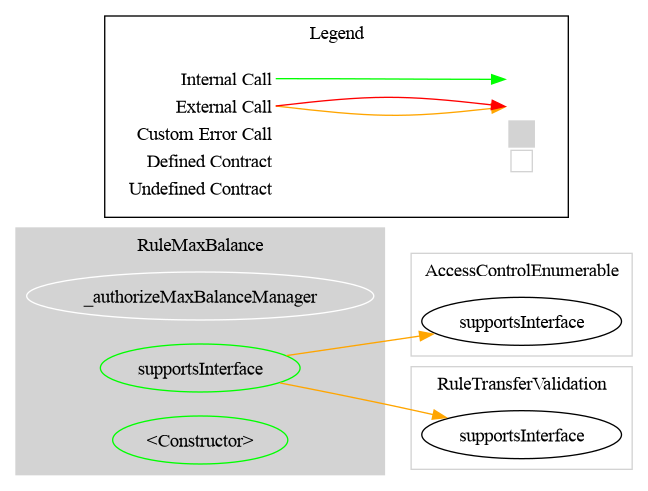
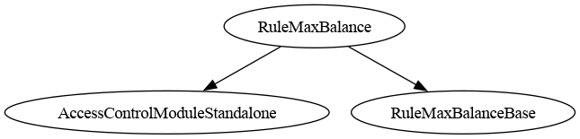

# Rule Max Balance

<!-- toc -->

- [Contract layout](#contract-layout)
- [Schema](#schema)
  - [Graph](#graph)
  - [Inheritance](#inheritance)
- [Restriction codes](#restriction-codes)
- [Who is screened](#who-is-screened)
- [Configuration](#configuration)
  - [maxBalance has no magic value](#maxbalance-has-no-magic-value)
- [Methods](#methods)
  - [Typical exemptions](#typical-exemptions)
- [Zero-value transfers to a holder already over the cap](#zero-value-transfers-to-a-holder-already-over-the-cap)
- [The read path never reverts](#the-read-path-never-reverts)
- [One instance per protected token](#one-instance-per-protected-token)
- [Usage scenario](#usage-scenario)
- [Deployment guides](#deployment-guides)
- [CMTAT v3.0.0](#cmtat-v300)

<!-- /toc -->

`RuleMaxBalance` caps how many tokens a single address may hold. One cap applies to every holder, and the operator may exempt specific addresses from it.

The rule screens the **receiver**: a transfer is rejected when `balanceOf(to) + value > maxBalance`. Mints are covered by the same check, since a mint raises the receiver's balance exactly as a transfer does.

> ## ⚠️ Do not deploy this rule on its own
>
> **The cap counts tokens per *address*, not per investor.** That is the only thing a compliance contract can observe on-chain. An investor who wants more than `maxBalance` simply splits the position across two addresses, and no rule objects, because each address is individually under the cap.
>
> **Pair it with a rule that admits one address per investor:**
>
> | Rule | What it contributes | | --- | --- | | [`RuleWhitelist`](./RuleWhitelist.md) | Only admitted addresses may send or receive | | [`RuleReceiverWhitelist`](./RuleReceiverWhitelist.md) | Only admitted addresses may receive (ERC-3643 eligibility semantics) | | [`RuleIdentityRegistry`](./RuleIdentityRegistry.md) | Only identity-verified addresses may receive |
>
> **The pairing is necessary but not sufficient — the operator policy is what closes the gap.** A whitelist admits *addresses*. If the operator admits two wallets belonging to the same investor, the cap is doubled again. The property you need is **one admitted address per legal entity**, enforced off-chain during onboarding and reflected on-chain by admitting exactly one address per investor.
>
> This is pinned by [`testSplitWalletsBypassTheCapEvenWithAWhitelist`](../../../test/RuleMaxBalance/RuleMaxBalanceCMTATIntegration.t.sol), which deliberately admits both wallets of one investor and shows the combined holding reaching twice the cap with a whitelist active. If that test ever fails, the bypass has been closed by other means and this warning should be revisited.

## Contract layout

The rule is split in two, so cap management does not drag the rest of the rule along with it.

| Contract | Holds | Depends on |
| --- | --- | --- |
| [`BalanceCapManager`](../../../src/rules/validation/abstract/core/BalanceCapManager.sol) | The observed token, the cap, the exemption list, their setters and the revert-free `balanceOf` read | `RuleAddressSetInternal`, the invariant storage. **No constructor, no ERC-1404** |
| [`RuleMaxBalanceBase`](../../../src/rules/validation/abstract/base/RuleMaxBalanceBase.sol) | The constructor, the ERC-1404 / ERC-3643 surface and the logic mapping a breached cap to a restriction code | `RuleTransferValidation`, `BalanceCapManager` |

The manager declaring no constructor is the point: it exposes the `_set*` internals and leaves *when* they run to the inheritor. `RuleMaxBalanceBase` calls them from its constructor; an upgradeable variant would call the same ones from an initializer, with no change to the manager. Nothing in the manager references a restriction-code interface either — it answers in booleans and token units — so a contract that only wants a revert-free view of remaining headroom can inherit it without implementing an ERC-1404 surface it does not need.

Storage layout and the deployed ABI are **unchanged** by the split, verified per-slot from the compiled artifacts for both `RuleMaxBalance` and `RuleMaxBalanceOwnable2Step`.

## Schema

The **Graph** and **Inheritance** diagrams are generated from the source code with [Surya](https://github.com/Consensys/surya), by the scripts in `doc/script/`, and must be regenerated after a code change:

- **Graph** (`surya graph`): the call graph of the contract's source file. Each node is a function, grouped by contract, and each arrow is a call from one function to another, including calls to other contracts. Only that file is parsed, so logic inherited from a base contract appears in that base contract's own graph.
- **Inheritance** (`surya inheritance`): the contracts and interfaces this contract inherits from, which tells you where each inherited function and modifier is defined.

### Graph

### Inheritance

## Restriction codes

| Constant | Code | Meaning |
| --- | --- | --- |
| `CODE_MAX_BALANCE_EXCEEDED` | 80 | The transfer would push the receiver's balance above `maxBalance` |
| `CODE_BALANCE_UNAVAILABLE` | 81 | `balanceOf(to)` could not be read, so the cap cannot be verified |

## Who is screened

| Operation | Screened? |
| --- | --- |
| Transfer / `transferFrom` | **Receiver only** |
| Mint (`from == address(0)`) | **Receiver** — a mint raises a balance like any transfer |
| Burn (`to == address(0)`) | **No** — reducing supply cannot breach a maximum |
| Sender | **Never** — sending tokens away only lowers a balance |
| Spender on `transferFrom` | **Never** — the cap constrains who *ends up holding*, not who moved the tokens |

An address already above the cap keeps its tokens and may still send them away. It simply cannot receive more until it is back under the cap. The same is true after the operator lowers the cap: existing balances are not clawed back.

## Configuration

| Constructor parameter | Description |
| --- | --- |
| `admin` / `owner` | Receives `DEFAULT_ADMIN_ROLE`, or ownership in the `Ownable2Step` variant |
| `balanceToken_` | Token whose `balanceOf` is read; must be a contract answering `balanceOf` |
| `maxBalance_` | Maximum balance per non-exempt address |

### `maxBalance` has no magic value

`0` means non-exempt addresses may hold **nothing**; it does **not** disable the rule. This is deliberate: a sentinel meaning "unlimited" would turn an operator's attempt to freeze holdings into the opposite. To lift the cap, set `type(uint256).max` or remove the rule from the engine.

## Methods

| Function | Role required | Description |
| --- | --- | --- |
| `setMaxBalance(uint256)` | `MAX_BALANCE_ROLE` / owner | Updates the cap |
| `setBalanceToken(address)` | `MAX_BALANCE_ROLE` / owner | Updates the observed token |
| `addExemptAddress(address)` | `MAX_BALANCE_ROLE` / owner | Exempts one address; reverts if already exempt or zero |
| `removeExemptAddress(address)` | `MAX_BALANCE_ROLE` / owner | Removes one exemption; reverts if not exempt |
| `addExemptAddresses(address[])` | `MAX_BALANCE_ROLE` / owner | Batch exempt; duplicates skipped, `address(0)` rejects the whole batch |
| `removeExemptAddresses(address[])` | `MAX_BALANCE_ROLE` / owner | Batch remove; unknown entries skipped |
| `isExemptAddress(address) → bool` | — | Whether an address may hold any amount |
| `exemptAddressCount() → uint256` | — | Number of exempt addresses |
| `remainingCapacity(address) → (uint8, uint256)` | — | Headroom before the cap, without simulating a transfer |

Exemptions reuse the same `EnumerableSet` set code as `RuleWhitelist` (`RuleAddressSetInternal`), so the batch semantics match the rest of the library: duplicates are skipped and counted, while `address(0)` is rejected on every add path including batches (invariant I-12).

### Typical exemptions

The exemption list exists for addresses that are not investor positions: the issuer's treasury, a custodian or omnibus account holding on behalf of many investors, a redemption or escrow contract, or a DEX pool. Exempting a custodian is the usual case — it holds for many people, so a per-holder cap is meaningless for it.

> ⚠️ **An exempt address is an unlimited-holding address.** If the reason for the cap is a regulatory concentration limit, exempting an account is a policy decision, not a technical convenience.

## Zero-value transfers to a holder already over the cap

A holder whose balance is **above** the cap — after the operator lowered it, or after a `forcedTransfer` — is rejected even for a transfer of `0`:

| Receiver's balance | `value` | Code |
| --- | --- | --- |
| exactly at the cap | `0` | `0` (allowed) |
| **above** the cap | `0` | **`80`** |

Receiving nothing cannot breach a holding cap, so this is a false rejection. It also makes the token non-conformant to ERC-20 for that receiver, since the standard requires a zero-value transfer to be treated as a normal transfer.

**Documented, not fixed, for `v0.5.0`.** The fix is to let `value == 0` pass regardless of the current balance. It is a behaviour change to shipped compliance logic and was recorded rather than applied late in the release; it is tracked together with the equivalent gap in the conditional-transfer rules, in [`RuleConditionalTransferLight.md`](./RuleConditionalTransferLight.md#zero-value-transfers-are-not-treated-as-no-ops). Exposure is limited: the receiver must already be over the cap, and nothing moves either way.

## The read path never reverts

The ERC-1404 / ERC-3643 views MUST NOT revert, so `balanceOf` is wrapped in `try/catch` and a failure yields `CODE_BALANCE_UNAVAILABLE` (fail-closed: the transfer is blocked rather than assumed safe). The token is validated at configuration — non-zero, has code, `balanceOf` callable — so that branch is taken only if the token changed behaviour after configuration, for example a proxy upgraded to something that reverts, or a pausable implementation reverting while paused.

Burns and exempt receivers are decided before any balance is read, so they keep working even while the token is unreadable.

As with `RuleMaxTotalSupply` and `RuleChainlinkPoR`, this relies on the configured token still having code: a `try` call to a codeless address reverts *uncatchably*. The setter requires code, and EIP-6780 (Cancun) makes that permanent. This is a **deployment precondition** — a Cancun-or-later chain, which `foundry.toml` targets.

## One instance per protected token

The rule reads balances from the `balanceToken` it was configured with, never from the token that triggered the check, and behind a RuleEngine it cannot learn that identity. Adding one instance to two RuleEngines would evaluate both tokens against the first one's balances. Deploy a second instance instead. This is the same exposure as `RuleMaxTotalSupply` and `RuleChainlinkPoR`.

## Usage scenario

An issuer must keep any single investor below 5% of a 1,000,000-token issue. They deploy `RuleWhitelist` and `RuleMaxBalance(admin, cmtat, 50_000)` in the same RuleEngine, admit exactly one address per onboarded investor, and exempt the treasury address that holds the unsold allocation. An investor at 50,000 tokens can still sell, and can buy again once below the cap; a mint that would push them over is rejected with code `80`.

## Deployment guides

Step-by-step deployment with a CMTAT token, with a sequence diagram per setup and per operation: [`DEPLOY_RULE_MAX_BALANCE_CMTAT_V3.0.0.md`](../guides/DEPLOY_RULE_MAX_BALANCE_CMTAT_V3.0.0.md) for v3.0.0, [`DEPLOY_RULE_MAX_BALANCE_CMTAT_V3.3.0.md`](../guides/DEPLOY_RULE_MAX_BALANCE_CMTAT_V3.3.0.md) for v3.3.0.

## CMTAT v3.0.0

✅ Supported, identical to v3.3.

- v3.0.0 notifies before moving the value, so `balanceOf(to)` excludes the amount in flight, as the rule assumes. Transfers, `transferFrom` and mints are capped on the receiver; burns are not.

Tested against a real CMTAT **v3.0.0** token (the last audited release), Standard and Debt variants, both set directly on the token and behind a `RuleEngine`: `test/CMTATv3.0.0/RuleMaxBalanceV300.t.sol`.
