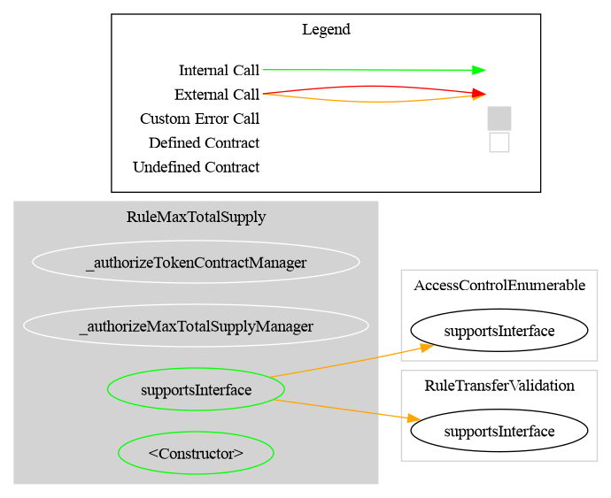
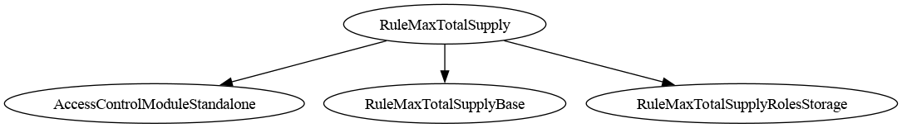

# Rule Max Total Supply

[TOC]

This rule restricts minting so that the token's total supply never exceeds a configured maximum. Only mint operations (`from == address(0)`) are checked. Regular transfers between holders and burns are not affected.

## Contract layout

The rule is split in two, so cap management does not drag the rest of the rule along with it.

| Contract | Holds | Depends on |
| --- | --- | --- |
| [`TotalSupplyCapManager`](../../../src/rules/validation/abstract/core/TotalSupplyCapManager.sol) | The observed token, the cap, their setters and the revert-free `totalSupply()` read | `TokenSupplyReader`, the invariant storage. **No constructor, no ERC-1404** |
| [`RuleMaxTotalSupplyBase`](../../../src/rules/validation/abstract/base/RuleMaxTotalSupplyBase.sol) | The constructor, the ERC-1404 / ERC-3643 surface and the logic mapping a breached cap to a restriction code | `RuleTransferValidation`, `TotalSupplyCapManager` |

The manager declaring no constructor is the point: it exposes the `_set*` internals and leaves *when* they run
to the inheritor. `RuleMaxTotalSupplyBase` calls them from its constructor; an upgradeable variant would call the
same ones from an initializer, with no change to the manager. Nothing in the manager references a
restriction-code interface either — it answers in booleans and token units — so a contract that only wants a
revert-free view of remaining headroom can inherit it without implementing an ERC-1404 surface it does not
need.

Storage layout and the deployed ABI are **unchanged** by the split, verified per-slot from the compiled
artifacts for both `RuleMaxTotalSupply` and `RuleMaxTotalSupplyOwnable2Step`.

## Configuration

### Constructor parameters

| Parameter | Description |
| --- | --- |
| `admin` | Address granted `DEFAULT_ADMIN_ROLE` (implicitly holds all roles) |
| `tokenContract_` | Address of the token contract; must be non-zero, must have code, and its `totalSupply()` must be callable |
| `maxTotalSupply_` | Initial maximum total supply cap, in token **base units** (see below) |

### Unit of the cap

`maxTotalSupply` is compared as-is with `tokenContract.totalSupply()`, so it is in the token's **base units**. The rule applies no `decimals()` scaling.

| Token `decimals()` | Intended cap | Value to pass |
| --- | --- | --- |
| `0` (typical CMTAT equity token) | 1,000,000 shares | `1_000_000` |
| `6` | 1,000,000 tokens | `1_000_000 * 10**6` |
| `18` | 1,000,000 tokens | `1_000_000 * 10**18` |

WARNING: passing whole tokens on a token with decimals sets a cap `10**decimals` times too small. On an 18-decimal token, `1_000_000` allows 0.000000000001 tokens, so every mint is rejected (code `50`). This fails closed, never over-mints, and shows up at the first mint. Check `remainingMintable()` after deployment.

### Post-deployment configuration

Both the cap and the token contract address can be updated by the admin after deployment.

## Schema

### Graph

### Inheritance

### Flow with a CMTAT token

The sequence below shows how the rule participates when a CMTAT token (with this rule configured in its RuleEngine) processes a mint. Only mints (`from == address(0)`) are gated; transfers and burns pass.

_Diagram source: doc/img/rule-max-total-supply-flow.puml._

## Restriction codes

| Constant | Code | Meaning |
| --- | --- | --- |
| `CODE_MAX_TOTAL_SUPPLY_EXCEEDED` | 50 | Mint would cause total supply to exceed the maximum |
| `CODE_SUPPLY_ORACLE_UNAVAILABLE` | 51 | `tokenContract.totalSupply()` reverted, or the token has lost its code |

## Access Control

The default admin is the address passed as `admin` in the constructor. It is granted `DEFAULT_ADMIN_ROLE`, which implicitly holds all roles.

| Role | Hash | May call |
| --- | --- | --- |
| `MAX_TOTAL_SUPPLY_ROLE` | `0xff56c44a0b63a2f9b3aaada52f4982ecb1bd4eefdb286a7832ff51e8bc4e49f1` | `setMaxTotalSupply`, `increaseMaxTotalSupply`, `decreaseMaxTotalSupply` |
| `DEFAULT_ADMIN_ROLE` | `0x00…00` | `setTokenContract`, role management, and (implicitly) everything `MAX_TOTAL_SUPPLY_ROLE` may call |

The split lets an issuer delegate cap changes, for example to a corporate-secretary key that records each capital increase, without granting full admin.

- Repointing the observed token stays with the admin. It changes the protected supply as thoroughly as changing the cap, and can switch the cap off for the real token.
- The admin holds `MAX_TOTAL_SUPPLY_ROLE` implicitly but is not listed by `getRoleMember`. Grant the role explicitly if an off-chain tool enumerates role members.
- Deployments made before the role existed keep working unchanged: the admin could change the cap before and still can.

`RuleMaxTotalSupplyOwnable2Step` has no roles: the owner may call both setters. The ERC-3643 variants inherit the access control of the contract they extend.

## Events

| Event | Emitted by | Notes |
| --- | --- | --- |
| `MaxTotalSupplyUpdated(uint256 previousMaxTotalSupply, uint256 newMaxTotalSupply)` | constructor, `setMaxTotalSupply`, `increaseMaxTotalSupply`, `decreaseMaxTotalSupply` | Both values in the data, not indexed. `previousMaxTotalSupply` is `0` at construction. Up to v0.6.0 the event carried only the new cap (`MaxTotalSupplyUpdated(uint256)`, a different topic) |
| `TokenContractUpdated(address indexed newTokenContract)` | constructor, `setTokenContract` | |

## Methods

### `setMaxTotalSupply(uint256 newMaxTotalSupply)`

Updates the maximum total supply cap, in token base units (see [Unit of the cap](#unit-of-the-cap)). Restricted to `MAX_TOTAL_SUPPLY_ROLE` (the admin holds it implicitly; the owner on the Ownable2Step variant). Emits `MaxTotalSupplyUpdated(previousMaxTotalSupply, newMaxTotalSupply)`, also at construction, with `previousMaxTotalSupply = 0`.

### `increaseMaxTotalSupply(uint256 amount)` / `decreaseMaxTotalSupply(uint256 amount)`

Raise or lower the cap by `amount`, in base units. Same permissions as `setMaxTotalSupply`, and the same `MaxTotalSupplyUpdated(previous, new)` event.

| Function | Reverts with | When |
| --- | --- | --- |
| `increaseMaxTotalSupply` | `RuleMaxTotalSupply_IncreaseOverflow(current, amount)` | the new cap would exceed `type(uint256).max` |
| `decreaseMaxTotalSupply` | `RuleMaxTotalSupply_DecreaseBelowZero(current, amount)` | `amount` exceeds the current cap |

Use the relative forms when changes are approved independently, such as two capital increases each authorised by its own resolution.
- Two `increaseMaxTotalSupply(N)` calls raise the cap by `2N` in whatever order they land.
- Two `setMaxTotalSupply(old + N)` calls, each computed from the same old cap, raise it by only `N`, because the second overwrites the first.
- Use `setMaxTotalSupply` when the authorised amount is stated as an absolute figure.

Decreasing below the current supply is allowed: it freezes minting while transfers and burns continue, as with `setMaxTotalSupply`.

### `setTokenContract(address newTokenContract)`

Updates the reference to the token contract. Reverts if the address is zero, has no code, or its `totalSupply()` is not callable. Restricted to `DEFAULT_ADMIN_ROLE` (the owner on the Ownable2Step variant), deliberately **not** to `MAX_TOTAL_SUPPLY_ROLE`. Emits `TokenContractUpdated`.

### `maxTotalSupply() → uint256`

Returns the current maximum total supply.

### `tokenContract() → ITotalSupply`

Returns the current token contract address.

### `remainingMintable() → (uint8 restrictionCode, uint256 headroom)`

How much may still be minted before total supply reaches the cap: `maxTotalSupply − totalSupply()`. It saturates at `0` when the cap is at or below the current supply, which the arithmetic would otherwise underflow on. It never reverts.

| `restrictionCode` | Meaning |
| --- | --- |
| `0` | `headroom` is valid: a mint of exactly `headroom` passes, `headroom + 1` is rejected with code `50` |
| `51` (`CODE_SUPPLY_ORACLE_UNAVAILABLE`) | `totalSupply()` could not be read; `headroom` is `0` and meaningless, and every mint is rejected |

A front end can size a mint from this one call, without computing the subtraction itself or simulating the mint. The ERC-3643 variants inherit it unchanged: a view always runs before the movement, so it needs no re-phasing. Same shape as `RuleMaxBalance.remainingCapacity(to)`.

## Transfer restriction logic

The rule only acts on mint operations (i.e. `from == address(0)`). It reads `tokenContract.totalSupply()` and rejects the mint if `totalSupply + value > maxTotalSupply`. Transfers and burns always pass.

### What the cap measures

The cap bounds the **outstanding supply**, read live from the token on every mint. It does **not** bound **cumulative issuance**: the rule keeps no counter, so every burn frees room for a later mint.

- This is the right model for an issue volume that is redeemed and re-issued, or for a ceiling on shares in existence.
- It is the wrong model for "never issue more than N in total, whatever is burned". That needs a counter the rule does not have, and cannot be emulated reliably by lowering the cap after each burn.

Because the token's own supply is the counter, the rule cannot drift from it. Every row below follows from that.

### Behaviour by token operation

Each row was checked in the CMTAT source for v3.0.0 and v3.3.0-rc4, where these code paths are identical. Each is pinned by a test on a real CMTAT v3.0.0 token (Standard and Debt, direct and behind a `RuleEngine`) in `test/CMTATv3.0.0/RuleMaxTotalSupplyV300.t.sol`, unless another file is named. Where a row lists several entrypoints, the test drives the first. The others share the same token code path but are not tested on their own.

| Operation | Effect on the remaining room | Why | Pinned by |
| --- | --- | --- | --- |
| `mint`, `batchMint` | Uses `value`; rejected (code `50`) if `value` exceeds the room | The engine is called before `_mint`, so `totalSupply()` excludes the amount being minted | `testMintLandingExactlyOnTheCap`, `testCannotMintAboveTheCap` |
| `burn`, `batchBurn`, `burnFrom`, `burn(uint256)` | Frees `value` | `totalSupply()` falls; the rule never blocks a burn | `testBurnFreesHeadroom`; `testBurningFreesHeadroomForANewMint` (current CMTAT, `test/DeploymentScripts/`) |
| `transfer`, `transferFrom`, `forcedTransfer` between holders | None | Supply is unchanged; the rule returns `TRANSFER_OK` without reading it | `testTransfersAreNotCapped` (`transfer`) |
| `burnAndMint(from, to, burnAmount, mintAmount)` | Needs room only for the **net** increase, `mintAmount − burnAmount` | The burn leg runs first and lowers `totalSupply()`; the mint leg is then checked against the reduced supply. A correction or reissue therefore does not use up the cap | `testBurnAndMintNeedsRoomForTheNetIncreaseOnly` |
| `crosschainMint` / `crosschainBurn` (Standard variant) | Same as `mint` / `burn` | Both go through the token's mint / burn path. A bridge-out followed by a bridge-in is net zero, so bridged tokens are safe | `testCrosschainMintAndBurn` |
| `forcedTransfer(from, address(0), value)` (forced burn) | Frees `value`, visible at the next mint | The engine is **not** called, but `totalSupply()` still falls | `testForcedBurnFreesHeadroom` |
| Cap set at or below the current supply (including `0`) | No room: every mint is rejected, **even a zero-value mint** when supply is above the cap; `remainingMintable()` returns `0` | Supply already over the line. Transfers and burns continue, so holders are never trapped. This is the emergency lever to stop minting | `testSettingTheCapBelowSupplyFreezesMintsOnly`; `testLoweringTheCapBelowTheSupplyBlocksFurtherMints`, `testSetMaxTotalSupplyToZero` (`test/RuleMaxTotalSupply/`) |
| Supply that existed before the rule was installed | Counted | The cap is absolute, not "new issuance from now on". After a capital increase of N, set `maxTotalSupply = existing supply + N` | `testSupplyMintedWhileDetachedIsCountedOnReattach` |
| Rule detached (`setRuleEngine(address(0))`, or `removeRule` on the engine), then re-attached | Cap lifted while detached; on re-attach it is evaluated against the **real** supply | No drift. Supply minted meanwhile is counted, and if it pushed supply above the cap, minting stays frozen until burns bring it back under | `testSupplyMintedWhileDetachedIsCountedOnReattach` |

These rows are also checked together, across random sequences of mints, burns, `burnAndMint`, forced burns, transfers and cap changes, by the invariant suite `MaxTotalSupplyInvariants` (`test/invariant/`). See `INVARIANT_TESTS.md` §3.3.

WARNING: detaching the rule is the one way to exceed the cap, and nothing on-chain records it. Whoever holds `DEFAULT_ADMIN_ROLE` on the token (`setRuleEngine`), or the rule-management role on the engine (`removeRule`), can lift the cap. So can a `MAX_TOTAL_SUPPLY_ROLE` holder, by raising it: grant that role only to a key trusted to change the authorised amount. Revoke `MINTER_ROLE` before any planned detachment.

### One instance per token

The rule reads the supply of its configured `tokenContract`, never of the token that triggered the check. Behind a `RuleEngine` it cannot learn that identity.

- One instance added to two RuleEngines, or set on two tokens, caps **both** tokens against the **first** token's supply. One token is silently over-minted or frozen, and no call reverts at configuration.
- Deploy one instance per protected token.
- `setTokenContract` repoints the rule at another token, which changes the protected supply as thoroughly as changing the cap. It is restricted to the admin (the owner on `RuleMaxTotalSupplyOwnable2Step`) for that reason.

### Read-path safety

`detectTransferRestriction` / `canTransfer` are ERC-1404 / ERC-3643 views that MUST NOT revert, so the supply read is guarded: a `tokenContract` that has lost its code, or whose `totalSupply()` reverts (a proxy upgraded to something broken, or a pausable implementation reverting while paused), yields `CODE_SUPPLY_ORACLE_UNAVAILABLE` (51) rather than propagating the failure. The comparison also uses remaining headroom (`value > maxTotalSupply - currentSupply`) instead of `currentSupply + value`, which could overflow.

Configuration validates the token up front — non-zero, has code, and `totalSupply()` callable — so an unusable token fails loudly at setup instead of silently blocking every mint later. The code-length check is explicit rather than relying on the uncatchable extcodesize revert that the probe would incidentally produce.

The trust placed in `tokenContract` is therefore narrower than it looks: it is trusted to report an **accurate** supply, which nothing on-chain can verify, but it is **not** trusted to stay callable.

#### Deployment precondition: EIP-6780 (Cancun or later)

**`try/catch` cannot contain a call to a codeless address.** This is the reason the code-length check lives at
*configuration* rather than being left to the read path, and the mechanism is not the one usually quoted.

`try/catch` catches a revert **raised by the callee**. It does not catch a failure that happens in *this*
contract's frame while preparing or consuming the call. Two such failures apply here, and which one you get
depends on the signature:

| Call shape | What the compiler emits | Why `catch` never runs |
| --- | --- | --- |
| Returns data (`totalSupply() → uint256`) | Since **Solidity 0.8.10** the `EXTCODESIZE` check is *skipped*; the compiler relies on the ABI decoder instead | The `CALL` to a codeless account **succeeds** with 0 bytes of return data. The decoder then fails to read a `uint256` from nothing — in the caller's frame, *after* the call returned. Not a callee revert, so not catchable |
| Returns nothing | The `EXTCODESIZE` check is still emitted, before the call | The revert happens before any external call is made. There is nothing for `catch` to attach to |

So for `totalSupply()` the uncatchable revert comes from the **ABI decoder**, not from `extcodesize`. That is
easy to confirm: point the rule at a contract that *has* code whose fallback succeeds and returns zero bytes.
`EXTCODESIZE` passes, the `CALL` succeeds — and the view still reverts uncatchably.

Two consequences follow:

1. **A runtime code-length re-check would be pointless**, which is why there is none. `_setTokenContract`
   requires code at configuration, and **EIP-6780** (Cancun) restricts `SELFDESTRUCT` to accounts created in
   the same transaction, so a validated token cannot become codeless afterwards. On a chain *without* EIP-6780
   this does not hold and the guard should be re-introduced (~100 gas per call site; the account is warm
   either way, so it is not a full cold `EXTCODESIZE`).
2. **Having code is necessary but not sufficient.** The guarantee is that the token returns a well-formed
   `uint256`, not merely that it exists. A proxy upgraded to an implementation whose fallback returns empty
   data keeps its code and still breaks the read path — the ABI decoder reverts and `CODE_SUPPLY_ORACLE_UNAVAILABLE`
   is never reached. `try/catch` covers a token that *reverts*; it cannot cover one that returns nothing.
   `tokenContract` is a trusted input for this reason, and pointing the rule at an untrusted proxy is outside
   the model.

## Usage scenario

The operator deploys `RuleMaxTotalSupply` with `tokenContract = CMTAT_address` (0 decimals, so base units are whole tokens) and `maxTotalSupply = 1_000_000`. The rule is registered in the `RuleEngine`. When the issuer mints 100,000 tokens and total supply is already 950,000, the mint is rejected with code 50. Transfers between existing holders continue unaffected.

## CMTAT v3.0.0

✅ Supported, identical to v3.3.

- v3.0.0 notifies the engine **before** `_mint` / `_burn`, the accounting the rule assumes, so no variant is needed.
- Every row of [Behaviour by token operation](#behaviour-by-token-operation) is pinned on v3.0.0.

Tested against a real CMTAT **v3.0.0** token (the last audited release), Standard and Debt variants, both set directly on the token and behind a `RuleEngine`: `test/CMTATv3.0.0/RuleMaxTotalSupplyV300.t.sol`.
