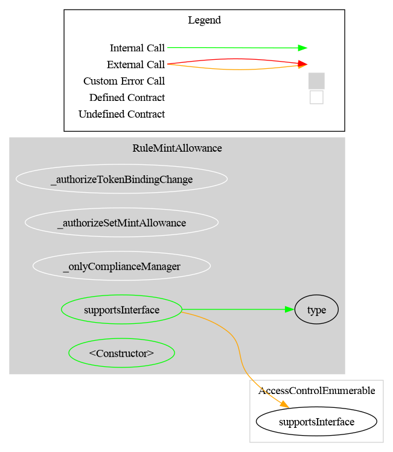
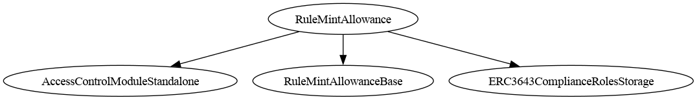

# Rule Mint Allowance

[TOC]

This rule enforces a per-minter mint quota. An operator assigns each minter address a maximum number of tokens it is allowed to mint. Every successful mint reduces the minter's remaining allowance. The operator can adjust the allowance at any time by setting an absolute value or by incrementing/decrementing the current one.

It is an **operation rule**: it modifies state during the transfer call (deducting from the minter's allowance), unlike validation rules which are read-only.

Regular transfers and burns are **not restricted** by this rule — it only acts on minting operations (`from == address(0)`).

`detectTransferRestriction(from, to, value)` (the 3-arg form without a spender) always returns `TRANSFER_OK` because the minter's identity is not available in that call path. Use `detectTransferRestrictionFrom(minter, address(0), to, amount)` to query a minter's allowance.

> ⚠️ **`canTransfer` and `detectTransferRestriction` are NOT authoritative for this rule.** Once the rule is bound they always answer "allowed" (`true` / `TRANSFER_OK`; before binding they report code 85), because the 3-arg signature carries no minter identity, so a pre-flight that gates on them will disagree with enforcement: the mint still reverts with `RuleMintAllowance_AllowanceExceeded` if the quota is insufficient. **For a mint pre-flight, always use the spender-aware view** `canTransferFrom(minter, address(0), to, value)` (or `detectTransferRestrictionFrom(minter, address(0), to, value)`), which returns the real answer.

> Compatibility warning: this rule does **not** enforce mint allowances for a token that only calls the standard ERC-3643 3-arg compliance functions. It requires the spender-aware RuleEngine/CMTAT v3.3+ path (`detectTransferRestrictionFrom` and `transferred(spender, from, to, value)`) so the minter address is available.

For that reason, `RuleMintAllowance` does not advertise the full ERC-3643 `ICompliance` interface through ERC-165. It still implements the inherited 3-arg callbacks required by the rule interface, but they are not sufficient to enforce mint quotas.

## Schema

### Graph

### Inheritance

### Flow with a CMTAT token

The sequence below shows how the rule participates when a CMTAT token (with this rule configured in its RuleEngine) processes a mint. As an operation rule, it decrements the minter's allowance in the `transferred` callback after balances are updated.

_Diagram source: doc/img/rule-mint-allowance-flow.puml._

## Restriction codes

| Constant | Code | Meaning |
| --- | --- | --- |
| `CODE_MINTER_ALLOWANCE_EXCEEDED` | 70 | Minter's remaining allowance is less than the requested mint amount |
| `CODE_RULE_NOT_BOUND` | 85 | No caller is bound yet (`bindToken`), so every operation would revert. Shared, with the same message, by `RuleConditionalTransferLight`, `RuleMintAllowance` and `RuleIssuanceCap` |

While the rule is unbound, every view reports code 85, including `canTransfer` / `detectTransferRestriction`. They return "allowed" only once a caller is bound.

## Access Control

| Role | Description |
| --- | --- |
| `DEFAULT_ADMIN_ROLE` | Manages all roles; implicitly holds all roles below |
| `ALLOWANCE_OPERATOR_ROLE` | May set, increase, and decrease per-minter allowances |
| `COMPLIANCE_MANAGER_ROLE` | May bind and unbind the rule to a RuleEngine (`bindToken`, `unbindToken`) |

The state-modifying `transferred()` functions are restricted to the bound entity only. In the standard CMTAT + RuleEngine deployment, bind the rule to the **RuleEngine address** (not the token address), because the RuleEngine is the direct caller of the rule's `transferred()`. The rule targets exactly one bound entity at a time; attempting to bind a second RuleEngine/token reverts with `RuleMintAllowance_TokenAlreadyBound`. To migrate, call `unbindToken` first.

## Methods

### `setMintAllowance(address minter, uint256 amount)`

Sets the `minter`'s allowance to an absolute `amount`, overwriting any previous value. Restricted to `ALLOWANCE_OPERATOR_ROLE`. Emits `MintAllowanceSet`.

### `increaseMintAllowance(address minter, uint256 amount)`

Adds `amount` to `minter`'s current allowance. Restricted to `ALLOWANCE_OPERATOR_ROLE`. Emits `MintAllowanceIncreased`.

### `decreaseMintAllowance(address minter, uint256 amount)`

Subtracts `amount` from `minter`'s current allowance. Reverts with `RuleMintAllowance_DecreaseBelowZero` if `amount` exceeds the current allowance. Restricted to `ALLOWANCE_OPERATOR_ROLE`. Emits `MintAllowanceDecreased`.

### `clearMintAllowances(address[] calldata minters)`

Sets the allowance of every listed minter to zero. Batch operation: does not revert on minters that already have a zero allowance, on duplicates, or on an empty array. Restricted to `ALLOWANCE_OPERATOR_ROLE`. Emits `MintAllowanceSet(minter, 0)` per entry.

Intended for migration — see the `bindToken` warning below.

### `mintAllowance(address minter) → uint256`

Returns the remaining mint allowance for `minter`. Default is `0`.

### `bindToken(address token)` / `unbindToken(address token)`

Binds or unbinds the caller address. Only the bound address is authorised to call `transferred`. In practice, bind the RuleEngine address. Restricted to `COMPLIANCE_MANAGER_ROLE`. A second `bindToken` call reverts until the current binding is removed.

> ⚠️ **`unbindToken` does not clear `mintAllowance`.** Quotas granted while the previous RuleEngine/token was bound remain in storage and are spendable by the same minters as soon as a new caller is bound. The operator who controls rebinding also controls allowances, so the trust model is preserved — but when migrating, call `clearMintAllowances` **before** rebinding if the old quotas must not carry over.

## Workflow

1. Deploy `RuleMintAllowance` (or `RuleMintAllowanceOwnable2Step`).
2. Add the rule to the RuleEngine with `ruleEngine.addRule(ruleMintAllowance)`.
3. Bind the rule to the RuleEngine: `ruleMintAllowance.bindToken(address(ruleEngine))`.
4. Set the CMTAT's RuleEngine: `cmtat.setRuleEngine(ruleEngine)`.
5. For each minter, call `setMintAllowance(minterAddress, quota)`.
6. Minters can now mint tokens up to their assigned quota.

## Allowance deduction

When CMTAT v3.3+ calls `ruleEngine.transferred(minter, address(0), recipient, amount)`, the rule receives `transferred(minter, address(0), recipient, amount)` and deducts `amount` from `mintAllowance[minter]`. If `amount > mintAllowance[minter]`, the call reverts with `RuleMintAllowance_AllowanceExceeded`.

## Multiple minters

Each minter has an independent allowance within the single bound RuleEngine/token. Multiple minters can share a single `RuleMintAllowance` instance, but that instance intentionally targets only one bound caller at a time so allowance state is not shared across multiple RuleEngines/tokens.

## Notes

### 3-arg `transferred` path

When CMTAT calls `ruleEngine.transferred(from, to, value)` without a spender (CMTAT v3.2 and earlier, a pure ERC-3643 token, or when spender is `address(0)`), the rule receives the 3-arg call and performs **no deduction**. The minter's quota is only consumed via the 4-arg path where the minter's address is passed as `spender`.

Because of this, `RuleMintAllowance` must not be used as a standalone compliance contract for a pure ERC-3643 token. It is intended for the CMTAT/RuleEngine spender-aware integration path.

### Burns not restricted

Burns (`to == address(0)`) are not tracked by this rule. Minters do not recover allowance when tokens are burned.

### Eligibility views: which one is authoritative

| View | Signature | Authoritative for mint quota? |
| --- | --- | --- |
| `canTransfer` | `(from, to, value)` | ❌ No — `true` once bound (no minter identity); `false` while unbound |
| `detectTransferRestriction` | `(from, to, value)` | ❌ No — `TRANSFER_OK` once bound; code 85 while unbound |
| `canTransferFrom` | `(minter, address(0), to, value)` | ✅ **Yes** — returns `false` when the quota is insufficient |
| `detectTransferRestrictionFrom` | `(minter, address(0), to, value)` | ✅ **Yes** — returns `70` when the quota is insufficient |

An integrator that pre-flights a mint with `canTransfer` will see "allowed" even when the mint will revert on the quota. This is intentional: the 3-arg views cannot see the minter. Always pre-flight mints with the spender-aware pair, passing the minter as the spender and `address(0)` as `from`.

#### The blind spot propagates to the RuleEngine and to the token

The table above describes calls made **directly on the rule**. In a normal deployment nobody does that: the rule sits inside a `RuleEngine`, which sits in the token's compliance slot, and an integrator holds only the **token** address. Every level in that chain forwards the 3-argument call unchanged, so every level inherits the rule's unconditional `true` (once bound):

| You call | Which reaches | Quota checked? |
| --- | --- | --- |
| `cmtat.detectTransferRestriction(address(0), to, value)` | `ruleEngine.detectTransferRestriction(...)` → each rule's 3-arg view | ❌ **No** |
| `cmtat.canTransfer(address(0), to, value)` | same 3-arg chain | ❌ **No** |
| `ruleEngine.canTransfer(address(0), to, value)` | `_detectTransferRestriction` → first non-zero code; this rule contributes `0` | ❌ **No** |
| `cmtat.detectTransferRestrictionFrom(minter, address(0), to, value)` | `ruleEngine.detectTransferRestrictionFrom(...)` → this rule's 4-arg view | ✅ **Yes** |
| `ruleEngine.canTransferFrom(minter, address(0), to, value)` | same 4-arg chain | ✅ **Yes** |

`RuleEngineBase._detectTransferRestriction` walks its rules calling each one's **3-argument** `detectTransferRestriction` and returns the first non-zero code. This rule always returns `0`, so it contributes nothing to the aggregate — the engine-level answer is "allowed" no matter what the minter's quota is, for **every token that engine serves**. CMTAT's `ValidationModuleERC1404` then forwards its own ERC-1404 views to the engine, carrying the blind spot to the token's public API.

> ⚠️ **If you hold only the token address**, the authoritative mint pre-flight is
> `cmtat.detectTransferRestrictionFrom(minter, address(0), to, value)` — or `canTransferFrom` with the
> same arguments. `cmtat.canTransfer` and `cmtat.detectTransferRestriction` will report a mint as
> allowed that then reverts with `RuleMintAllowance_AllowanceExceeded`.

This is pinned by `test_MA1_EngineAndTokenInheritTheHardcodedAllowedView_CurrentBehaviour` in
[`test/ThreatModel/ThreatModelTests.t.sol`](../../../test/ThreatModel/ThreatModelTests.t.sol). Per the
project convention, that test asserts behaviour the audit considers wrong: if the rule, the engine or
the token is ever changed to close the gap, it fails, and the finding and documentation must be
updated with it.

## Usage scenario

An issuer deploys `RuleMintAllowance` and grants `ALLOWANCE_OPERATOR_ROLE` to a compliance officer. The officer assigns `setMintAllowance(alice, 100_000e18)` — Alice may mint up to 100 000 tokens. Each `cmtat.mint(recipient, amount)` call by Alice reduces her quota. Once exhausted, further mints by Alice revert. The officer can call `increaseMintAllowance(alice, 50_000e18)` to extend Alice's quota or `setMintAllowance(alice, 0)` to revoke it entirely.

## CMTAT v3.0.0

❌ **Not supported (inert).**

- The quota is debited only on the 4-argument `transferred(minter, address(0), to, value)`. v3.0.0 sends every mint on the 3-argument path with no minter, so the rule blocks nothing and debits nothing, while its own `canTransferFrom` still reports the quota as exceeded. Requires CMTAT >= v3.3. The test pins this so that the limitation stays visible.

Tested against a real CMTAT **v3.0.0** token (the last audited release), Standard and Debt variants, both set directly on the token and behind a `RuleEngine`: `test/CMTATv3.0.0/RuleMintAllowanceV300.t.sol`.
