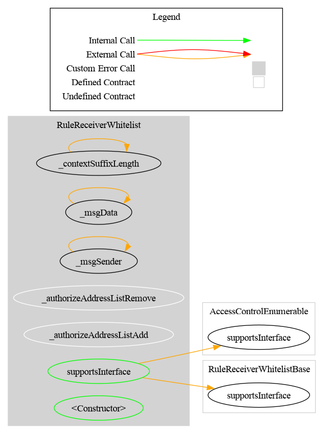
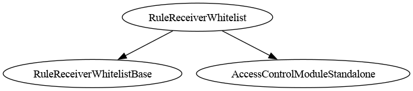

# Rule Receiver Whitelist

[TOC]

`RuleReceiverWhitelist` is a whitelist that screens **only the receiver**, reproducing ERC-3643's eligibility rule as a CMTAT compliance rule. The sender and the spender are never checked.

It sits between two existing rules:

| Rule | Screens |
| --- | --- |
| [`RuleWhitelist`](./RuleWhitelist.md) | sender **and** receiver (spender optional) |
| **`RuleReceiverWhitelist`** | **receiver only** |
| [`RuleSpenderWhitelist`](./RuleSpenderWhitelist.md) | spender only |

## Why receiver-only

ERC-3643 mandates exactly one identity check, *"The receiver MUST be whitelisted on the Identity Registry and verified"*, and states that `transferFrom` "works the same way", that `mint` "only require[s] the receiver", and that `burn` "bypasses all checks on eligibility".

That is not an oversight in the standard. **Screening the sender traps de-listed holders**: an investor whose eligibility lapses could neither receive nor send, stranding their position permanently. ERC-3643 checks only the receiver precisely so a lapsed investor can still exit to an eligible counterparty. This rule is the CMTAT-side expression of that decision, and the same reasoning `CLAUDE.md` records as non-negotiable for `RuleIdentityRegistry`.

If you want both parties screened, that is a different policy; use `RuleWhitelist`.

## Behaviour

| Operation | Screened | Notes |
| --- | --- | --- |
| `transfer(from, to)` | `to` only | the sender is never checked |
| `transferFrom(spender, from, to)` | `to` only | the spender is never checked either |
| mint (`from == address(0)`) | `to`, like any other receiver | no `allowMint` flag — see below |
| burn (`to == address(0)`) | nothing | always allowed |

### Burn is exempted explicitly

On a burn the receiver is `address(0)`, which **can never be listed**: the underlying address set rejects it, so `isAddressListed(address(0))` is always `false`. Without an explicit exemption every burn would be rejected. ERC-3643 says burn bypasses eligibility, so the exemption is the conformant behaviour rather than a convenience.

### Mint has no opt-out flag

Unlike `RuleWhitelist`, there is no `allowMint`/`allowBurn`. ERC-3643 gates minting on receiver eligibility alone: a mint to a listed address is allowed, a mint to an unlisted one is not. To cap or close issuance, compose with `RuleMaxTotalSupply` or `RuleChainlinkPoR` rather than adding a flag here.

## Restriction codes

| Constant | Code | Meaning |
| --- | --- | --- |
| `CODE_ADDRESS_RECEIVER_NOT_WHITELISTED` | 81 | The receiver is not on the whitelist |

The constant is named `RECEIVER` rather than `TO` so it does not collide with `RuleWhitelist`'s `CODE_ADDRESS_TO_NOT_WHITELISTED` (22) when a test contract inherits both invariant stores.

## Schema

The **Graph** and **Inheritance** diagrams are generated from the source code with [Surya](https://github.com/Consensys/surya), by the scripts in `doc/script/`, and must be regenerated after a code change:

- **Graph** (`surya graph`): the call graph of the contract's source file. Each node is a function, grouped by contract, and each arrow is a call from one function to another, including calls to other contracts. Only that file is parsed, so logic inherited from a base contract appears in that base contract's own graph.
- **Inheritance** (`surya inheritance`): the contracts and interfaces this contract inherits from, which tells you where each inherited function and modifier is defined.

### Graph



### Inheritance



## Configuration

### Constructor parameters

| Parameter | Description |
| --- | --- |
| `admin` / `owner` | `DEFAULT_ADMIN_ROLE` (AccessControl variant) or contract owner (Ownable2Step variant) |
| `forwarderIrrevocable` | ERC-2771 forwarder for meta-transactions; `address(0)` to disable |

Available as `RuleReceiverWhitelist` (AccessControl) and `RuleReceiverWhitelistOwnable2Step`.

## Access Control

| Role | Description |
| --- | --- |
| `ADDRESS_LIST_ADD_ROLE` | May call `addAddress` / `addAddresses` |
| `ADDRESS_LIST_REMOVE_ROLE` | May call `removeAddress` / `removeAddresses` |

Identical to the other address-set rules: the list machinery is `RuleAddressSet`, so batch operations skip duplicates, single operations revert on invalid input, and the zero address can never be listed.

## Methods

The full `IAddressList` surface is inherited from `RuleAddressSet`: `addAddress`, `addAddresses`, `removeAddress`, `removeAddresses`, `isAddressListed`, `areAddressesListed`, `listedAddressCount`. The rule advertises `IAddressList` via ERC-165.

## Usage

### Behind a RuleEngine, for a CMTAT token

```solidity
RuleReceiverWhitelist rule = new RuleReceiverWhitelist(admin, address(0));
rule.addAddress(investor);
ruleEngine.addRule(rule);
cmtat.setRuleEngine(ruleEngine);
```

### As the compliance contract of an ERC-3643 token

```solidity
engine.setTokenSelfBindingApproval(address(token), true);
token.setCompliance(address(engine));   // engine holds RuleReceiverWhitelist
```

Because the rule's semantics match the token's own, it composes with the identity registry without changing the token's behaviour; it narrows eligibility, never widens or redirects it.

## Tests

| File | Covers |
| --- | --- |
| `test/RuleReceiverWhitelist/RuleReceiverWhitelistUnit.t.sol` | Receiver screened; sender and spender explicitly not; mint screened on the receiver; burn always allowed; zero address never listable; write path; ERC-1404 surface; access control |
| `test/RuleReceiverWhitelist/Ownable/RuleReceiverWhitelistOwnable2Step.t.sol` | Ownable2Step variant |
| `test/ERC3643Real/ERC3643ReceiverWhitelistParity.t.sol` | **Equivalence against the real vendored ERC-3643 token** |

The parity suite is the one that matters for the conformance claim. It runs the rule in the compliance slot of the genuine `Token.sol` over the *same address set* the identity registry holds, and asserts the rule never changes the outcome — a de-listed holder still exits, an unlisted spender is not blocked, burn still works. A rule that screened the sender would break those while every unit test still passed. A final test confirms the rule is genuinely consulted (it blocks when its list is narrower than the registry's), so the parity results are not vacuous.

Run it with `FOUNDRY_PROFILE=erc3643 forge test`; see `foundry.toml` for why that suite needs its own profile.

## CMTAT v3.0.0

✅ Supported, identical to v3.3.

- Only the receiver is screened, on transfers and mints; burns are exempt. The rule never reads a spender, so the v3.0.0 mint path makes no difference.

Tested against a real CMTAT **v3.0.0** token (the last audited release), Standard and Debt variants, both set directly on the token and behind a `RuleEngine`: `test/CMTATv3.0.0/RuleReceiverWhitelistV300.t.sol`.
