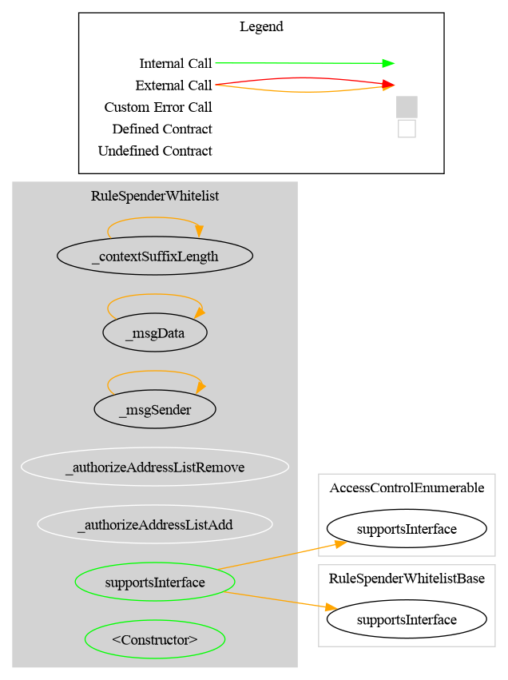
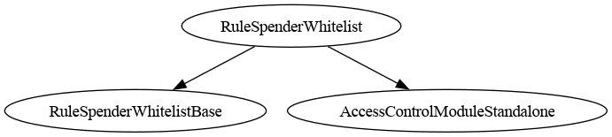

# Rule SpenderWhitelist

[TOC]

This rule restricts only spender-initiated transfers (`transferFrom`): the spender must be listed in an internal whitelist. Regular transfers (`transfer`) are always accepted by this rule.

## Configuration

### Constructor parameters

| Parameter | Description |
| --- | --- |
| `admin` / `owner` | Access-control authority (`AccessControlEnumerable` or `Ownable2Step` variant) |
| `forwarderIrrevocable` | ERC-2771 trusted forwarder address for meta-transactions (use `address(0)` to disable) |

## Schema

The **Graph** and **Inheritance** diagrams are generated from the source code with [Surya](https://github.com/Consensys/surya), by the scripts in `doc/script/`, and must be regenerated after a code change:

- **Graph** (`surya graph`): the call graph of the contract's source file. Each node is a function, grouped by contract, and each arrow is a call from one function to another, including calls to other contracts. Only that file is parsed, so logic inherited from a base contract appears in that base contract's own graph.
- **Inheritance** (`surya inheritance`): the contracts and interfaces this contract inherits from, which tells you where each inherited function and modifier is defined.
- **Flow with a CMTAT token**: a sequence diagram, written by hand in PlantUML (source in `doc/img/`), of how the rule takes part in a token transfer.

### Graph

### Inheritance

### Flow with a CMTAT token

The sequence below shows how the rule participates when a CMTAT token (with this rule configured in its RuleEngine) processes a transfer. Direct `transfer` calls always pass; only `transferFrom` spenders are gated.

_Diagram source: doc/img/rule-spender-whitelist-flow.puml._

## Restriction codes

| Constant | Code | Meaning |
| --- | --- | --- |
| `CODE_ADDRESS_SPENDER_NOT_WHITELISTED` | 66 | `transferFrom` spender is not in the whitelist |

## Access control

### AccessControlEnumerable variant (`RuleSpenderWhitelist`)

| Role | Description |
| --- | --- |
| `DEFAULT_ADMIN_ROLE` | Manages all roles |
| `ADDRESS_LIST_ADD_ROLE` | May add spenders (`addAddress`, `addAddresses`) |
| `ADDRESS_LIST_REMOVE_ROLE` | May remove spenders (`removeAddress`, `removeAddresses`) |

### Ownable2Step variant (`RuleSpenderWhitelistOwnable2Step`)

Owner can manage the spender list and transfer ownership with two-step acceptance.

## Behavior

### Direct transfer path

`detectTransferRestriction(from, to, value)` always returns `TRANSFER_OK`. `transferred(from, to, value)` is a no-op and never reverts.

### Spender path (`transferFrom`)

`detectTransferRestrictionFrom(spender, from, to, value)` returns:
- `66` if `spender` is not listed
- `0` otherwise

`transferred(spender, from, to, value)` reverts with `RuleSpenderWhitelist_InvalidTransferFrom` when the spender is not listed.

## Notes

- The rule does not validate `from` or `to` addresses.
- The rule also supports ERC-7943 tokenId/context overloads through `RuleNFTAdapter`.
- Batch add/remove follows the project convention: skips duplicates/missing entries without reverting.

## Deployment guides

Step-by-step deployment with a CMTAT token, with a sequence diagram per setup and per operation: [`DEPLOY_RULE_SPENDER_WHITELIST_CMTAT_V3.0.0.md`](../guides/DEPLOY_RULE_SPENDER_WHITELIST_CMTAT_V3.0.0.md) for v3.0.0, [`DEPLOY_RULE_SPENDER_WHITELIST_CMTAT_V3.3.0.md`](../guides/DEPLOY_RULE_SPENDER_WHITELIST_CMTAT_V3.3.0.md) for v3.3.0.

## CMTAT v3.0.0

✅ Supported, identical to v3.3.

- v3.0.0 forwards the `transferFrom` caller as spender on the 4-argument path. Direct transfers, mints and burns are not screened on either version.

Tested against a real CMTAT **v3.0.0** token (the last audited release), Standard and Debt variants, both set directly on the token and behind a `RuleEngine`: `test/CMTATv3.0.0/RuleSpenderWhitelistV300.t.sol`.
