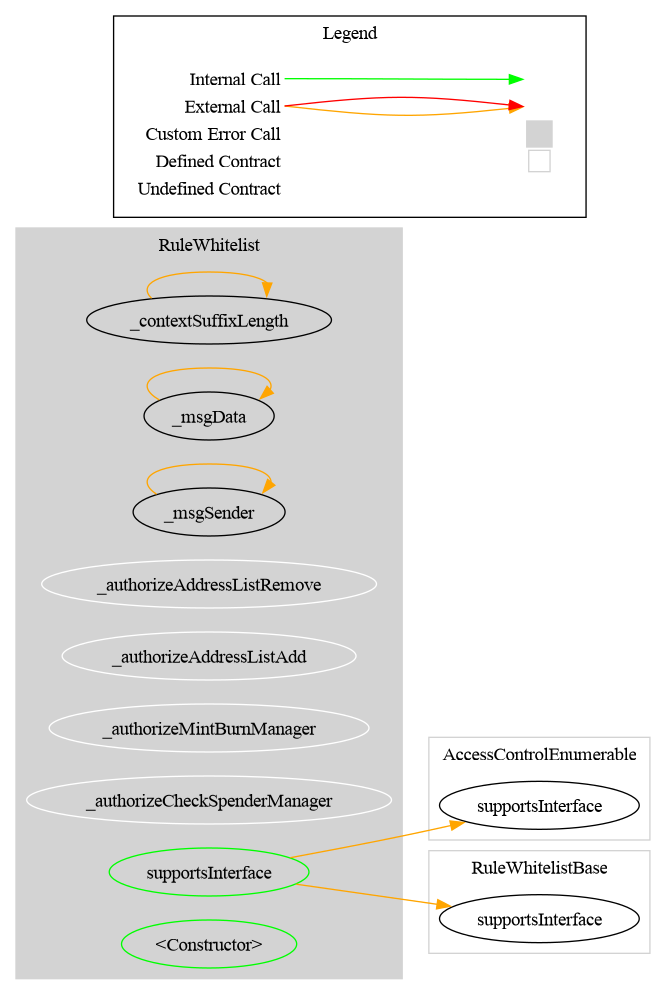
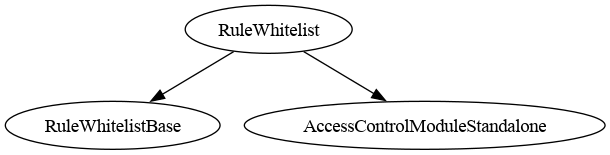

# Rule Whitelist

[TOC]

This rule restricts transfers so that only whitelisted addresses may send and receive tokens. Optionally, spender addresses (used in `transferFrom`) can also be checked.

## Configuration

### Constructor parameters

| Parameter | Description |
| --- | --- |
| `admin` | Address granted `DEFAULT_ADMIN_ROLE` (implicitly holds all roles) |
| `forwarderIrrevocable` | ERC-2771 trusted forwarder address for meta-transactions (use `address(0)` to disable) |
| `checkSpender_` | If `true`, `transferFrom` spender address is also verified against the whitelist |
| `allowMintBurn` | If `true`, sets **both** `allowMint` and `allowBurn`. Mint/burn permission is an explicit flag — the zero address is **never** listed. Adjust independently afterwards with `setAllowMint` / `setAllowBurn`. |

### `checkSpender` flag

When `checkSpender` is `true`, the spender in a `transferFrom` call must also be whitelisted. This flag can be toggled post-deployment by the admin with `setCheckSpender(bool)`.

## Schema

The **Graph** and **Inheritance** diagrams are generated from the source code with [Surya](https://github.com/Consensys/surya), by the scripts in `doc/script/`, and must be regenerated after a code change:

- **Graph** (`surya graph`): the call graph of the contract's source file. Each node is a function, grouped by contract, and each arrow is a call from one function to another, including calls to other contracts. Only that file is parsed, so logic inherited from a base contract appears in that base contract's own graph.
- **Inheritance** (`surya inheritance`): the contracts and interfaces this contract inherits from, which tells you where each inherited function and modifier is defined.
- **Flow with a CMTAT token**: a sequence diagram, written by hand in PlantUML (source in `doc/img/`), of how the rule takes part in a token transfer.

### Graph

### Inheritance

### Flow with a CMTAT token

The sequence below shows how the rule participates when a CMTAT token (with this rule configured in its RuleEngine) processes a transfer.

_Diagram source: doc/img/rule-whitelist-flow.puml._

## Restriction codes

| Constant | Code | Meaning |
| --- | --- | --- |
| `CODE_ADDRESS_FROM_NOT_WHITELISTED` | 21 | Sender is not in the whitelist |
| `CODE_ADDRESS_TO_NOT_WHITELISTED` | 22 | Recipient is not in the whitelist |
| `CODE_ADDRESS_SPENDER_NOT_WHITELISTED` | 23 | Spender is not in the whitelist (only when `checkSpender` is enabled) |
| `CODE_MINT_NOT_ALLOWED` | 24 | Minting is disabled (`allowMint == false`) |
| `CODE_BURN_NOT_ALLOWED` | 25 | Burning is disabled (`allowBurn == false`) |

## Access Control

The default admin is the address passed as `admin` in the constructor. It is granted `DEFAULT_ADMIN_ROLE`, which implicitly holds all roles.

| Role | Description |
| --- | --- |
| `DEFAULT_ADMIN_ROLE` | Manages all roles; can call all privileged functions |
| `ADDRESS_LIST_ADD_ROLE` | May add addresses to the whitelist (`addAddress`, `addAddresses`) |
| `ADDRESS_LIST_REMOVE_ROLE` | May remove addresses from the whitelist (`removeAddress`, `removeAddresses`) |

## Methods

### `addAddress(address targetAddress)`

Adds a single address to the whitelist. Reverts if the address is already listed.

### `addAddresses(address[] calldata targetAddresses)`

Batch-adds addresses to the whitelist. Silently skips duplicates (no revert).

### `removeAddress(address targetAddress)`

Removes a single address from the whitelist. Reverts if the address is not listed.

### `removeAddresses(address[] calldata targetAddresses)`

Batch-removes addresses from the whitelist. Silently skips addresses not listed (no revert).

### `isAddressListed(address targetAddress) → bool`

Returns `true` if the address is in the whitelist.

### `areAddressesListed(address[] memory targetAddresses) → bool[]`

Returns a boolean array indicating whitelist membership for each address.

### `setCheckSpender(bool value)`

Enables or disables spender checks for `transferFrom`. Restricted to `DEFAULT_ADMIN_ROLE`.

## Notes

### Zero address — the mint/burn sentinel, never a list member

The zero address **cannot be added to the whitelist**: `addAddress(address(0))` reverts with
`RuleAddressSet_ZeroAddressNotAllowed`, and a batch containing it reverts too.

It is the ERC-20 mint/burn sentinel, not a participant. Listing it would make the standardized identity getters
assert falsehoods — `isVerified(address(0))` and `contains(address(0))` would return `true`, contradicting ERC-3643,
which defines `isVerified` as *"is this wallet a valid investor holding the required claims"*.

Mint and burn are instead governed by explicit flags:

| Flag | Effect | Blocked code |
| --- | --- | --- |
| `allowMint` | Permits `from == address(0)` | `24` (`CODE_MINT_NOT_ALLOWED`) |
| `allowBurn` | Permits `to == address(0)` | `25` (`CODE_BURN_NOT_ALLOWED`) |

Both are set together by the `allowMintBurn` constructor parameter and are independently settable afterwards
(`setAllowMint` / `setAllowBurn`), so an issuer can permanently close issuance while keeping redemptions open.

The flags gate the **operation only**: a permitted mint still requires a whitelisted **recipient**, and a permitted
burn still requires a whitelisted **sender**.

### Batch vs single operations

Single-item operations (`addAddress`, `removeAddress`) revert on duplicate/missing input. Batch operations (`addAddresses`, `removeAddresses`) skip invalid entries silently to allow partial lists without full rollback.

### Usage scenario

The operator deploys `RuleWhitelist`, grants `ADDRESS_LIST_ADD_ROLE` to a compliance manager, and registers the rule in the `RuleEngine`. The compliance manager calls `addAddresses([alice, bob])`. Transfers between whitelisted addresses pass; any transfer from or to an unlisted address is rejected with codes 21 or 22.

## CMTAT v3.0.0

✅ Supported.

- Mint and burn are gated by `allowMint` / `allowBurn` exactly as on v3.3: the minter never matters to this rule, so the missing mint spender changes nothing.
- `checkSpender` screens `transferFrom` spenders, which v3.0.0 forwards on the 4-argument path.

Step-by-step deployment, and the mint and transfer workflows: [`DEPLOY_RULE_WHITELIST_CMTAT_V3.0.0.md`](../guides/DEPLOY_RULE_WHITELIST_CMTAT_V3.0.0.md) for v3.0.0, [`DEPLOY_RULE_WHITELIST_CMTAT_V3.3.0.md`](../guides/DEPLOY_RULE_WHITELIST_CMTAT_V3.3.0.md) for v3.3.0.

Tested against a real CMTAT **v3.0.0** token (the last audited release), Standard and Debt variants, both set directly on the token and behind a `RuleEngine`: `test/CMTATv3.0.0/RuleWhitelistV300.t.sol`; the rule or a RuleEngine passed in the token constructor: `test/CMTATv3.0.0/RuleWhitelistV300Deployment.t.sol`.
