# Deploy `RuleBlacklist` with a CMTAT v3.0.0 token

[TOC]

This guide deploys a CMTAT **v3.0.0** token whose transfers, mints and burns are blocked when they involve a blacklisted address, enforced by `RuleBlacklist`. It covers:

- where the rule sits: on the token directly, or inside a RuleEngine;
- when it is installed: in the token constructor, or later with `setRuleEngine`;
- what happens on a mint, a transfer and a burn once it is active.

CMTAT v3.0.0 is the last audited CMTAT release. For CMTAT v3.3.0, validated against `v3.3.0-rc4`, see the [v3.3.0 guide](./DEPLOY_RULE_BLACKLIST_CMTAT_V3.3.0.md), which also lists the differences between the two versions.

> **On v3.0.0 the minter and the burner are not screened.** v3.0.0 calls the rule on mint and burn through the 3-argument `transferred(from, to, value)`, without the address of the caller. A blacklisted `MINTER_ROLE` or `BURNER_ROLE` holder can therefore still mint and burn; only the receiver of a mint and the holder of a burn are checked. On CMTAT v3.3.0 the minter and the burner are forwarded and blocked (code 38). If your blacklist must also stop a compromised or sanctioned operator key, revoke its role on the token: the rule cannot do it on v3.0.0.

Every step below is tested against a real v3.0.0 token:

- `test/CMTATv3.0.0/RuleBlacklistV300.t.sol`: rule installed after deployment, on the Standard and Debt variants, directly (§4.2) and behind a RuleEngine bound in its constructor (§4.4); it also pins the unscreened minter;
- `test/CMTATv3.0.0/RuleBlacklistV300Deployment.t.sol`: rule or RuleEngine passed in the token constructor (§4.1, §4.3), a blacklisted holder trapped until `forcedTransfer`, and the unscreened minter.

## 1. What the rule enforces

| Operation | Checked by `RuleBlacklist` | Rejected with |
| --- | --- | --- |
| Transfer `from → to` | neither `from` nor `to` is blacklisted | 36 (sender), 37 (receiver) |
| `transferFrom` by a spender | the spender is not blacklisted, then as above | 38 (spender), 36, 37 |
| Mint to `to` | `to` is not blacklisted. **The minter is not checked on v3.0.0** | 37 |
| Burn from `from` | `from` is not blacklisted. **The burner is not checked on v3.0.0** | 36 |

The checks run in that order (spender, sender, receiver) and the first hit gives the code. The zero address can never be added to the list (`addAddress` and `addAddresses` both revert on it), so the `address(0)` side of a mint or a burn never matches.

Why the minter is missing: CMTAT v3.0.0 mints and burns through `_checkTransferred(address(0), from, to, value)`, so the spender is `address(0)` and the token takes the 3-argument path. `transferFrom` is different: it passes the caller as spender on the 4-argument path, so a blacklisted spender **is** stopped on v3.0.0.

## 2. Choose the setup

**Where the rule sits.**

| Topology | Token calls | Use it when |
| --- | --- | --- |
| **Direct** | the rule itself (`token.ruleEngine() == rule`) | the blacklist is the only rule. Fewer contracts to deploy, and one external call less per transfer |
| **RuleEngine** | a `RuleEngine`, which calls each of its rules | you need several rules (for example blacklist + sanctions list + max total supply), or want to add rules later without touching the token |

`RuleBlacklist` is stateless on the transfer path, so it behaves identically in both. It needs no token address and no binding to the token.

**When the rule is installed.**

| Moment | How | Effect |
| --- | --- | --- |
| **At deployment** | pass the rule (or the RuleEngine) in the token constructor's `Engine.ruleEngine` field | the token is never unrestricted, the very first mint is screened |
| **After deployment** | deploy the token with `Engine.ruleEngine = address(0)`, then `token.setRuleEngine(...)` | between the two transactions the token has **no compliance**: any mint or transfer goes through. Do not mint or grant `MINTER_ROLE` before `setRuleEngine` |

Installing at deployment is recommended: directly if the blacklist is the only rule (§4.1), behind a RuleEngine otherwise (§4.3). Installing afterwards is the right choice for a token already live, or to change or replace the compliance later.

A blacklist blocks nothing while it is empty. Whatever the setup, add the addresses you already know must be blocked before the first mint.

## 3. Contracts and roles

| Contract | Constructor | Roles that matter here |
| --- | --- | --- |
| `RuleBlacklist` | `(admin, forwarderIrrevocable)` | `DEFAULT_ADMIN_ROLE` (holds every role), `ADDRESS_LIST_ADD_ROLE` (`addAddress`, `addAddresses`), `ADDRESS_LIST_REMOVE_ROLE` (`removeAddress`, `removeAddresses`) |
| `RuleBlacklistOwnable2Step` | `(owner, forwarderIrrevocable)` | the owner adds and removes; ownership moves in two steps (`transferOwnership`, then `acceptOwnership`) |
| `RuleEngine` (RuleEngine `v3.0.0-rc7`, optional) | `(admin, tokenContract)`; `tokenContract` may be `address(0)` | `RULES_MANAGEMENT_ROLE` (`addRule`), `COMPLIANCE_MANAGER_ROLE` (`bindToken`) |
| CMTAT v3.0.0 `CMTATStandalone` (or `CMTATStandaloneDebt`, or a proxy variant) | `(forwarder, admin, ERC20Attributes, ExtraInformationAttributes, Engine{ruleEngine, snapshotEngine, documentEngine})`. `CMTATStandaloneDebt` takes no forwarder | `DEFAULT_ADMIN_ROLE` (`setRuleEngine`, `forcedTransfer`, all roles), `MINTER_ROLE`, `BURNER_ROLE`, `PAUSER_ROLE`, `ENFORCER_ROLE` (freeze an address), `ERC20ENFORCER_ROLE` (freeze part of a balance) |

On both CMTAT and the AccessControl rules, the default admin implicitly holds every role. Pass `forwarderIrrevocable = address(0)` unless you use ERC-2771 meta-transactions for the rule's admin calls.

## 4. Deployment steps

Each setup lists its steps, then draws them as a sequence diagram. The calls are shown from a single admin; in production the list, rule and minting roles can be held by different addresses (§3).

### 4.1 Rule set directly, at deployment (recommended for a blacklist alone)

1. **Deploy the rule:** `RuleBlacklist(admin, address(0))`. It needs no token address.
2. **Fill the blacklist:** `addAddresses([blocked1, blocked2, ...])`, as the admin or an `ADDRESS_LIST_ADD_ROLE` holder. Until an address is listed, nothing stops it.
3. **Deploy the token** with `Engine(ruleEngine = rule, snapshotEngine = 0, documentEngine = 0)`.
4. **Grant `MINTER_ROLE`** to the issuer's minting address, if it is not the admin. Listing that address would not stop it on v3.0.0.
5. **Check the setup:** `token.ruleEngine() == rule`; on the Standard variant, `token.detectTransferRestriction(address(0), blocked1, 1) == 37` and the same call to a clean address returns 0.

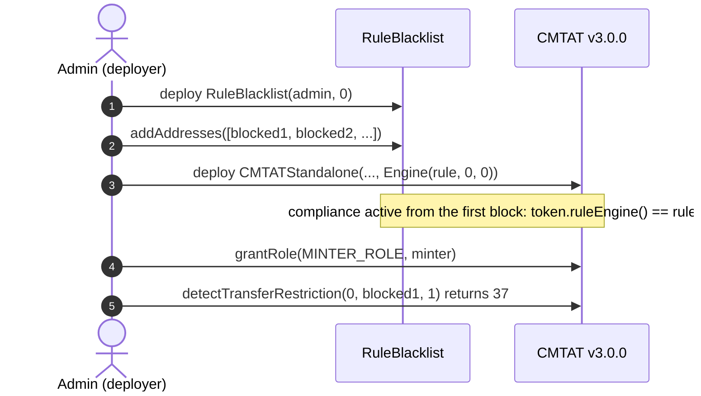

### 4.2 Rule set directly, after deployment

1. **Deploy the token** with `Engine(ruleEngine = address(0), ...)`. Do not mint yet.
2. **Deploy the rule** and fill the blacklist, as in 4.1 steps 1 and 2.
3. **Install it:** `token.setRuleEngine(rule)`, as the token's `DEFAULT_ADMIN_ROLE`. It emits `RuleEngine(rule)` and reverts with `CMTAT_ValidationModule_SameValue` if that rule is already set.
4. **Grant `MINTER_ROLE`**, then check as in 4.1 step 5.

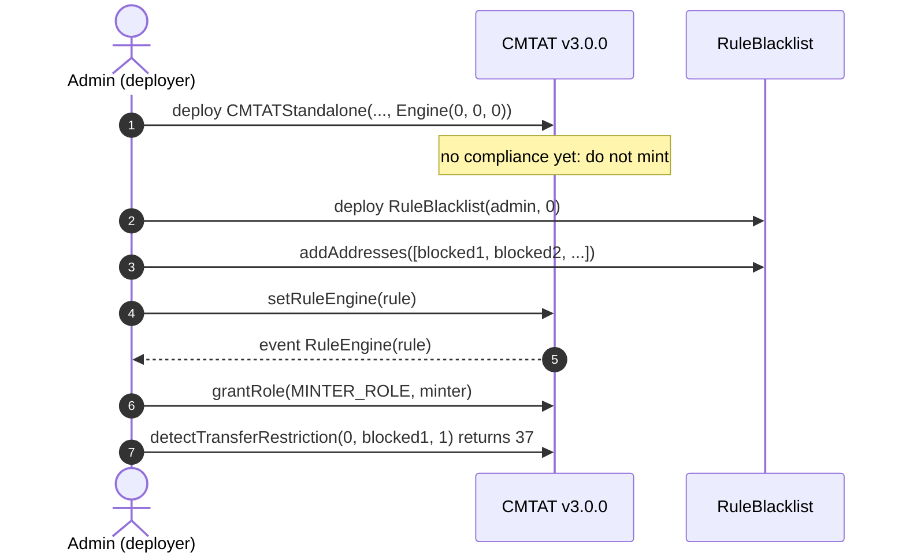

The repository script `script/DeployCMTATWithBlacklist.s.sol` follows this order, but deploys the current CMTAT (v3.3), not v3.0.0. See [`DEPLOYMENT_SCRIPTS.md`](./DEPLOYMENT_SCRIPTS.md).

### 4.3 Behind a RuleEngine, at deployment (recommended with other rules)

The token address does not exist yet when the engine is deployed, so the engine is deployed without a token and binds it afterwards. Until that binding, the engine rejects every call from the token (`TokenBinding_UnauthorizedCaller`): no mint or transfer can happen unscreened.

1. **Deploy the RuleEngine:** `RuleEngine(admin, address(0))`.
2. **Deploy the rule**, fill the blacklist, and add it: `engine.addRule(rule)` (`RULES_MANAGEMENT_ROLE`). Add the other rules the same way.
3. **Deploy the token** with `Engine(ruleEngine = engine, ...)`.
4. **Bind the token:** `engine.bindToken(token)` (`COMPLIANCE_MANAGER_ROLE`). From now on the token works.
5. **Grant `MINTER_ROLE`** and check as in 4.1 step 5.

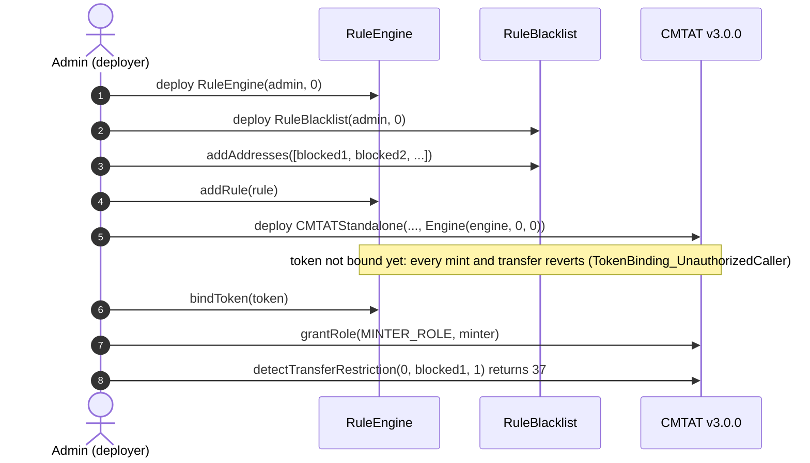

### 4.4 Behind a RuleEngine, after deployment

1. **Deploy the token** with `Engine(ruleEngine = address(0), ...)`. Do not mint yet.
2. **Deploy the RuleEngine** with the token already known: `RuleEngine(admin, token)` binds it in the constructor.
3. **Deploy the rule**, fill the blacklist, `engine.addRule(rule)`.
4. **Install it:** `token.setRuleEngine(engine)`.
5. **Grant `MINTER_ROLE`** and check as in 4.1 step 5.

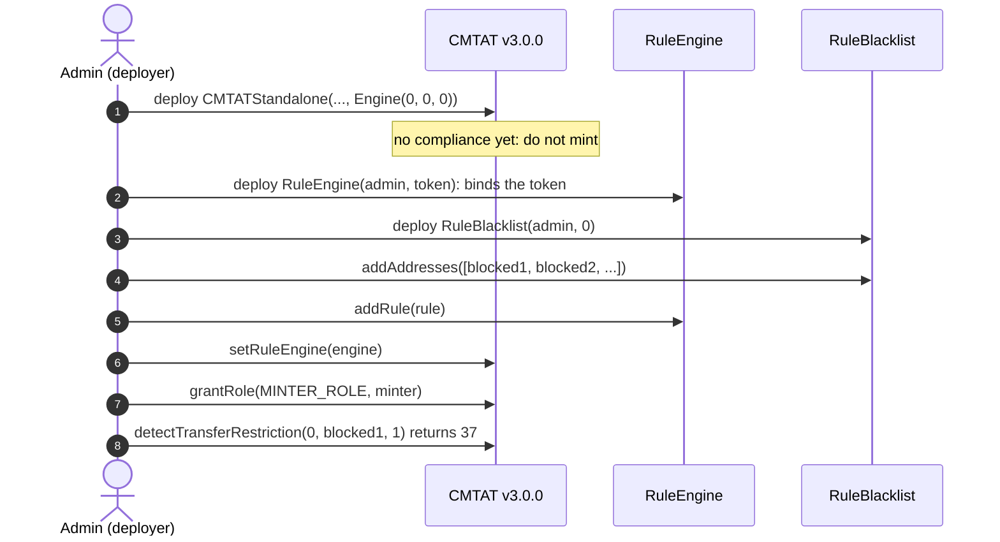

The repository script `script/DeployCMTATWithBlacklistAndSanctionsList.s.sol` follows this order with a sanctions list as a second rule, on CMTAT v3.3.

A RuleEngine serving one token is the intended setup. `RuleBlacklist` itself would work for several tokens (it reads no token state), but every token would then share one blacklist.

## 5. Mint workflow

`mint(to, value)` by a `MINTER_ROLE` holder, with the rule active. On v3.0.0 the token checks the active balance of `from` (always passes for `address(0)`), then that the contract is not deactivated and the receiver not frozen, then notifies the compliance contract **before** creating the tokens, on the 3-argument `transferred(address(0), to, value)`: no minter is forwarded, so the rule cannot screen it. Pause does not stop a mint on v3.0.0.

### 5.1 Rule plugged directly into the token

The token calls `RuleBlacklist` itself: `token.ruleEngine() == rule`.

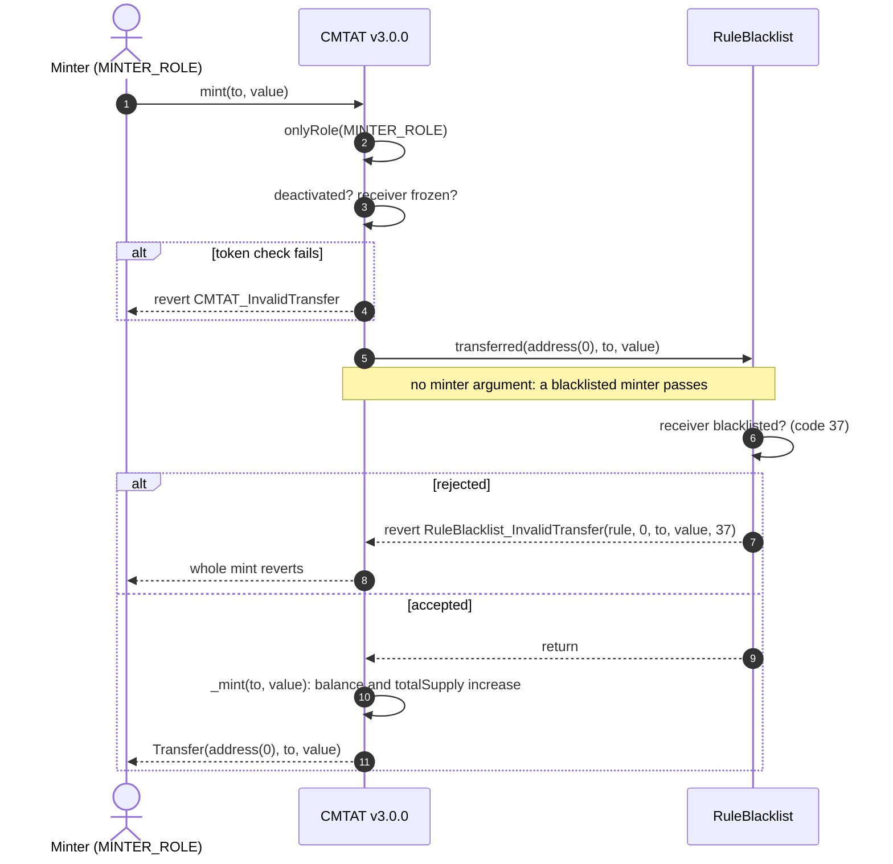

### 5.2 Rule behind a RuleEngine

The token calls the RuleEngine, which accepts only its bound token and then calls each of its rules in order. The first rule that reverts stops the mint, and the engine passes the revert back to the token.

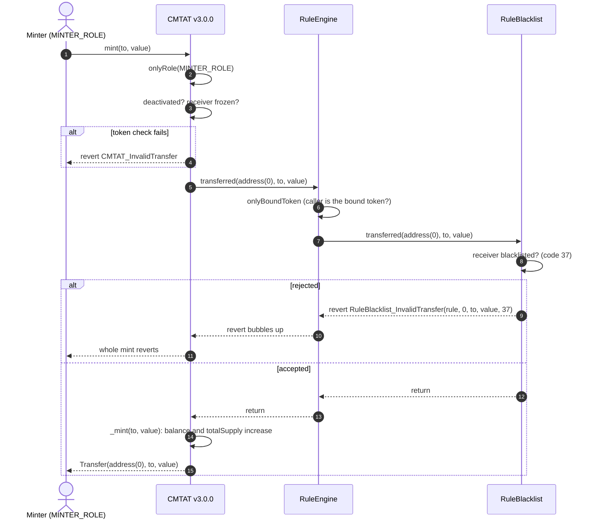

### 5.3 Happy path: a mint to a clean investor

The issuer mints 1,000 tokens to Alice, who is not on the blacklist. The contract is active and Alice is not frozen. The rule is plugged directly into the token; behind a RuleEngine the engine sits between the token and the rule, as in §5.2.

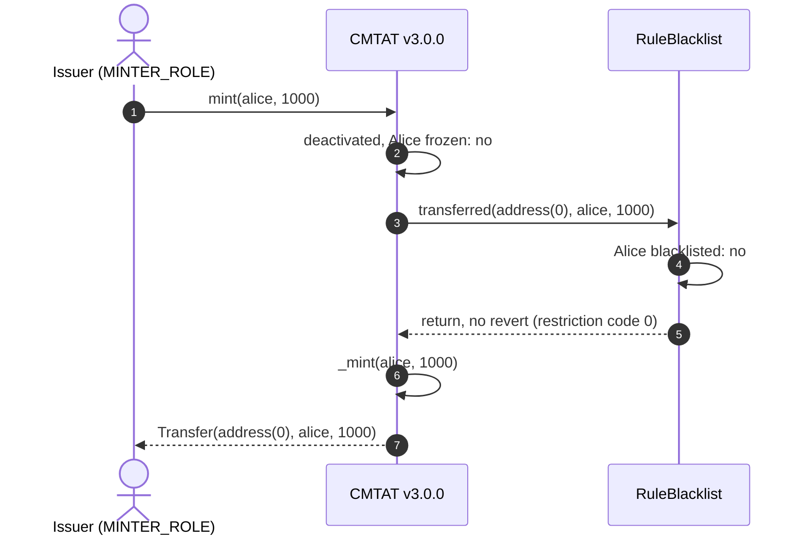

## 6. Transfer and burn workflows

### 6.1 Transfer, rule plugged directly into the token

`transfer(to, value)` by a holder. The token first checks that the tokens are not frozen (active balance), then that the token is not paused and nobody involved is frozen, then notifies the compliance contract **before** moving the balance. A `transfer` has no spender and takes the 3-argument path.

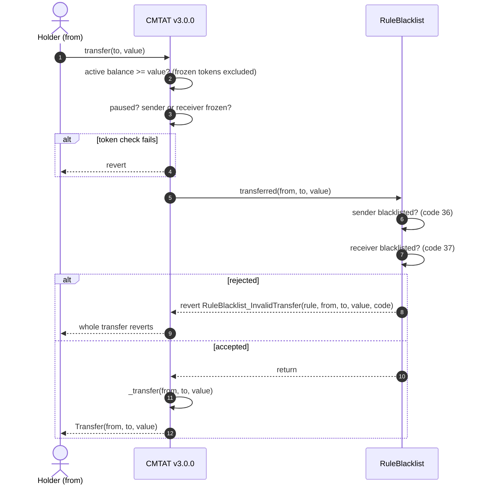

### 6.2 Transfer, rule behind a RuleEngine

Same path through the engine as for a mint (§5.2), on the 3-argument `transferred`.

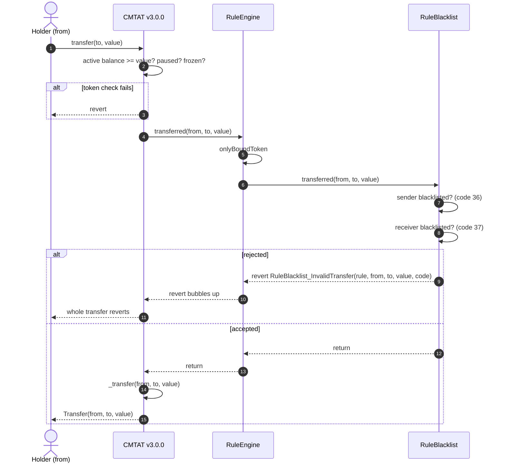

### 6.3 `transferFrom`: the spender is screened

`transferFrom(from, to, value)` by an approved spender takes the 4-argument path, with the caller as spender. The rule checks the spender first. Behind a RuleEngine the engine forwards the same 4-argument call.

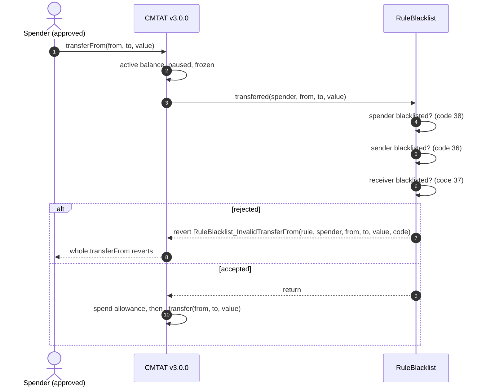

### 6.4 Happy path: a transfer between clean holders

Alice sends 100 tokens to Bob. Neither is blacklisted, Alice holds at least 100 unfrozen tokens, and the token is not paused.

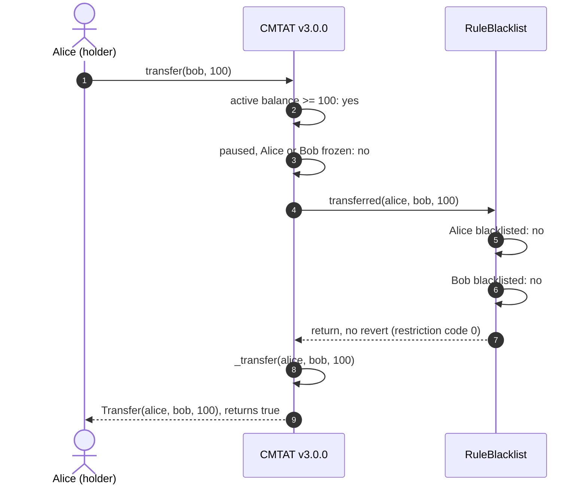

### 6.5 Burn, rule plugged directly into the token

`burn(from, value)` by a `BURNER_ROLE` holder. The token checks the active balance of `from`, that the contract is not deactivated and `from` not frozen, then calls the rule on the 3-argument `transferred(from, address(0), value)`. The burner is not forwarded.

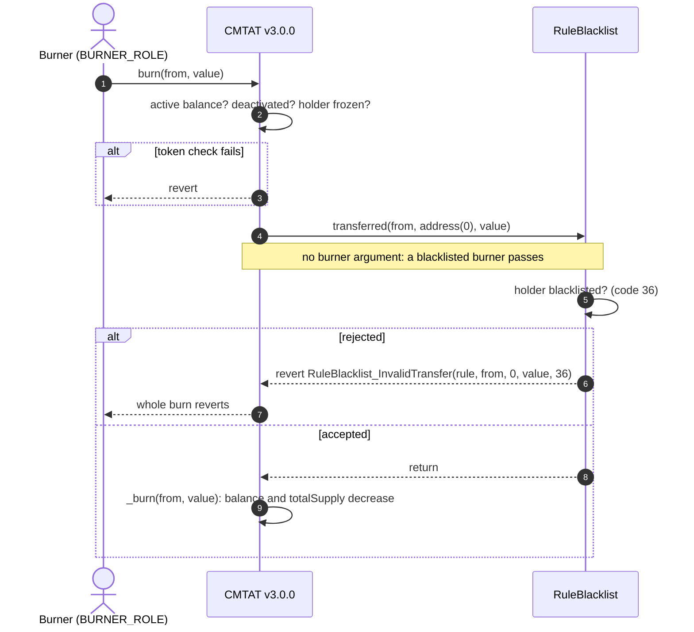

### 6.6 Burn, rule behind a RuleEngine

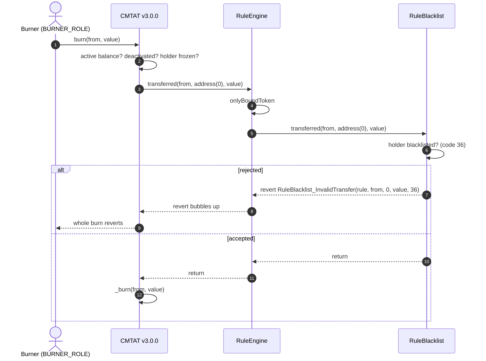

### 6.7 Happy path: a redemption from a clean holder

The issuer burns 50 of Alice's tokens. Alice is not blacklisted, not frozen, and holds at least 50 unfrozen tokens.

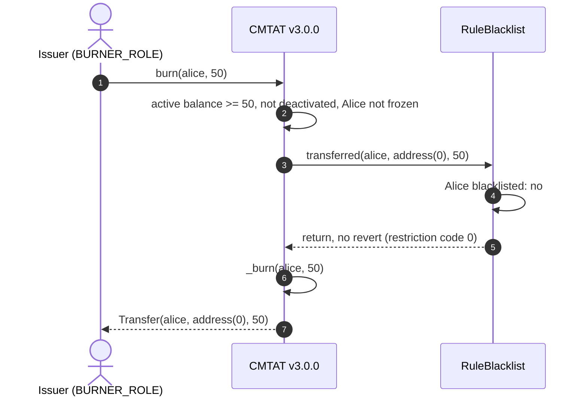

Before sending, a wallet or a front end can ask the same question without a transaction: `token.canTransfer(from, to, value)` and `token.canTransferFrom(spender, from, to, value)` on both variants, and `token.detectTransferRestriction(from, to, value)` plus `messageForTransferRestriction(code)` on the Standard variant (the Debt variant has no ERC-1404 layer).

## 7. Operating the token

| Task | Call | Role |
| --- | --- | --- |
| Block addresses | `rule.addAddresses([...])` (skips duplicates, reverts on `address(0)`) or `addAddress` (reverts on a duplicate) | `ADDRESS_LIST_ADD_ROLE` (owner on the Ownable2Step variant) |
| Unblock | `rule.removeAddresses([...])` / `removeAddress` | `ADDRESS_LIST_REMOVE_ROLE` (owner) |
| Check an address | `rule.isAddressListed(addr)`, `rule.areAddressesListed([...])`, `rule.listedAddressCount()` | anyone |
| Stop a compromised minter or burner | revoke its role: `token.revokeRole(MINTER_ROLE, addr)`. Listing it in the rule does not stop it on v3.0.0 | token `DEFAULT_ADMIN_ROLE` |
| Replace the compliance | `token.setRuleEngine(newRuleOrEngine)` | token `DEFAULT_ADMIN_ROLE` |
| Remove the compliance | `token.setRuleEngine(address(0))`: the token becomes unrestricted | token `DEFAULT_ADMIN_ROLE` |

**A blacklisted holder's tokens are locked:** the holder can neither send nor be burned from (code 36) while listed. To move them out use the token's `forcedTransfer(from, to, value)` (`DEFAULT_ADMIN_ROLE`; `to = address(0)` burns), which does not call the compliance contract.

**The token has its own block list.** `token.setAddressFrozen(addr, true)` (`ENFORCER_ROLE`) stops an address on the token itself, with no rule involved. Freezing applies to one token; the blacklist applies to every token that uses the rule.

See also: [`RuleBlacklist.md`](../contracts/RuleBlacklist.md) for the full rule reference, and [`RULE_SEMANTICS.md`](./RULE_SEMANTICS.md) §7 for the per-rule CMTAT v3.0.0 status.
