# Deploy `RuleBlacklist` with a CMTAT v3.3.0 token

<!-- toc -->

- [1. What the rule enforces](#1-what-the-rule-enforces)
- [2. Choose the setup](#2-choose-the-setup)
- [3. Contracts and roles](#3-contracts-and-roles)
- [4. Deployment steps](#4-deployment-steps)
  - [Rule constructor parameters](#rule-constructor-parameters)
  - [4.1 Rule set directly, at deployment (recommended for a blacklist alone)](#41-rule-set-directly-at-deployment-recommended-for-a-blacklist-alone)
  - [4.2 Rule set directly, after deployment](#42-rule-set-directly-after-deployment)
  - [4.3 Behind a RuleEngine, at deployment (recommended with other rules)](#43-behind-a-ruleengine-at-deployment-recommended-with-other-rules)
  - [4.4 Behind a RuleEngine, after deployment](#44-behind-a-ruleengine-after-deployment)
- [5. Mint workflow](#5-mint-workflow)
  - [5.1 Rule plugged directly into the token](#51-rule-plugged-directly-into-the-token)
  - [5.2 Rule behind a RuleEngine](#52-rule-behind-a-ruleengine)
  - [5.3 Happy path: a mint to a clean investor](#53-happy-path-a-mint-to-a-clean-investor)
- [6. Transfer and burn workflows](#6-transfer-and-burn-workflows)
  - [6.1 Transfer, rule plugged directly into the token](#61-transfer-rule-plugged-directly-into-the-token)
  - [6.2 Transfer, rule behind a RuleEngine](#62-transfer-rule-behind-a-ruleengine)
  - [6.3 transferFrom: the spender is screened](#63-transferfrom-the-spender-is-screened)
  - [6.4 Happy path: a transfer between clean holders](#64-happy-path-a-transfer-between-clean-holders)
  - [6.5 Burn, rule plugged directly into the token](#65-burn-rule-plugged-directly-into-the-token)
  - [6.6 Burn, rule behind a RuleEngine](#66-burn-rule-behind-a-ruleengine)
  - [6.7 Happy path: a redemption from a clean holder](#67-happy-path-a-redemption-from-a-clean-holder)
- [7. Operating the token](#7-operating-the-token)
- [8. Differences from CMTAT v3.0.0](#8-differences-from-cmtat-v300)

<!-- /toc -->

This guide deploys a CMTAT **v3.3.0** token whose transfers, mints and burns are blocked when they involve a blacklisted address, enforced by `RuleBlacklist`. It covers:

- where the rule sits: on the token directly, or inside a RuleEngine;
- when it is installed: in the token constructor, or later with `setRuleEngine`;
- what happens on a mint, a transfer and a burn once it is active.

v3.3.0 is not final yet: this library is validated against **`v3.3.0-rc4`**, the version pinned in `lib/CMTAT`, and every statement below was checked against that code. For the last audited release, see the [v3.0.0 guide](./DEPLOY_RULE_BLACKLIST_CMTAT_V3.0.0.md); [§8](#8-differences-from-cmtat-v300) lists what differs.

> **On v3.3.0 the minter and the burner are screened.** v3.3.0 calls the rule on mint and burn through the 4-argument `transferred(spender, from, to, value)`, with the `MINTER_ROLE` or `BURNER_ROLE` holder as `spender`. `RuleBlacklist` does not exempt them: a blacklisted minter cannot mint and a blacklisted burner cannot burn, whoever the receiver or holder is (code 38). This is the intended behaviour of a deny-list, and it differs from v3.0.0, where the operator is never forwarded. Never list your own operational minting or burning address by mistake: every issuance or redemption it sends is rejected.

Every step below is tested against a real v3.3.0-rc4 token:

- `test/RuleBlacklist/RuleBlacklistCMTATDeployment.t.sol`: rule or RuleEngine passed in the token constructor (§4.1, §4.3), blacklisted minter and burner rejected with code 38, blacklisted holder trapped until `forcedTransfer`;
- `test/RuleBlacklist/CMTATIntegrationDirect.t.sol`: rule set directly on the token after deployment (§4.2);
- `test/RuleBlacklist/CMTATIntegration.t.sol`: rule behind a RuleEngine bound in its constructor, set after deployment (§4.4);
- `test/DeploymentScripts/DeployCMTATWithBlacklist.t.sol` and `DeployCMTATWithBlacklistAndSanctionsList.t.sol`: the repository scripts for §4.2 and §4.4.

## 1. What the rule enforces

| Operation | Checked by `RuleBlacklist` | Rejected with |
| --- | --- | --- |
| Transfer `from → to` | neither `from` nor `to` is blacklisted | 36 (sender), 37 (receiver) |
| `transferFrom` by a spender | the spender is not blacklisted, then as above | 38 (spender), 36, 37 |
| Mint to `to` | the **minter** is not blacklisted, and `to` is not blacklisted | 38 (minter), 37 |
| Burn from `from` | the **burner** is not blacklisted, and `from` is not blacklisted | 38 (burner), 36 |

The checks run in that order (spender, sender, receiver) and the first hit gives the code. The zero address can never be added to the list (`addAddress` and `addAddresses` both revert on it), so the `address(0)` side of a mint or a burn never matches.

On v3.3.0 the token mints and burns through `_checkTransferred(_msgSender(), from, to, value)`, so the caller arrives as `spender` and the token takes the 4-argument path. A plain `transfer` passes `spender = address(0)` and takes the 3-argument path. Code 38 is reported as "The spender is blacklisted" for the minter and the burner too: the rule does not distinguish them from an ERC-20 spender.

## 2. Choose the setup

**Where the rule sits.**

| Topology | Token calls | Use it when |
| --- | --- | --- |
| **Direct** | the rule itself (`token.ruleEngine() == rule`) | the blacklist is the only rule. Fewer contracts to deploy, and one external call less per transfer |
| **RuleEngine** | a `RuleEngine`, which calls each of its rules | you need several rules (for example blacklist + sanctions list + max total supply), or want to add rules later without touching the token |

`RuleBlacklist` is stateless on the transfer path, so it behaves identically in both. It needs no token address and no binding to the token.

**When the rule is installed.**

| Moment | How | Effect |
| --- | --- | --- |
| **At deployment** | pass the rule (or the RuleEngine) in the token constructor's `Engine.ruleEngine` field | the token is never unrestricted, the very first mint is screened |
| **After deployment** | deploy the token with `Engine.ruleEngine = address(0)`, then `token.setRuleEngine(...)` | between the two transactions the token has **no compliance**: any mint or transfer goes through. Do not mint or grant `MINTER_ROLE` before `setRuleEngine` |

Installing at deployment is recommended: directly if the blacklist is the only rule (§4.1), behind a RuleEngine otherwise (§4.3). Installing afterwards is the right choice for a token already live, or to change or replace the compliance later.

A blacklist blocks nothing while it is empty. Whatever the setup, add the addresses you already know must be blocked before the first mint.

## 3. Contracts and roles

| Contract | Constructor | Roles that matter here |
| --- | --- | --- |
| `RuleBlacklist` | `(admin, forwarderIrrevocable)` | `DEFAULT_ADMIN_ROLE` (holds every role), `ADDRESS_LIST_ADD_ROLE` (`addAddress`, `addAddresses`), `ADDRESS_LIST_REMOVE_ROLE` (`removeAddress`, `removeAddresses`) |
| `RuleBlacklistOwnable2Step` | `(owner, forwarderIrrevocable)` | the owner adds and removes; ownership moves in two steps (`transferOwnership`, then `acceptOwnership`) |
| `RuleEngine` (RuleEngine `v3.0.0-rc7`, optional) | `(admin, tokenContract)`; `tokenContract` may be `address(0)` | `RULES_MANAGEMENT_ROLE` (`addRule`), `COMPLIANCE_MANAGER_ROLE` (`bindToken`) |
| CMTAT v3.3.0 `CMTATStandardStandalone` (or `CMTATStandaloneDebt`, or a proxy variant) | `(forwarder, admin, ERC20Attributes, ExtraInformationAttributes, Engine{ruleEngine})`. `CMTATStandaloneDebt` takes no forwarder | `DEFAULT_ADMIN_ROLE` (`setRuleEngine`, `forcedTransfer`, all roles), `MINTER_ROLE`, `BURNER_ROLE`, `PAUSER_ROLE`, `ENFORCER_ROLE` (freeze an address), `ERC20ENFORCER_ROLE` (freeze part of a balance) |

On both CMTAT and the AccessControl rules, the default admin implicitly holds every role. The v3.3.0 `Engine` struct has a single field, `ruleEngine`; the snapshot and document engines of v3.0.0 are no longer constructor arguments. Pass `forwarderIrrevocable = address(0)` unless you use ERC-2771 meta-transactions for the rule's admin calls.

## 4. Deployment steps

Each setup lists its steps, then draws them as a sequence diagram. The calls are shown from a single admin; in production the list, rule and minting roles can be held by different addresses (§3).

### Rule constructor parameters

| Parameter | Type | What it sets | Checks and notes |
| --- | --- | --- | --- |
| `admin` | `address` | Receives `DEFAULT_ADMIN_ROLE`, which implicitly holds every role of the rule. Set it to the account (ideally a multisig) that will operate the rule. | Reverts if `address(0)`. On the `Ownable2Step` variant this parameter is `owner`, who then holds every privileged function |
| `forwarderIrrevocable` | `address` | ERC-2771 trusted forwarder for gasless (meta-transaction) calls to the rule's admin functions. | `address(0)` disables meta-transactions. Cannot be changed after deployment |

### 4.1 Rule set directly, at deployment (recommended for a blacklist alone)

1. **Deploy the rule:** `RuleBlacklist(admin, address(0))`. It needs no token address.
2. **Fill the blacklist:** `addAddresses([blocked1, blocked2, ...])`, as the admin or an `ADDRESS_LIST_ADD_ROLE` holder. Until an address is listed, nothing stops it.
3. **Deploy the token** with `Engine(ruleEngine = rule)`.
4. **Grant `MINTER_ROLE`** (and `BURNER_ROLE`) to the issuer's operational addresses, if they are not the admin. Check that none of them is on the blacklist.
5. **Check the setup:** `token.ruleEngine() == rule`; on the Standard variant, `token.detectTransferRestriction(address(0), blocked1, 1) == 37`, and `token.detectTransferRestrictionFrom(minter, address(0), investor1, 1) == 0` confirms the minter is clean.

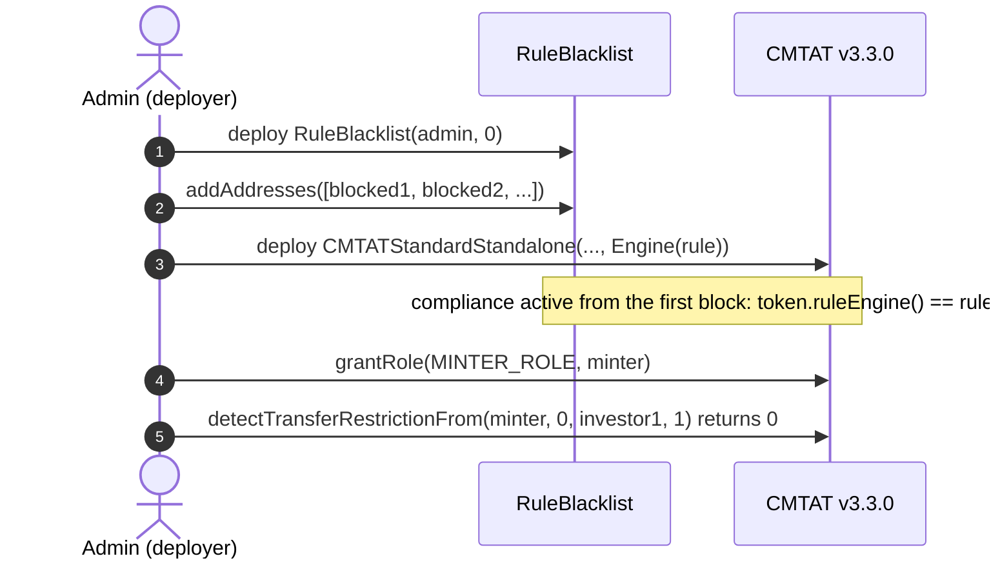

The repository script `script/DeployCMTATWithBlacklist.s.sol` deploys this setup on v3.3.0. See [`DEPLOYMENT_SCRIPTS.md`](./DEPLOYMENT_SCRIPTS.md).

### 4.2 Rule set directly, after deployment

1. **Deploy the token** with `Engine(ruleEngine = address(0))`. Do not mint yet.
2. **Deploy the rule** and fill the blacklist, as in 4.1 steps 1 and 2.
3. **Install it:** `token.setRuleEngine(rule)`, as the token's `DEFAULT_ADMIN_ROLE`. It emits `RuleEngine(rule)` and reverts with `CMTAT_ValidationModule_SameValue` if that rule is already set.
4. **Grant `MINTER_ROLE`**, then check as in 4.1 step 5.

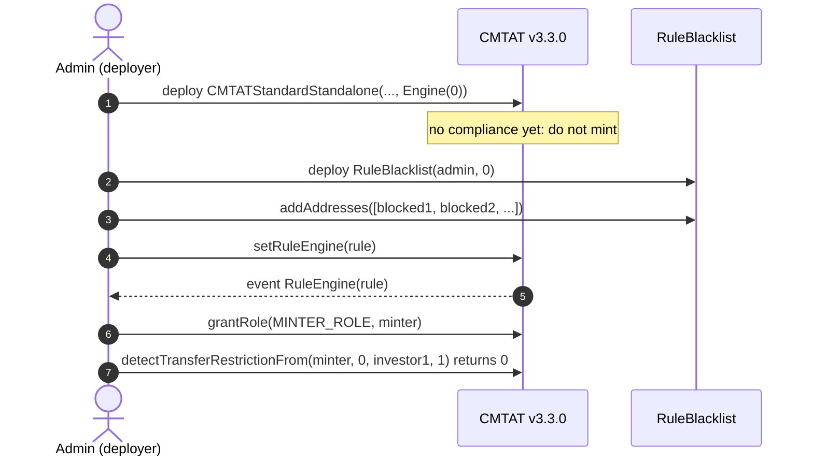

### 4.3 Behind a RuleEngine, at deployment (recommended with other rules)

The token address does not exist yet when the engine is deployed, so the engine is deployed without a token and binds it afterwards. Until that binding, the engine rejects every call from the token (`TokenBinding_UnauthorizedCaller`): no mint or transfer can happen unscreened.

1. **Deploy the RuleEngine:** `RuleEngine(admin, address(0))`.
2. **Deploy the rule**, fill the blacklist, and add it: `engine.addRule(rule)` (`RULES_MANAGEMENT_ROLE`). Add the other rules the same way.
3. **Deploy the token** with `Engine(ruleEngine = engine)`.
4. **Bind the token:** `engine.bindToken(token)` (`COMPLIANCE_MANAGER_ROLE`). From now on the token works.
5. **Grant `MINTER_ROLE`** and check as in 4.1 step 5.

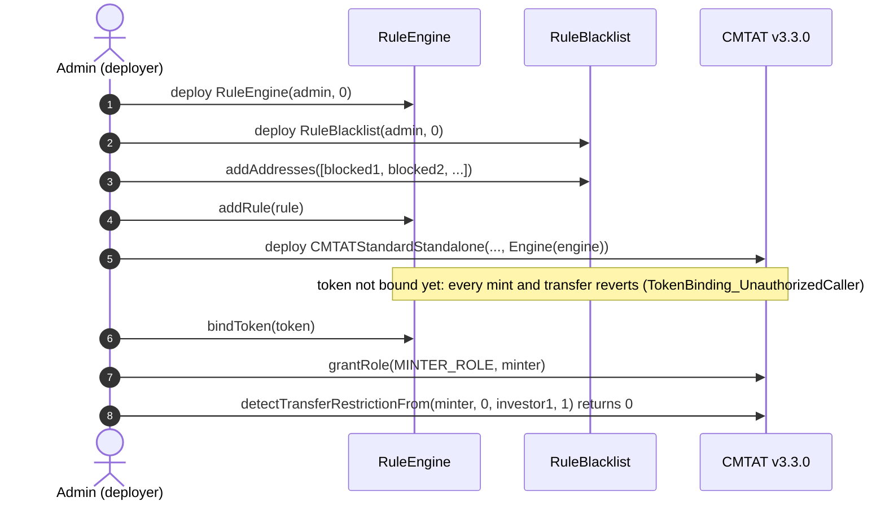

The repository script `script/DeployCMTATWithBlacklistAndSanctionsList.s.sol` deploys this setup with a sanctions list as a second rule.

### 4.4 Behind a RuleEngine, after deployment

1. **Deploy the token** with `Engine(ruleEngine = address(0))`. Do not mint yet.
2. **Deploy the RuleEngine** with the token already known: `RuleEngine(admin, token)` binds it in the constructor.
3. **Deploy the rule**, fill the blacklist, `engine.addRule(rule)`.
4. **Install it:** `token.setRuleEngine(engine)`.
5. **Grant `MINTER_ROLE`** and check as in 4.1 step 5.

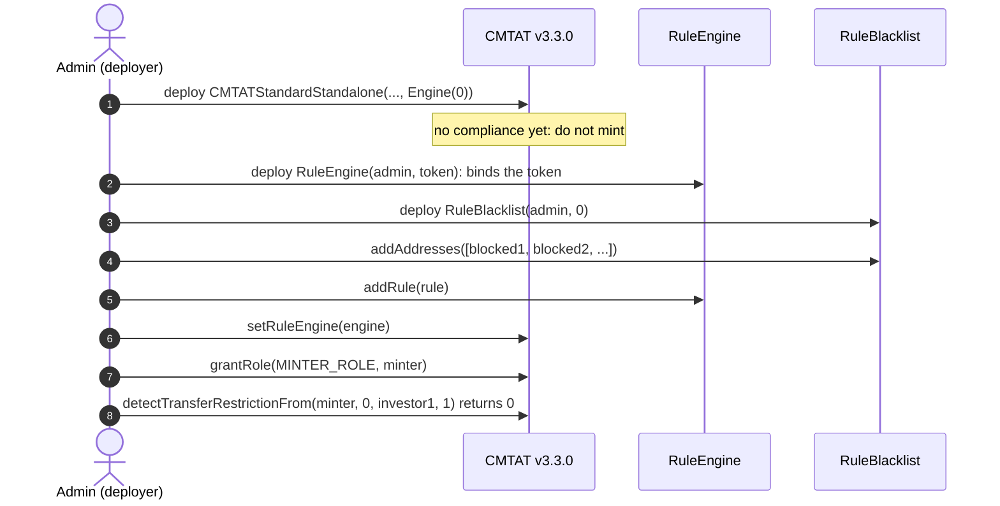

A RuleEngine serving one token is the intended setup. `RuleBlacklist` itself would work for several tokens (it reads no token state), but every token would then share one blacklist.

## 5. Mint workflow

`mint(to, value)` by a `MINTER_ROLE` holder, with the rule active. The token runs its own checks first (contract deactivated, receiver frozen), then notifies the compliance contract **before** creating the tokens, on the 4-argument `transferred(minter, address(0), to, value)`. Pause does not stop a mint. On the Standard variant the call to the compliance contract runs under a transient reentrancy guard.

### 5.1 Rule plugged directly into the token

The token calls `RuleBlacklist` itself: `token.ruleEngine() == rule`.

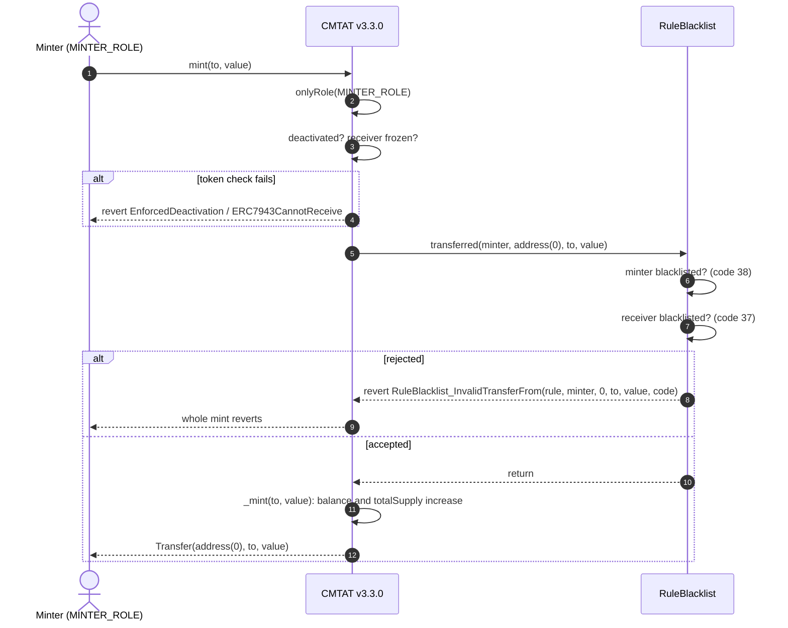

### 5.2 Rule behind a RuleEngine

The token calls the RuleEngine, which accepts only its bound token and then calls each of its rules in order with the same four arguments. The first rule that reverts stops the mint, and the engine passes the revert back to the token.

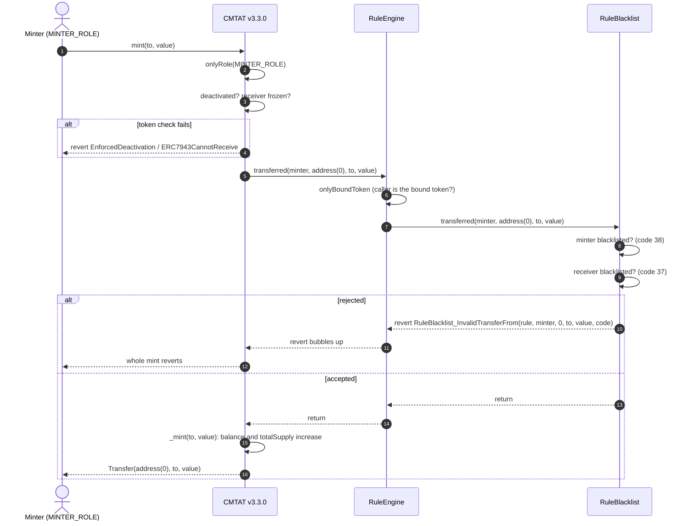

### 5.3 Happy path: a mint to a clean investor

The issuer's minter mints 1,000 tokens to Alice. Neither the minter nor Alice is on the blacklist, the contract is active and Alice is not frozen. The rule is plugged directly into the token; behind a RuleEngine the engine sits between the token and the rule, as in §5.2.

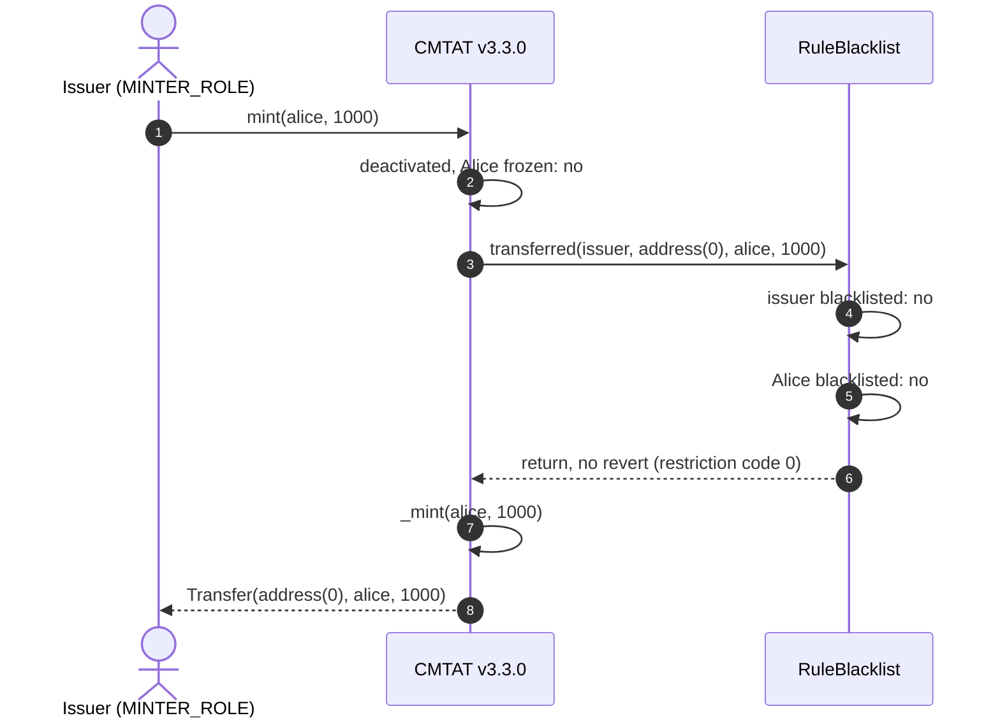

To pre-check a mint without a transaction, ask with the minter: `token.canTransferFrom(minter, address(0), to, value)`, or `detectTransferRestrictionFrom` on the Standard variant. `canTransfer(address(0), to, value)` checks only the receiver, so it answers `true` for a blacklisted minter.

## 6. Transfer and burn workflows

### 6.1 Transfer, rule plugged directly into the token

`transfer(to, value)` by a holder. The token first checks that the tokens are not frozen (active balance), then that the token is not paused and nobody involved is frozen, then notifies the compliance contract **before** moving the balance. A `transfer` has no spender and takes the 3-argument path.

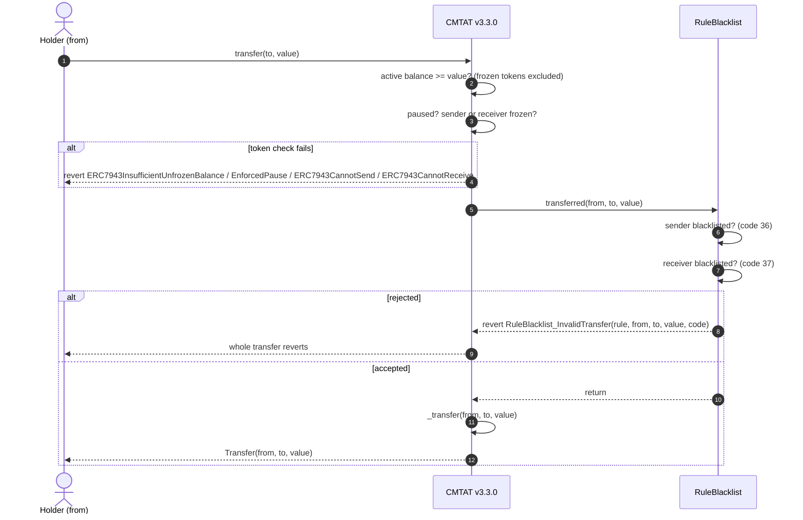

### 6.2 Transfer, rule behind a RuleEngine

Same path through the engine as for a mint (§5.2), on the 3-argument `transferred`.

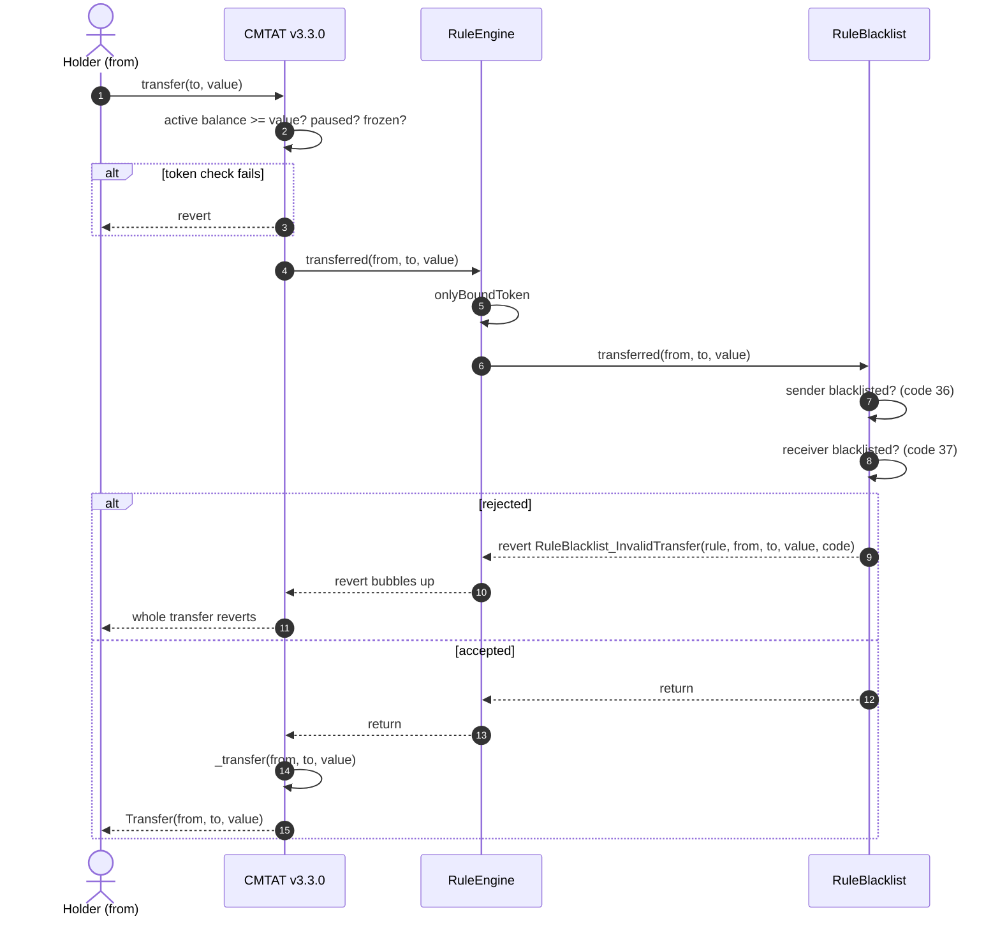

### 6.3 `transferFrom`: the spender is screened

`transferFrom(from, to, value)` by an approved spender takes the 4-argument path, with the caller as spender. The rule checks the spender first. Behind a RuleEngine the engine forwards the same 4-argument call.

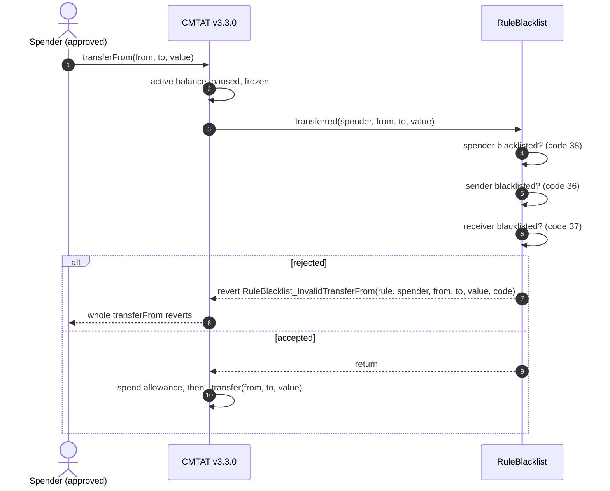

### 6.4 Happy path: a transfer between clean holders

Alice sends 100 tokens to Bob. Neither is blacklisted, Alice holds at least 100 unfrozen tokens, and the token is not paused.

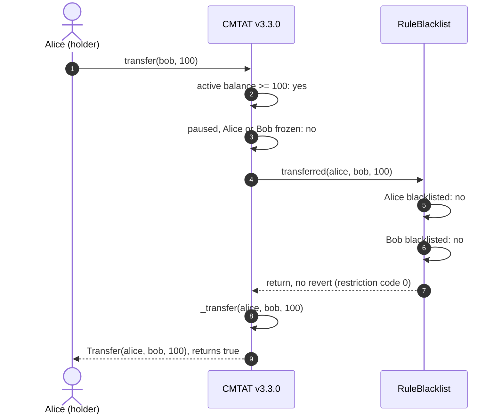

### 6.5 Burn, rule plugged directly into the token

`burn(from, value)` by a `BURNER_ROLE` holder. The token checks the active balance of `from`, that the contract is not deactivated and `from` not frozen, then calls the rule on the 4-argument `transferred(burner, from, address(0), value)`.

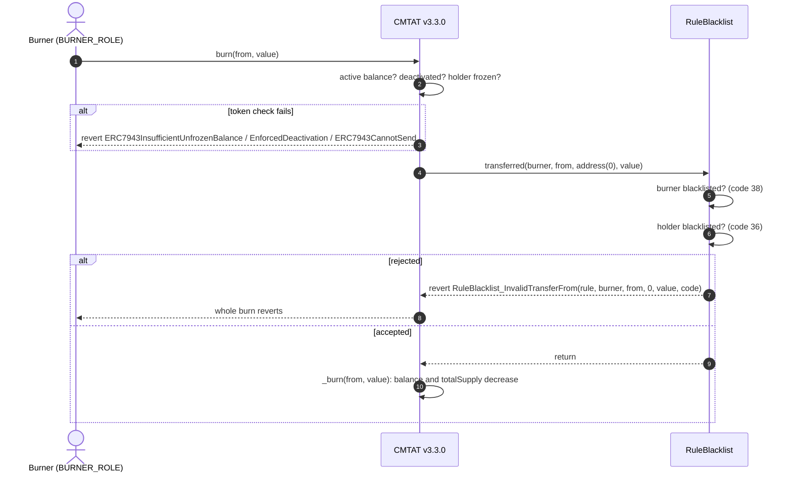

### 6.6 Burn, rule behind a RuleEngine

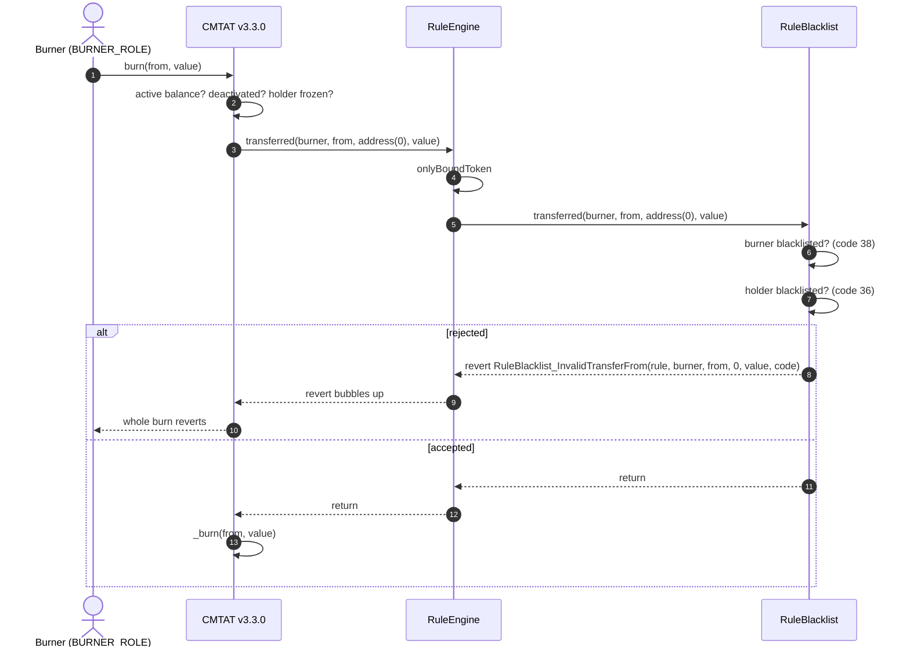

### 6.7 Happy path: a redemption from a clean holder

The issuer burns 50 of Alice's tokens. Neither the issuer's burner nor Alice is blacklisted, Alice is not frozen and holds at least 50 unfrozen tokens.

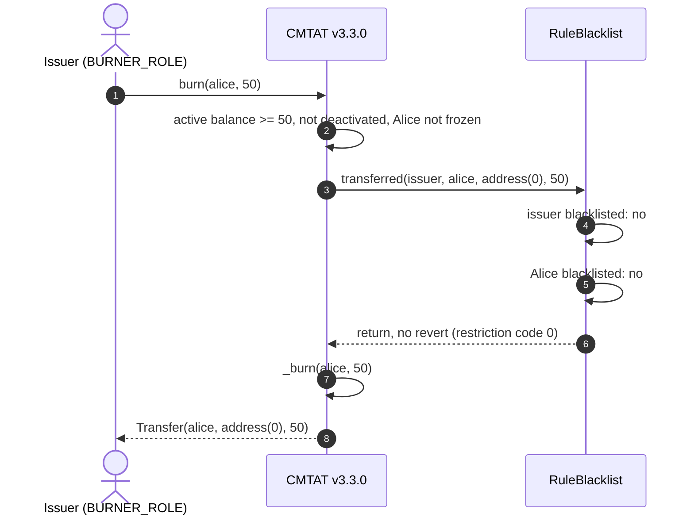

Before sending, a wallet or a front end can ask the same question without a transaction: `token.canTransfer(from, to, value)` and `token.canTransferFrom(spender, from, to, value)` on both variants, and `token.detectTransferRestriction(from, to, value)` / `detectTransferRestrictionFrom(...)` plus `messageForTransferRestriction(code)` on the Standard variant (the Debt variant has no ERC-1404 layer).

## 7. Operating the token

| Task | Call | Role |
| --- | --- | --- |
| Block addresses | `rule.addAddresses([...])` (skips duplicates, reverts on `address(0)`) or `addAddress` (reverts on a duplicate) | `ADDRESS_LIST_ADD_ROLE` (owner on the Ownable2Step variant) |
| Unblock | `rule.removeAddresses([...])` / `removeAddress` | `ADDRESS_LIST_REMOVE_ROLE` (owner) |
| Check an address | `rule.isAddressListed(addr)`, `rule.areAddressesListed([...])`, `rule.listedAddressCount()` | anyone |
| Stop a compromised minter or burner | list it in the rule (immediate, code 38), and revoke its role on the token | `ADDRESS_LIST_ADD_ROLE`; token `DEFAULT_ADMIN_ROLE` |
| Replace the compliance | `token.setRuleEngine(newRuleOrEngine)` | token `DEFAULT_ADMIN_ROLE` |
| Remove the compliance | `token.setRuleEngine(address(0))`: the token becomes unrestricted | token `DEFAULT_ADMIN_ROLE` |

**A blacklisted holder's tokens are locked:** the holder can neither send nor be burned from (code 36) while listed. To move them out use the token's `forcedTransfer(from, to, value)` (`DEFAULT_ADMIN_ROLE`; `to = address(0)` burns), which does not call the compliance contract.

**The token has its own block list.** `token.setAddressFrozen(addr, true)` (`ENFORCER_ROLE`) stops an address on the token itself, with no rule involved. Freezing applies to one token; the blacklist applies to every token that uses the rule.

## 8. Differences from CMTAT v3.0.0

| | v3.0.0 | v3.3.0 |
| --- | --- | --- |
| Constructor `Engine` struct | `{ruleEngine, snapshotEngine, documentEngine}` | `{ruleEngine}` |
| Standard standalone contract | `CMTATStandalone` | `CMTATStandardStandalone` |
| How mint and burn call the rule | 3-argument `transferred`, no minter / burner | 4-argument `transferred`, minter / burner as `spender` |
| Blacklisted minter or burner | **not screened**: mints and burns go through | rejected with code 38 |
| Mint or burn rejected by the rule | `RuleBlacklist_InvalidTransfer` | `RuleBlacklist_InvalidTransferFrom` |
| Pre-check of a mint | `canTransfer(address(0), to, value)` is complete | use `canTransferFrom(minter, address(0), to, value)` to include the minter |
| Token-side check fails (frozen, paused, deactivated) | `CMTAT_InvalidTransfer` | the specific error: `ERC7943CannotSend` / `ERC7943CannotReceive`, `EnforcedPause`, `EnforcedDeactivation` |
| Reentrancy guard around the compliance call | none | transient guard on the Standard variant |

Transfers and `transferFrom` behave the same on both versions. See [`RULE_SEMANTICS.md`](./RULE_SEMANTICS.md) §7 for the other rules.

See also: [`RuleBlacklist.md`](../contracts/RuleBlacklist.md) for the full rule reference.
