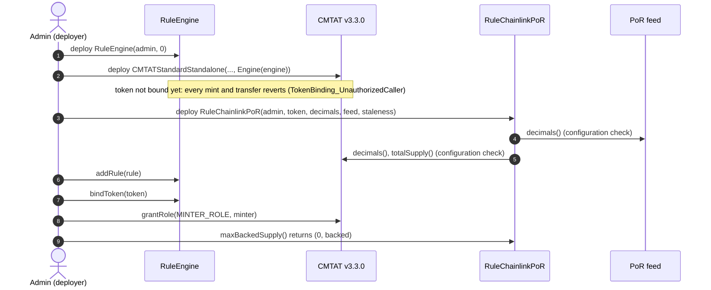
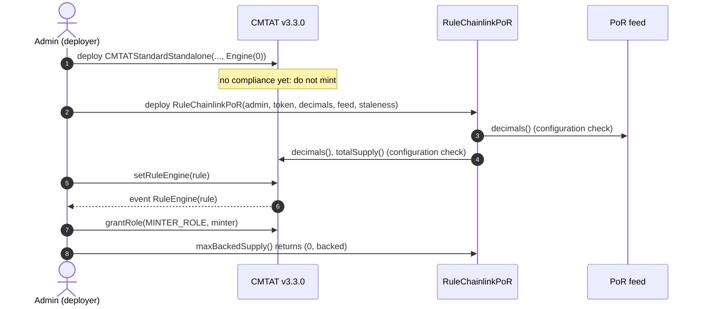
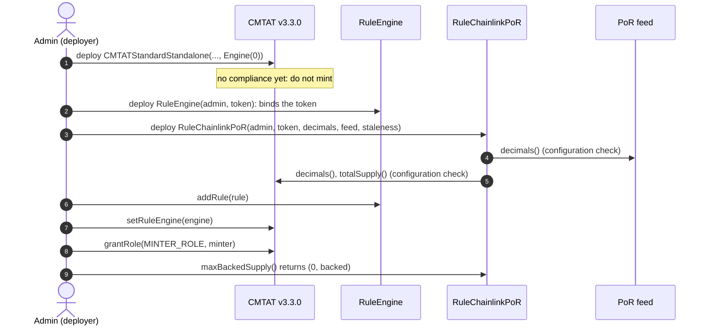
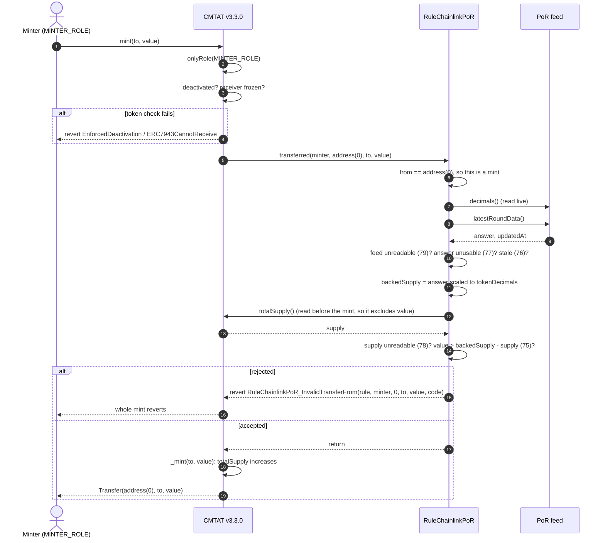
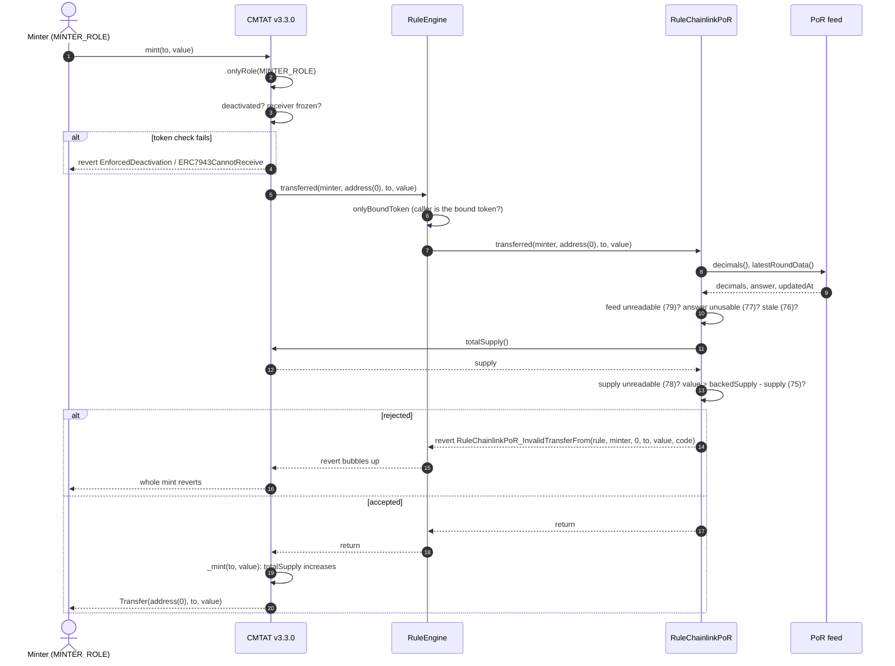
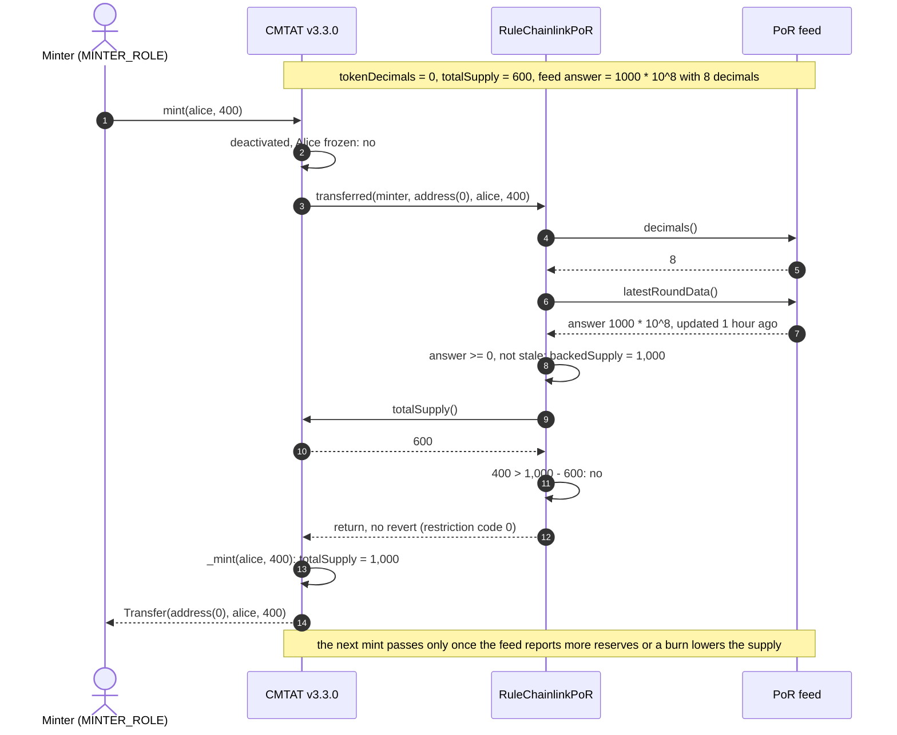
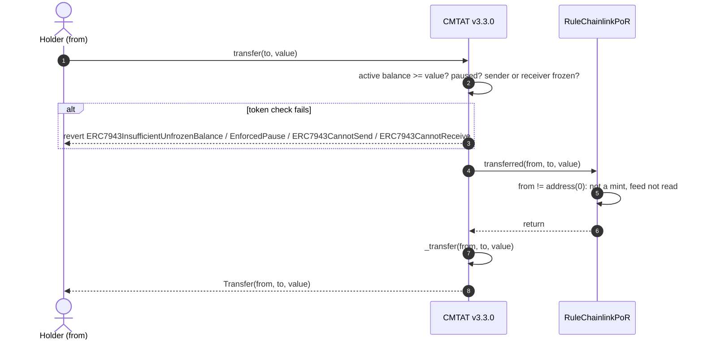
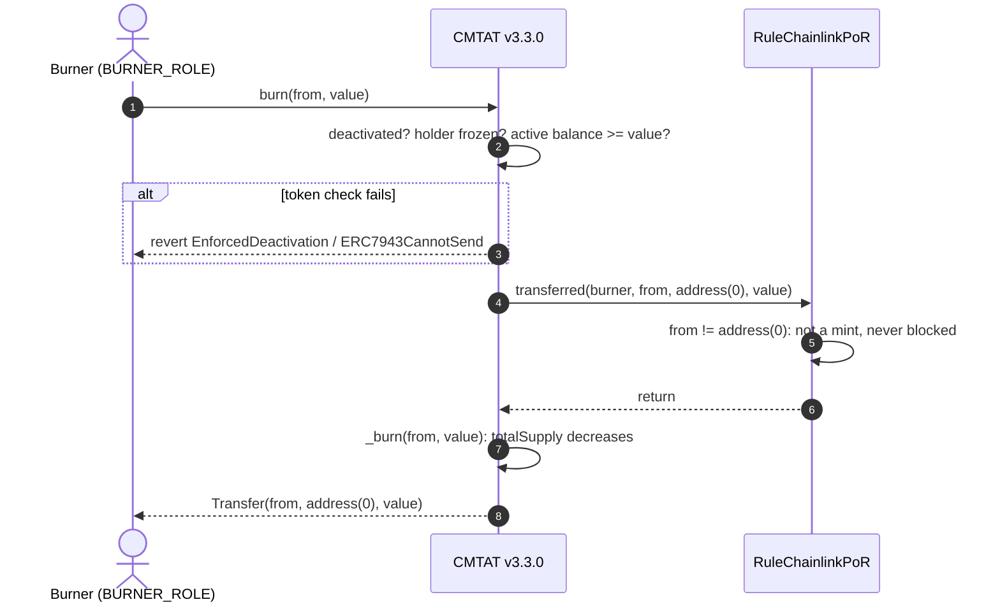

# Deploy `RuleChainlinkPoR` with a CMTAT v3.3.0 token

<!-- toc -->

- [1. What the rule enforces](#1-what-the-rule-enforces)
- [2. Choose the setup](#2-choose-the-setup)
- [3. Contracts and roles](#3-contracts-and-roles)
- [4. Deployment steps](#4-deployment-steps)
  - [4.1 Behind a RuleEngine, set at deployment (recommended)](#41-behind-a-ruleengine-set-at-deployment-recommended)
  - [4.2 Rule set directly, after deployment](#42-rule-set-directly-after-deployment)
  - [4.3 Behind a RuleEngine, after deployment](#43-behind-a-ruleengine-after-deployment)
- [5. Mint workflow](#5-mint-workflow)
  - [5.1 Rule plugged directly into the token](#51-rule-plugged-directly-into-the-token)
  - [5.2 Rule behind a RuleEngine](#52-rule-behind-a-ruleengine)
  - [5.3 Happy path: a mint backed by the reserves](#53-happy-path-a-mint-backed-by-the-reserves)
- [6. Transfer and burn workflows](#6-transfer-and-burn-workflows)
  - [6.1 Transfer](#61-transfer)
  - [6.2 Burn](#62-burn)
- [7. Operating the token](#7-operating-the-token)
- [8. Differences from CMTAT v3.0.0](#8-differences-from-cmtat-v300)

<!-- /toc -->

This guide deploys a CMTAT **v3.3.0** token whose total supply can never be minted above the reserves reported by a Chainlink Proof of Reserve feed, enforced by `RuleChainlinkPoR`. It covers:

- what the rule needs before it can be deployed: the token, the feed and a staleness threshold;
- where the rule sits: on the token directly, or inside a RuleEngine;
- when it can be installed, given that the rule needs the token's address;
- what happens on a mint, a transfer and a burn once it is active.

v3.3.0 is not final yet: this library is validated against **`v3.3.0-rc4`**, the version pinned in `lib/CMTAT`, and every statement below was checked against that code. For the last audited release, see the [v3.0.0 guide](./DEPLOY_RULE_CHAINLINK_POR_CMTAT_V3.0.0.md); [§8](#8-differences-from-cmtat-v300) lists what differs.

`RuleChainlinkPoRERC3643` exists for ERC-3643 tokens, which notify compliance after the mint; it is not for CMTAT and is not covered here.

Every setup below is tested against a real v3.3.0-rc4 token (Standard variant), with a mock feed (`AggregatorV3Mock`):

- `test/RuleChainlinkPoR/RuleChainlinkPoRCMTATDeployment.t.sol`: RuleEngine passed in the token constructor and token bound last (setup 4.1), rule set directly on the token after deployment (setup 4.2) with a stale feed that blocks mints but not transfers or burns, and the rule refusing token decimals that do not match the token;
- `test/RuleChainlinkPoR/CMTATIntegration.t.sol`: rule behind a RuleEngine set after deployment (setup 4.3): mint up to the reserves, mint above them, a reserve increase that unlocks a mint, a stale feed, and the engine's restriction views.

## 1. What the rule enforces

| Operation | Checked by `RuleChainlinkPoR` | Rejected with |
| --- | --- | --- |
| Mint of `value` | `totalSupply() + value <= backedSupply`, where `backedSupply` is the feed's latest answer scaled to the token's decimals, and `totalSupply()` is read from the token before the mint | 75 (reserves exceeded), 76 (feed stale), 77 (answer unusable), 78 (`totalSupply()` unreadable), 79 (feed unreadable) |
| Transfer, `transferFrom` | nothing: the supply does not change | never |
| Burn | nothing, and the burn frees room for a later mint | never |

The limit equals the reported reserves **exactly**: there is no margin parameter. For a safety cushion or a fixed ceiling, add [`RuleMaxTotalSupply`](./DEPLOY_RULE_MAX_TOTAL_SUPPLY_CMTAT_V3.3.0.md) to the same RuleEngine; the engine applies both.

Every feed failure blocks mints only. A stale, broken or negative feed never stops a transfer or a burn, so holders are never trapped.

On v3.3.0 mint and burn call the rule through the 4-argument `transferred`, with the minter or burner as `spender`. The rule ignores it: it caps supply, not identities.

**Decimals.** The rule scales the feed's answer from the feed's decimals to `tokenDecimals`. The feed's `decimals()` is read again on every check, never cached, so a feed migration that changes its decimals is followed at once. `tokenDecimals` is given at deployment and must equal the token's own `decimals()`, which CMTAT exposes; a mismatch reverts with `RuleChainlinkPoR_TokenDecimalsMismatch`. On a 0-decimal token (a typical CMTAT share) the scaling truncates: an answer of `1000.99999999` backs 1,000 shares, and reserves below one whole unit back nothing.

**Staleness.** `maxStalenessSeconds` is the oldest answer the rule accepts; set it to the feed's heartbeat or slightly above. `0` disables the check.

## 2. Choose the setup

**Where the rule sits.**

| Topology | Token calls | Use it when |
| --- | --- | --- |
| **Direct** | the rule itself (`token.ruleEngine() == rule`) | the reserve check is the only rule |
| **RuleEngine** | a `RuleEngine`, which calls each of its rules | you need several rules (a whitelist, a static cap, a second reserve feed), or want to install the rule with no unscreened window |

**When the rule can be installed.** The rule's constructor takes the token's address and checks that it is a contract whose `totalSupply()` answers and whose `decimals()` matches `tokenDecimals`; it also checks that the feed is a contract whose `decimals()` answers. So the rule can only be deployed **after** the token and the feed, and cannot be passed in the token constructor itself. A RuleEngine can be, and that gives the one setup with no unscreened window:

| Setup | Unscreened window |
| --- | --- |
| **4.1** RuleEngine in the token constructor, rule added, token bound last (recommended) | none: every mint and transfer reverts until the token is bound |
| **4.2** Rule set directly with `setRuleEngine`, after deployment | between the token's deployment and `setRuleEngine`: do not mint |
| **4.3** RuleEngine set with `setRuleEngine`, after deployment | same as 4.2 |

A mint made before the rule is installed is **not lost**: the rule reads the live supply, so it is counted at the next mint. If it already pushed the supply above the reserves, minting stays blocked until burns or new reserves bring the supply back under.

## 3. Contracts and roles

| Contract | Constructor | Roles that matter here |
| --- | --- | --- |
| `RuleChainlinkPoR` (or `RuleChainlinkPoROwnable2Step`) | `(admin, tokenContract, tokenDecimals, reservesFeed, maxStalenessSeconds)`; `tokenContract` must be non-zero, have code and answer `totalSupply()`; `tokenDecimals` at most 18 and equal to the token's `decimals()`; `reservesFeed` must be a contract whose `decimals()` answers with at most 36 | `DEFAULT_ADMIN_ROLE` (`setReservesFeed`, `setTokenMetadata`, `setMaxStalenessSeconds`, roles). The Ownable2Step variant gives all of it to the owner |
| Chainlink Proof of Reserve feed | deployed and run by Chainlink, or any contract implementing `AggregatorV3Interface` | none: the rule only reads `decimals()` and `latestRoundData()` |
| `RuleEngine` (RuleEngine `v3.0.0-rc7`, optional) | `(admin, tokenContract)`; `tokenContract` may be `address(0)` | `RULES_MANAGEMENT_ROLE` (`addRule`), `COMPLIANCE_MANAGER_ROLE` (`bindToken`) |
| CMTAT v3.3.0 `CMTATStandardStandalone` (or `CMTATStandaloneDebt`, or a proxy variant) | `(forwarder, admin, ERC20Attributes, ExtraInformationAttributes, `Engine{ruleEngine}`)`. `CMTATStandaloneDebt` takes no forwarder | `DEFAULT_ADMIN_ROLE` (`setRuleEngine`, all roles), `MINTER_ROLE`, `BURNER_ROLE` |

On both CMTAT and the AccessControl rule, the default admin implicitly holds every role. The rule has no separate operator role: whoever holds its `DEFAULT_ADMIN_ROLE` can repoint the feed, and so decides how much can be minted.

**One rule instance per token.** The rule reads the supply of its configured `tokenContract`, never of the token that triggered the check. One instance added to two RuleEngines checks both tokens against the first token's supply and feed. **One feed per instance:** if the token is backed by several reserve sources, deploy one rule per feed and add them all to the same RuleEngine, so every feed must back the mint.

## 4. Deployment steps

Each setup lists its steps, then draws them as a sequence diagram. The calls are shown from a single admin; in production the rule and minting roles can be held by different addresses (§3). The feed address is taken from Chainlink's list of Proof of Reserve feeds for the target chain.

### 4.1 Behind a RuleEngine, set at deployment (recommended)

1. **Deploy the RuleEngine:** `RuleEngine(admin, address(0))`.
2. **Deploy the token** with `Engine(ruleEngine = engine)`. The engine rejects every call from a token it has not bound, so nothing can be minted or transferred yet.
3. **Deploy the rule:** `RuleChainlinkPoR(admin, token, token.decimals(), feed, heartbeat)`.
4. **Add it:** `engine.addRule(rule)` (`RULES_MANAGEMENT_ROLE`).
5. **Bind the token last:** `engine.bindToken(token)` (`COMPLIANCE_MANAGER_ROLE`). From now on the token works, and the reserve check holds from the first mint.
6. **Grant `MINTER_ROLE`** to the issuer's minting address, if it is not the admin.
7. **Check the setup:** `rule.maxBackedSupply()` returns `(0, backed)` with the reserves you expect in token units; on the Standard variant, `token.detectTransferRestriction(address(0), investor, backed + 1)` returns 75.

### 4.2 Rule set directly, after deployment

1. **Deploy the token** with `Engine(ruleEngine = 0)`. Do not mint yet.
2. **Deploy the rule:** `RuleChainlinkPoR(admin, token, token.decimals(), feed, heartbeat)`.
3. **Install it:** `token.setRuleEngine(rule)`, as the token's `DEFAULT_ADMIN_ROLE`. It emits `RuleEngine(rule)` and reverts with `CMTAT_ValidationModule_SameValue` if that rule is already set.
4. **Grant `MINTER_ROLE`**, then check as in 4.1 step 7.

### 4.3 Behind a RuleEngine, after deployment

1. **Deploy the token** with no engine. Do not mint yet.
2. **Deploy the RuleEngine** with the token already known: `RuleEngine(admin, token)` binds it in the constructor.
3. **Deploy the rule** and add it: `engine.addRule(rule)`.
4. **Install the engine:** `token.setRuleEngine(engine)`.
5. **Grant `MINTER_ROLE`** and check as in 4.1 step 7.

The repository script `script/DeployCMTATWithChainlinkPoR.s.sol` deploys this rule on a v3.3.0 token, set directly on it, in one run. See [`DEPLOYMENT_SCRIPTS.md`](./DEPLOYMENT_SCRIPTS.md).

## 5. Mint workflow

`mint(to, value)` by a `MINTER_ROLE` holder, with the rule active. The token runs its own checks first (contract deactivated, receiver frozen), then notifies the compliance contract **before** creating the tokens, so the supply the rule reads does not include `value` yet. The rule reads the feed, then calls back the token for `totalSupply()`. Pause does not stop a mint. On the Standard variant the call to the compliance contract runs under a transient reentrancy guard.

The feed checks run in this order, and the first failure decides the code: `decimals()` reverts or reports more than 36 (79); `latestRoundData()` reverts (79); the answer is negative, the round incomplete (`updatedAt == 0`) or stamped in the future (77); the answer is older than `maxStalenessSeconds` (76). Then `totalSupply()` reverts (78), and finally the mint exceeds the backed supply (75).

### 5.1 Rule plugged directly into the token

The token calls `RuleChainlinkPoR` itself: `token.ruleEngine() == rule`.

### 5.2 Rule behind a RuleEngine

The token calls the RuleEngine, which accepts only its bound token and then calls each of its rules in order. The first rule that reverts stops the mint, and the engine passes the revert back to the token.

### 5.3 Happy path: a mint backed by the reserves

The same mint when everything passes, with numbers. The token has 0 decimals and a supply of 600. The feed reports 8 decimals and an answer of `1000.00000000`, updated an hour ago, with `maxStalenessSeconds` set to one day. The issuer mints 400 to Alice, which lands exactly on the reserves. The rule is plugged directly into the token; behind a RuleEngine the engine sits between the token and the rule, as in §5.2.

## 6. Transfer and burn workflows

The rule only acts on mints. On a transfer or a burn it returns at once, without reading the feed or the supply, so a stale or broken feed can never trap a holder. The diagrams show the rule plugged directly into the token; behind a RuleEngine the engine sits between them, as in §5.2.

### 6.1 Transfer

### 6.2 Burn

Before minting, a front end can check the limit without a transaction: `rule.maxBackedSupply()` returns `(0, backedSupply)`, or the feed's failure code (76, 77 or 79) with `0`; subtract `token.totalSupply()` to get the room left. On the Standard variant `token.detectTransferRestriction(address(0), to, value)` returns the same code the mint would fail with; the Debt variant has no ERC-1404 layer, so use `token.canTransfer(address(0), to, value)`.

## 7. Operating the token

| Task | Call | Role |
| --- | --- | --- |
| Check the backed supply | `rule.maxBackedSupply()` | anyone |
| Check the feed's current decimals | `rule.feedDecimals()` (forwards the feed's revert, unlike the restriction views) | anyone |
| Change the staleness threshold | `rule.setMaxStalenessSeconds(seconds)`; `0` disables the check | rule `DEFAULT_ADMIN_ROLE` |
| Repoint to a new feed | `rule.setReservesFeed(feed)` | rule `DEFAULT_ADMIN_ROLE` |
| Change the protected token or its decimals | `rule.setTokenMetadata(token, decimals)` | rule `DEFAULT_ADMIN_ROLE` |
| Add a static ceiling | deploy `RuleMaxTotalSupply` and add it to the same RuleEngine | engine `RULES_MANAGEMENT_ROLE` |
| Remove the reserve check | `token.setRuleEngine(address(0))` (direct) or `engine.removeRule(rule)` | token `DEFAULT_ADMIN_ROLE` / engine `RULES_MANAGEMENT_ROLE` |

Each setter emits an event: `ReservesFeedUpdated(feed, feedDecimals)`, `TokenMetadataUpdated(token, decimals)`, `MaxStalenessSecondsUpdated(seconds)`.

Key warnings:

- **A mint fails while the feed is stale or broken.** Codes 76, 77 and 79 tell the operator which: 76 means the feed has not updated within `maxStalenessSeconds`, 77 that a round came back with an unusable answer, 79 that the feed could not be read at all. Transfers and burns keep working.
- **The rule admin decides the mintable amount** by choosing the feed, the decimals and the staleness threshold. Treat the rule's `DEFAULT_ADMIN_ROLE` like `MINTER_ROLE`.
- **Removing the rule lifts the backing requirement,** and nothing on-chain records it. Revoke `MINTER_ROLE` before any planned removal. When the rule is installed again it is checked against the real supply, so supply minted in between is counted.

See also: [`RuleChainlinkPoR.md`](../contracts/RuleChainlinkPoR.md) for the full rule reference: feed handling, decimal scaling, the read-path safety and the restriction codes.

## 8. Differences from CMTAT v3.0.0

| | v3.0.0 | v3.3.0 |
| --- | --- | --- |
| Constructor `Engine` struct | `{ruleEngine, snapshotEngine, documentEngine}` | `{ruleEngine}` |
| Standard standalone contract | `CMTATStandalone` | `CMTATStandardStandalone` |
| How mint and burn call the rule | 3-argument `transferred`, no minter or burner | 4-argument `transferred`, minter or burner as `spender` (ignored by `RuleChainlinkPoR`) |
| Mint rejected by the rule | `RuleChainlinkPoR_InvalidTransfer` | `RuleChainlinkPoR_InvalidTransferFrom` |
| Token-side check fails (frozen, paused, deactivated) | `CMTAT_InvalidTransfer` | the specific error: `ERC7943CannotSend` / `ERC7943CannotReceive`, `EnforcedPause`, `EnforcedDeactivation` |
| Reentrancy guard around the compliance call | none | transient guard on the Standard variant |

What the rule allows is the same on both versions: both notify the compliance contract before `_mint` / `_burn`, which is the accounting the rule assumes, and both expose `decimals()`, which the rule checks against `tokenDecimals`. See [`RULE_SEMANTICS.md`](./RULE_SEMANTICS.md) §7 for the other rules.
