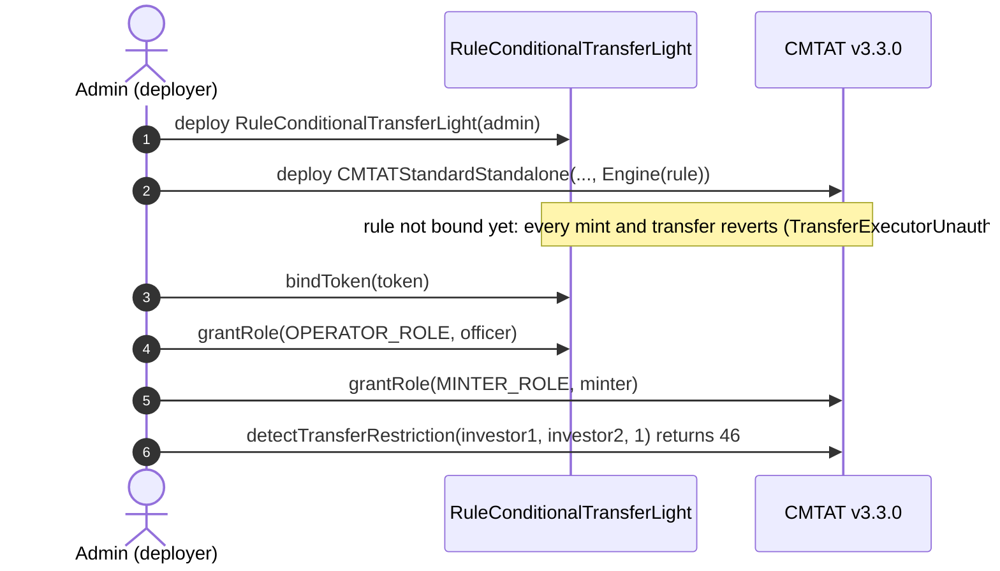
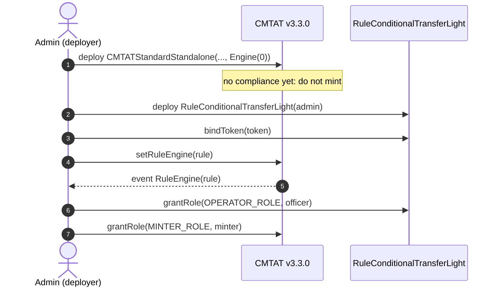
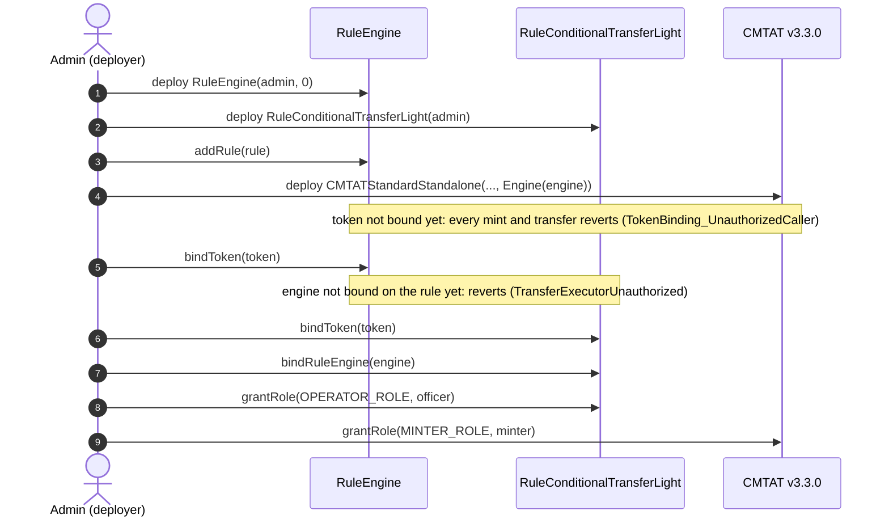
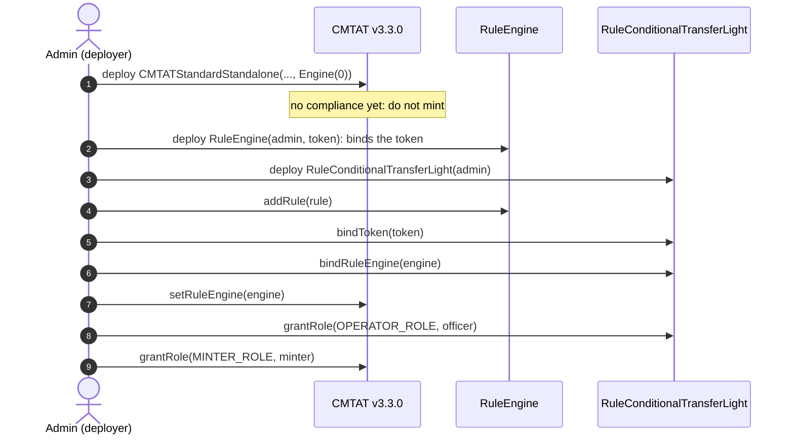
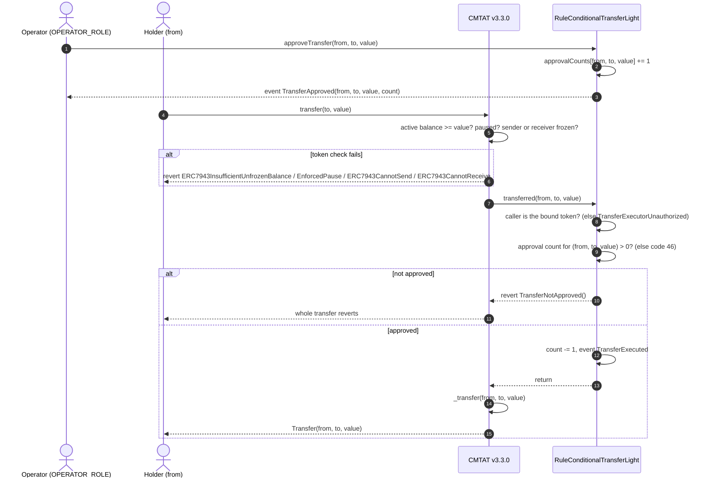
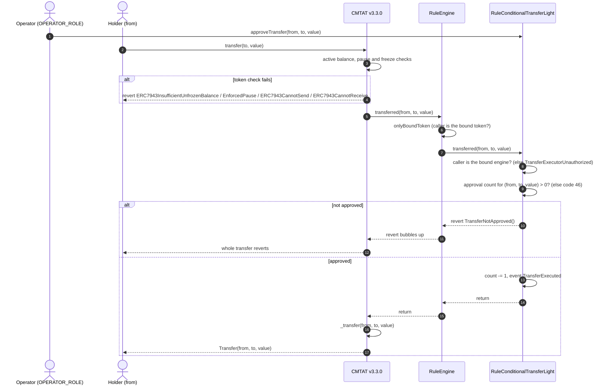
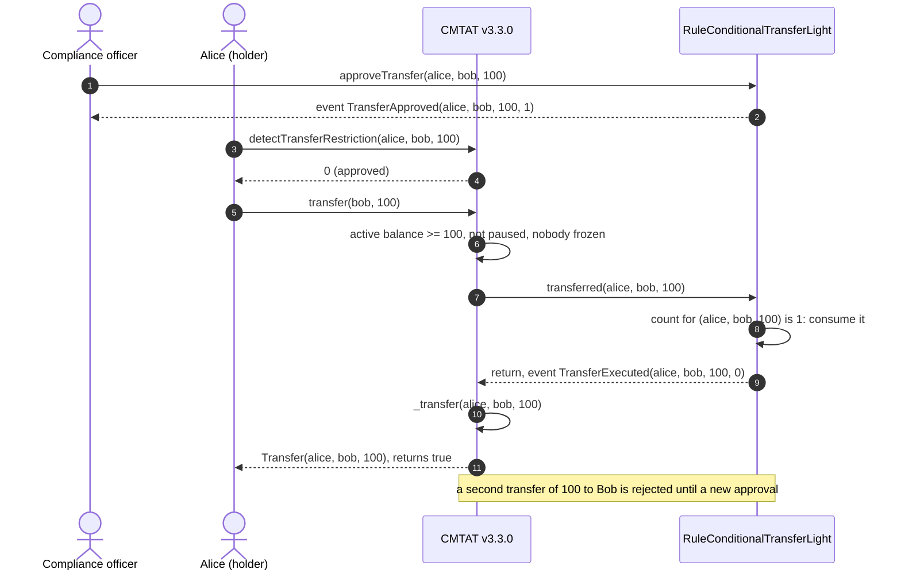
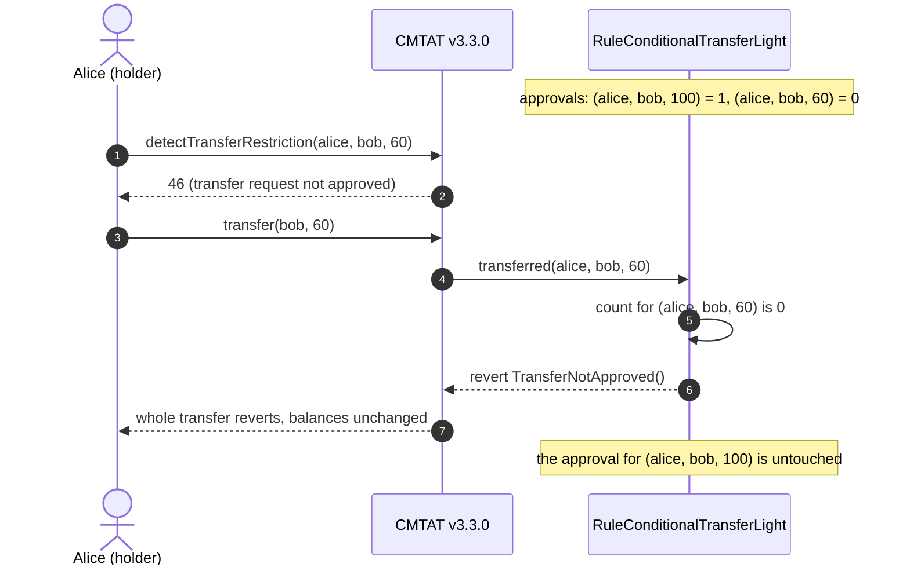
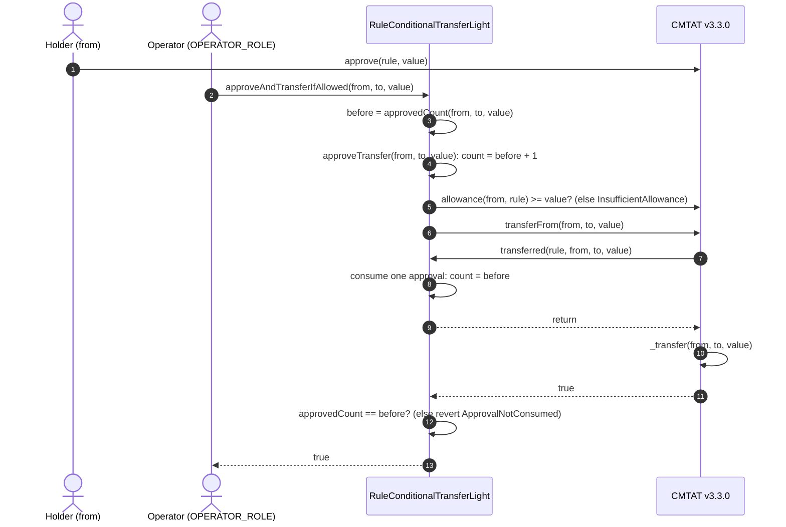
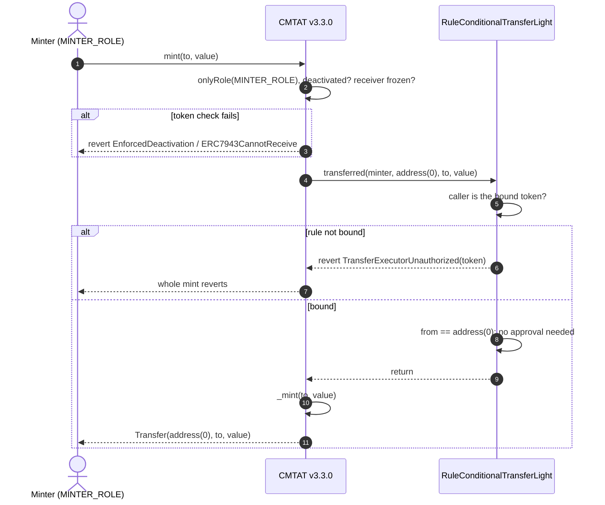

# Deploy `RuleConditionalTransferLight` with a CMTAT v3.3.0 token

[TOC]

This guide deploys a CMTAT **v3.3.0** token on which every transfer needs a prior approval from an operator, enforced by `RuleConditionalTransferLight`. It covers:

- where the rule sits: on the token directly, or inside a RuleEngine;
- when it is installed: in the token constructor, or later with `setRuleEngine`;
- the binding the rule needs before anything moves (`bindToken`, and `bindRuleEngine` behind an engine);
- what happens on an approved transfer, on an unapproved one, on the operator helper `approveAndTransferIfAllowed`, and on mint and burn.

v3.3.0 is not final yet: this library is validated against **`v3.3.0-rc4`**, the version pinned in `lib/CMTAT`, and every statement below was checked against that code. For the last audited release, see the [v3.0.0 guide](./DEPLOY_RULE_CONDITIONAL_TRANSFER_LIGHT_CMTAT_V3.0.0.md); [§8](#8-differences-from-cmtat-v300) lists what differs.

Every setup below is tested against a real v3.3.0-rc4 token (Standard variant):

- `test/RuleConditionalTransferLight/RuleConditionalTransferLightCMTATDeployment.t.sol`: rule passed in the token constructor, rule set directly after deployment, and RuleEngine passed in the token constructor; each blocked until bound, then approved and unapproved transfers, `approveAndTransferIfAllowed` and burn;
- `test/RuleConditionalTransferLight/RuleConditionalTransferLightBindRuleEngine.t.sol`: RuleEngine set after deployment, the engine unauthorised until `bindRuleEngine`, and `approveAndTransferIfAllowed` behind the engine;
- `test/RuleConditionalTransferLight/RuleConditionalTransferLightApproveAndTransfer.t.sol`: the helper's post-condition, against a mock ERC-20 rather than CMTAT.

## 1. What the rule enforces

The rule keeps a counter of approvals per `(from, to, value)`. An operator raises it with `approveTransfer`; each executed transfer of exactly that tuple lowers it by one.

| Operation | Checked by `RuleConditionalTransferLight` | Rejected with |
| --- | --- | --- |
| Transfer `from → to` of `value` | an approval exists for `(from, to, value)`; one is consumed | 46 (not approved) |
| `transferFrom` by a spender | the same: the spender is ignored, any spender consumes the approval for `(from, to, value)` | 46 |
| Mint to `to` | no approval needed | never by the approval check |
| Burn from `from` | no approval needed | never by the approval check |
| Any operation while the rule has no bound caller | the caller is neither the bound token nor the bound RuleEngine | 85 (views), revert on the write path |

Mint and burn are exempt from approvals, but **not from binding**: the rule's `transferred` checks its caller before it looks at the addresses, so until the rule is bound to the token (or to the RuleEngine that calls it) every mint, burn and transfer reverts with `RuleConditionalTransferLight_TransferExecutorUnauthorized(caller)`.

The approval is matched on the exact value: an approval for 100 does not cover a transfer of 60, and two transfers of 50 need two approvals for 50.

On v3.3.0, mint and burn call the rule through the 4-argument `transferred(spender, from, to, value)` with the minter or burner as `spender`. The rule ignores the spender on every path, so it does not screen the minter: who may mint is decided by the token's `MINTER_ROLE`.

**Error names.** A missing approval reverts with `TransferNotApproved()` on both the 3- and the 4-argument path; this rule has no `..._InvalidTransfer` error. An unbound caller reverts with `RuleConditionalTransferLight_TransferExecutorUnauthorized(caller)`.

## 2. Choose the setup

**Where the rule sits.**

| Topology | Token calls | Bindings on the rule | Use it when |
| --- | --- | --- | --- |
| **Direct** | the rule itself (`token.ruleEngine() == rule`) | `bindToken(token)` | the approval rule is the only rule |
| **RuleEngine** | a `RuleEngine`, which calls each of its rules | `bindToken(token)` **and** `bindRuleEngine(engine)` | you need other rules too (for example a whitelist), or want to add rules later |

Behind an engine the engine, not the token, calls `transferred`, so the rule must also authorise the engine with `bindRuleEngine`. `bindToken(token)` is still needed: it names the ERC-20 that `approveAndTransferIfAllowed` moves. Both bindings accept one address at a time: a second `bindToken` reverts with `RuleConditionalTransferLight_TokenAlreadyBound` and a second `bindRuleEngine` with `RuleConditionalTransferLight_RuleEngineAlreadyBound`, until the first is unbound.

**One token per rule, and one token per engine.** Approvals are keyed `(from, to, value)` with no token in the key. An engine that serves several tokens relays all of them into the same counters, so an approval given for token A is consumed by a transfer of the same tuple on token B. Bind this rule only to an engine serving this one token; for several tokens deploy [`RuleConditionalTransferLightMultiToken`](./DEPLOY_RULE_CONDITIONAL_TRANSFER_LIGHT_MULTI_TOKEN_CMTAT_V3.3.0.md) set directly on each token.

**When the rule is installed.**

| Setup | Unscreened window |
| --- | --- |
| **4.1** Rule set directly, at deployment (recommended for this rule alone) | none: until `bindToken`, every mint and transfer reverts |
| **4.2** Rule set directly, after deployment | between the token's deployment and `setRuleEngine`: do not mint |
| **4.3** Behind a RuleEngine, at deployment (recommended with other rules) | none: the engine rejects the token until `engine.bindToken`, then the rule rejects the engine until `bindRuleEngine` |
| **4.4** Behind a RuleEngine, after deployment | same as 4.2 |

Installing at deployment is recommended. The rule needs no token address in its constructor, so it can be deployed first and passed in the token constructor; the binding comes after the token exists, and the rule blocks everything until then.

## 3. Contracts and roles

| Contract | Constructor | Roles that matter here |
| --- | --- | --- |
| `RuleConditionalTransferLight` | `(admin)` | `OPERATOR_ROLE` (`approveTransfer`, `cancelTransferApproval`, `resetApproval`, `approveAndTransferIfAllowed`), `COMPLIANCE_MANAGER_ROLE` (`bindToken`, `unbindToken`, `bindRuleEngine`, `unbindRuleEngine`), `DEFAULT_ADMIN_ROLE` (all roles) |
| `RuleConditionalTransferLightOwnable2Step` | `(owner)` | the owner does everything above; ownership moves in two steps (`transferOwnership`, `acceptOwnership`) |
| `RuleEngine` (RuleEngine `v3.0.0-rc7`, optional) | `(admin, tokenContract)`; `tokenContract` may be `address(0)` | `RULES_MANAGEMENT_ROLE` (`addRule`), `COMPLIANCE_MANAGER_ROLE` (`bindToken`) |
| CMTAT v3.3.0 `CMTATStandardStandalone` (or `CMTATStandaloneDebt`, or a proxy variant) | `(forwarder, admin, ERC20Attributes, ExtraInformationAttributes, Engine{ruleEngine})`. `CMTATStandaloneDebt` takes no forwarder | `DEFAULT_ADMIN_ROLE` (`setRuleEngine`, `forcedTransfer`, all roles), `MINTER_ROLE`, `BURNER_ROLE` |

On CMTAT and on the AccessControl rule, the default admin implicitly holds every role. In production give `OPERATOR_ROLE` to the compliance officer who reviews transfer requests, and keep `COMPLIANCE_MANAGER_ROLE` with the admin: whoever controls the bindings decides which contract may consume approvals.

## 4. Deployment steps

Each setup lists its steps, then draws them as a sequence diagram. The calls are shown from a single admin; in production the operator, binding and minting roles can be held by different addresses (§3).

### 4.1 Rule set directly, at deployment (recommended for this rule alone)

1. **Deploy the rule:** `RuleConditionalTransferLight(admin)`. It needs no token address.
2. **Deploy the token** with `Engine(ruleEngine = rule)`. The rule is not bound yet: every mint and transfer reverts, and `token.detectTransferRestriction(from, to, value)` returns 85.
3. **Bind the token:** `rule.bindToken(token)` (`COMPLIANCE_MANAGER_ROLE`). From now on mints and burns pass, and transfers need an approval.
4. **Grant `OPERATOR_ROLE`** on the rule to the compliance officer, and **`MINTER_ROLE`** on the token to the issuer's minting address, if they are not the admin.
5. **Check the setup:** `rule.getTokenBound() == token`, `rule.isTransferExecutor(token)` is `true`, and on the Standard variant `token.detectTransferRestriction(investor1, investor2, 1)` returns 46.

### 4.2 Rule set directly, after deployment

1. **Deploy the token** with `Engine(ruleEngine = address(0), ...)`. Do not mint yet.
2. **Deploy the rule** and **bind the token:** `RuleConditionalTransferLight(admin)`, then `rule.bindToken(token)`.
3. **Install it:** `token.setRuleEngine(rule)`, as the token's `DEFAULT_ADMIN_ROLE`. It emits `RuleEngine(rule)` and reverts with `CMTAT_ValidationModule_SameValue` if that rule is already set.
4. **Grant the roles** and check as in 4.1 steps 4 and 5.

Binding before `setRuleEngine` means the token works as soon as the rule is installed. The reverse order also works, but every operation reverts between the two calls.

### 4.3 Behind a RuleEngine, at deployment (recommended with other rules)

The token address does not exist yet when the engine is deployed, so the engine is deployed without a token and binds it afterwards. Two gates then hold until the last step: the engine rejects the token until `engine.bindToken`, and the rule rejects the engine until `rule.bindRuleEngine`.

1. **Deploy the RuleEngine:** `RuleEngine(admin, address(0))`.
2. **Deploy the rule** and add it: `engine.addRule(rule)` (`RULES_MANAGEMENT_ROLE`).
3. **Deploy the token** with `Engine(ruleEngine = engine, ...)`.
4. **Bind the token to the engine:** `engine.bindToken(token)` (engine `COMPLIANCE_MANAGER_ROLE`).
5. **Bind the rule:** `rule.bindToken(token)` and `rule.bindRuleEngine(engine)` (rule `COMPLIANCE_MANAGER_ROLE`). From now on the token works.
6. **Grant the roles** and check as in 4.1 steps 4 and 5; also `rule.isTransferExecutor(engine)` is `true`.

### 4.4 Behind a RuleEngine, after deployment

1. **Deploy the token** with `Engine(ruleEngine = address(0), ...)`. Do not mint yet.
2. **Deploy the RuleEngine** with the token already known: `RuleEngine(admin, token)` binds it in the constructor.
3. **Deploy the rule**, `engine.addRule(rule)`, then `rule.bindToken(token)` and `rule.bindRuleEngine(engine)`.
4. **Install the engine:** `token.setRuleEngine(engine)`.
5. **Grant the roles** and check as in 4.3 step 6.

If `bindRuleEngine` is forgotten, nothing on the read path shows it: the views return 46 or 0 as usual (code 85 appears only when neither a token nor an engine is bound), but every mint, burn and transfer reverts with `RuleConditionalTransferLight_TransferExecutorUnauthorized(engine)`. A test mint after step 4 catches it.

## 5. Transfer workflows

`transfer(to, value)` by a holder. The token first checks its own conditions (active balance, pause, frozen addresses), then notifies the compliance contract **before** moving the balance, on the 3-argument `transferred(from, to, value)`. A `transferFrom` takes the 4-argument path with the caller as spender; the rule ignores the spender, so the diagrams below apply unchanged.

### 5.1 Operator approval, then transfer: rule plugged directly into the token

The two steps happen in separate transactions. The operator reviews the request off-chain and records the approval; the holder then sends the transfer.

### 5.2 Operator approval, then transfer: rule behind a RuleEngine

The token calls the RuleEngine, which accepts only its bound token and then calls each of its rules in order. The rule accepts the engine because of `bindRuleEngine`. The first rule that reverts stops the transfer, and the engine passes the revert back to the token.

### 5.3 Happy path: an approved transfer of 100

Alice asks to send 100 tokens to Bob. The compliance officer approves it, Alice holds at least 100 unfrozen tokens, and the token is not paused. The rule is plugged directly into the token; behind a RuleEngine the engine sits between the token and the rule, as in §5.2.

### 5.4 Rejected: a transfer nobody approved

Alice sends 60 to Bob while the only approval is for 100. The tuple `(alice, bob, 60)` has no approval, so the rule reverts and the whole transfer is undone.

### 5.5 Operator helper: `approveAndTransferIfAllowed`

The operator can approve and execute in one call. The rule acts as the ERC-20 spender, so the holder must first `approve(rule, value)` on the token. Steps:

1. The rule reads the bound token (`RuleConditionalTransferLight_TokenNotBound` if none) and the current approval count for `(from, to, value)`.
2. It records one approval **before** calling the token. This inverts checks-effects-interactions on purpose: the approval must exist when the token calls back into the rule during the transfer.
3. It checks the holder's allowance to the rule (`RuleConditionalTransferLight_InsufficientAllowance` if too low) and calls `token.transferFrom(from, to, value)` through `SafeERC20`.
4. The token runs the transfer and calls `transferred(rule, from, to, value)` (4-argument path, the rule as spender), which consumes the approval.
5. **Post-condition:** the approval count must be back to its value from step 1, else the call reverts with `RuleConditionalTransferLight_ApprovalNotConsumed`. That happens when the rule received no callback (wrong binding, a RuleEngine not bound with `bindRuleEngine`), and it prevents a leftover approval that would authorise a later, unapproved transfer of the same tuple. The operator's own pending approvals for that tuple are left as they were.

It works in both topologies, provided the token is bound with `bindToken` (behind an engine, `bindRuleEngine` too). The diagram shows the direct topology; behind a RuleEngine the token calls the engine at step 7, which calls the rule.

## 6. Mint and burn workflow

Mint and burn need no approval. On v3.3.0 both call the rule through the 4-argument `transferred` with the minter or burner as `spender` (`from == address(0)` for a mint, `to == address(0)` for a burn); the rule checks its caller, sees the zero address and returns without touching any counter. Pause does not stop a mint or a burn. On the Standard variant the call to the compliance contract runs under a transient reentrancy guard. The diagram shows the rule plugged directly into the token; behind a RuleEngine the engine sits between them, and the caller check is on the engine.

A burn takes the same path with `transferred(burner, from, address(0), value)`. To screen who may receive newly minted tokens, add a whitelist rule next to this one in a RuleEngine (§4.3).

## 7. Operating the token

| Task | Call | Role |
| --- | --- | --- |
| Approve a transfer request | `rule.approveTransfer(from, to, value)`; call it n times for n identical transfers | rule `OPERATOR_ROLE` |
| Withdraw one approval | `rule.cancelTransferApproval(from, to, value)` (reverts with `TransferApprovalNotFound` if none) | rule `OPERATOR_ROLE` |
| Withdraw all approvals for a tuple | `rule.resetApproval(from, to, value)`, returns the count cleared | rule `OPERATOR_ROLE` |
| Approve and execute in one call | `rule.approveAndTransferIfAllowed(from, to, value)`, after the holder's `approve(rule, value)` | rule `OPERATOR_ROLE` |
| Check pending approvals | `rule.approvedCount(from, to, value)` | anyone |
| Pre-check a transfer | `token.canTransfer(from, to, value)`; on the Standard variant `token.detectTransferRestriction(from, to, value)` | anyone |
| Move a token from a blocked holder | `token.forcedTransfer(from, to, value)`: does not call the compliance contract, consumes no approval | token `DEFAULT_ADMIN_ROLE` |
| Change the token | `rule.unbindToken(old)`, `rule.resetApproval(...)` for old tuples, then `rule.bindToken(new)` | rule `COMPLIANCE_MANAGER_ROLE`, `OPERATOR_ROLE` |
| Remove the rule | `token.setRuleEngine(address(0))` (direct) or `engine.removeRule(rule)` | token `DEFAULT_ADMIN_ROLE` / engine `RULES_MANAGEMENT_ROLE` |

Key warnings:

- **Unbinding does not clear approvals.** `unbindToken` and `unbindRuleEngine` leave `approvalCounts` in storage; a token or engine bound later can consume them. Clear old tuples with `resetApproval` before rebinding, and call `unbindRuleEngine` when the engine changes.
- **A transfer of 0 needs an approval too.** The rule does not treat `value == 0` as a no-op, so an unapproved zero-value transfer reverts.
- **The ERC-1404 views read the approval state only.** They report 46 or 0 from the counters, and 85 only when neither a token nor an engine is bound; a rule bound to the token but not to its engine still reports 0 for an approved tuple while the transfer reverts.

See also: [`RuleConditionalTransferLight.md`](../contracts/RuleConditionalTransferLight.md) for the full rule reference, and [`RULE_SEMANTICS.md`](./RULE_SEMANTICS.md) for the per-rule semantics.

## 8. Differences from CMTAT v3.0.0

| | v3.0.0 | v3.3.0 |
| --- | --- | --- |
| Constructor `Engine` struct | `{ruleEngine, snapshotEngine, documentEngine}` | `{ruleEngine}` |
| Standard standalone contract | `CMTATStandalone` | `CMTATStandardStandalone` |
| How mint and burn call the rule | 3-argument `transferred`, no minter or burner | 4-argument `transferred`, minter or burner as `spender` (ignored by this rule) |
| Transfer rejected by the rule | `TransferNotApproved()` | `TransferNotApproved()`, unchanged |
| Token-side check fails (frozen, paused, deactivated) | `CMTAT_InvalidTransfer` | the specific error: `ERC7943CannotSend` / `ERC7943CannotReceive`, `EnforcedPause`, `EnforcedDeactivation` |
| Reentrancy guard around the compliance call | none | transient guard on the Standard variant; `approveAndTransferIfAllowed` enters the token once, so it is not affected |

What the rule allows is the same on both versions: transfers and `transferFrom` need an approval, mint and burn do not, and the binding gates every operation.

See also: [`RuleConditionalTransferLight.md`](../contracts/RuleConditionalTransferLight.md) for the full rule reference.
