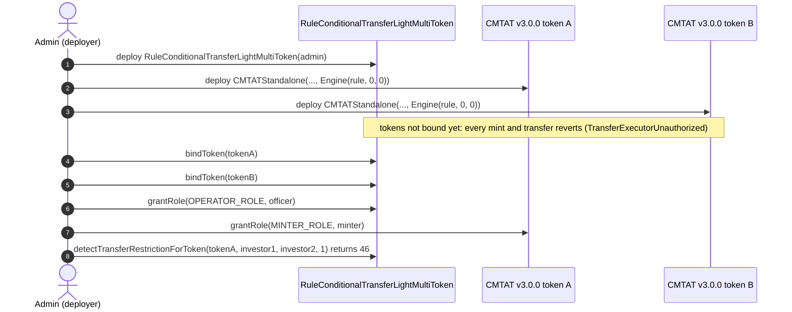
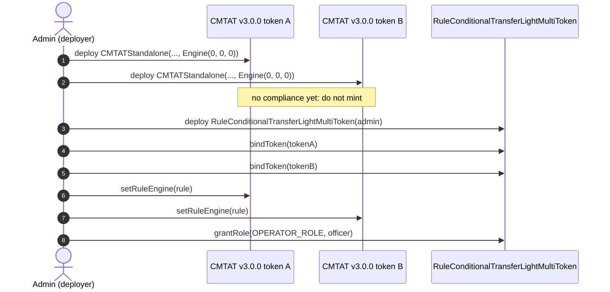
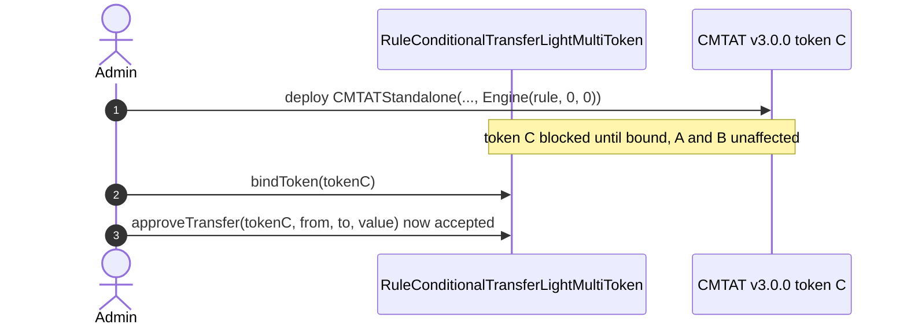
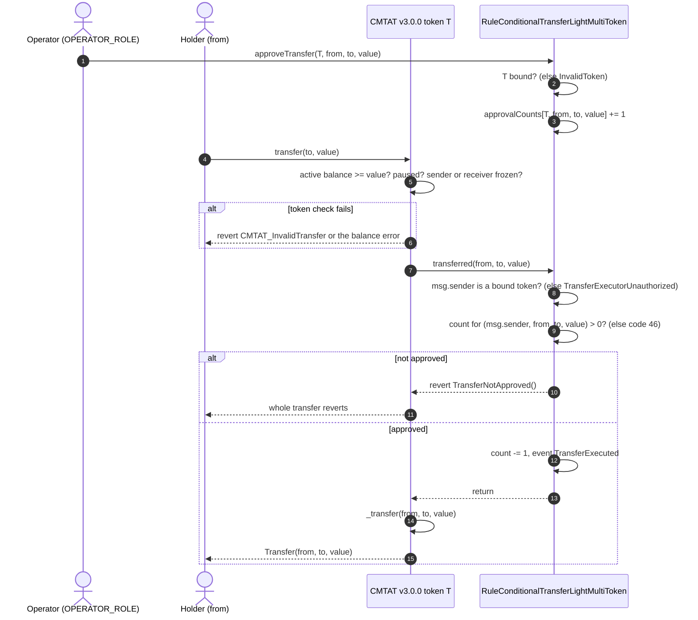
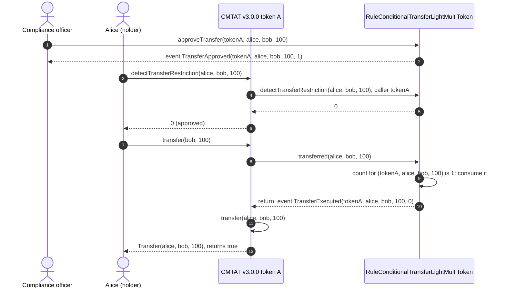
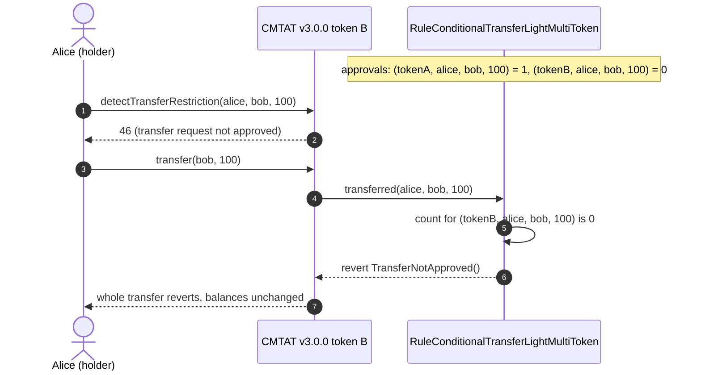
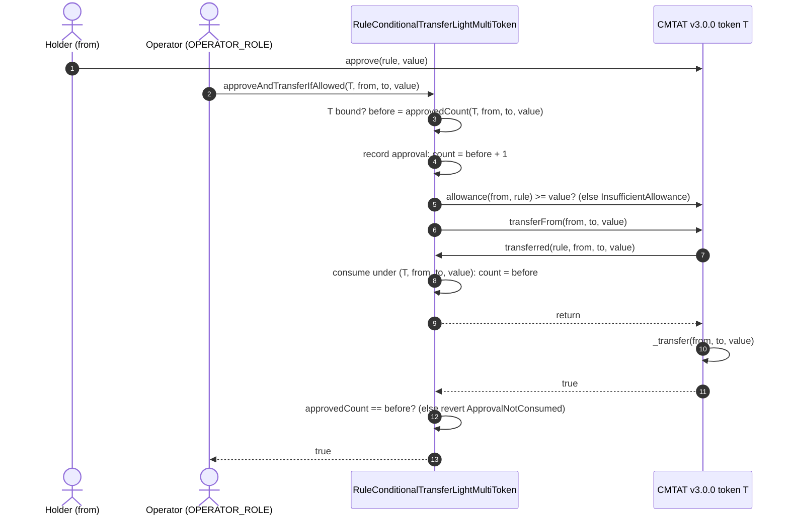
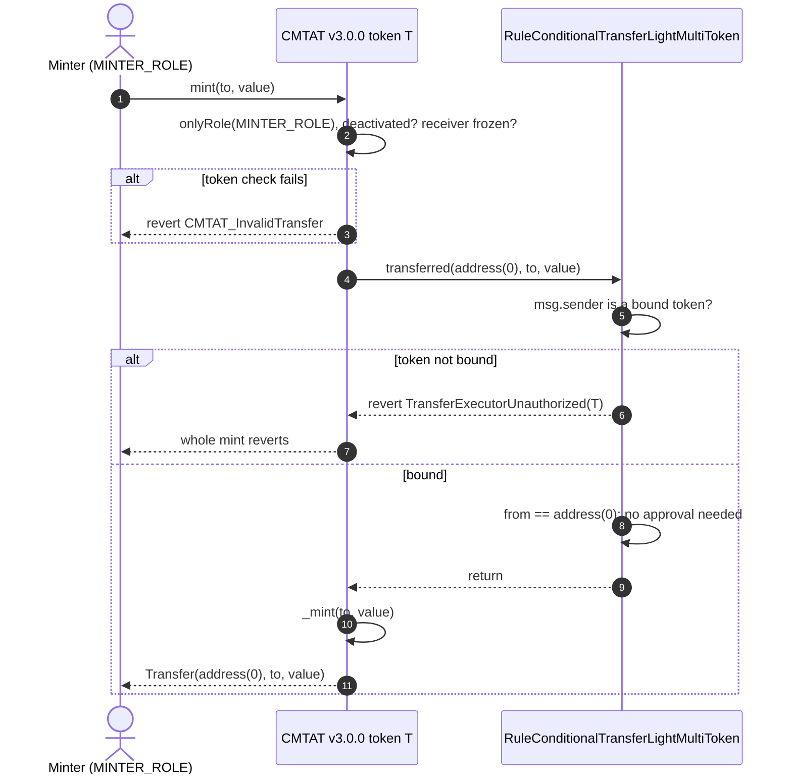

# Deploy `RuleConditionalTransferLightMultiToken` with CMTAT v3.0.0 tokens

[TOC]

This guide deploys one or more CMTAT **v3.0.0** tokens on which every transfer needs a prior approval from an operator, enforced by a single `RuleConditionalTransferLightMultiToken` shared by all of them. Approvals are recorded per token, so an approval given for one token never authorises a transfer of another. It covers:

- the only supported topology: the rule set **directly** on each token, never behind a RuleEngine, and why;
- when it is installed: in the token constructor, or later with `setRuleEngine`;
- the binding each token needs before anything moves (`bindToken`);
- what happens on an approved transfer, on an unapproved one, on the operator helper `approveAndTransferIfAllowed`, and on mint and burn.

CMTAT v3.0.0 is the last audited CMTAT release. For CMTAT v3.3.0, validated against `v3.3.0-rc4`, see the [v3.3.0 guide](./DEPLOY_RULE_CONDITIONAL_TRANSFER_LIGHT_MULTI_TOKEN_CMTAT_V3.3.0.md), which also lists the differences between the two versions.

Every setup below is tested against real v3.0.0 tokens:

- `test/CMTATv3.0.0/RuleConditionalTransferLightMultiTokenV300.t.sol`: rule set directly on two tokens after deployment, on the Standard and Debt variants; unapproved transfer, approval scoped to its token, `approveAndTransferIfAllowed`, mint and burn;
- `test/CMTATv3.0.0/RuleConditionalTransferLightMultiTokenV300Deployment.t.sol`: rule passed in the constructor of two tokens, each blocked until bound, then approvals scoped per token and the caller-dependent views (Standard variant).

No test puts this rule behind a RuleEngine on a real token, because that topology is not supported (§2).

## 1. What the rule enforces

The rule keeps a counter of approvals per `(token, from, to, value)`. An operator raises it with `approveTransfer(token, from, to, value)`; each executed transfer of exactly that tuple on that token lowers it by one.

| Operation | Checked by `RuleConditionalTransferLightMultiToken` | Rejected with |
| --- | --- | --- |
| Transfer `from → to` of `value` on token T | an approval exists for `(T, from, to, value)`, where T is the calling token; one is consumed | 46 (not approved) |
| `transferFrom` by a spender | the same: the spender is ignored, any spender consumes the approval | 46 |
| Mint to `to` | no approval needed | never by the approval check |
| Burn from `from` | no approval needed | never by the approval check |
| Any operation from a token that is not bound | the caller is not a bound token | revert on the write path; the views return 46 |

Mint and burn are exempt from approvals, but **not from binding**: `transferred` checks that its caller is a bound token before it looks at the addresses, so until a token is bound every mint, burn and transfer on it reverts with `RuleConditionalTransferLightMultiToken_TransferExecutorUnauthorized(token)`. This rule has no code 85: an unbound token reads as 46.

The approval is matched on the exact value: an approval for 100 does not cover a transfer of 60.

On v3.0.0, mint and burn call the rule through the 3-argument `transferred(from, to, value)` with no minter. That changes nothing here: the rule ignores the spender on every path.

**Error names.** A missing approval reverts with `RuleConditionalTransferLightMultiToken_TransferNotApproved()` on both the 3- and the 4-argument path. An unbound caller reverts with `RuleConditionalTransferLightMultiToken_TransferExecutorUnauthorized(caller)`. Approving for a token that is not bound reverts with `RuleConditionalTransferLightMultiToken_InvalidToken()`.

## 2. Choose the setup

**Direct only. Do not add this rule to a RuleEngine.** The rule records an approval under the `token` argument the operator passes, but consumes it under `msg.sender`, the contract that calls `transferred`. Set directly on the token, that caller is the token, so both keys match. Behind a RuleEngine the caller is the engine, and no wiring works:

| Wiring behind an engine | Result |
| --- | --- |
| Token bound, engine not | the engine is not a bound caller: every mint and transfer reverts |
| Engine bound, approvals given for the token | the token is not bound: `approveTransfer` reverts with `InvalidToken` |
| Both bound, approvals given for the token | approval stored under the token, looked up under the engine: every transfer reverts and the approval stays stranded until `resetApproval` |
| Engine bound, approvals given for the engine | runs, but approvals are no longer per token, and `approveAndTransferIfAllowed` fails because the engine is not an ERC-20 |

So "multi-token" means several tokens each calling one shared rule directly. A token that also needs other rules (a whitelist, a supply cap) cannot have them through a RuleEngine together with this rule; use [`RuleConditionalTransferLight`](./DEPLOY_RULE_CONDITIONAL_TRANSFER_LIGHT_CMTAT_V3.0.0.md) in a RuleEngine dedicated to that one token instead.

**When the rule is installed.**

| Setup | Unscreened window |
| --- | --- |
| **4.1** Rule set directly, at deployment (recommended) | none: until `bindToken`, every mint and transfer on the token reverts |
| **4.2** Rule set directly, after deployment | between the token's deployment and `setRuleEngine`: do not mint |
| **4.3** Add a further token to a deployed rule | as 4.1 or 4.2 for that token; the tokens already bound are not affected |

The rule needs no token address in its constructor, so it can be deployed first and passed in each token's constructor.

## 3. Contracts and roles

| Contract | Constructor | Roles that matter here |
| --- | --- | --- |
| `RuleConditionalTransferLightMultiToken` | `(admin)` | `OPERATOR_ROLE` (`approveTransfer`, `cancelTransferApproval`, `resetApproval`, `approveAndTransferIfAllowed`), `COMPLIANCE_MANAGER_ROLE` (`bindToken`, `unbindToken`), `DEFAULT_ADMIN_ROLE` (all roles) |
| `RuleConditionalTransferLightMultiTokenOwnable2Step` | `(owner)` | the owner does everything above; ownership moves in two steps (`transferOwnership`, `acceptOwnership`) |
| CMTAT v3.0.0 `CMTATStandalone` (or `CMTATStandaloneDebt`, or a proxy variant) | `(forwarder, admin, ERC20Attributes, ExtraInformationAttributes, Engine{ruleEngine, snapshotEngine, documentEngine})`. `CMTATStandaloneDebt` takes no forwarder | `DEFAULT_ADMIN_ROLE` (`setRuleEngine`, `forcedTransfer`, all roles), `MINTER_ROLE`, `BURNER_ROLE`, `PAUSER_ROLE`, `ENFORCER_ROLE`, `ERC20ENFORCER_ROLE` |

No RuleEngine is deployed. On CMTAT and on the AccessControl rule, the default admin implicitly holds every role. One `OPERATOR_ROLE` holder approves transfers for every token bound to the rule: share one instance only between tokens run by the same compliance team.

## 4. Deployment steps

Each setup lists its steps, then draws them as a sequence diagram. The calls are shown from a single admin; in production the operator, binding and minting roles can be held by different addresses (§3).

### 4.1 Rule set directly, at deployment (recommended)

1. **Deploy the rule:** `RuleConditionalTransferLightMultiToken(admin)`. It needs no token address.
2. **Deploy each token** with `Engine(ruleEngine = rule, snapshotEngine = 0, documentEngine = 0)`. Until it is bound, every mint and transfer on it reverts.
3. **Bind each token:** `rule.bindToken(tokenA)`, `rule.bindToken(tokenB)` (`COMPLIANCE_MANAGER_ROLE`).
4. **Grant `OPERATOR_ROLE`** on the rule to the compliance officer, and **`MINTER_ROLE`** on each token, if they are not the admin.
5. **Check the setup:** `rule.isTokenBound(tokenA)` is `true`, and `rule.detectTransferRestrictionForToken(tokenA, investor1, investor2, 1)` returns 46.

### 4.2 Rule set directly, after deployment

1. **Deploy each token** with `Engine(ruleEngine = address(0), ...)`. Do not mint yet.
2. **Deploy the rule** and **bind each token:** `rule.bindToken(tokenA)`, `rule.bindToken(tokenB)`.
3. **Install it on each token:** `tokenA.setRuleEngine(rule)`, `tokenB.setRuleEngine(rule)`, as each token's `DEFAULT_ADMIN_ROLE`. Each emits `RuleEngine(rule)`.
4. **Grant the roles** and check as in 4.1 steps 4 and 5.

### 4.3 Add a further token to a deployed rule

1. **Deploy token C** with `Engine(ruleEngine = rule, ...)`, or with no engine and `tokenC.setRuleEngine(rule)` afterwards.
2. **Bind it:** `rule.bindToken(tokenC)`. Tokens A and B keep working throughout, and their approvals are not visible to C.

## 5. Transfer workflows

`transfer(to, value)` by a holder. The token first checks its own conditions (active balance, pause, frozen addresses), then calls the rule **before** moving the balance, on the 3-argument `transferred(from, to, value)`. A `transferFrom` takes the 4-argument path with the caller as spender; the rule ignores the spender, so the diagrams apply unchanged. There is no RuleEngine variant of these diagrams: the topology is not supported (§2).

### 5.1 Operator approval, then transfer

The two steps happen in separate transactions. The operator names the token in the approval; the token is the caller in the transfer.

### 5.2 Happy path: an approved transfer of 100 on token A

Alice asks to send 100 token-A shares to Bob. The compliance officer approves it for token A, Alice holds at least 100 unfrozen shares, and token A is not paused.

### 5.3 Rejected: the approval was given for another token

The officer approved `(tokenA, alice, bob, 100)`. Alice sends 100 of **token B** to Bob: the rule looks up `(tokenB, alice, bob, 100)`, finds no approval, and reverts. The approval for token A is untouched.

A transfer with no approval at all, or with an approval for a different value, fails the same way.

### 5.4 Operator helper: `approveAndTransferIfAllowed`

The operator can approve and execute in one call, naming the token. The rule acts as the ERC-20 spender, so the holder must first `approve(rule, value)` on that token. Steps:

1. The rule checks that the token is bound (`InvalidToken` otherwise) and reads the current approval count for `(token, from, to, value)`.
2. It records one approval **before** calling the token. This inverts checks-effects-interactions on purpose: the approval must exist when the token calls back into the rule during the transfer.
3. It checks the holder's allowance to the rule (`RuleConditionalTransferLightMultiToken_InsufficientAllowance` if too low) and calls `token.transferFrom(from, to, value)` through `SafeERC20`.
4. The token calls `transferred(rule, from, to, value)`; the caller is the token, so the approval is consumed under the right key.
5. **Post-condition:** the count must be back to its value from step 1, else the call reverts with `RuleConditionalTransferLightMultiToken_ApprovalNotConsumed`. This is what catches a token that does not call this rule directly (for example one behind a RuleEngine), which would otherwise leave a spendable approval behind. The operator's own pending approvals for that tuple are left as they were.

This helper works only in the direct topology.

## 6. Mint and burn workflow

Mint and burn need no approval. On v3.0.0 both call the rule through the 3-argument `transferred` (`from == address(0)` for a mint, `to == address(0)` for a burn); the rule checks that the calling token is bound, sees the zero address and returns without touching any counter. Pause does not stop a mint or a burn on v3.0.0.

A burn takes the same path with `transferred(from, address(0), value)`.

## 7. Operating the token

| Task | Call | Role |
| --- | --- | --- |
| Approve a transfer request | `rule.approveTransfer(token, from, to, value)`; the token must be bound | rule `OPERATOR_ROLE` |
| Withdraw one approval | `rule.cancelTransferApproval(token, from, to, value)` | rule `OPERATOR_ROLE` |
| Withdraw all approvals for a tuple | `rule.resetApproval(token, from, to, value)`; works on an unbound token | rule `OPERATOR_ROLE` |
| Approve and execute in one call | `rule.approveAndTransferIfAllowed(token, from, to, value)`, after the holder's `approve(rule, value)` | rule `OPERATOR_ROLE` |
| Check pending approvals | `rule.approvedCount(token, from, to, value)` | anyone |
| Pre-check a transfer from a wallet or a back office | `rule.detectTransferRestrictionForToken(token, from, to, value)` / `rule.canTransferForToken(...)`, or the token's own `canTransfer` / `detectTransferRestriction` | anyone |
| Move a token from a blocked holder | `token.forcedTransfer(from, to, value)`: does not call the rule, consumes no approval | token `DEFAULT_ADMIN_ROLE` |
| Retire a token | `rule.unbindToken(token)`, then `resetApproval` for its pending tuples | rule `COMPLIANCE_MANAGER_ROLE`, `OPERATOR_ROLE` |
| Remove the rule from a token | `token.setRuleEngine(address(0))`: that token becomes unrestricted | token `DEFAULT_ADMIN_ROLE` |

Key warnings:

- **Never add this rule to a RuleEngine** (§2), on any CMTAT version.
- **Call the rule's own views with the token named.** `rule.detectTransferRestriction(from, to, value)` and `rule.canTransfer(...)` take the token from the caller, so called by a wallet or an explorer they always answer 46 / `false`, even for an approved transfer. Called through the token (`token.detectTransferRestriction`), the token is the caller and the answer is correct. From outside, use `detectTransferRestrictionForToken` / `canTransferForToken`.
- **Unbinding does not clear approvals.** They stay in storage and become usable again if the token is bound later; clear them with `resetApproval`.
- **A transfer of 0 needs an approval too.** The rule does not treat `value == 0` as a no-op.

See also: [`RuleConditionalTransferLightMultiToken.md`](../contracts/RuleConditionalTransferLightMultiToken.md) for the full rule reference, and [`RULE_SEMANTICS.md`](./RULE_SEMANTICS.md) §7 for the per-rule CMTAT v3.0.0 status.
