# Deploy `RuleERC2980` with a CMTAT v3.3.0 token

[TOC]

This guide deploys a CMTAT **v3.3.0** token restricted by `RuleERC2980`, the ERC-2980 Swiss Compliant rule: a whitelist of the addresses allowed to **receive**, and a frozenlist of addresses that may neither send nor receive. It covers:

- where the rule sits: on the token directly, or inside a RuleEngine;
- when it is installed: in the token constructor, or later with `setRuleEngine`;
- what happens on a mint, a transfer, a `transferFrom` and a burn once it is active.

v3.3.0 is not final yet: this library is validated against **`v3.3.0-rc4`**, the version pinned in `lib/CMTAT`, and every statement below was checked against that code. For the last audited release, see the [v3.0.0 guide](./DEPLOY_RULE_ERC2980_CMTAT_V3.0.0.md); [§8](#8-differences-from-cmtat-v300) lists what differs.

Every step below is tested against a real v3.3.0-rc4 token:

- `test/RuleERC2980/RuleERC2980CMTATDeployment.t.sol`: rule or RuleEngine passed in the token constructor, including the frozen minter rejected with code 62.

The rule's checks themselves (codes, list management, roles, flags) are covered without a token by `test/RuleERC2980/RuleERC2980.t.sol`, `test/RuleERC2980/AccessControl/RuleERC2980AccessControl.t.sol`, `test/RuleERC2980/Ownable/` and `test/MintBurnFlags/MintBurnFlags.t.sol`. The setups installed after deployment (§4.2, §4.4) are not tested on a v3.3.0 token; they are on v3.0.0, with the same calls.

## 1. What the rule enforces

| Operation | Checked by `RuleERC2980`, in this order | Rejected with |
| --- | --- | --- |
| Transfer `from → to` | `from` not frozen, `to` not frozen, `to` whitelisted | 60 (sender frozen), 61 (receiver frozen), 63 (receiver not whitelisted) |
| `transferFrom` by a spender | the spender not frozen, then as above | 62 (spender frozen) |
| Mint to `to` | the minter not frozen, `allowMint` is `true`, `to` not frozen, `to` whitelisted | 62 (minter frozen), 64 (mint not allowed), 61, 63 |
| Burn from `from` | the burner not frozen, `allowBurn` is `true`, `from` not frozen | 62 (burner frozen), 65 (burn not allowed), 60 |

The frozenlist takes priority over the whitelist: a frozen address is rejected whatever its whitelist status. The **sender does not need to be whitelisted**, as ERC-2980 requires: a holder removed from the whitelist can still send what it holds and can still be burned from. Only a frozen holder is blocked.

The zero address is never a member of either list: both `addWhitelistAddress(address(0))` and `addFrozenlistAddress(address(0))` revert, and so does a batch add containing it. Mint and burn are permitted by the `allowMint` / `allowBurn` flags.

On v3.3.0 the token forwards the **minter** (and the burner) to the rule as `spender`, on the 4-argument `transferred(spender, from, to, value)`. `RuleERC2980` screens it against the frozenlist like any spender: **a minter or burner on the frozenlist is rejected with code 62.** It is never checked against the whitelist, so the minting key does not need to be whitelisted. The token's own freeze (`setAddressFrozen`) does not screen the minter on a mint, only the receiver; the rule's frozenlist does.

## 2. Choose the setup

**Where the rule sits.**

| Topology | Token calls | Use it when |
| --- | --- | --- |
| **Direct** | the rule itself (`token.ruleEngine() == rule`) | `RuleERC2980` is the only rule. Fewer contracts to deploy, and one external call less per transfer |
| **RuleEngine** | a `RuleEngine`, which calls each of its rules | you need several rules (for example ERC-2980 lists and a supply cap), or want to add rules later without touching the token |

`RuleERC2980` keeps its lists in its own storage and reads no token state, so it behaves identically in both. It needs no binding to the token. The RuleEngine forwards the minter and the spender to the rule unchanged.

**When the rule is installed.**

| Moment | How | Effect |
| --- | --- | --- |
| **At deployment** | pass the rule (or the RuleEngine) in the token constructor's `Engine.ruleEngine` field | the token is never unrestricted, the very first mint is screened |
| **After deployment** | deploy the token with `Engine.ruleEngine = address(0)`, then `token.setRuleEngine(...)` | between the two transactions the token has **no compliance**: any mint or transfer goes through. Do not mint or grant `MINTER_ROLE` before `setRuleEngine` |

Installing at deployment is recommended. Installing afterwards is the right choice for a token already live, or to change or replace the compliance later.

## 3. Contracts and roles

| Contract | Constructor | Roles that matter here |
| --- | --- | --- |
| `RuleERC2980` | `(admin, forwarderIrrevocable, allowMintBurn)` | `DEFAULT_ADMIN_ROLE` (all roles, `setAllowMint` / `setAllowBurn`), `WHITELIST_ADD_ROLE`, `WHITELIST_REMOVE_ROLE`, `FROZENLIST_ADD_ROLE`, `FROZENLIST_REMOVE_ROLE` |
| `RuleERC2980Ownable2Step` | `(owner, forwarderIrrevocable, allowMintBurn)` | the owner does everything the roles above allow |
| `RuleEngine` (RuleEngine `v3.0.0-rc7`, optional) | `(admin, tokenContract)`; `tokenContract` may be `address(0)` | `RULES_MANAGEMENT_ROLE` (`addRule`), `COMPLIANCE_MANAGER_ROLE` (`bindToken`) |
| CMTAT v3.3.0 `CMTATStandardStandalone` (or `CMTATStandaloneDebt`, or a proxy variant) | `(forwarder, admin, ERC20Attributes, ExtraInformationAttributes, Engine{ruleEngine})`. `CMTATStandaloneDebt` takes no forwarder | `DEFAULT_ADMIN_ROLE` (`setRuleEngine`, `forcedTransfer`, all roles), `MINTER_ROLE`, `BURNER_ROLE`, `PAUSER_ROLE`, `ENFORCER_ROLE` (freeze an address), `ERC20ENFORCER_ROLE` (freeze part of a balance) |

On both CMTAT and the AccessControl rule, the default admin implicitly holds every role. The whitelist and the frozenlist have separate roles, so onboarding and enforcement can be given to different keys. The v3.3.0 `Engine` struct has a single field, `ruleEngine`.

Constructor flags of the rule:

- `allowMintBurn = true` to be able to issue and redeem. With `false`, every mint is rejected with code 64 and every burn with code 65. Both flags can be changed later with `setAllowMint` / `setAllowBurn`, for example to close issuance for good while keeping redemptions open.
- `forwarderIrrevocable = address(0)` unless you use ERC-2771 meta-transactions for the rule's admin calls.

**Two frozen lists.** The rule's frozenlist is separate from the token's own freeze (`token.setAddressFrozen`, `ENFORCER_ROLE`). The token's freeze is checked first and reverts with `ERC7943CannotSend` / `ERC7943CannotReceive`; the rule's frozenlist reverts with `RuleERC2980_InvalidTransfer` or `RuleERC2980_InvalidTransferFrom` and codes 60 to 62. Use one of them as the reference, so that operators know where to look.

## 4. Deployment steps

Each setup lists its steps, then draws them as a sequence diagram. The calls are shown from a single admin; in production the list, rule and minting roles can be held by different addresses (§3).

### 4.1 Rule set directly, at deployment (recommended for `RuleERC2980` alone)

1. **Deploy the rule:** `RuleERC2980(admin, address(0), true)`. It needs no token address.
2. **Fill the whitelist:** `addWhitelistAddresses([investor1, investor2, ...])`, as the admin or a `WHITELIST_ADD_ROLE` holder. Freeze any address that must be blocked from the start with `addFrozenlistAddresses([...])`. This can also happen after step 3; until then every mint is rejected with code 63.
3. **Deploy the token** with `Engine(ruleEngine = rule)`.
4. **Grant `MINTER_ROLE`** to the issuer's minting address, if it is not the admin. It does not need to be whitelisted, but it must not be on the frozenlist.
5. **Check the setup:** `token.ruleEngine() == rule`; on the Standard variant, `token.detectTransferRestrictionFrom(minter, address(0), investor1, 1) == 0` and the same call to an address not on the whitelist returns 63. A small test mint confirms it end to end.

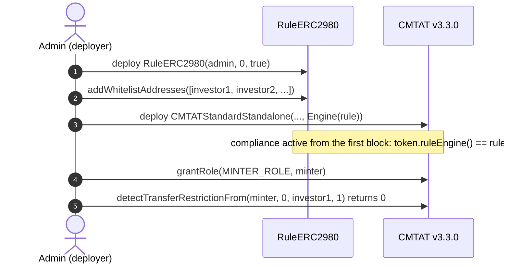

### 4.2 Rule set directly, after deployment

1. **Deploy the token** with `Engine(ruleEngine = address(0))`. Do not mint yet.
2. **Deploy the rule** and fill the whitelist, as in 4.1 steps 1 and 2.
3. **Install it:** `token.setRuleEngine(rule)`, as the token's `DEFAULT_ADMIN_ROLE`. It emits `RuleEngine(rule)` and reverts with `CMTAT_ValidationModule_SameValue` if that rule is already set.
4. **Grant `MINTER_ROLE`**, then check as in 4.1 step 5.

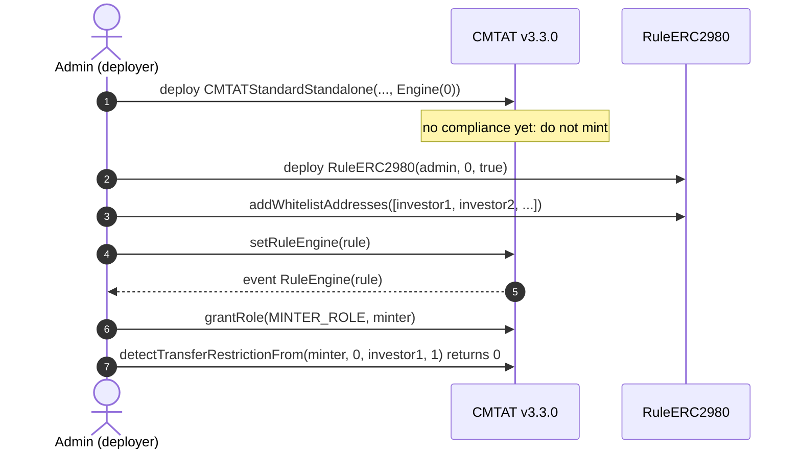

### 4.3 Behind a RuleEngine, at deployment

The token address does not exist yet when the engine is deployed, so the engine is deployed without a token and binds it afterwards. Until that binding, the engine rejects every call from the token (`TokenBinding_UnauthorizedCaller`): no mint or transfer can happen unscreened.

1. **Deploy the RuleEngine:** `RuleEngine(admin, address(0))`.
2. **Deploy the rule**, fill the whitelist, and add it: `engine.addRule(rule)` (`RULES_MANAGEMENT_ROLE`).
3. **Deploy the token** with `Engine(ruleEngine = engine)`.
4. **Bind the token:** `engine.bindToken(token)` (`COMPLIANCE_MANAGER_ROLE`). From now on the token works.
5. **Grant `MINTER_ROLE`** and check as in 4.1 step 5.

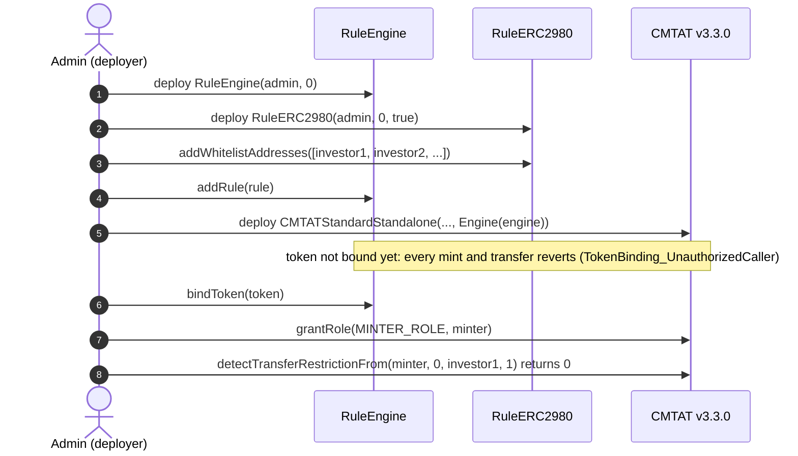

### 4.4 Behind a RuleEngine, after deployment

1. **Deploy the token** with `Engine(ruleEngine = address(0))`. Do not mint yet.
2. **Deploy the RuleEngine** with the token already known: `RuleEngine(admin, token)` binds it in the constructor.
3. **Deploy the rule**, fill the whitelist, `engine.addRule(rule)`.
4. **Install it:** `token.setRuleEngine(engine)`.
5. **Grant `MINTER_ROLE`** and check as in 4.1 step 5.

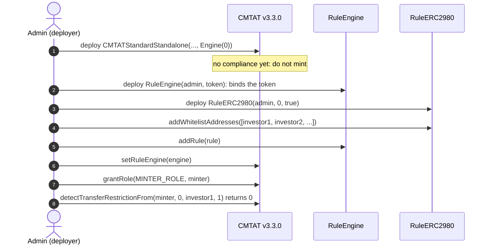

A RuleEngine serving one token is the intended setup. `RuleERC2980` itself would work for several tokens, since it reads no token state, but every token would then share one whitelist and one frozenlist.

## 5. Mint workflow

`mint(to, value)` by a `MINTER_ROLE` holder, with the rule active. The token runs its own checks first (contract deactivated, receiver frozen on the token), then notifies the compliance contract **before** creating the tokens, on the 4-argument `transferred(minter, address(0), to, value)`. Pause does not stop a mint. On the Standard variant the call to the compliance contract runs under a transient reentrancy guard.

### 5.1 Rule plugged directly into the token

The token calls `RuleERC2980` itself: `token.ruleEngine() == rule`.

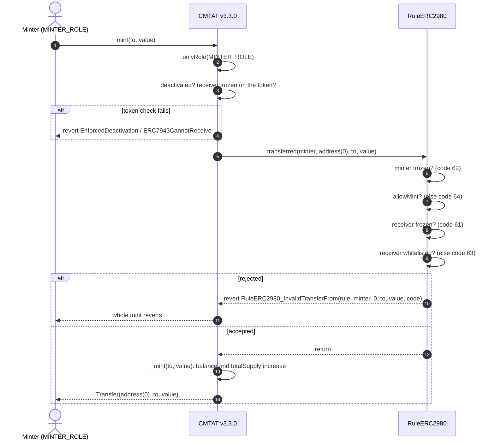

### 5.2 Rule behind a RuleEngine

The token calls the RuleEngine, which accepts only its bound token and then calls each of its rules in order. The first rule that reverts stops the mint, and the engine passes the revert back to the token.

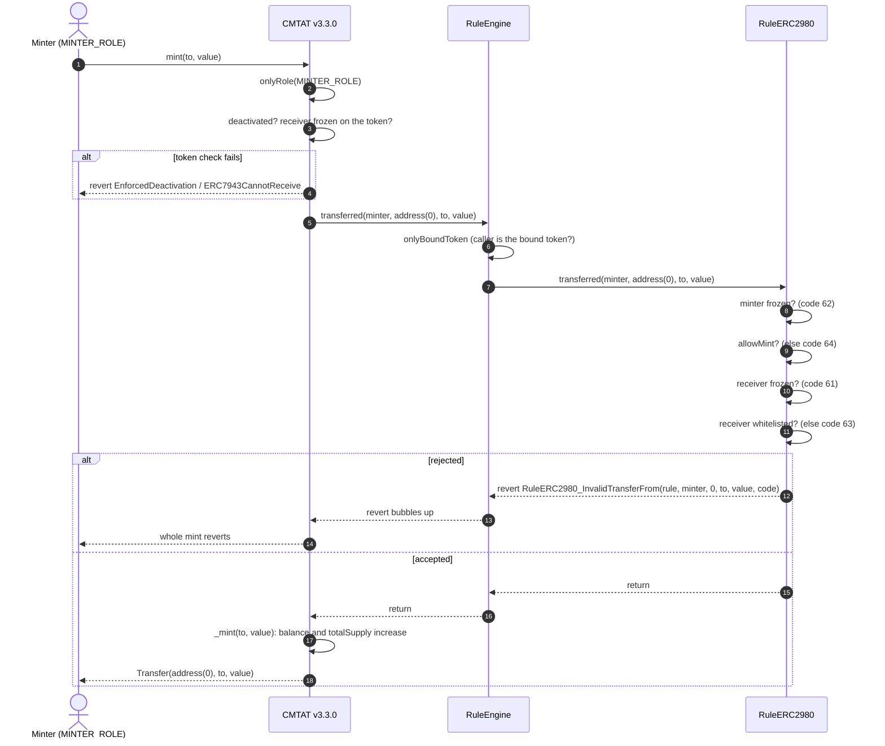

### 5.3 Happy path: a mint to a whitelisted investor

The same mint when everything passes. The minter is not on the frozenlist, Alice is on the whitelist and on neither frozen list, `allowMint` is `true`, and the contract is not deactivated. The rule is plugged directly into the token; behind a RuleEngine the engine sits between them, as in §5.2.

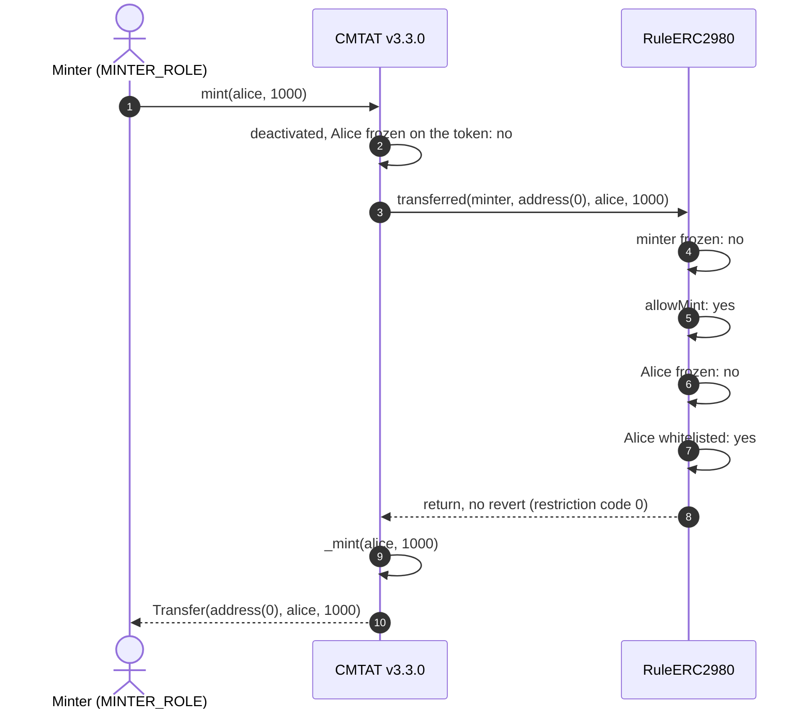

## 6. Transfer and burn workflows

`transfer(to, value)` by a holder. The token first checks that the tokens are not frozen (active balance), then that nobody involved is frozen on the token and that the token is not paused, then notifies the compliance contract **before** moving the balance. A `transfer` has no spender and takes the 3-argument path; `transferFrom` takes the 4-argument path with the caller as spender (§6.3).

### 6.1 Rule plugged directly into the token

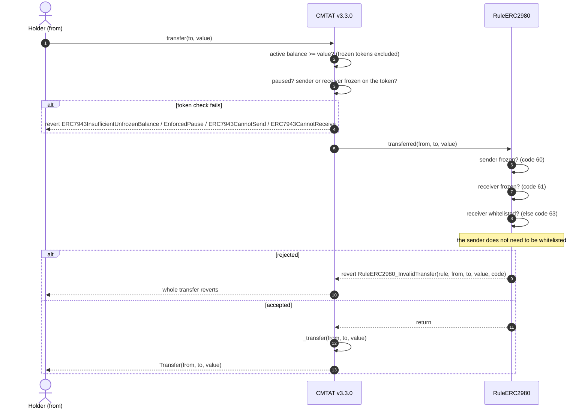

### 6.2 Rule behind a RuleEngine

Same path through the engine as for a mint (§5.2), on the 3-argument `transferred`.

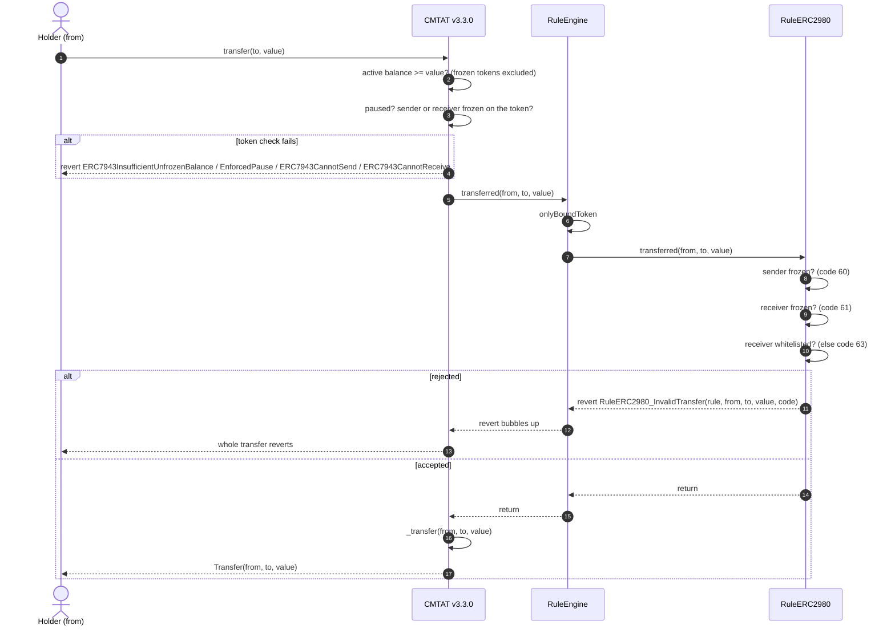

### 6.3 `transferFrom`: the spender is screened first

The token calls the 4-argument `transferred(spender, from, to, value)` with the caller as spender, before it checks and spends the allowance. The rule rejects a frozen spender with code 62, then runs the transfer checks of §6.1. The spender does not need to be whitelisted. Behind a RuleEngine the engine forwards the same 4-argument call.

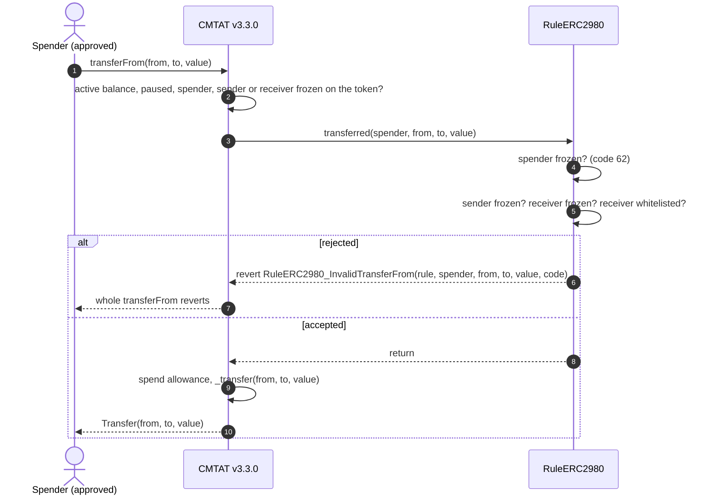

### 6.4 Happy path: a transfer to a whitelisted investor

Alice holds at least 100 unfrozen tokens and is on no frozen list; she need not be on the whitelist. Bob is whitelisted and not frozen, and the token is not paused.

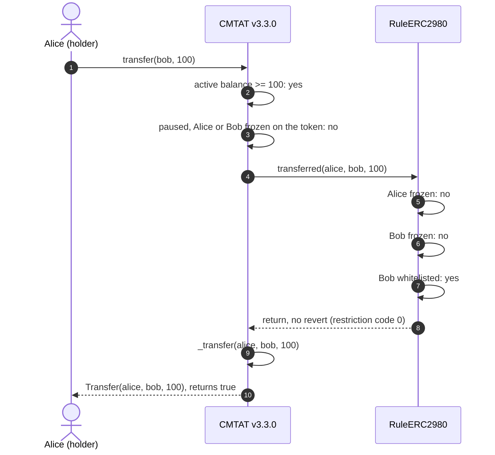

### 6.5 Burn

`burn(from, value)` by a `BURNER_ROLE` holder. The burner arrives as `spender` and is checked against the frozenlist first. The rule then checks `allowBurn` and that the holder is not on its frozenlist; it does not check the whitelist, so a holder removed from the whitelist can still be burned from. Behind a RuleEngine the engine sits between the token and the rule, as in §5.2.

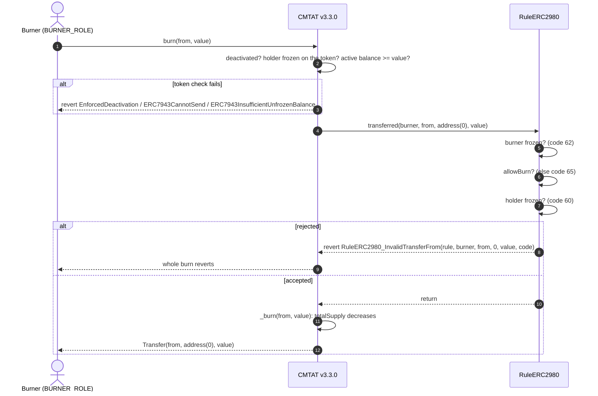

Before sending, a wallet or a front end can ask the same question without a transaction: `token.canTransfer(from, to, value)` and `token.canTransferFrom(spender, from, to, value)` on both variants, and `token.detectTransferRestriction(from, to, value)` / `detectTransferRestrictionFrom(spender, from, to, value)` plus `messageForTransferRestriction(code)` on the Standard variant (the Debt variant has no ERC-1404 layer). To preview a mint including the minter check, pass the minter as `spender` and `address(0)` as `from`.

## 7. Operating the token

| Task | Call | Role |
| --- | --- | --- |
| Onboard investors | `rule.addWhitelistAddresses([...])` (skips duplicates) or `addWhitelistAddress` (reverts on a duplicate) | `WHITELIST_ADD_ROLE` |
| Offboard | `rule.removeWhitelistAddresses([...])` / `removeWhitelistAddress`: the address can no longer receive, but can still send and be burned from | `WHITELIST_REMOVE_ROLE` |
| Freeze an address in the rule, a minter or burner included | `rule.addFrozenlistAddresses([...])` / `addFrozenlistAddress` | `FROZENLIST_ADD_ROLE` |
| Unfreeze | `rule.removeFrozenlistAddresses([...])` / `removeFrozenlistAddress` | `FROZENLIST_REMOVE_ROLE` |
| Stop issuance, keep redemptions | `rule.setAllowMint(false)` | rule `DEFAULT_ADMIN_ROLE` |
| Replace the compliance | `token.setRuleEngine(newRuleOrEngine)` | token `DEFAULT_ADMIN_ROLE` |
| Remove the compliance | `token.setRuleEngine(address(0))`: the token becomes unrestricted | token `DEFAULT_ADMIN_ROLE` |

**Freezing an address in the rule traps its tokens:** it can neither send nor be burned from (code 60) until unfrozen. To move tokens out of it use the token's `forcedTransfer(from, to, value)` (`DEFAULT_ADMIN_ROLE`; `to = address(0)` burns), which does not call the compliance contract. Removing an address from the whitelist does not trap it.

**Freezing the admin freezes its minting.** If the token admin also mints or burns, adding it to the rule's frozenlist rejects its mints and burns with code 62.

`rule.isVerified(address)` and `rule.whitelist(address)` report whitelist membership only: a whitelisted address that is frozen still returns `true`. Use `isFrozen` or `frozenlist` for the freeze status.

## 8. Differences from CMTAT v3.0.0

| | v3.0.0 | v3.3.0 |
| --- | --- | --- |
| Constructor `Engine` struct | `{ruleEngine, snapshotEngine, documentEngine}` | `{ruleEngine}` |
| Standard standalone contract | `CMTATStandalone` | `CMTATStandardStandalone` |
| How mint and burn call the rule | 3-argument `transferred`, no minter or burner | 4-argument `transferred`, minter / burner as `spender` |
| Frozen minter or burner | not screened: the rule never sees it | rejected with code 62 |
| Mint or burn rejected by the rule | `RuleERC2980_InvalidTransfer` | `RuleERC2980_InvalidTransferFrom` |
| Token-side check fails (frozen, paused, deactivated) | `CMTAT_InvalidTransfer` | the specific error: `ERC7943CannotSend` / `ERC7943CannotReceive`, `EnforcedPause`, `EnforcedDeactivation` |
| Reentrancy guard around the compliance call | none | transient guard on the Standard variant |

Transfers and `transferFrom` behave the same on both versions. See [`RULE_SEMANTICS.md`](./RULE_SEMANTICS.md) §7 for the other rules.

See also: [`RuleERC2980.md`](../contracts/RuleERC2980.md) for the full rule reference.
