# Deploy `RuleIdentityRegistry` with a CMTAT v3.3.0 token

<!-- toc -->

- [1. What the rule enforces](#1-what-the-rule-enforces)
- [2. Choose the registry](#2-choose-the-registry)
- [3. Choose the setup](#3-choose-the-setup)
- [4. Contracts and roles](#4-contracts-and-roles)
- [5. Deployment steps](#5-deployment-steps)
  - [Rule constructor parameters](#rule-constructor-parameters)
  - [5.1 Rule set directly, at deployment (recommended for identity alone)](#51-rule-set-directly-at-deployment-recommended-for-identity-alone)
  - [5.2 Rule set directly, after deployment](#52-rule-set-directly-after-deployment)
  - [5.3 Behind a RuleEngine, at deployment](#53-behind-a-ruleengine-at-deployment)
  - [5.4 Behind a RuleEngine, after deployment](#54-behind-a-ruleengine-after-deployment)
- [6. Mint workflow](#6-mint-workflow)
  - [6.1 Rule plugged directly into the token](#61-rule-plugged-directly-into-the-token)
  - [6.2 Rule behind a RuleEngine](#62-rule-behind-a-ruleengine)
  - [6.3 Happy path: a mint to a registered investor](#63-happy-path-a-mint-to-a-registered-investor)
- [7. Transfer and burn workflows](#7-transfer-and-burn-workflows)
  - [7.1 Rule plugged directly into the token](#71-rule-plugged-directly-into-the-token)
  - [7.2 Rule behind a RuleEngine](#72-rule-behind-a-ruleengine)
  - [7.3 transferFrom](#73-transferfrom)
  - [7.4 Happy path: a de-listed holder sells to a registered investor](#74-happy-path-a-de-listed-holder-sells-to-a-registered-investor)
  - [7.5 Burn](#75-burn)
- [8. Operating the token](#8-operating-the-token)
- [9. Differences from CMTAT v3.0.0](#9-differences-from-cmtat-v300)

<!-- /toc -->

This guide deploys a CMTAT **v3.3.0** token whose receivers must be verified in an ERC-3643 identity registry, checked by `RuleIdentityRegistry`. It covers:

- which registry the rule consults: `IdentityRegistryWhitelist` from this library, or an existing ERC-3643 identity registry;
- where the rule sits: on the token directly, or inside a RuleEngine;
- when it is installed: in the token constructor, or later with `setRuleEngine`;
- what happens on a mint, a transfer, a `transferFrom` and a burn once it is active.

v3.3.0 is not final yet: this library is validated against **`v3.3.0-rc4`**, the version pinned in `lib/CMTAT`, and every statement below was checked against that code. For the last audited release, see the [v3.0.0 guide](./DEPLOY_RULE_IDENTITY_REGISTRY_CMTAT_V3.0.0.md); [§9](#9-differences-from-cmtat-v300) lists what differs. For this rule the differences are small: the minter is exempt on both versions.

These tests run the setups against a real v3.3.0-rc4 token and an `IdentityRegistryWhitelist`:

- `test/RuleIdentityRegistry/RuleIdentityRegistryCMTATDeployment.t.sol`: rule or RuleEngine passed in the token constructor, with `checkSpender = true` and a minter that is not registered;
- `test/IdentityRegistryWhitelist/CMTATRuleIdentityRegistryComposition.t.sol`: rule behind a RuleEngine set after deployment, including de-listing, burn and both opt-in flags.

The rule set directly after deployment (§5.2) is not tested on a v3.3.0 token; it is on v3.0.0, with the same calls. `test/ERC3643Real/RuleIdentityRegistryWithRealERC3643Registry.t.sol` runs the rule against the reference ERC-3643 `IdentityRegistry`, behind a RuleEngine without a token (`FOUNDRY_PROFILE=erc3643`).

## 1. What the rule enforces

`RuleIdentityRegistry` follows ERC-3643: by default **only the receiver** must be verified, which the rule asks the registry with `isVerified(to)`. Two flags, both off by default, add checks that ERC-3643 does not require.

| Operation | Checked by `RuleIdentityRegistry` | Rejected with |
| --- | --- | --- |
| Transfer `from → to` | `to` is verified; `from` too if `checkSender` is `true` | 56 (receiver), 55 (sender) |
| `transferFrom` by a spender | as above, plus the spender if `checkSpender` is `true` | 57 (spender) |
| Mint to `to` | `to` is verified. The minter is never checked | 56 |
| Burn from `from` | nothing: a burn bypasses every eligibility check | never |

**Leave `checkSender` off unless you mean to trap holders.** ERC-3643 checks only the receiver so that an investor whose identity lapses, or who is removed from the registry, can still sell to a verified counterparty. With `checkSender = true` that holder can no longer send, and only `forcedTransfer` or a burn can move the tokens.

**An unset registry disables the rule.** If the rule's `identityRegistry` is `address(0)`, every operation passes. The constructor accepts `address(0)` without reverting, so check `rule.identityRegistry()` after deployment.

On v3.3.0 the token forwards the **minter** (and the burner) to the rule as `spender`, on the 4-argument `transferred(spender, from, to, value)`. `RuleIdentityRegistry` does **not** check it, even with `checkSpender = true`: ERC-3643 requires only the receiver on a mint, and the minter acts on its own authority, not as a delegated ERC-20 spender. Who may mint is decided by the token's `MINTER_ROLE`. A burn returns before any check, whoever the burner is.

## 2. Choose the registry

The rule needs a contract that answers `isVerified(address) returns (bool)`. It holds no list of its own.

| Registry | Deploy it when | Who maintains it |
| --- | --- | --- |
| **`IdentityRegistryWhitelist`** (this library, `src/registry/`) | you want ERC-3643 semantics on a CMTAT token without ONCHAINID or claims. `isVerified` means "this wallet is on the list" | `IDENTITY_REGISTRAR_ROLE` holders, with `registerIdentity` / `deleteIdentity` |
| **An existing ERC-3643 `IdentityRegistry`** (for example one already used by an ERC-3643 token) | investors are already onboarded with ONCHAINID claims and you want one source of truth for several tokens | whoever runs that registry |

`IdentityRegistryWhitelist` is not a rule: do not add it to a RuleEngine and do not pass it as the token's rule engine. CMTAT has no identity registry slot of its own, so on a CMTAT token the registry is only consulted through `RuleIdentityRegistry`. This guide uses `IdentityRegistryWhitelist`; with another registry, skip its deployment steps and pass that registry's address to the rule.

The rule calls `isVerified` directly. If the registry reverts, every mint and transfer reverts too, and so do the ERC-1404 queries; burns are not affected, since the rule does not call the registry for them.

## 3. Choose the setup

**Where the rule sits.**

| Topology | Token calls | Use it when |
| --- | --- | --- |
| **Direct** | the rule itself (`token.ruleEngine() == rule`) | identity is the only rule. Fewer contracts to deploy, and one external call less per transfer |
| **RuleEngine** | a `RuleEngine`, which calls each of its rules | you need several rules (for example identity and a supply cap), or want to add rules later without touching the token |

`RuleIdentityRegistry` reads no token state, so it behaves identically in both. It needs no binding to the token.

**When the rule is installed.**

| Moment | How | Effect |
| --- | --- | --- |
| **At deployment** | pass the rule (or the RuleEngine) in the token constructor's `Engine.ruleEngine` field | the token is never unrestricted, the very first mint is screened |
| **After deployment** | deploy the token with `Engine.ruleEngine = address(0)`, then `token.setRuleEngine(...)` | between the two transactions the token has **no compliance**: any mint or transfer goes through. Do not mint or grant `MINTER_ROLE` before `setRuleEngine` |

Installing at deployment is recommended. Installing afterwards is the right choice for a token already live, or to change or replace the compliance later.

## 4. Contracts and roles

| Contract | Constructor | Roles that matter here |
| --- | --- | --- |
| `IdentityRegistryWhitelist` (optional, see §2) | `(admin)` | `DEFAULT_ADMIN_ROLE` (all roles), `IDENTITY_REGISTRAR_ROLE` (`registerIdentity`, `deleteIdentity`) |
| `RuleIdentityRegistry` | `(admin, identityRegistry, checkSender, checkSpender)` | `DEFAULT_ADMIN_ROLE`: `setIdentityRegistry`, `clearIdentityRegistry`, `setCheckSender`, `setCheckSpender` |
| `RuleIdentityRegistryOwnable2Step` | `(owner, identityRegistry, checkSender, checkSpender)` | the owner does everything the admin role above allows |
| `RuleEngine` (RuleEngine `v3.0.0-rc7`, optional) | `(admin, tokenContract)`; `tokenContract` may be `address(0)` | `RULES_MANAGEMENT_ROLE` (`addRule`), `COMPLIANCE_MANAGER_ROLE` (`bindToken`) |
| CMTAT v3.3.0 `CMTATStandardStandalone` (or `CMTATStandaloneDebt`, or a proxy variant) | `(forwarder, admin, ERC20Attributes, ExtraInformationAttributes, Engine{ruleEngine})`. `CMTATStandaloneDebt` takes no forwarder | `DEFAULT_ADMIN_ROLE` (`setRuleEngine`, `forcedTransfer`, all roles), `MINTER_ROLE`, `BURNER_ROLE`, `PAUSER_ROLE`, `ENFORCER_ROLE` (freeze an address), `ERC20ENFORCER_ROLE` (freeze part of a balance) |

On CMTAT, on the AccessControl rule and on `IdentityRegistryWhitelist`, the default admin implicitly holds every role.

Constructor arguments of the rule:

- `identityRegistry`: the registry's address. `address(0)` deploys a rule that blocks nothing (§1).
- `checkSender = false` for ERC-3643 behaviour. `true` also requires the sender to be verified.
- `checkSpender`: `true` also requires the spender of a `transferFrom` to be verified. It never applies to the minter or burner. Both flags can be changed later with `setCheckSender` / `setCheckSpender`.

`IdentityRegistryWhitelist.registerIdentity(wallet, identity, country)` keeps only the wallet: `identity` is echoed in the `IdentityRegistered` event and `country` is ignored, so `address(0)` and `0` are fine on a CMTAT deployment. On CMTAT the token never calls the registry, so the token does not need `IDENTITY_REGISTRAR_ROLE` (an ERC-3643 token does, for `recoveryAddress`).

The repository script `script/DeployCMTATWithIdentityRegistry.s.sol` deploys this rule on a v3.3.0 token, set directly on it, in one run. See [`DEPLOYMENT_SCRIPTS.md`](./DEPLOYMENT_SCRIPTS.md).

## 5. Deployment steps

Each setup lists its steps, then draws them as a sequence diagram. The calls are shown from a single admin; in production the registrar, rule and minting roles can be held by different addresses (§4). Every setup starts with the registry; with an existing ERC-3643 registry, skip steps 1 and 2.

### Rule constructor parameters

| Parameter | Type | What it sets | Checks and notes |
| --- | --- | --- | --- |
| `admin` | `address` | Receives `DEFAULT_ADMIN_ROLE`, which implicitly holds every role of the rule. Set it to the account (ideally a multisig) that will operate the rule. | Reverts if `address(0)`. On the `Ownable2Step` variant this parameter is `owner`, who then holds every privileged function |
| `identityRegistry_` | `address` | The ERC-3643 identity registry the rule queries with `isVerified(address)`, for example an `IdentityRegistryWhitelist`. | Not checked: `address(0)` leaves the rule unconfigured and it blocks nothing. A registry without code, or one that reverts, makes every mint and transfer revert. Change later with `setIdentityRegistry` |
| `checkSender_` | `bool` | When `true`, the sender must also be verified (code 55). | Default `false`, as ERC-3643 requires: `true` traps de-listed holders, who can no longer sell |
| `checkSpender_` | `bool` | When `true`, a `transferFrom` spender must also be verified (code 57). The minter is exempt. | Default `false` |

`IdentityRegistryWhitelist`, the registry deployed alongside in these setups, takes a single parameter, `admin`, which receives `DEFAULT_ADMIN_ROLE` and so `IDENTITY_REGISTRAR_ROLE` (`registerIdentity` / `deleteIdentity`).

### 5.1 Rule set directly, at deployment (recommended for identity alone)

1. **Deploy the registry:** `IdentityRegistryWhitelist(admin)`, and grant `IDENTITY_REGISTRAR_ROLE` to the onboarding key.
2. **Register investors:** `registerIdentity(investor, address(0), 0)` for each. This can also happen after step 4; until then every mint is rejected with code 56.
3. **Deploy the rule:** `RuleIdentityRegistry(admin, registry, false, checkSpender)`. It needs no token address.
4. **Deploy the token** with `Engine(ruleEngine = rule)`.
5. **Grant `MINTER_ROLE`** to the issuer's minting address, if it is not the admin. It does not need to be registered.
6. **Check the setup:** `rule.identityRegistry() == registry`, `token.ruleEngine() == rule`; on the Standard variant, `token.detectTransferRestriction(address(0), investor1, 1) == 0` and the same call to an unregistered address returns 56. A small test mint confirms it end to end.

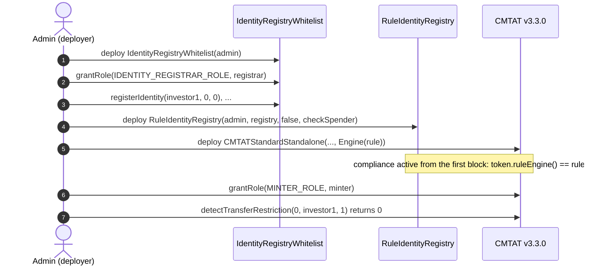

### 5.2 Rule set directly, after deployment

1. **Deploy the token** with `Engine(ruleEngine = address(0))`. Do not mint yet.
2. **Deploy the registry, register investors and deploy the rule**, as in 5.1 steps 1 to 3.
3. **Install it:** `token.setRuleEngine(rule)`, as the token's `DEFAULT_ADMIN_ROLE`. It emits `RuleEngine(rule)` and reverts with `CMTAT_ValidationModule_SameValue` if that rule is already set.
4. **Grant `MINTER_ROLE`**, then check as in 5.1 step 6.

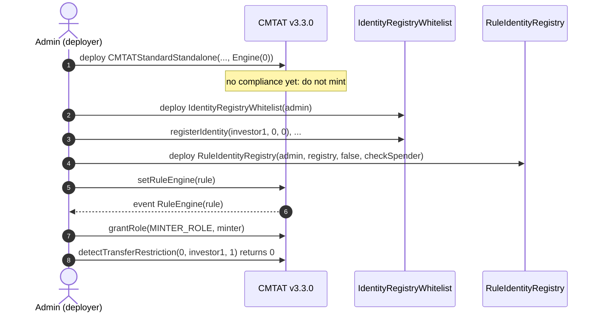

### 5.3 Behind a RuleEngine, at deployment

The token address does not exist yet when the engine is deployed, so the engine is deployed without a token and binds it afterwards. Until that binding, the engine rejects every call from the token (`TokenBinding_UnauthorizedCaller`): no mint or transfer can happen unscreened.

1. **Deploy the registry, register investors and deploy the rule**, as in 5.1 steps 1 to 3.
2. **Deploy the RuleEngine:** `RuleEngine(admin, address(0))`, and add the rule: `engine.addRule(rule)` (`RULES_MANAGEMENT_ROLE`).
3. **Deploy the token** with `Engine(ruleEngine = engine)`.
4. **Bind the token:** `engine.bindToken(token)` (`COMPLIANCE_MANAGER_ROLE`). From now on the token works.
5. **Grant `MINTER_ROLE`** and check as in 5.1 step 6.

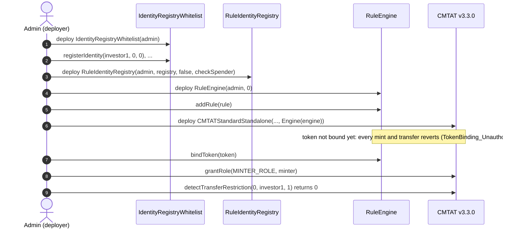

### 5.4 Behind a RuleEngine, after deployment

1. **Deploy the token** with `Engine(ruleEngine = address(0))`. Do not mint yet.
2. **Deploy the RuleEngine** with the token already known: `RuleEngine(admin, token)` binds it in the constructor.
3. **Deploy the registry, register investors, deploy the rule** as in 5.1 steps 1 to 3, then `engine.addRule(rule)`.
4. **Install it:** `token.setRuleEngine(engine)`.
5. **Grant `MINTER_ROLE`** and check as in 5.1 step 6.

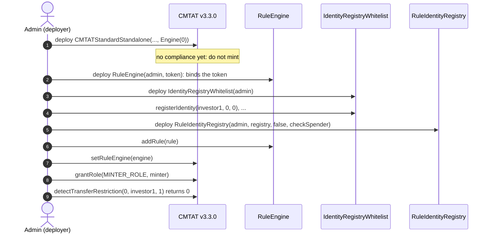

One registry, and one rule, can serve several tokens: the rule reads no token state, so every token consulting it shares the same set of verified wallets.

## 6. Mint workflow

`mint(to, value)` by a `MINTER_ROLE` holder, with the rule active. The token runs its own checks first (contract deactivated, receiver frozen), then notifies the compliance contract **before** creating the tokens, on the 4-argument `transferred(minter, address(0), to, value)`. Pause does not stop a mint. On the Standard variant the call to the compliance contract runs under a transient reentrancy guard.

### 6.1 Rule plugged directly into the token

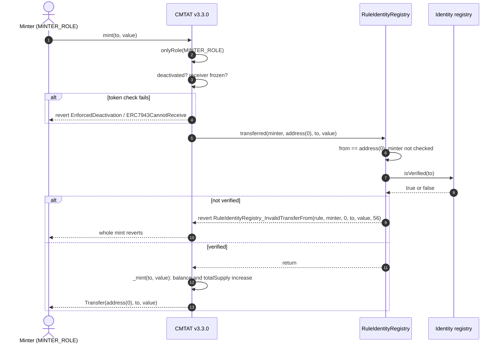

### 6.2 Rule behind a RuleEngine

The token calls the RuleEngine, which accepts only its bound token and then calls each of its rules in order. The first rule that reverts stops the mint, and the engine passes the revert back to the token.

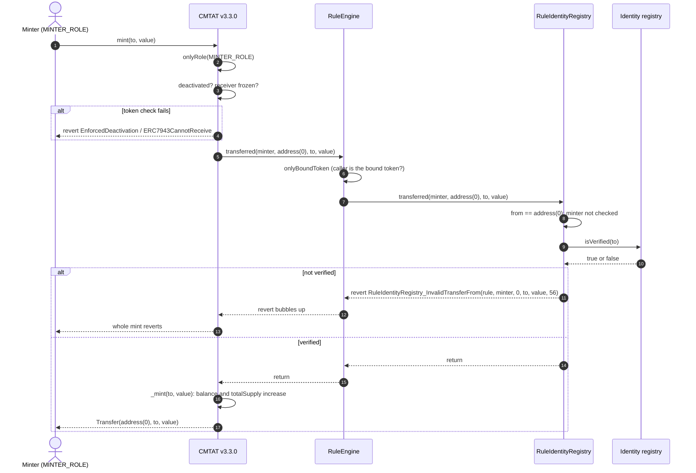

### 6.3 Happy path: a mint to a registered investor

Alice is registered in the registry, the contract is not deactivated and Alice is not frozen on the token. The minter is not registered, which does not matter. The rule is plugged directly into the token; behind a RuleEngine the engine sits between them, as in §6.2.

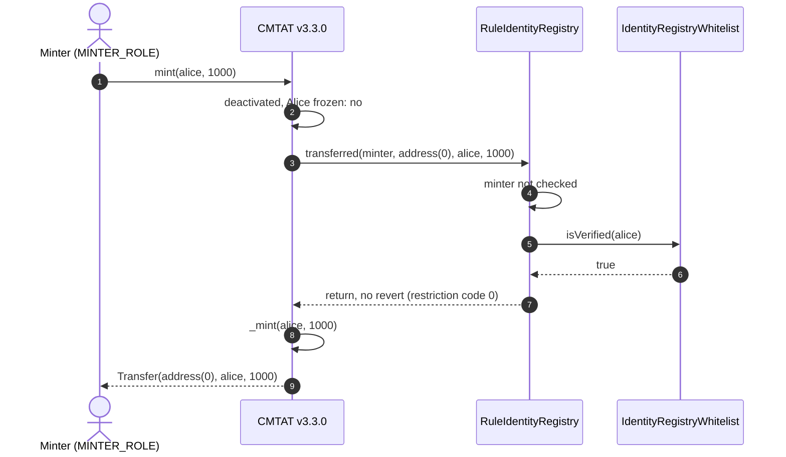

## 7. Transfer and burn workflows

`transfer(to, value)` by a holder. The token first checks that the tokens are not frozen (active balance), then that nobody involved is frozen and that the token is not paused, then notifies the compliance contract **before** moving the balance. A `transfer` has no spender and takes the 3-argument path; `transferFrom` takes the 4-argument path with the caller as spender (§7.3).

### 7.1 Rule plugged directly into the token

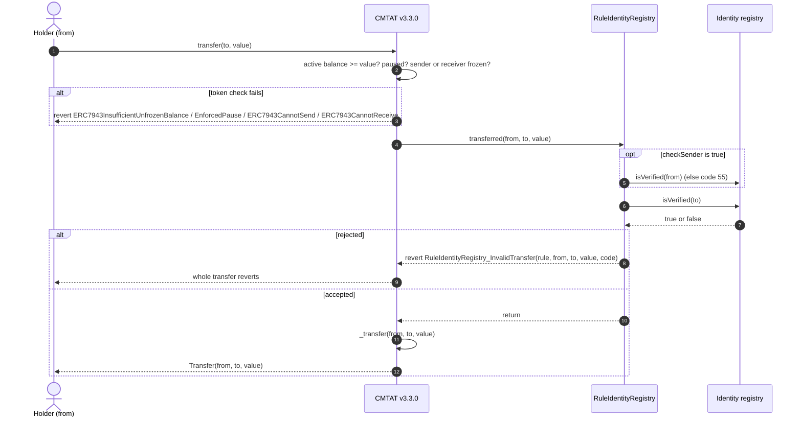

### 7.2 Rule behind a RuleEngine

Same path through the engine as for a mint (§6.2), on the 3-argument `transferred`.

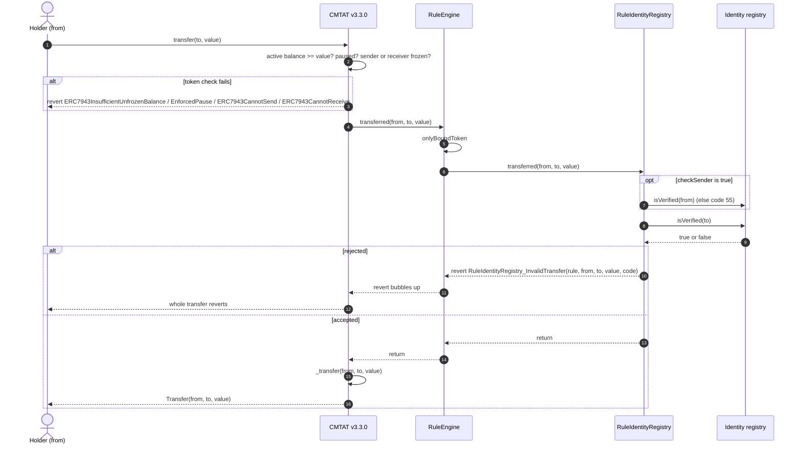

### 7.3 `transferFrom`

The token calls the 4-argument `transferred(spender, from, to, value)` with the caller as spender, before it checks and spends the allowance. With `checkSpender = true` the rule first asks the registry about the spender (code 57), then runs the checks of §7.1. With `checkSpender = false`, the ERC-3643 default, the spender is not checked. Behind a RuleEngine the engine forwards the same 4-argument call.

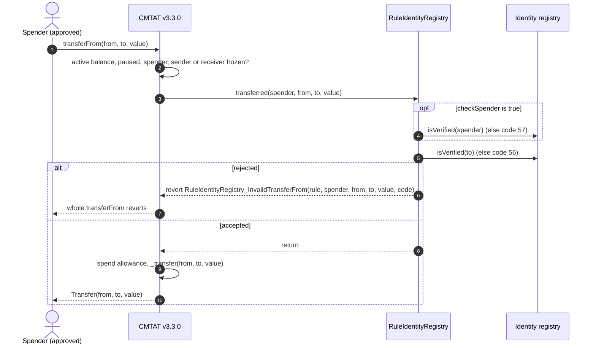

### 7.4 Happy path: a de-listed holder sells to a registered investor

The case the ERC-3643 default exists for. Alice was registered, bought tokens, and has since been removed with `deleteIdentity`. Bob is registered. `checkSender` is `false`, Alice holds at least 100 unfrozen tokens, and the token is not paused.

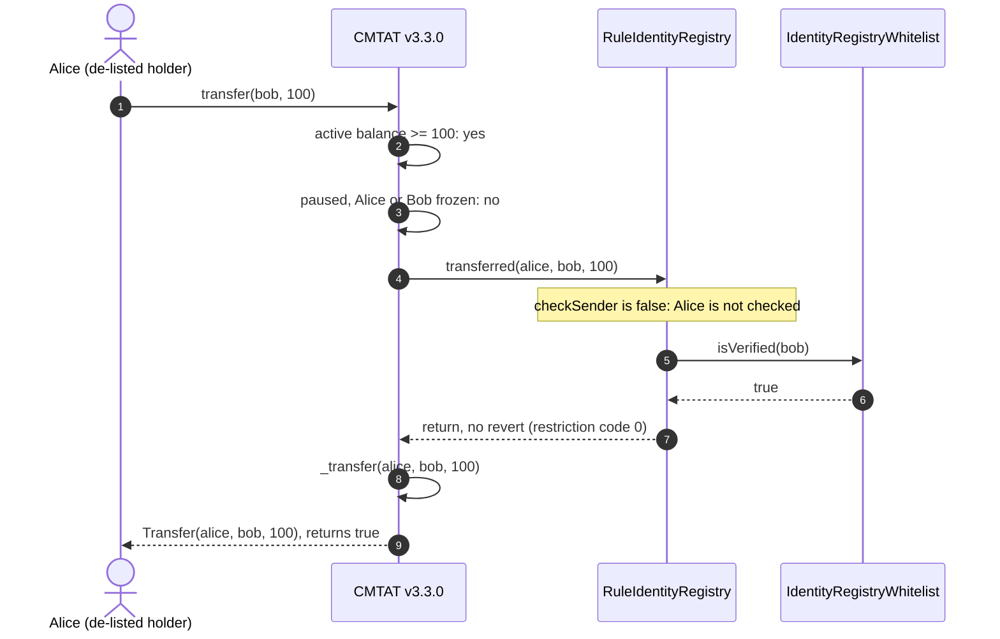

### 7.5 Burn

A burn bypasses every eligibility check, as ERC-3643 requires: the rule returns at once without asking the registry, so an issuer can always burn the tokens of a holder who is no longer verified. Behind a RuleEngine the engine sits between the token and the rule, as in §6.2.

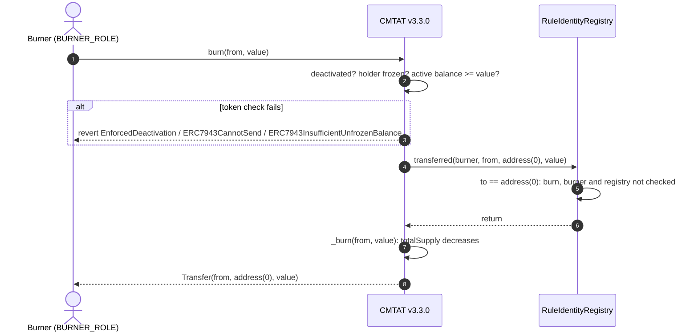

Before sending, a wallet or a front end can ask the same question without a transaction: `token.canTransfer(from, to, value)` and `token.canTransferFrom(spender, from, to, value)` on both variants, and `token.detectTransferRestriction(from, to, value)` plus `messageForTransferRestriction(code)` on the Standard variant (the Debt variant has no ERC-1404 layer). For this rule a mint preview gives the same answer with or without the minter: `detectTransferRestriction(address(0), to, value)` is enough.

## 8. Operating the token

| Task | Call | Role |
| --- | --- | --- |
| Onboard an investor | `registry.registerIdentity(wallet, identity, country)` (reverts if already registered) | registry `IDENTITY_REGISTRAR_ROLE` |
| Offboard | `registry.deleteIdentity(wallet)`: the wallet can no longer receive, but can still send and be burned from | registry `IDENTITY_REGISTRAR_ROLE` |
| Point the rule at another registry | `rule.setIdentityRegistry(newRegistry)` (reverts on `address(0)`) | rule `DEFAULT_ADMIN_ROLE` |
| Turn identity checks off | `rule.clearIdentityRegistry()`: every operation passes the rule | rule `DEFAULT_ADMIN_ROLE` |
| Screen delegated spenders | `rule.setCheckSpender(true)` | rule `DEFAULT_ADMIN_ROLE` |
| Also screen senders (stricter than ERC-3643) | `rule.setCheckSender(true)`: traps de-listed holders | rule `DEFAULT_ADMIN_ROLE` |
| Replace the compliance | `token.setRuleEngine(newRuleOrEngine)` | token `DEFAULT_ADMIN_ROLE` |
| Remove the compliance | `token.setRuleEngine(address(0))`: the token becomes unrestricted | token `DEFAULT_ADMIN_ROLE` |

**The registry is the list.** A registration or deletion takes effect for every token whose rule consults that registry, at the next transfer, with no call to the rule or the token. Whoever holds `IDENTITY_REGISTRAR_ROLE` (or runs the external registry) decides who may receive the token.

**`clearIdentityRegistry` lifts the restriction silently** from the token's point of view: the token keeps calling the rule, and the rule approves everything. It emits `IdentityRegistryUpdated(address(0))`.

To move tokens without the rule, use the token's `forcedTransfer(from, to, value)` (`DEFAULT_ADMIN_ROLE`), which does not call the compliance contract.

## 9. Differences from CMTAT v3.0.0

| | v3.0.0 | v3.3.0 |
| --- | --- | --- |
| Constructor `Engine` struct | `{ruleEngine, snapshotEngine, documentEngine}` | `{ruleEngine}` |
| Standard standalone contract | `CMTATStandalone` | `CMTATStandardStandalone` |
| How mint and burn call the rule | 3-argument `transferred`, no minter or burner | 4-argument `transferred`, minter / burner as `spender` (not checked by `RuleIdentityRegistry`) |
| Mint rejected by the rule | `RuleIdentityRegistry_InvalidTransfer` | `RuleIdentityRegistry_InvalidTransferFrom` |
| Token-side check fails (frozen, paused, deactivated) | `CMTAT_InvalidTransfer` | the specific error: `ERC7943CannotSend` / `ERC7943CannotReceive`, `EnforcedPause`, `EnforcedDeactivation` |
| Reentrancy guard around the compliance call | none | transient guard on the Standard variant |

What the rule allows is the same on both versions: it never checked the minter or the burner. See [`RULE_SEMANTICS.md`](./RULE_SEMANTICS.md) §7 for the other rules.

See also: [`RuleIdentityRegistry.md`](../contracts/RuleIdentityRegistry.md) for the full rule reference, and [`IdentityRegistryWhitelist.md`](../contracts/IdentityRegistryWhitelist.md) for the registry.
