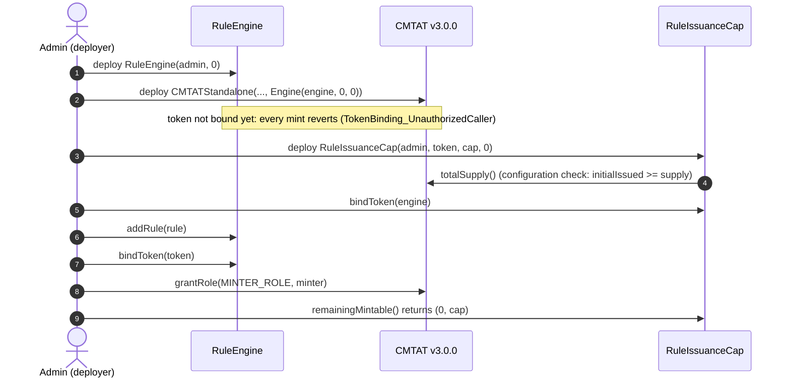
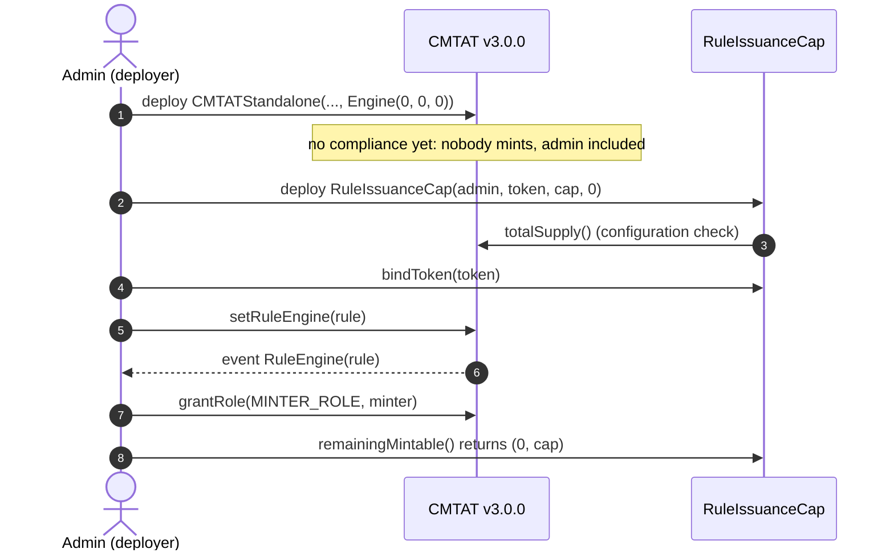
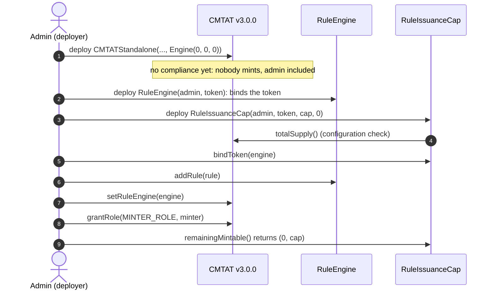
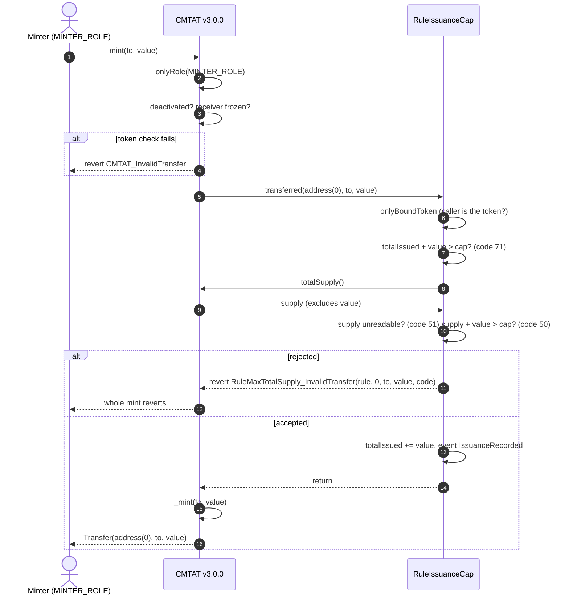
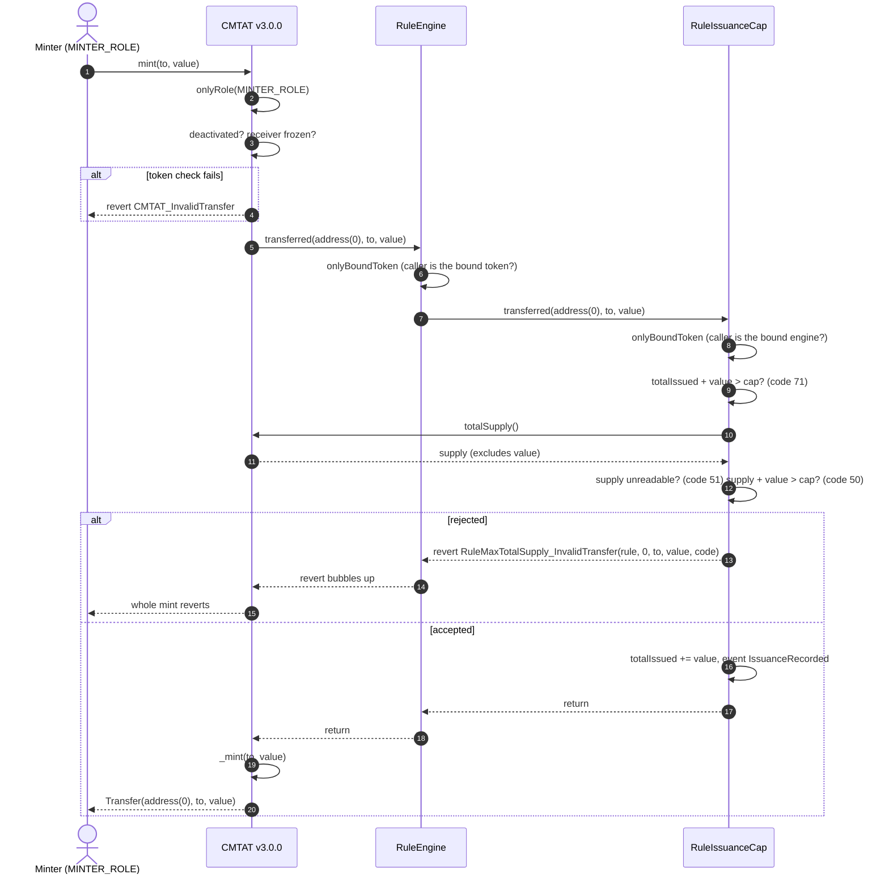
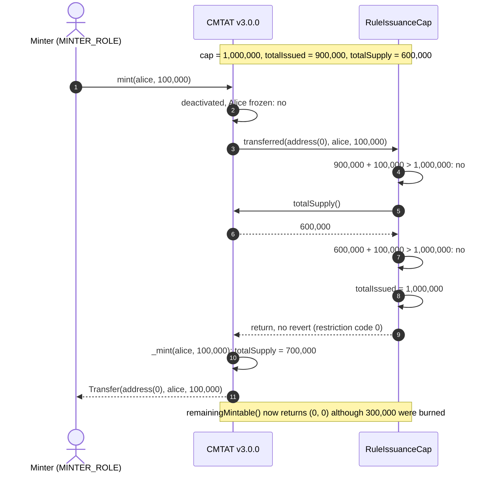
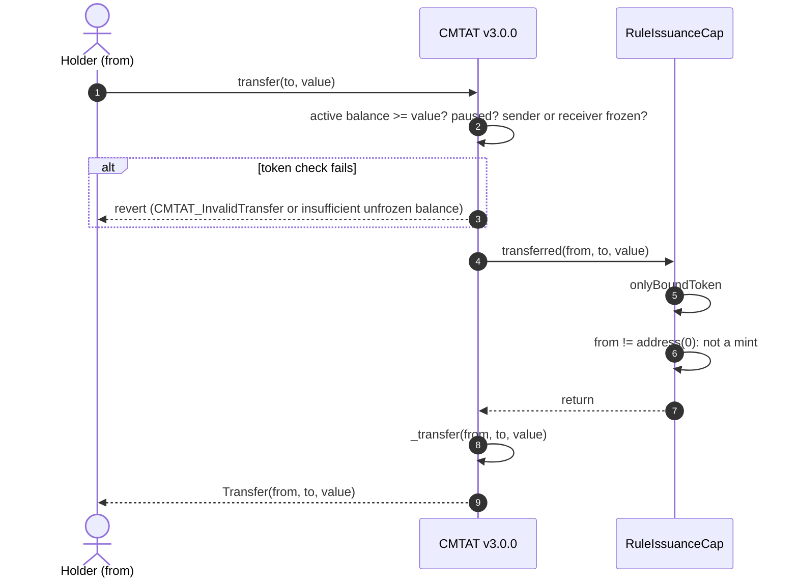
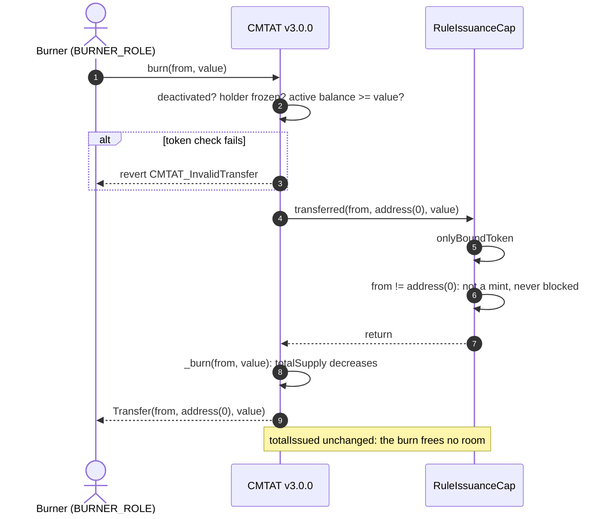

# Deploy `RuleIssuanceCap` with a CMTAT v3.0.0 token

<!-- toc -->

- [1. What the rule enforces](#1-what-the-rule-enforces)
- [2. Choose the setup](#2-choose-the-setup)
- [3. Contracts and roles](#3-contracts-and-roles)
- [4. Deployment steps](#4-deployment-steps)
  - [4.1 Behind a RuleEngine, set at deployment (recommended)](#41-behind-a-ruleengine-set-at-deployment-recommended)
  - [4.2 Rule set directly, after deployment](#42-rule-set-directly-after-deployment)
  - [4.3 Behind a RuleEngine, after deployment](#43-behind-a-ruleengine-after-deployment)
- [5. Mint workflow](#5-mint-workflow)
  - [5.1 Rule plugged directly into the token](#51-rule-plugged-directly-into-the-token)
  - [5.2 Rule behind a RuleEngine](#52-rule-behind-a-ruleengine)
  - [5.3 Happy path: a mint after a burn](#53-happy-path-a-mint-after-a-burn)
- [6. Transfer and burn workflows](#6-transfer-and-burn-workflows)
  - [6.1 Transfer](#61-transfer)
  - [6.2 Burn](#62-burn)
- [7. Operating the token](#7-operating-the-token)

<!-- /toc -->

This guide deploys a CMTAT **v3.0.0** token whose cumulative issuance can never exceed a fixed amount, enforced by `RuleIssuanceCap`. Burns do not give the room back. It covers:

- where the rule sits: on the token directly, or inside a RuleEngine, and which caller it must be bound to;
- when it can be installed, given that the rule needs the token's address and must count every mint;
- what happens on a mint, a transfer and a burn once it is active.

CMTAT v3.0.0 is the last audited CMTAT release. For CMTAT v3.3.0, validated against `v3.3.0-rc4`, see the [v3.3.0 guide](./DEPLOY_RULE_ISSUANCE_CAP_CMTAT_V3.3.0.md), which also lists the differences between the two versions. This is the use case of [CMTA/Rules#16](https://github.com/CMTA/Rules/issues/16): the rule works on v3.0.0 because it caps issuance per token and never needs the minter.

Every step below is tested against a real v3.0.0 token:

- `test/CMTATv3.0.0/RuleIssuanceCapV300Deployment.t.sol`: RuleEngine passed in the token constructor, rule bound and added, token bound last (setup 4.1), and code 85 while the rule is unbound;
- `test/CMTATv3.0.0/RuleIssuanceCapV300.t.sol`: rule installed after deployment (setups 4.2 and 4.3), on the Standard and Debt variants, directly and behind a RuleEngine, with every token operation (mint, burn, forced burn, `burnAndMint`, bridge mint and burn on Standard, transfers, detach and re-attach, lowered cap). In that suite the rule is bound right after `setRuleEngine` rather than before; both orders are safe (§4.2).

## 1. What the rule enforces

| Operation | Checked by `RuleIssuanceCap` | Rejected with |
| --- | --- | --- |
| Mint of `value` | `totalIssued + value <= cap` (the counter), then `totalSupply() + value <= cap` (the live supply, read before the mint) | 71 (issuance cap exceeded), 50 (supply cap exceeded), 51 (`totalSupply()` unreadable) |
| Transfer, `transferFrom` | nothing; the counter does not change | never |
| Burn | nothing, and the burn does **not** free room for a later mint | never |
| Any operation while no caller is bound | the rule rejects its caller | reverts `TokenBinding_UnauthorizedCaller`; views report 85 |

`totalIssued` starts at `initialIssued` and grows by `value` on every accepted mint. It never goes down. The cap is held in `maxTotalSupply` and is shared by both checks. While every mint is counted, the counter is always at least the supply, so code 50 only fires when mints were made without the rule (for example while it was detached): the live check then stops minting at the same cap.

For a cap that burns do restore, deploy [`RuleMaxTotalSupply`](../contracts/RuleMaxTotalSupply.md) instead. For both limits at once, put both rules in the same RuleEngine.

On v3.0.0 mint and burn call the rule through the 3-argument `transferred`, with no minter or burner. The rule never uses one, so nothing is lost: the cap is per token, not per minter.

**The cap and `initialIssued` are in base units.** On a 0-decimal token (a typical CMTAT share), `1_000_000` means one million shares; on an 18-decimal token, one million tokens is `1_000_000 * 10**18`.

## 2. Choose the setup

**Where the rule sits, and what it is bound to.** The rule writes `totalIssued` on every mint, so it accepts `transferred` only from the one caller bound with `bindToken`:

| Topology | Token calls | Bind the rule to | Use it when |
| --- | --- | --- | --- |
| **Direct** | the rule itself (`token.ruleEngine() == rule`) | the **token** | the cap is the only rule |
| **RuleEngine** | a `RuleEngine`, which calls each of its rules | the **RuleEngine** | you need several rules, or want to install the cap with no uncounted window |

Until the rule is bound, every mint, transfer and burn that calls it reverts with `TokenBinding_UnauthorizedCaller`, and its views report code 85. A second `bindToken` reverts with `RuleIssuanceCap_TokenAlreadyBound`: one rule instance serves one caller.

**When the rule can be installed.** The rule's constructor takes the token's address, checks that it is a contract whose `totalSupply()` answers, and checks that `initialIssued >= totalSupply()`. So the rule can only be deployed **after** the token. A mint made before the rule is installed is not counted: a mint followed by a burn in that window would let lifetime issuance exceed the cap without the rule ever knowing. A RuleEngine can be passed in the token constructor, and that gives the one setup with no such window:

| Setup | Uncounted window |
| --- | --- |
| **4.1** RuleEngine in the token constructor, rule bound and added, token bound last (recommended) | none: every mint reverts until the token is bound, the admin's included |
| **4.2** Rule set directly with `setRuleEngine`, after deployment | between the token's deployment and `setRuleEngine`: nobody may mint, the admin included |
| **4.3** RuleEngine set with `setRuleEngine`, after deployment | same as 4.2 |

The window matters more than for `RuleMaxTotalSupply`. The live-supply check keeps the outstanding supply under the cap, but issuance made in the window is lost to the counter for good.

## 3. Contracts and roles

| Contract | Constructor | Roles that matter here |
| --- | --- | --- |
| `RuleIssuanceCap` (or `RuleIssuanceCapOwnable2Step`) | `(admin, tokenContract, issuanceCap, initialIssued)`; `tokenContract` must be non-zero, have code and answer `totalSupply()`; `initialIssued` must be at least `totalSupply()` (`0` for a new token) | `MAX_TOTAL_SUPPLY_ROLE` (`setMaxTotalSupply`, `increaseMaxTotalSupply`, `decreaseMaxTotalSupply`), `COMPLIANCE_MANAGER_ROLE` (`bindToken`, `unbindToken`), `DEFAULT_ADMIN_ROLE` (roles, and implicitly every role above). The Ownable2Step variant gives all of it to the owner |
| `RuleEngine` (RuleEngine `v3.0.0-rc7`, optional) | `(admin, tokenContract)`; `tokenContract` may be `address(0)` | `RULES_MANAGEMENT_ROLE` (`addRule`, `removeRule`), `COMPLIANCE_MANAGER_ROLE` (`bindToken`) |
| CMTAT v3.0.0 `CMTATStandalone` (or `CMTATStandaloneDebt`, or a proxy variant) | `(forwarder, admin, ERC20Attributes, ExtraInformationAttributes, Engine{ruleEngine, snapshotEngine, documentEngine})`. `CMTATStandaloneDebt` takes no forwarder | `DEFAULT_ADMIN_ROLE` (`setRuleEngine`, all roles), `MINTER_ROLE`, `BURNER_ROLE` |

On both CMTAT and the AccessControl rule, the default admin implicitly holds every role. The rule and the RuleEngine both name a role `COMPLIANCE_MANAGER_ROLE`; they are separate grants on separate contracts.

**The token is locked.** `setTokenContract` always reverts with `RuleIssuanceCap_TokenContractLocked`: the counter is the history of one token. To protect another token, deploy another instance.

**One RuleEngine per token.** A RuleEngine can bind several tokens, and the rule cannot tell which one minted. Every mint of every token the engine serves would be added to this rule's `totalIssued`, while the live check still reads `tokenContract` only. Use a RuleEngine that serves only this token.

## 4. Deployment steps

Each setup lists its steps, then draws them as a sequence diagram. The calls are shown from a single admin; in production the cap, binding and minting roles can be held by different addresses (§3).

### 4.1 Behind a RuleEngine, set at deployment (recommended)

1. **Deploy the RuleEngine:** `RuleEngine(admin, address(0))`.
2. **Deploy the token** with `Engine(ruleEngine = engine, 0, 0)`. The engine rejects every call from a token it has not bound, so nothing can be minted, even by the admin.
3. **Deploy the rule:** `RuleIssuanceCap(admin, token, cap, 0)`, with `cap` in base units.
4. **Bind the rule to the engine:** `rule.bindToken(engine)` (rule `COMPLIANCE_MANAGER_ROLE`).
5. **Add it:** `engine.addRule(rule)` (`RULES_MANAGEMENT_ROLE`), plus any other rules.
6. **Bind the token last:** `engine.bindToken(token)` (engine `COMPLIANCE_MANAGER_ROLE`). From now on the token works, and the rule counts the first mint.
7. **Grant `MINTER_ROLE`** to the issuer's minting address, if it is not the admin. A minter granted the role before step 6 is blocked like the admin.
8. **Check the setup:** `rule.remainingMintable()` returns `(0, cap)`, `rule.totalIssued()` returns `0`; on the Standard variant, `token.detectTransferRestriction(address(0), investor, cap + 1)` returns 71.

### 4.2 Rule set directly, after deployment

1. **Deploy the token** with `Engine(ruleEngine = 0, 0, 0)`. Nobody may mint yet: CMTAT gives the default admin every role, so the admin can mint and must not.
2. **Deploy the rule:** `RuleIssuanceCap(admin, token, cap, 0)`.
3. **Bind the rule to the token:** `rule.bindToken(token)`.
4. **Install it:** `token.setRuleEngine(rule)`, as the token's `DEFAULT_ADMIN_ROLE`. It emits `RuleEngine(rule)` and reverts with `CMTAT_ValidationModule_SameValue` if that rule is already set.
5. **Grant `MINTER_ROLE`**, then check as in 4.1 step 8.

Steps 3 and 4 may be swapped: a rule installed before it is bound rejects every operation until `bindToken`, it never lets one through.

### 4.3 Behind a RuleEngine, after deployment

1. **Deploy the token** with no engine. Nobody may mint yet.
2. **Deploy the RuleEngine** with the token already known: `RuleEngine(admin, token)` binds it in the constructor.
3. **Deploy the rule**, bind it to the engine (`rule.bindToken(engine)`), and add it: `engine.addRule(rule)`.
4. **Install the engine:** `token.setRuleEngine(engine)`.
5. **Grant `MINTER_ROLE`** and check as in 4.1 step 8.

**For a token that is already live,** use 4.2 or 4.3 and pass as `initialIssued` the issuance at the moment the rule is installed: at least `totalSupply()`, and more if tokens were already burned. Do not mint between the rule's deployment and its installation.

## 5. Mint workflow

`mint(to, value)` by a `MINTER_ROLE` holder, with the rule active. The token runs its own checks first (contract deactivated, receiver frozen), then notifies the compliance contract **before** creating the tokens, so the supply the rule reads does not include `value` yet. Pause does not stop a mint.

### 5.1 Rule plugged directly into the token

The token calls `RuleIssuanceCap` itself, and the rule is bound to the token.

If the rule is not bound to the token, step 5 reverts with `TokenBinding_UnauthorizedCaller` and nothing is minted.

### 5.2 Rule behind a RuleEngine

The token calls the RuleEngine, which accepts only its bound token and then calls each of its rules in order. The rule in turn accepts only the engine it is bound to. The first rule that reverts stops the mint, and the engine passes the revert back to the token.

### 5.3 Happy path: a mint after a burn

The same mint when everything passes, with numbers. The cap is 1,000,000. The issuer has minted 900,000 in total, and 300,000 were later burned, so the supply is 600,000 but `totalIssued` stays at 900,000. The issuer mints 100,000 to Alice, which lands exactly on the cap. The rule is plugged directly into the token; behind a RuleEngine the engine sits between the token and the rule, as in §5.2.

## 6. Transfer and burn workflows

The rule only acts on mints. On a transfer or a burn it checks its caller, then returns without reading the supply or touching the counter. The diagrams show the rule plugged directly into the token; behind a RuleEngine the engine sits between them, as in §5.2.

### 6.1 Transfer

### 6.2 Burn

Before minting, a front end can size the mint without a transaction: `rule.remainingMintable()` returns `(0, headroom)`, the smaller of the counter room and the live-supply room, or `(51, 0)` if the supply cannot be read, or `(85, 0)` while no caller is bound. On the Standard variant `token.detectTransferRestriction(address(0), to, value)` returns the same code the mint would fail with; the Debt variant has no ERC-1404 layer, so use `token.canTransfer(address(0), to, value)`.

## 7. Operating the token

| Task | Call | Role |
| --- | --- | --- |
| Raise the authorised volume by N | `rule.increaseMaxTotalSupply(N)` | `MAX_TOTAL_SUPPLY_ROLE` |
| Lower it by N | `rule.decreaseMaxTotalSupply(N)` | `MAX_TOTAL_SUPPLY_ROLE` |
| Set an absolute cap | `rule.setMaxTotalSupply(cap)` | `MAX_TOTAL_SUPPLY_ROLE` |
| Stop all minting, keep transfers and burns | any cap at or below `totalIssued` | `MAX_TOTAL_SUPPLY_ROLE` |
| Check the room left and the history | `rule.remainingMintable()`, `rule.totalIssued()` | anyone |
| Move to a new RuleEngine | `rule.unbindToken(oldEngine)`, then `rule.bindToken(newEngine)` | rule `COMPLIANCE_MANAGER_ROLE` |
| Replace the rule | deploy a new one with `initialIssued = old.totalIssued()`, bind it, then swap it in | rule and token or engine admins |

Every cap change emits `MaxTotalSupplyUpdated(previous, new)`; every counted mint emits `IssuanceRecorded(value, totalIssued)`.

Warnings:

- **Detaching the rule lifts the cap, and the admin can still mint.** After `token.setRuleEngine(address(0))` or `engine.removeRule(rule)`, mints are neither checked nor counted. Revoking `MINTER_ROLE` from every minter is not enough: CMTAT gives the default admin every role, so the admin must not mint during the gap either. Pause does not help, it does not stop mints. When the rule comes back, the live-supply check catches the supply minted in between, but not issuance that was minted and burned again.
- **Bridged tokens.** On the Standard variant `crosschainMint` is a mint: it is checked and counted. A bridge round trip (burn out, mint back in) therefore uses up the cap. Do not use this rule on a token bridged with `crosschainMint` / `crosschainBurn`; use `RuleMaxTotalSupply`.
- **`burnAndMint` counts the mint leg in full.** A correction of 50 uses up 50 of the authorised volume; raise the cap by the same amount if it should not.
- **A RuleEngine shared by several tokens** adds all their mints to one counter (§3). Use one engine per token with this rule.

See also: [`RuleIssuanceCap.md`](../contracts/RuleIssuanceCap.md) for the full rule reference.

