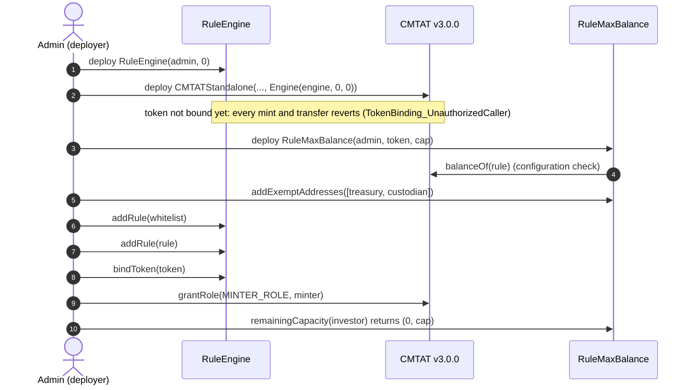
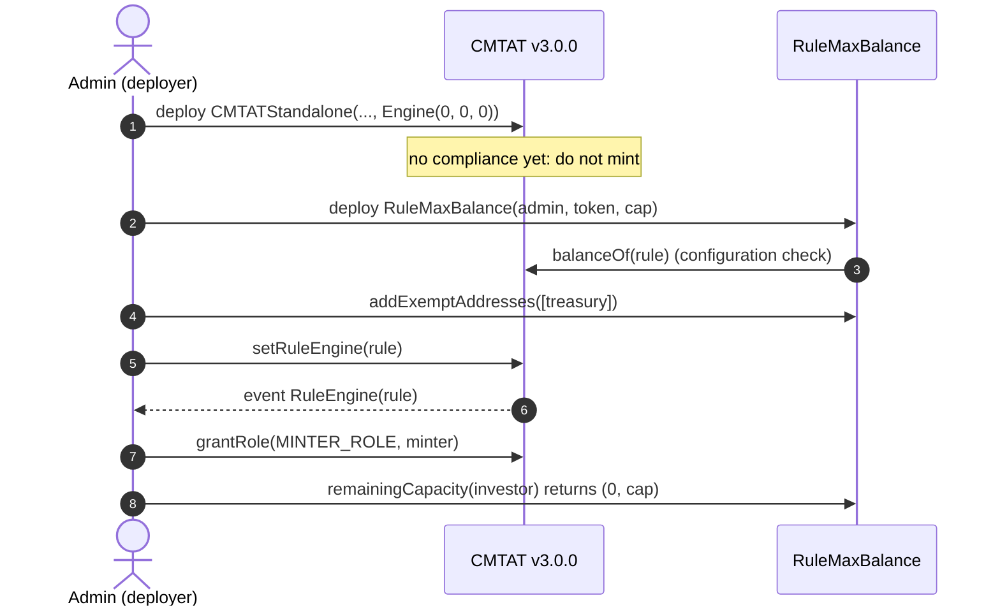
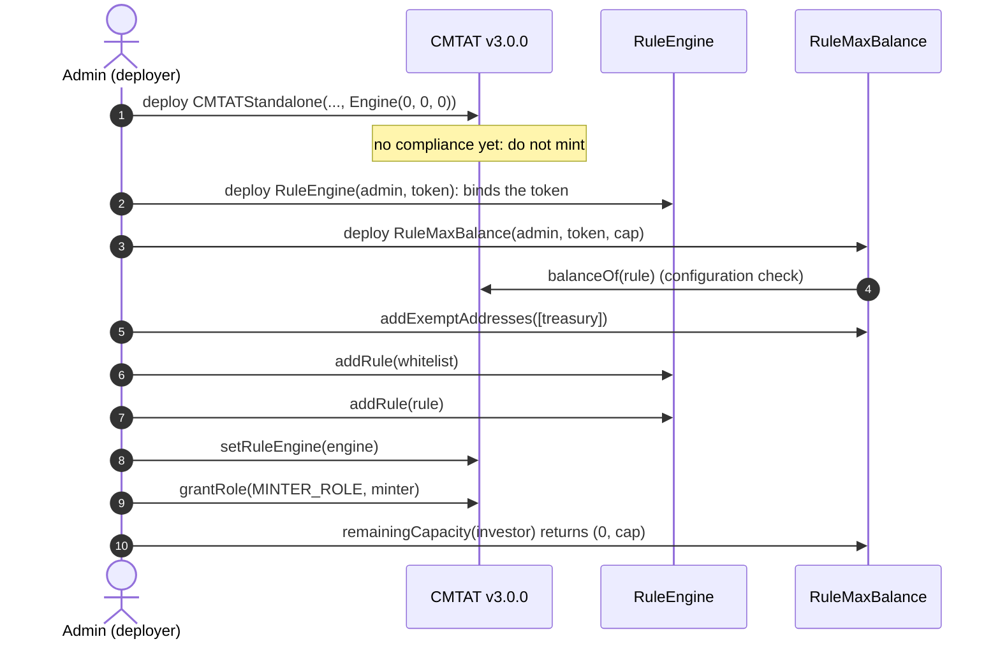
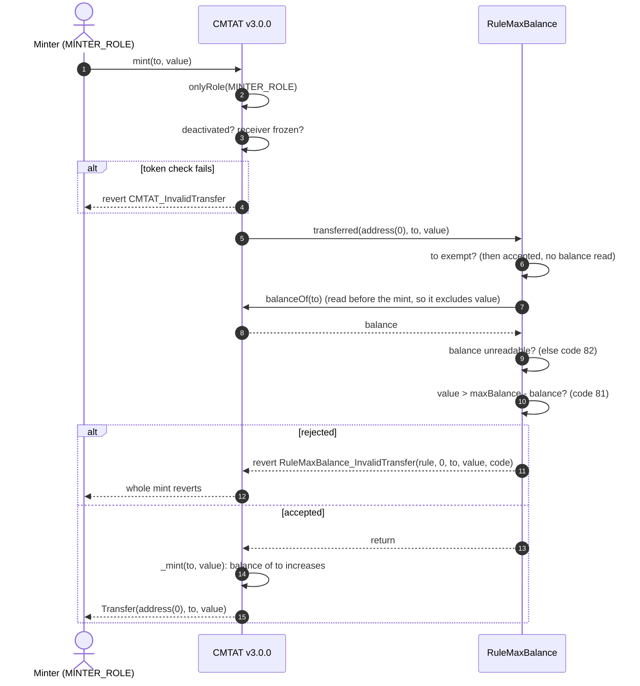
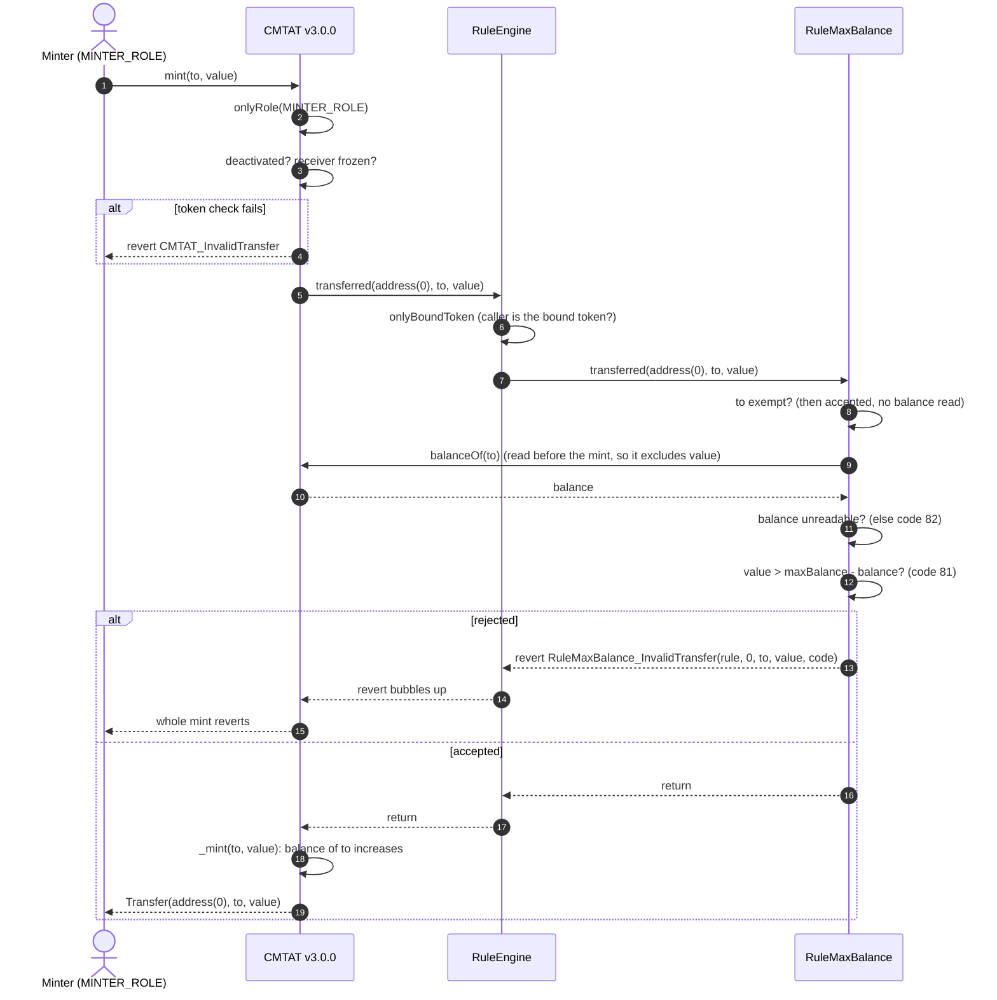
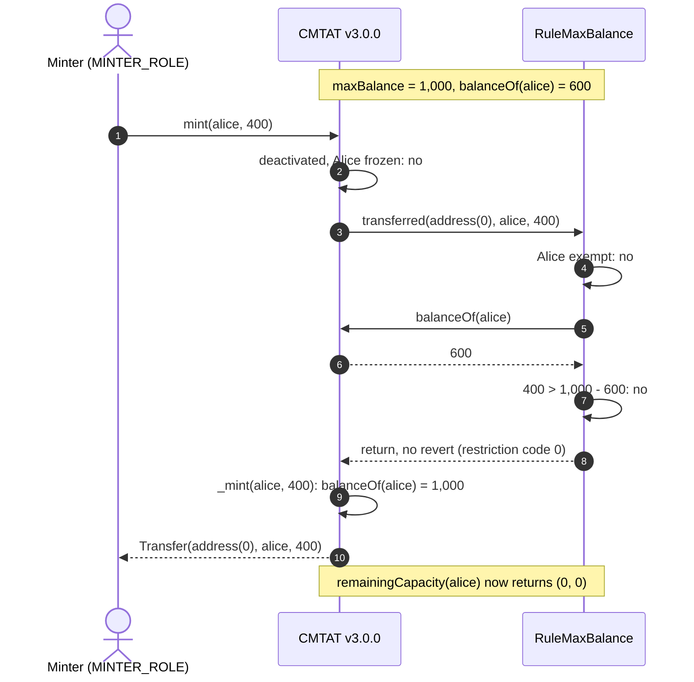
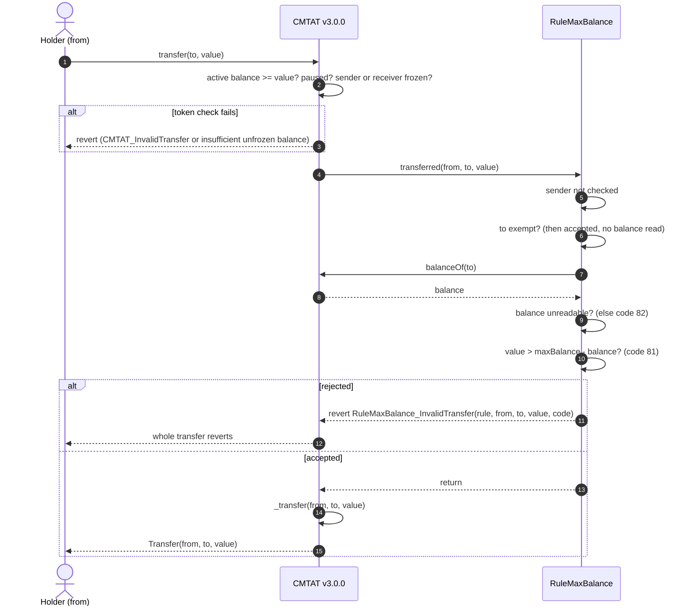
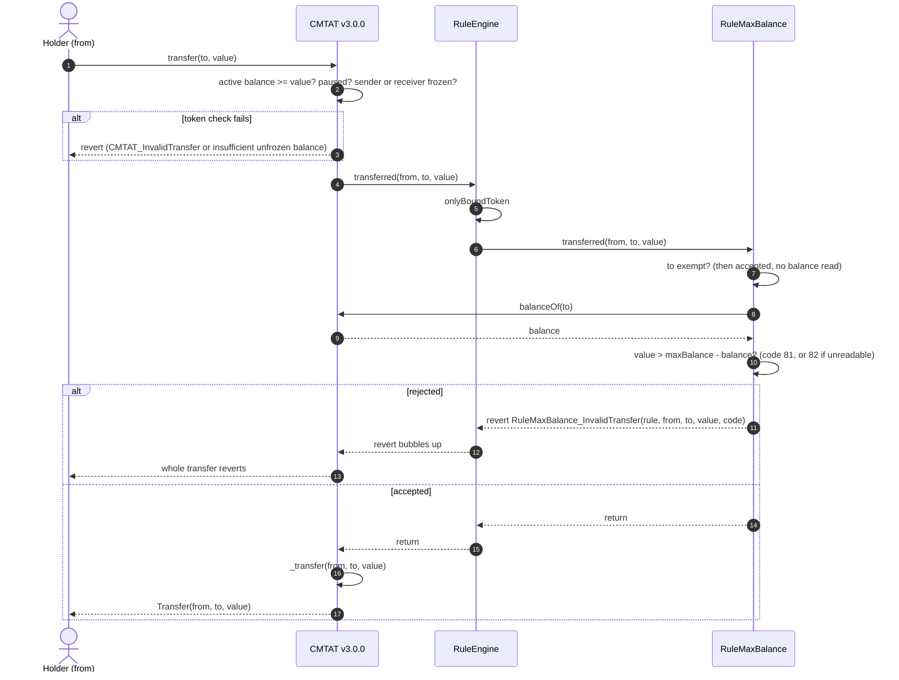
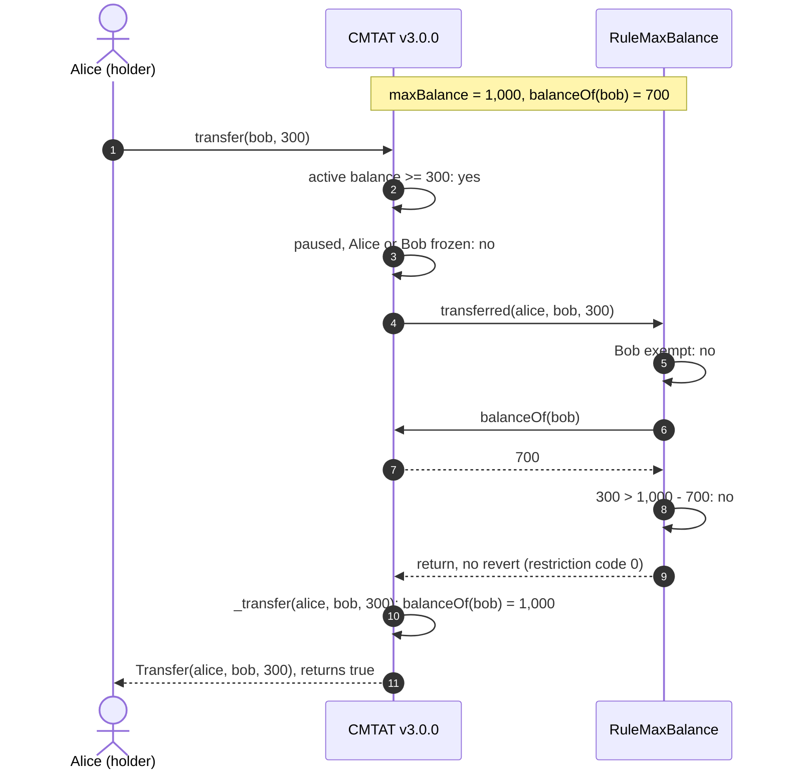
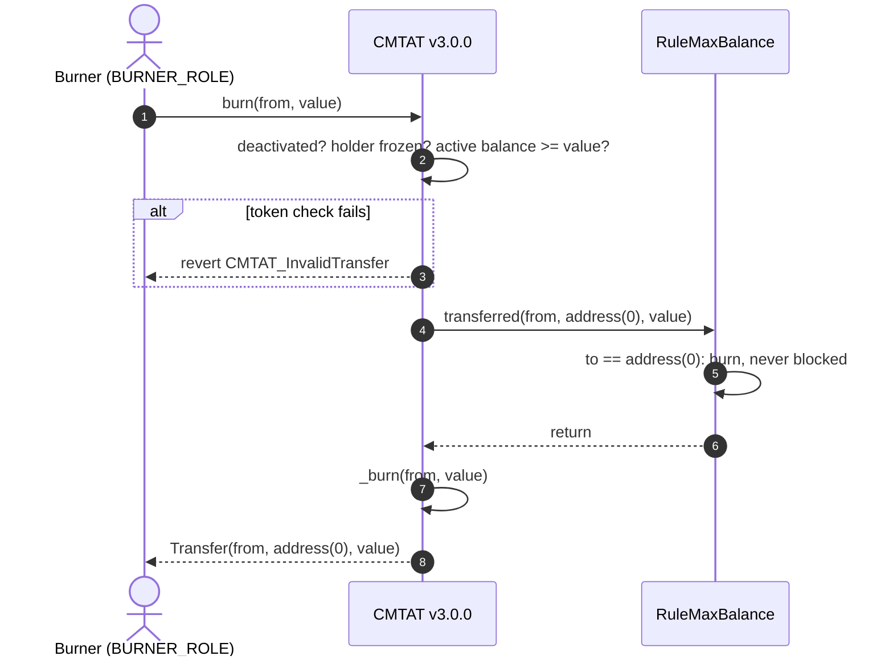

# Deploy `RuleMaxBalance` with a CMTAT v3.0.0 token

<!-- toc -->

- [1. What the rule enforces](#1-what-the-rule-enforces)
- [2. Choose the setup](#2-choose-the-setup)
- [3. Contracts and roles](#3-contracts-and-roles)
- [4. Deployment steps](#4-deployment-steps)
  - [Rule constructor parameters](#rule-constructor-parameters)
  - [4.1 Behind a RuleEngine, set at deployment (recommended)](#41-behind-a-ruleengine-set-at-deployment-recommended)
  - [4.2 Rule set directly, after deployment](#42-rule-set-directly-after-deployment)
  - [4.3 Behind a RuleEngine, after deployment](#43-behind-a-ruleengine-after-deployment)
- [5. Mint workflow](#5-mint-workflow)
  - [5.1 Rule plugged directly into the token](#51-rule-plugged-directly-into-the-token)
  - [5.2 Rule behind a RuleEngine](#52-rule-behind-a-ruleengine)
  - [5.3 Happy path: a mint that fits under the cap](#53-happy-path-a-mint-that-fits-under-the-cap)
- [6. Transfer and burn workflows](#6-transfer-and-burn-workflows)
  - [6.1 Rule plugged directly into the token](#61-rule-plugged-directly-into-the-token)
  - [6.2 Rule behind a RuleEngine](#62-rule-behind-a-ruleengine)
  - [6.3 Happy path: the receiver stays under the cap](#63-happy-path-the-receiver-stays-under-the-cap)
  - [6.4 Burn](#64-burn)
- [7. Operating the token](#7-operating-the-token)

<!-- /toc -->

This guide deploys a CMTAT **v3.0.0** token on which no single address can hold more than a fixed number of tokens, enforced by `RuleMaxBalance`. It covers:

- why the rule should not run alone, and which rule to pair it with;
- where the rule sits: on the token directly, or inside a RuleEngine;
- when it can be installed, given that the rule needs the token's address;
- what happens on a mint, a transfer and a burn once it is active.

CMTAT v3.0.0 is the last audited CMTAT release. For CMTAT v3.3.0, validated against `v3.3.0-rc4`, see the [v3.3.0 guide](./DEPLOY_RULE_MAX_BALANCE_CMTAT_V3.3.0.md), which also lists the differences between the two versions.

There is no ERC-3643 variant of this rule: ERC-3643 tokens notify compliance after moving the value, and the rule is not supported on them (see [`RULE_SEMANTICS.md`](./RULE_SEMANTICS.md) §6).

Every step below is tested against a real v3.0.0 token:

- `test/CMTATv3.0.0/RuleMaxBalanceV300.t.sol`: rule installed after deployment, on the Standard and Debt variants, directly (setup 4.2) and behind a RuleEngine (setup 4.3), with transfer, `transferFrom`, mint and burn;
- `test/CMTATv3.0.0/RuleMaxBalanceV300Deployment.t.sol`: RuleEngine passed in the token constructor and token bound last (setup 4.1), and the rule refusing a zero token address.

## 1. What the rule enforces

| Operation | Checked by `RuleMaxBalance` | Rejected with |
| --- | --- | --- |
| Transfer, `transferFrom` of `value` to `to` | `balanceOf(to) + value <= maxBalance`, with `balanceOf(to)` read from the token before the move. The sender and the spender are never checked | 81 (cap exceeded), 82 (`balanceOf` unreadable) |
| Mint of `value` to `to` | the same check on the receiver | 81, 82 |
| Burn | nothing: a burn only lowers a balance | never |
| Any operation to an exempt address | nothing: an exempt address may hold any amount | never |

On v3.0.0 mint and burn call the rule through the 3-argument `transferred(from, to, value)`, with no minter or burner, and a plain `transfer` takes the same path. `transferFrom` takes the 4-argument path with the caller as `spender`; the rule ignores the spender, since the cap concerns who ends up holding the tokens.

**`maxBalance = 0` forbids holding.** It does not disable the rule: every mint or transfer to a non-exempt address is then rejected with code 81. To lift the cap, set `type(uint256).max` or remove the rule.

**The cap is in base units.** It is compared as-is with `balanceOf`. On a 0-decimal token (a typical CMTAT share), `50_000` means 50,000 shares; on an 18-decimal token it is `50_000 * 10**18`.

**Do not deploy the rule alone.** The cap counts tokens per address, not per investor, so an investor who splits a position across two wallets holds twice the cap with no rule objecting. Put the rule in a RuleEngine together with a rule that admits addresses (`RuleWhitelist`, `RuleReceiverWhitelist` or `RuleIdentityRegistry`), and admit exactly one address per investor during onboarding. The whitelist alone does not close the gap: if the operator admits two wallets of the same investor, the cap is doubled again.

## 2. Choose the setup

**Where the rule sits.**

| Topology | Token calls | Use it when |
| --- | --- | --- |
| **RuleEngine** | a `RuleEngine`, which calls each of its rules | the normal case: the cap runs next to the rule that admits one address per investor |
| **Direct** | the rule itself (`token.ruleEngine() == rule`) | another control, outside this token's compliance, already guarantees one address per investor |

**When the rule can be installed.** The rule's constructor takes the token's address and checks that it is a contract whose `balanceOf` answers. So the rule can only be deployed **after** the token, and cannot be passed in the token constructor itself. A RuleEngine can be, and that gives the one setup with no unscreened window:

| Setup | Unscreened window |
| --- | --- |
| **4.1** RuleEngine in the token constructor, rule added, token bound last (recommended) | none: every mint and transfer reverts until the token is bound |
| **4.2** Rule set directly with `setRuleEngine`, after deployment | between the token's deployment and `setRuleEngine`: do not mint |
| **4.3** RuleEngine set with `setRuleEngine`, after deployment | same as 4.2 |

A balance pushed above the cap during the window is **not** taken back when the rule is installed. The holder keeps the tokens and may still send them, but cannot receive more until back under the cap.

## 3. Contracts and roles

| Contract | Constructor | Roles that matter here |
| --- | --- | --- |
| `RuleMaxBalance` (or `RuleMaxBalanceOwnable2Step`) | `(admin, balanceToken, maxBalance)`; `balanceToken` must be non-zero, have code and answer `balanceOf` | `MAX_BALANCE_ROLE` (`setMaxBalance`, `setBalanceToken`, `addExemptAddress(es)`, `removeExemptAddress(es)`), `DEFAULT_ADMIN_ROLE` (roles, and everything the cap role may call). The Ownable2Step variant gives all of it to the owner |
| `RuleEngine` (RuleEngine `v3.0.0-rc7`) | `(admin, tokenContract)`; `tokenContract` may be `address(0)` | `RULES_MANAGEMENT_ROLE` (`addRule`), `COMPLIANCE_MANAGER_ROLE` (`bindToken`) |
| CMTAT v3.0.0 `CMTATStandalone` (or `CMTATStandaloneDebt`, or a proxy variant) | `(forwarder, admin, ERC20Attributes, ExtraInformationAttributes, `Engine{ruleEngine, snapshotEngine, documentEngine}`)`. `CMTATStandaloneDebt` takes no forwarder | `DEFAULT_ADMIN_ROLE` (`setRuleEngine`, `forcedTransfer`, all roles), `MINTER_ROLE`, `BURNER_ROLE` |

On both CMTAT and the AccessControl rule, the default admin implicitly holds every role. `MAX_BALANCE_ROLE` covers the exemption list and `setBalanceToken` as well as the cap: whoever holds it can lift the cap for any address.

**One rule instance per token.** The rule reads balances from its configured `balanceToken`, never from the token that triggered the check. One instance added to two RuleEngines checks both tokens against the first token's balances.

## 4. Deployment steps

Each setup lists its steps, then draws them as a sequence diagram. The calls are shown from a single admin; in production the cap, rule and minting roles can be held by different addresses (§3). The pairing rule (here a whitelist) is shown in 4.1 and 4.3; deploy and fill it as in its own guide.

### Rule constructor parameters

| Parameter | Type | What it sets | Checks and notes |
| --- | --- | --- | --- |
| `admin` | `address` | Receives `DEFAULT_ADMIN_ROLE`, which implicitly holds every role of the rule. Set it to the account (ideally a multisig) that will operate the rule. | Reverts if `address(0)`. On the `Ownable2Step` variant this parameter is `owner`, who then holds every privileged function |
| `balanceToken_` | `address` | The token whose `balanceOf` the rule reads to check the receiver's balance. | Must be non-zero, have code and answer `balanceOf`, so the rule is deployed after the token |
| `maxBalance_` | `uint256` | The largest balance a non-exempt address may hold, in base units. A transfer or mint that would push the receiver above it is refused (code 81). | `0` forbids holding entirely, it does not disable the rule. Change later with `setMaxBalance` |

### 4.1 Behind a RuleEngine, set at deployment (recommended)

1. **Deploy the RuleEngine:** `RuleEngine(admin, address(0))`.
2. **Deploy the token** with `Engine(ruleEngine = engine, 0, 0)`. The engine rejects every call from a token it has not bound, so nothing can be minted or transferred yet.
3. **Deploy the rule:** `RuleMaxBalance(admin, token, cap)`, with `cap` in base units.
4. **Exempt the non-investor addresses** that must hold more than the cap (treasury, custodian): `rule.addExemptAddresses([...])` (`MAX_BALANCE_ROLE`).
5. **Add the rules:** `engine.addRule(whitelist)` and `engine.addRule(rule)` (`RULES_MANAGEMENT_ROLE`).
6. **Bind the token last:** `engine.bindToken(token)` (`COMPLIANCE_MANAGER_ROLE`). From now on the token works, and the cap holds from the first mint.
7. **Grant `MINTER_ROLE`** to the issuer's minting address, if it is not the admin.
8. **Check the setup:** `rule.remainingCapacity(investor)` returns `(0, cap)`; on the Standard variant, `token.detectTransferRestriction(address(0), investor, cap + 1)` returns 81.

### 4.2 Rule set directly, after deployment

Only when one address per investor is guaranteed by another control (§2).

1. **Deploy the token** with `Engine(ruleEngine = 0, 0, 0)`. Do not mint yet.
2. **Deploy the rule:** `RuleMaxBalance(admin, token, cap)`, and add the exemptions.
3. **Install it:** `token.setRuleEngine(rule)`, as the token's `DEFAULT_ADMIN_ROLE`. It emits `RuleEngine(rule)` and reverts with `CMTAT_ValidationModule_SameValue` if that rule is already set.
4. **Grant `MINTER_ROLE`**, then check as in 4.1 step 8.

### 4.3 Behind a RuleEngine, after deployment

1. **Deploy the token** with no engine. Do not mint yet.
2. **Deploy the RuleEngine** with the token already known: `RuleEngine(admin, token)` binds it in the constructor.
3. **Deploy the rule**, add the exemptions, and add it with the pairing rule: `engine.addRule(whitelist)`, `engine.addRule(rule)`.
4. **Install the engine:** `token.setRuleEngine(engine)`.
5. **Grant `MINTER_ROLE`** and check as in 4.1 step 8.

## 5. Mint workflow

`mint(to, value)` by a `MINTER_ROLE` holder, with the rule active. The token runs its own checks first (contract deactivated, receiver frozen), then notifies the compliance contract **before** creating the tokens, so the balance the rule reads does not include `value` yet. The rule calls back the token for `balanceOf(to)`. Pause does not stop a mint.

### 5.1 Rule plugged directly into the token

The token calls `RuleMaxBalance` itself: `token.ruleEngine() == rule`.

### 5.2 Rule behind a RuleEngine

The token calls the RuleEngine, which accepts only its bound token and then calls each of its rules in order. The first rule that reverts stops the mint, and the engine passes the revert back to the token.

### 5.3 Happy path: a mint that fits under the cap

The same mint when everything passes, with numbers. The cap is 1,000, Alice holds 600, and the issuer mints 400 to her, which lands exactly on the cap. The rule is plugged directly into the token; behind a RuleEngine the engine sits between the token and the rule, as in §5.2.

## 6. Transfer and burn workflows

`transfer(to, value)` by a holder. The token first checks that the tokens are not frozen (active balance), then that the token is not paused and nobody involved is frozen, then notifies the compliance contract **before** moving the balance. A `transfer` takes the 3-argument path; `transferFrom` takes the 4-argument path with the caller as spender and reverts with `RuleMaxBalance_InvalidTransferFrom` instead. Only the receiver is checked.

### 6.1 Rule plugged directly into the token

### 6.2 Rule behind a RuleEngine

Same path through the engine as for a mint (§5.2), on the 3-argument `transferred`.

### 6.3 Happy path: the receiver stays under the cap

The cap is 1,000, Bob holds 700, and Alice sends him 300. Alice holds at least 300 unfrozen tokens and the token is not paused. The rule is plugged directly into the token; behind a RuleEngine the engine sits between the token and the rule, as in §6.2.

### 6.4 Burn

A burn has `to == address(0)`, which the rule accepts at once without reading a balance, so a burn is never blocked, even with `maxBalance = 0`.

Before sending or minting, a front end can size the amount without a transaction: `rule.remainingCapacity(to)` returns `(0, headroom)`, where `headroom` is `type(uint256).max` for an exempt address, or `(82, 0)` if the balance cannot be read. On the Standard variant `token.detectTransferRestriction(from, to, value)` returns the code the operation would fail with; the Debt variant has no ERC-1404 layer, so use `token.canTransfer(from, to, value)`.

## 7. Operating the token

| Task | Call | Role |
| --- | --- | --- |
| Change the cap | `rule.setMaxBalance(cap)` | `MAX_BALANCE_ROLE` |
| Exempt a treasury or custodian | `rule.addExemptAddresses([...])` (skips duplicates) or `addExemptAddress` (reverts on a duplicate) | `MAX_BALANCE_ROLE` |
| Remove an exemption | `rule.removeExemptAddresses([...])` / `removeExemptAddress` | `MAX_BALANCE_ROLE` |
| Check the room left for an address | `rule.remainingCapacity(to)` | anyone |
| Stop all holding by non-exempt addresses | `rule.setMaxBalance(0)`: mints and transfers to them fail, burns still pass | `MAX_BALANCE_ROLE` |
| Remove the cap | `rule.setMaxBalance(type(uint256).max)`, `token.setRuleEngine(address(0))` (direct) or `engine.removeRule(rule)` | `MAX_BALANCE_ROLE` / token `DEFAULT_ADMIN_ROLE` / engine `RULES_MANAGEMENT_ROLE` |

Key warnings:

- **Lowering the cap, or removing an exemption, takes nothing back.** An address above the cap keeps its tokens and may still send them; it only cannot receive more until back under the cap.
- **A zero-value transfer to an address above the cap is rejected** with code 81, although nothing moves.
- **`forcedTransfer` does not call the compliance contract,** so the admin can push an address above the cap with it.
- **An exempt address may hold any amount.** If the cap implements a regulatory concentration limit, each exemption is a policy decision.
- **The cap holds per address only.** Keep the onboarding rule of one admitted address per investor (§1).

See also: [`RuleMaxBalance.md`](../contracts/RuleMaxBalance.md) for the full rule reference.
