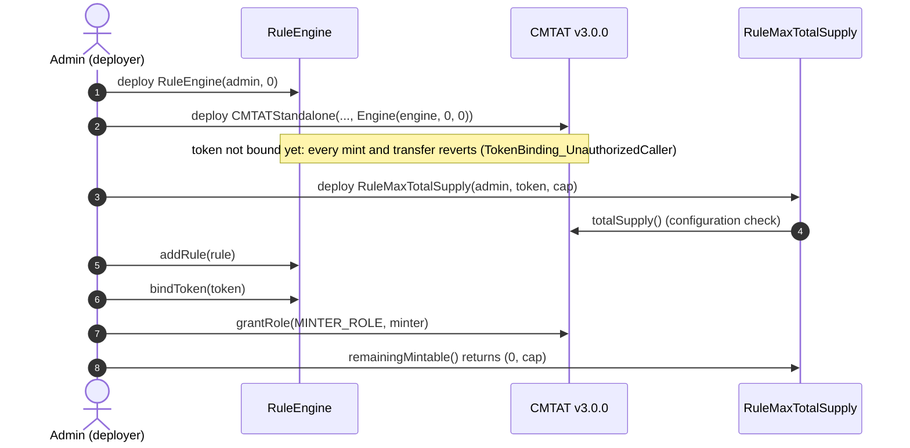
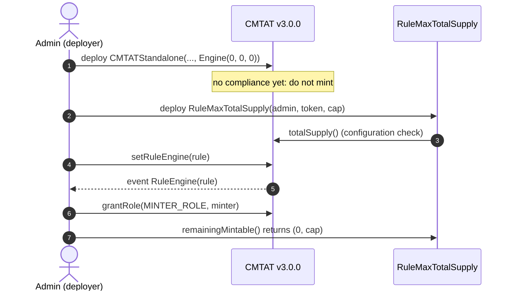
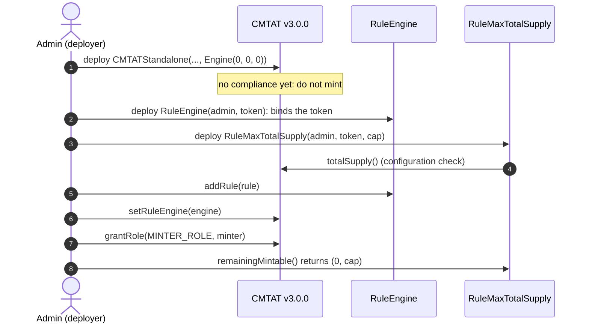
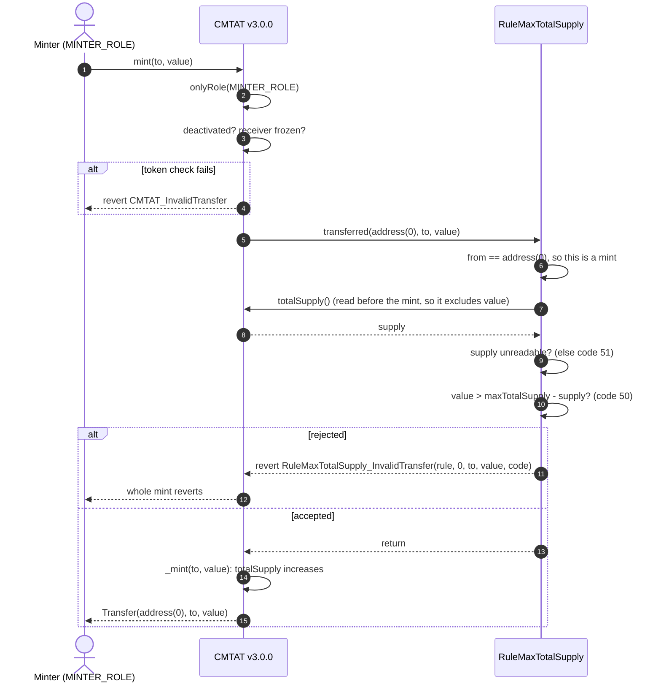
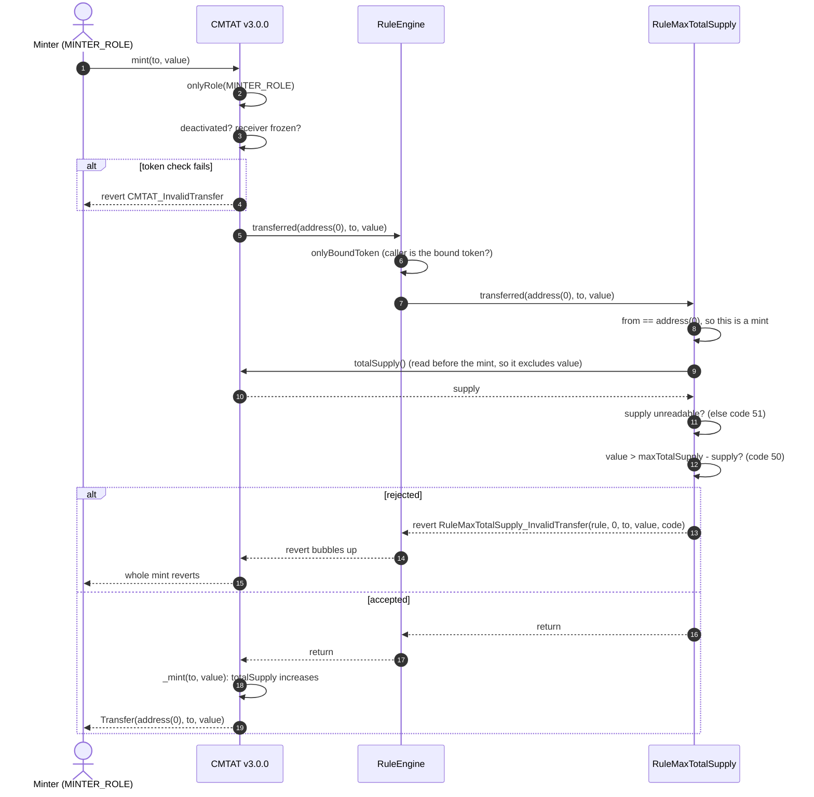
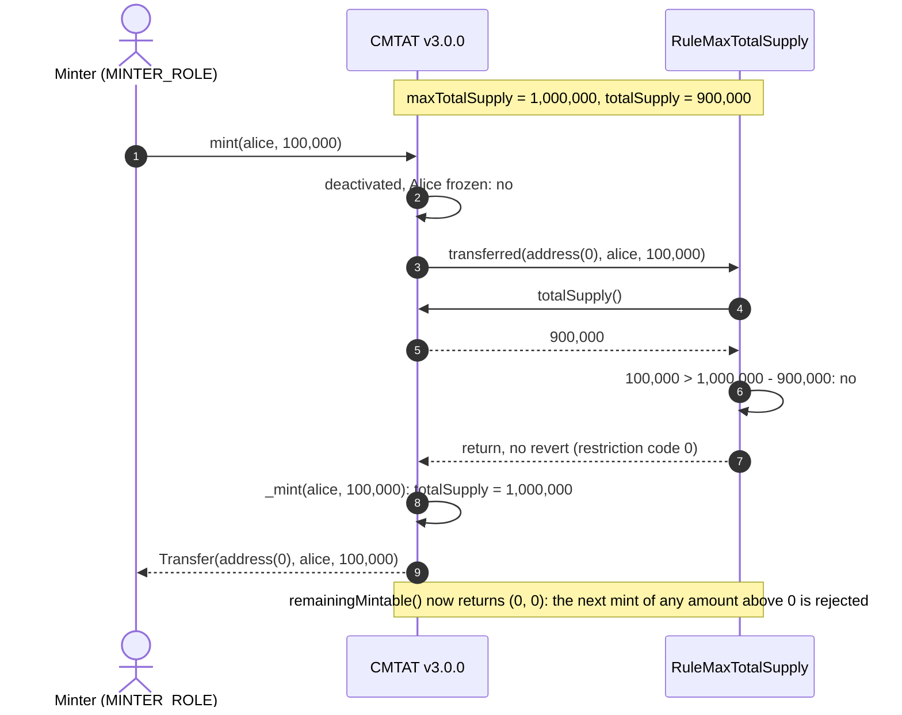
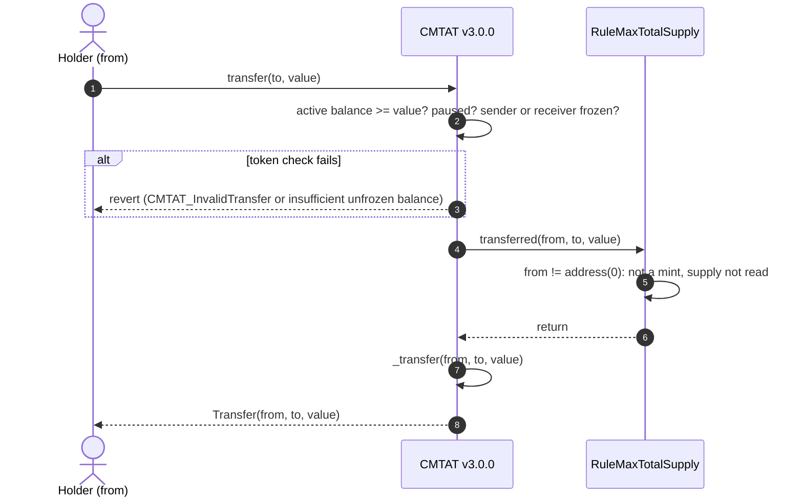
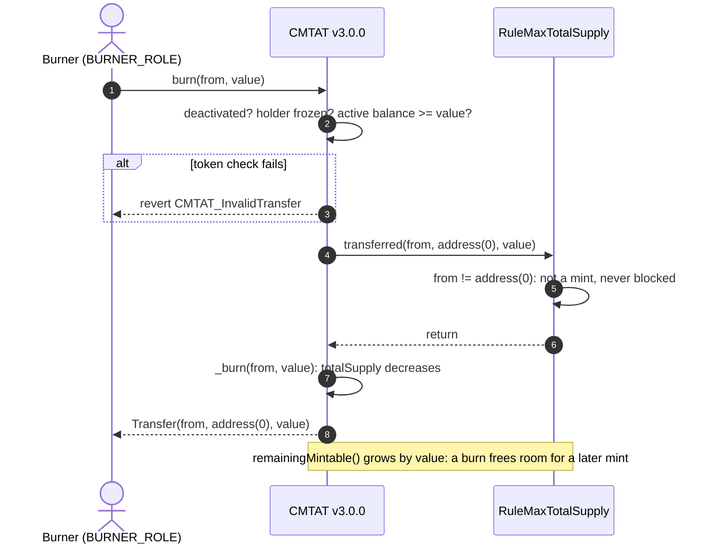

# Deploy `RuleMaxTotalSupply` with a CMTAT v3.0.0 token

<!-- toc -->

- [1. What the rule enforces](#1-what-the-rule-enforces)
- [2. Choose the setup](#2-choose-the-setup)
- [3. Contracts and roles](#3-contracts-and-roles)
- [4. Deployment steps](#4-deployment-steps)
  - [Rule constructor parameters](#rule-constructor-parameters)
  - [4.1 Behind a RuleEngine, set at deployment (recommended)](#41-behind-a-ruleengine-set-at-deployment-recommended)
  - [4.2 Rule set directly, after deployment](#42-rule-set-directly-after-deployment)
  - [4.3 Behind a RuleEngine, after deployment](#43-behind-a-ruleengine-after-deployment)
- [5. Mint workflow](#5-mint-workflow)
  - [5.1 Rule plugged directly into the token](#51-rule-plugged-directly-into-the-token)
  - [5.2 Rule behind a RuleEngine](#52-rule-behind-a-ruleengine)
  - [5.3 Happy path: a mint that fits under the cap](#53-happy-path-a-mint-that-fits-under-the-cap)
- [6. Transfer and burn workflows](#6-transfer-and-burn-workflows)
  - [6.1 Transfer](#61-transfer)
  - [6.2 Burn](#62-burn)
- [7. Operating the token](#7-operating-the-token)

<!-- /toc -->

This guide deploys a CMTAT **v3.0.0** token whose total supply can never be minted above a fixed cap, enforced by `RuleMaxTotalSupply`. It covers:

- where the rule sits: on the token directly, or inside a RuleEngine;
- when it can be installed, given that the rule needs the token's address;
- what happens on a mint, a transfer and a burn once it is active.

CMTAT v3.0.0 is the last audited CMTAT release. For CMTAT v3.3.0, validated against `v3.3.0-rc4`, see the [v3.3.0 guide](./DEPLOY_RULE_MAX_TOTAL_SUPPLY_CMTAT_V3.3.0.md), which also lists the differences between the two versions.

Every step below is tested against a real v3.0.0 token:

- `test/CMTATv3.0.0/RuleMaxTotalSupplyV300.t.sol`: rule installed after deployment, on the Standard and Debt variants, directly and behind a RuleEngine, with every token operation (mint, burn, `burnAndMint`, forced burn, bridge mint and burn, detach and re-attach);
- `test/CMTATv3.0.0/RuleMaxTotalSupplyV300Deployment.t.sol`: RuleEngine passed in the token constructor, and the rule refusing a zero token address.

## 1. What the rule enforces

| Operation | Checked by `RuleMaxTotalSupply` | Rejected with |
| --- | --- | --- |
| Mint of `value` | `totalSupply() + value <= maxTotalSupply`, with `totalSupply()` read from the token before the mint | 50 (cap exceeded), 51 (`totalSupply()` unreadable) |
| Transfer, `transferFrom` | nothing: the supply does not change | never |
| Burn | nothing, and the burn frees room for a later mint | never |

The cap bounds the **outstanding** supply. It is not a cap on cumulative issuance: a burn lowers `totalSupply()`, so the room comes back. For "never issue more than N in total, whatever is burned", deploy [`RuleIssuanceCap`](../contracts/RuleIssuanceCap.md) instead.

On v3.0.0 mint and burn call the rule through the 3-argument `transferred`, with no minter or burner: the rule never uses one, so nothing is lost.

**The cap is in base units.** It is compared as-is with `totalSupply()`. On a 0-decimal token (a typical CMTAT share), `1_000_000` means one million shares; on an 18-decimal token, one million tokens is `1_000_000 * 10**18`. Passing whole tokens on a token with decimals sets a cap far too small, and every mint fails with code 50. Check `remainingMintable()` after deployment.

## 2. Choose the setup

**Where the rule sits.**

| Topology | Token calls | Use it when |
| --- | --- | --- |
| **Direct** | the rule itself (`token.ruleEngine() == rule`) | the cap is the only rule |
| **RuleEngine** | a `RuleEngine`, which calls each of its rules | you need several rules (for example a whitelist and a supply cap), or want to install the cap with no unscreened window |

**When the rule can be installed.** The rule's constructor takes the token's address and checks that it is a contract whose `totalSupply()` answers. So the rule can only be deployed **after** the token, and cannot be passed in the token constructor itself. A RuleEngine can be, and that gives the one setup with no unscreened window:

| Setup | Unscreened window |
| --- | --- |
| **4.1** RuleEngine in the token constructor, rule added, token bound last (recommended) | none: every mint and transfer reverts until the token is bound |
| **4.2** Rule set directly with `setRuleEngine`, after deployment | between the token's deployment and `setRuleEngine`: do not mint |
| **4.3** RuleEngine set with `setRuleEngine`, after deployment | same as 4.2 |

A mint made before the rule is installed is **not lost**: the rule reads the live supply, so it is counted at the next mint. If it already pushed the supply above the cap, minting stays blocked until burns bring it back under. The window is still worth avoiding, because the cap does not hold during it.

## 3. Contracts and roles

| Contract | Constructor | Roles that matter here |
| --- | --- | --- |
| `RuleMaxTotalSupply` (or `RuleMaxTotalSupplyOwnable2Step`) | `(admin, tokenContract, maxTotalSupply)`; `tokenContract` must be non-zero, have code and answer `totalSupply()` | `MAX_TOTAL_SUPPLY_ROLE` (`setMaxTotalSupply`, `increaseMaxTotalSupply`, `decreaseMaxTotalSupply`), `DEFAULT_ADMIN_ROLE` (`setTokenContract`, roles, and everything the cap role may call). The Ownable2Step variant gives all of it to the owner |
| `RuleEngine` (RuleEngine `v3.0.0-rc7`, optional) | `(admin, tokenContract)`; `tokenContract` may be `address(0)` | `RULES_MANAGEMENT_ROLE` (`addRule`), `COMPLIANCE_MANAGER_ROLE` (`bindToken`) |
| CMTAT v3.0.0 `CMTATStandalone` (or `CMTATStandaloneDebt`, or a proxy variant) | `(forwarder, admin, ERC20Attributes, ExtraInformationAttributes, `Engine{ruleEngine, snapshotEngine, documentEngine}`)`. `CMTATStandaloneDebt` takes no forwarder | `DEFAULT_ADMIN_ROLE` (`setRuleEngine`, all roles), `MINTER_ROLE`, `BURNER_ROLE` |

On both CMTAT and the AccessControl rule, the default admin implicitly holds every role. The cap role can be given to a separate key, for example the one that records each capital increase, without giving it the admin role: the admin keeps `setTokenContract`, which changes the protected supply as much as the cap does.

**One rule instance per token.** The rule reads the supply of its configured `tokenContract`, never of the token that triggered the check. One instance shared by two tokens, or added to two RuleEngines, caps both against the first token's supply.

## 4. Deployment steps

Each setup lists its steps, then draws them as a sequence diagram. The calls are shown from a single admin; in production the cap, rule and minting roles can be held by different addresses (§3).

### Rule constructor parameters

| Parameter | Type | What it sets | Checks and notes |
| --- | --- | --- | --- |
| `admin` | `address` | Receives `DEFAULT_ADMIN_ROLE`, which implicitly holds every role of the rule. Set it to the account (ideally a multisig) that will operate the rule. | Reverts if `address(0)`. On the `Ownable2Step` variant this parameter is `owner`, who then holds every privileged function |
| `tokenContract_` | `address` | The token whose `totalSupply()` the rule reads. The cap applies to this token only. | Must be non-zero, have code and answer `totalSupply()`, so the rule is deployed after the token. Repoint later with `setTokenContract` (admin only) |
| `maxTotalSupply_` | `uint256` | The supply cap, in the token's **base units** (`whole tokens * 10 ** decimals`). A mint that would push `totalSupply()` above it is refused (code 50). | Any value, `0` included (blocks every mint). Change later with `setMaxTotalSupply` / `increaseMaxTotalSupply` / `decreaseMaxTotalSupply` |

### 4.1 Behind a RuleEngine, set at deployment (recommended)

1. **Deploy the RuleEngine:** `RuleEngine(admin, address(0))`.
2. **Deploy the token** with `Engine(ruleEngine = engine, 0, 0)`. The engine rejects every call from a token it has not bound, so nothing can be minted or transferred yet.
3. **Deploy the rule:** `RuleMaxTotalSupply(admin, token, cap)`, with `cap` in base units.
4. **Add it:** `engine.addRule(rule)` (`RULES_MANAGEMENT_ROLE`).
5. **Bind the token last:** `engine.bindToken(token)` (`COMPLIANCE_MANAGER_ROLE`). From now on the token works, and the cap holds from the first mint.
6. **Grant `MINTER_ROLE`** to the issuer's minting address, if it is not the admin.
7. **Check the setup:** `rule.remainingMintable()` returns `(0, cap)`; on the Standard variant, `token.detectTransferRestriction(address(0), investor, cap + 1)` returns 50.

### 4.2 Rule set directly, after deployment

1. **Deploy the token** with `Engine(ruleEngine = 0, 0, 0)`. Do not mint yet.
2. **Deploy the rule:** `RuleMaxTotalSupply(admin, token, cap)`.
3. **Install it:** `token.setRuleEngine(rule)`, as the token's `DEFAULT_ADMIN_ROLE`. It emits `RuleEngine(rule)` and reverts with `CMTAT_ValidationModule_SameValue` if that rule is already set.
4. **Grant `MINTER_ROLE`**, then check as in 4.1 step 7.

The repository script `script/DeployCMTATWithMaxTotalSupply.s.sol` follows this order, but deploys CMTAT v3.3.0, not v3.0.0. See [`DEPLOYMENT_SCRIPTS.md`](./DEPLOYMENT_SCRIPTS.md).

### 4.3 Behind a RuleEngine, after deployment

1. **Deploy the token** with no engine. Do not mint yet.
2. **Deploy the RuleEngine** with the token already known: `RuleEngine(admin, token)` binds it in the constructor.
3. **Deploy the rule** and add it: `engine.addRule(rule)`.
4. **Install the engine:** `token.setRuleEngine(engine)`.
5. **Grant `MINTER_ROLE`** and check as in 4.1 step 7.

The repository script `script/DeployCMTATWithBlacklistSanctionsListAndMaxTotalSupply.s.sol` follows this order, with a blacklist and a sanctions rule in the same engine, but deploys CMTAT v3.3.0, not v3.0.0. See [`DEPLOYMENT_SCRIPTS.md`](./DEPLOYMENT_SCRIPTS.md).

## 5. Mint workflow

`mint(to, value)` by a `MINTER_ROLE` holder, with the rule active. The token runs its own checks first (contract deactivated, receiver frozen), then notifies the compliance contract **before** creating the tokens, so the supply the rule reads does not include `value` yet. The rule calls back the token for `totalSupply()`. Pause does not stop a mint.

### 5.1 Rule plugged directly into the token

The token calls `RuleMaxTotalSupply` itself: `token.ruleEngine() == rule`.

### 5.2 Rule behind a RuleEngine

The token calls the RuleEngine, which accepts only its bound token and then calls each of its rules in order. The first rule that reverts stops the mint, and the engine passes the revert back to the token.

### 5.3 Happy path: a mint that fits under the cap

The same mint when everything passes, with numbers. The cap is 1,000,000, the supply is 900,000, and the issuer mints 100,000 to Alice, which lands exactly on the cap. The rule is plugged directly into the token; behind a RuleEngine the engine sits between the token and the rule, as in §5.2.

## 6. Transfer and burn workflows

The rule only acts on mints. On a transfer or a burn it returns at once, without reading the supply, so it can never trap a holder. The diagrams show the rule plugged directly into the token; behind a RuleEngine the engine sits between them, as in §5.2.

### 6.1 Transfer

### 6.2 Burn

Before minting, a front end can size the mint without a transaction: `rule.remainingMintable()` returns `(0, headroom)`, where a mint of exactly `headroom` passes and `headroom + 1` is rejected, or `(51, 0)` if the supply cannot be read. On the Standard variant `token.detectTransferRestriction(address(0), to, value)` returns the same code the mint would fail with; the Debt variant has no ERC-1404 layer, so use `token.canTransfer(address(0), to, value)`.

## 7. Operating the token

| Task | Call | Role |
| --- | --- | --- |
| Record a capital increase of N | `rule.increaseMaxTotalSupply(N)` | `MAX_TOTAL_SUPPLY_ROLE` |
| Lower the cap by N | `rule.decreaseMaxTotalSupply(N)` | `MAX_TOTAL_SUPPLY_ROLE` |
| Set an absolute cap | `rule.setMaxTotalSupply(cap)` | `MAX_TOTAL_SUPPLY_ROLE` |
| Stop all minting, keep transfers and burns | `rule.setMaxTotalSupply(0)`, or any cap at or below the current supply | `MAX_TOTAL_SUPPLY_ROLE` |
| Check the room left | `rule.remainingMintable()` | anyone |
| Remove the cap | `token.setRuleEngine(address(0))` (direct) or `engine.removeRule(rule)` | token `DEFAULT_ADMIN_ROLE` / engine `RULES_MANAGEMENT_ROLE` |

Every cap change emits `MaxTotalSupplyUpdated(previous, new)`. Prefer `increaseMaxTotalSupply` when changes are approved independently: two increases of N add 2N in whatever order they land, while two `setMaxTotalSupply(old + N)` computed from the same old cap add only N.

**Removing the rule is the one way to exceed the cap,** and nothing on-chain records it. Whoever can call `setRuleEngine` on the token or `removeRule` on the engine can lift the cap, and so can a `MAX_TOTAL_SUPPLY_ROLE` holder by raising it. Revoke `MINTER_ROLE` before any planned removal. When the rule is installed again it is checked against the real supply, so supply minted in between is counted.

See also: [`RuleMaxTotalSupply.md`](../contracts/RuleMaxTotalSupply.md) for the full rule reference, including how every other token operation affects the cap: `burnAndMint`, forced burn, bridge mint and burn.
