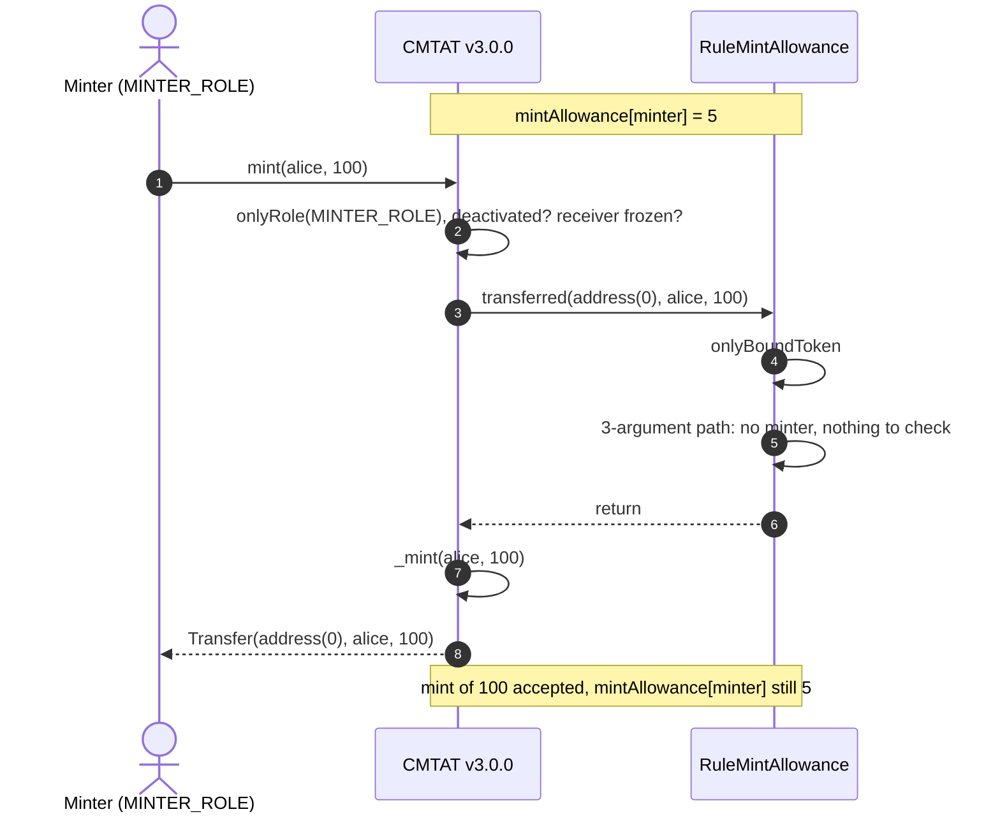

# Deploy `RuleMintAllowance` with a CMTAT v3.0.0 token

[TOC]

**`RuleMintAllowance` is not supported on CMTAT v3.0.0.** It can be deployed, bound and installed without any error, but it enforces nothing there: every mint passes, whatever the minter's quota, and no quota is ever debited. Use CMTAT v3.3.0 or later, with the [v3.3.0 guide](./DEPLOY_RULE_MINT_ALLOWANCE_CMTAT_V3.3.0.md).

This page covers:

- why the rule cannot work on v3.0.0;
- what happens on a mint if it is installed anyway;
- what to use instead on a v3.0.0 token.

CMTAT v3.0.0 is the last audited CMTAT release. v3.3.0 is validated against `v3.3.0-rc4`.

The behaviour below is pinned against a real v3.0.0 token by `test/CMTATv3.0.0/RuleMintAllowanceV300.t.sol`, on the Standard and Debt variants, with the rule set directly on the token and behind a RuleEngine: a mint of 100 by a minter whose quota is 5 succeeds, and the quota stays at 5.

## 1. Why the rule is inert on v3.0.0

`RuleMintAllowance` keeps a quota per **minter address** and debits it on each mint. To do that it needs to know who is minting, and the only place it can learn it is the `spender` argument of the 4-argument `transferred(spender, from, to, value)`.

| | CMTAT v3.0.0 | CMTAT v3.3.0 |
| --- | --- | --- |
| Call made to the compliance contract on `mint(to, value)` | 3-argument `transferred(address(0), to, value)` | 4-argument `transferred(minter, address(0), to, value)` |
| Minter known to the rule | no | yes |
| What `RuleMintAllowance` does | returns at once: nothing to debit | checks and debits `mintAllowance[minter]`, rejects with code 70 when short |

v3.0.0 sends every mint, and every burn, on the 3-argument path. The rule's 3-argument `transferred` checks only that its caller is bound, then returns. The 4-argument path, which v3.0.0 uses only for `transferFrom`, has `from != address(0)` there, so the rule ignores it too.

The one effect left is the binding check. Like on v3.3.0, the rule accepts `transferred` only from the caller bound with `bindToken` (the token directly, or the RuleEngine). Until then every operation reverts with `TokenBinding_UnauthorizedCaller`, and its views report code 85. Once bound, it lets everything through.

## 2. What happens on a mint

The rule is shown plugged directly into the token; behind a RuleEngine the engine sits between them and forwards the same 3-argument call.

**The views disagree with enforcement.** The rule's own `canTransferFrom(minter, address(0), alice, 100)` returns `false`, because it reads the quota, while the mint it describes succeeds. The 3-argument `canTransfer` and `detectTransferRestriction` answer "allowed", as on v3.3.0. Nothing on the token signals that the quota is not applied, so an operator watching the views would believe it is.

Transfers and burns are not affected either way: the rule never restricts them, on any version.

## 3. What to use instead

| Need on a v3.0.0 token | Use |
| --- | --- |
| Limit how much each minter may mint | upgrade to CMTAT v3.3.0 and follow the [v3.3.0 guide](./DEPLOY_RULE_MINT_ALLOWANCE_CMTAT_V3.3.0.md) |
| Limit who may mint | the token's `MINTER_ROLE`: grant it only to the addresses that may issue |
| Cap the outstanding supply, whoever mints | [`RuleMaxTotalSupply`](../contracts/RuleMaxTotalSupply.md), see the [v3.0.0 guide](./DEPLOY_RULE_MAX_TOTAL_SUPPLY_CMTAT_V3.0.0.md) |
| Cap the total ever issued, whoever mints | [`RuleIssuanceCap`](../contracts/RuleIssuanceCap.md), see the [v3.0.0 guide](./DEPLOY_RULE_ISSUANCE_CAP_CMTAT_V3.0.0.md) |

The two cap rules work on v3.0.0 because they limit the token's supply, not a minter: they need no `spender`.

If the rule is already installed on a v3.0.0 token, remove it (`token.setRuleEngine(address(0))` when set directly, or `engine.removeRule(rule)`) so that no one relies on quotas that are not applied. Its stored quotas stay readable with `mintAllowance(minter)`.

See also: [`RuleMintAllowance.md`](../contracts/RuleMintAllowance.md) for the full rule reference, and [`RULE_SEMANTICS.md`](./RULE_SEMANTICS.md) §7 for the v3.0.0 status of every rule.
