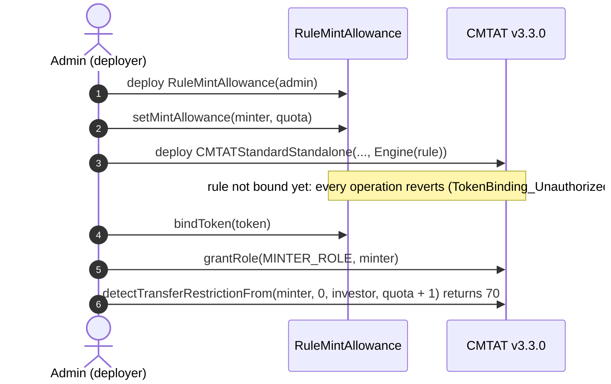
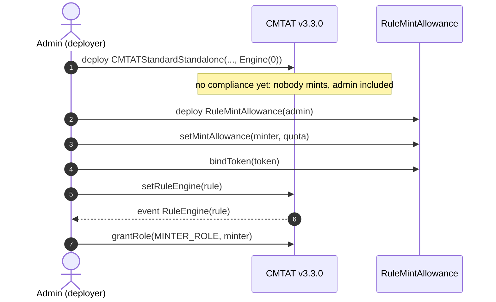
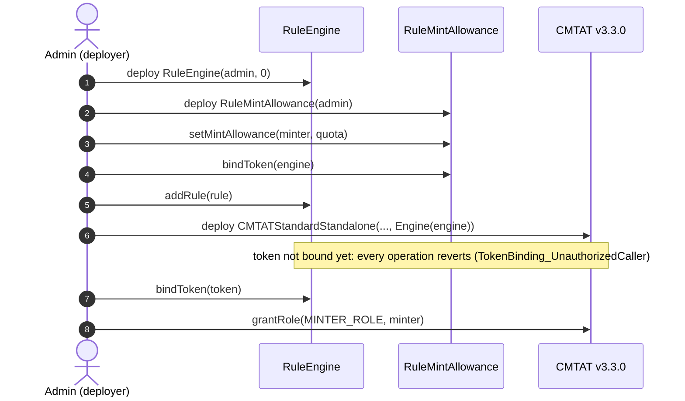
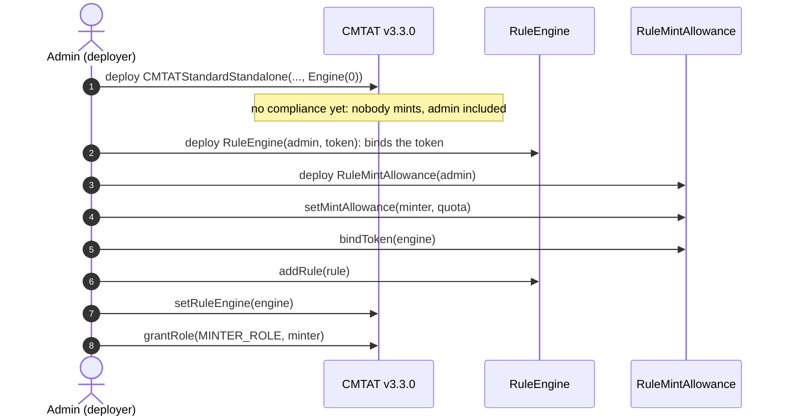
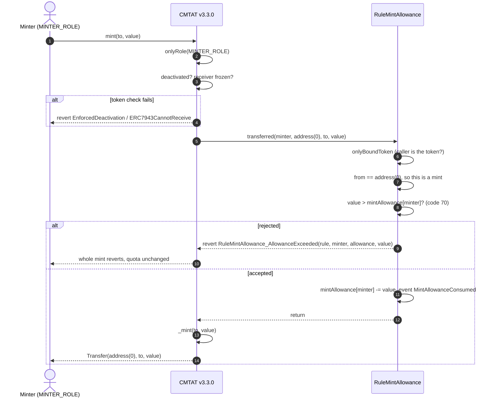
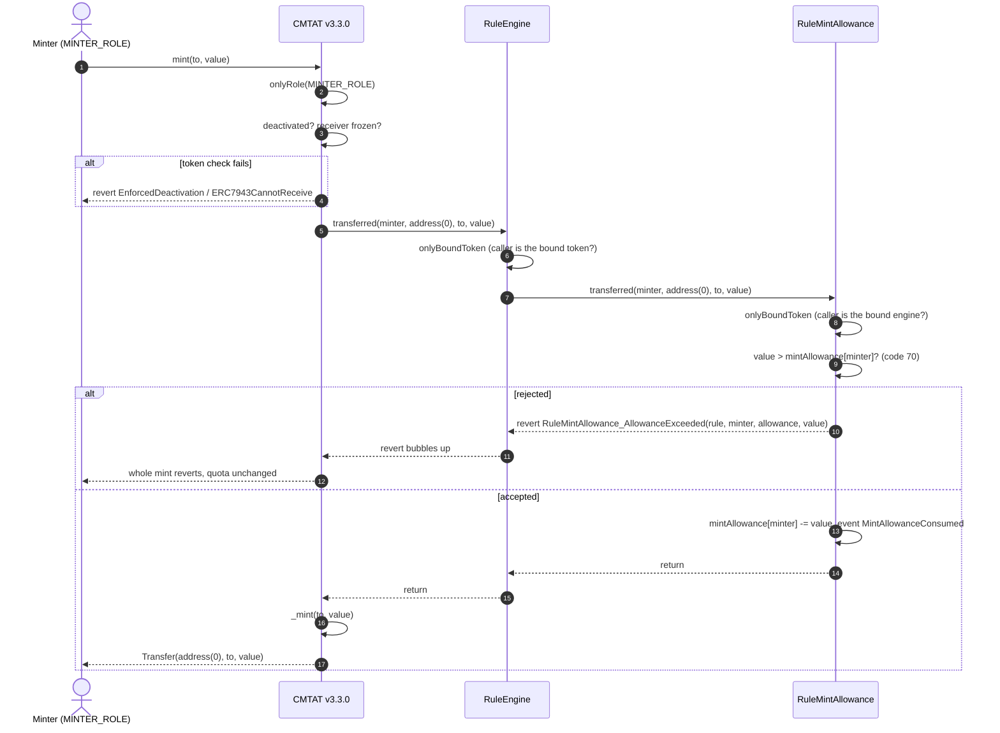
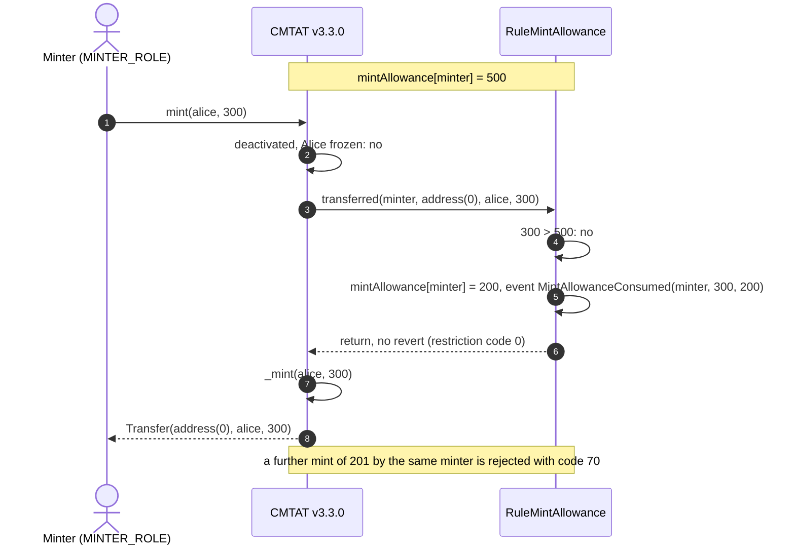
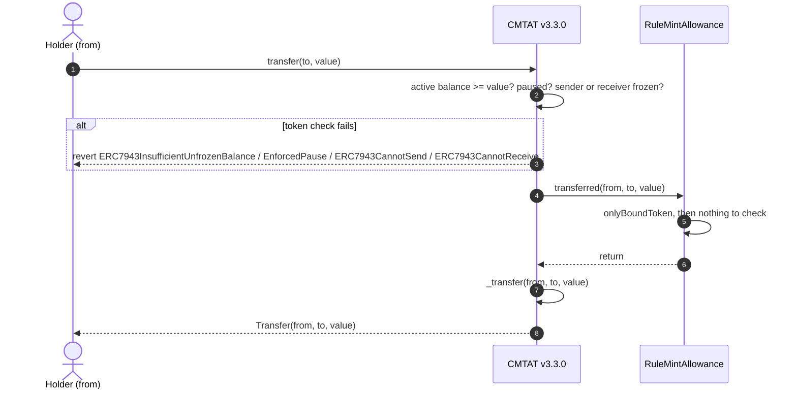
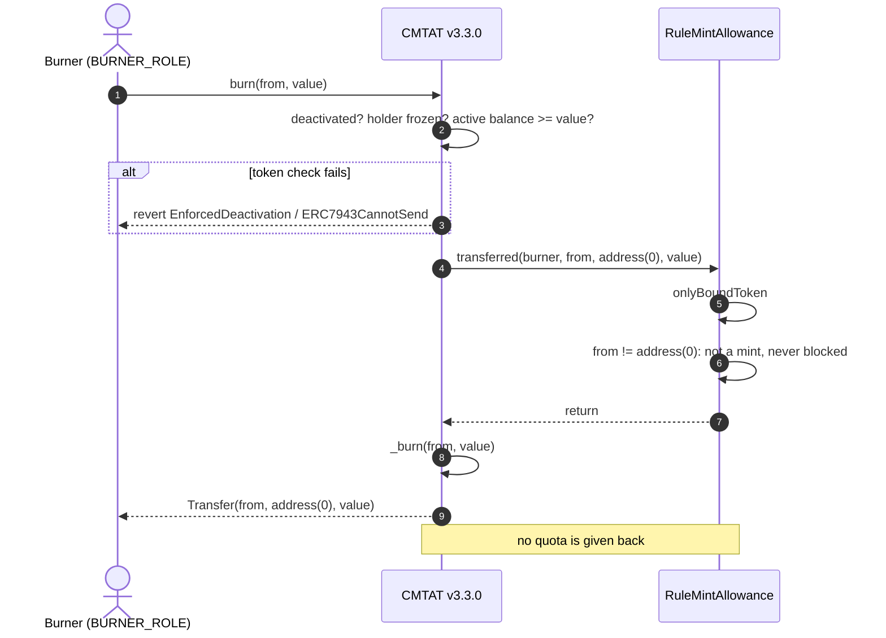

# Deploy `RuleMintAllowance` with a CMTAT v3.3.0 token

[TOC]

This guide deploys a CMTAT **v3.3.0** token on which each minter may only mint up to a quota set by an operator, enforced by `RuleMintAllowance`. It covers:

- where the rule sits: on the token directly, or inside a RuleEngine, and which caller it must be bound to;
- when it is installed: in the token constructor, or later with `setRuleEngine`;
- what happens on a mint, a transfer and a burn once it is active.

v3.3.0 is not final yet: this library is validated against **`v3.3.0-rc4`**, the version pinned in `lib/CMTAT`, and every statement below was checked against that code. The rule needs CMTAT v3.3 or later: on the last audited release it enforces nothing, see the [v3.0.0 guide](./DEPLOY_RULE_MINT_ALLOWANCE_CMTAT_V3.0.0.md); [§8](#8-differences-from-cmtat-v300) lists what differs.

Every step below is tested against a real v3.3.0-rc4 token:

- `test/RuleMintAllowance/RuleMintAllowanceCMTATDeployment.t.sol`: rule passed in the token constructor and bound afterwards (setup 4.1), rule set directly after deployment (setup 4.2), RuleEngine passed in the token constructor with the token bound last (setup 4.3), and the single-binding guard;
- `test/RuleMintAllowance/CMTATIntegration.t.sol`: rule behind a RuleEngine set after deployment (setup 4.4), with several minters, `batchMint`, the token's pre-flight views and a quota raised after exhaustion.

## 1. What the rule enforces

| Operation | Checked by `RuleMintAllowance` | Rejected with |
| --- | --- | --- |
| Mint of `value` by `minter` | `value <= mintAllowance[minter]`; on success the quota is debited by `value` | 70 (minter allowance exceeded): reverts `RuleMintAllowance_AllowanceExceeded(rule, minter, allowance, value)` |
| Transfer, `transferFrom` | nothing | never |
| Burn | nothing, and the burn does **not** give quota back | never |
| Any operation while no caller is bound | the rule rejects its caller | reverts `TokenBinding_UnauthorizedCaller`; views report 85 |

The quota is per **minter address**, not per token holder: `mintAllowance[minter]` is what that address may still mint, in base units, and each of its mints lowers it. It starts at 0.

**The rule depends on the minter arriving as `spender`.** On v3.3.0 every mint calls the compliance contract through the 4-argument `transferred(minter, address(0), to, value)`, where `minter` is the caller of `mint` (`_msgSender()`). That is the only path on which the rule debits anything. A `transfer` takes the 3-argument path and a `transferFrom` or a burn has `from != address(0)`: the rule ignores all three.

**The default admin is not exempt.** CMTAT gives the default admin every role, `MINTER_ROLE` included, but the rule only knows quotas: an admin with no quota of its own is rejected with code 70 like any other minter.

## 2. Choose the setup

**Where the rule sits, and what it is bound to.** The rule writes `mintAllowance` on every mint, so it accepts `transferred` only from the one caller bound with `bindToken`:

| Topology | Token calls | Bind the rule to | Use it when |
| --- | --- | --- | --- |
| **Direct** | the rule itself (`token.ruleEngine() == rule`) | the **token** | the quota is the only rule |
| **RuleEngine** | a `RuleEngine`, which calls each of its rules | the **RuleEngine** | you need several rules, for example a whitelist on the holders and a quota on the minters |

Until the rule is bound, every mint, transfer and burn that calls it reverts with `TokenBinding_UnauthorizedCaller`, and its views report code 85. A second `bindToken` reverts with `RuleMintAllowance_TokenAlreadyBound`: one rule instance serves one caller.

**When the rule is installed.** The rule's constructor takes no token address, so the rule, or a RuleEngine holding it, can be passed in the token constructor. Binding afterwards is then the last step, and nothing can be minted before it:

| Setup | Unscreened window |
| --- | --- |
| **4.1** Rule in the token constructor, bound to the token afterwards (recommended for the quota alone) | none: every operation reverts until `rule.bindToken(token)` |
| **4.2** Rule set directly with `setRuleEngine`, after deployment | between the token's deployment and `setRuleEngine`: any minter, the admin included, mints without quota |
| **4.3** RuleEngine in the token constructor, token bound last (recommended with other rules) | none: every operation reverts until `engine.bindToken(token)` |
| **4.4** RuleEngine set with `setRuleEngine`, after deployment | same as 4.2 |

In 4.1 the token is unusable between its deployment and the binding: transfers revert too. That is the point, not a defect.

## 3. Contracts and roles

| Contract | Constructor | Roles that matter here |
| --- | --- | --- |
| `RuleMintAllowance` (or `RuleMintAllowanceOwnable2Step`) | `(admin)`; no token address | `ALLOWANCE_OPERATOR_ROLE` (`setMintAllowance`, `increaseMintAllowance`, `decreaseMintAllowance`, `clearMintAllowances`), `COMPLIANCE_MANAGER_ROLE` (`bindToken`, `unbindToken`), `DEFAULT_ADMIN_ROLE` (roles, and implicitly every role above). The Ownable2Step variant gives all of it to the owner |
| `RuleEngine` (RuleEngine `v3.0.0-rc7`, optional) | `(admin, tokenContract)`; `tokenContract` may be `address(0)` | `RULES_MANAGEMENT_ROLE` (`addRule`, `removeRule`), `COMPLIANCE_MANAGER_ROLE` (`bindToken`) |
| CMTAT v3.3.0 `CMTATStandardStandalone` (or `CMTATStandaloneDebt`, or a proxy variant) | `(forwarder, admin, ERC20Attributes, ExtraInformationAttributes, Engine{ruleEngine})`. `CMTATStandaloneDebt` takes no forwarder | `DEFAULT_ADMIN_ROLE` (`setRuleEngine`, all roles), `MINTER_ROLE`, `BURNER_ROLE` |

On both CMTAT and the AccessControl rule, the default admin implicitly holds every role. The rule and the RuleEngine both name a role `COMPLIANCE_MANAGER_ROLE`; they are separate grants on separate contracts. The quota operator can be a separate key, for example the treasury that approves each issuance, without the rule's admin role.

**Two controls, both needed.** `MINTER_ROLE` on the token decides who may call `mint` at all; the quota decides how much each of them may mint. A minter with a quota but no role cannot mint; a minter with the role but no quota is rejected by the rule.

## 4. Deployment steps

Each setup lists its steps, then draws them as a sequence diagram. The calls are shown from a single admin; in production the quota, binding and minting roles can be held by different addresses (§3).

### 4.1 Rule set directly, at deployment (recommended for the quota alone)

1. **Deploy the rule:** `RuleMintAllowance(admin)`.
2. **Set the quotas:** `rule.setMintAllowance(minter, quota)` for each minter (`ALLOWANCE_OPERATOR_ROLE`). This can also happen after step 4; until then each mint is rejected with code 70.
3. **Deploy the token** with `Engine(ruleEngine = rule)`. The rule is not bound yet, so every operation on the token reverts.
4. **Bind the token:** `rule.bindToken(token)` (rule `COMPLIANCE_MANAGER_ROLE`). From now on the token works and every mint is debited.
5. **Grant `MINTER_ROLE`** to each minter, if it is not the admin.
6. **Check the setup:** on the Standard variant, `token.detectTransferRestrictionFrom(minter, address(0), investor, quota)` returns 0 and the same call with `quota + 1` returns 70.

### 4.2 Rule set directly, after deployment

1. **Deploy the token** with `Engine(ruleEngine = address(0))`. Nobody may mint yet: CMTAT gives the default admin every role, so the admin can mint and must not.
2. **Deploy the rule** and set the quotas, as in 4.1 steps 1 and 2.
3. **Bind the rule to the token:** `rule.bindToken(token)`.
4. **Install it:** `token.setRuleEngine(rule)`, as the token's `DEFAULT_ADMIN_ROLE`. It emits `RuleEngine(rule)` and reverts with `CMTAT_ValidationModule_SameValue` if that rule is already set.
5. **Grant `MINTER_ROLE`**, then check as in 4.1 step 6.

Steps 3 and 4 may be swapped: a rule installed before it is bound rejects every operation until `bindToken`, it never lets one through.

### 4.3 Behind a RuleEngine, at deployment (recommended with other rules)

1. **Deploy the RuleEngine:** `RuleEngine(admin, address(0))`.
2. **Deploy the rule**, set the quotas, and bind it to the engine: `rule.bindToken(engine)`.
3. **Add it:** `engine.addRule(rule)` (`RULES_MANAGEMENT_ROLE`), plus any other rules.
4. **Deploy the token** with `Engine(ruleEngine = engine)`. The engine rejects every call from a token it has not bound.
5. **Bind the token last:** `engine.bindToken(token)` (engine `COMPLIANCE_MANAGER_ROLE`). From now on the token works.
6. **Grant `MINTER_ROLE`** and check as in 4.1 step 6.

### 4.4 Behind a RuleEngine, after deployment

1. **Deploy the token** with `Engine(ruleEngine = address(0))`. Nobody may mint yet.
2. **Deploy the RuleEngine** with the token already known: `RuleEngine(admin, token)` binds it in the constructor.
3. **Deploy the rule**, set the quotas, `rule.bindToken(engine)`, `engine.addRule(rule)`.
4. **Install it:** `token.setRuleEngine(engine)`.
5. **Grant `MINTER_ROLE`** and check as in 4.1 step 6.

**Use a RuleEngine that serves only this token.** The quota is keyed on the minter address alone. If the engine bound several tokens, a minter's quota would be spent by its mints on any of them.

## 5. Mint workflow

`mint(to, value)` by a `MINTER_ROLE` holder, with the rule active. The token runs its own checks first (contract deactivated, receiver frozen), then notifies the compliance contract **before** creating the tokens, on the 4-argument `transferred(minter, address(0), to, value)`. Pause does not stop a mint. On the Standard variant the call to the compliance contract runs under a transient reentrancy guard.

### 5.1 Rule plugged directly into the token

The token calls `RuleMintAllowance` itself, and the rule is bound to the token.

If the rule is not bound to the token, step 5 reverts with `TokenBinding_UnauthorizedCaller` and nothing is minted.

### 5.2 Rule behind a RuleEngine

The token calls the RuleEngine, which accepts only its bound token and then calls each of its rules in order, passing the minter on. The rule in turn accepts only the engine it is bound to. The first rule that reverts stops the mint, and the engine passes the revert back to the token.

### 5.3 Happy path: a mint within the quota

The same mint when everything passes, with numbers. The operator gave the minter a quota of 500. The minter mints 300 to Alice. The rule is plugged directly into the token; behind a RuleEngine the engine sits between the token and the rule, as in §5.2.

**Pre-flight a mint with the 4-argument views.** `token.detectTransferRestrictionFrom(minter, address(0), to, value)` returns 70 when the quota is short, and `token.canTransferFrom(minter, address(0), to, value)` returns `false`; the Debt variant has no ERC-1404 layer, so use `canTransferFrom` there. The 3-argument `detectTransferRestriction(address(0), to, value)` and `canTransfer` cannot see the minter: once the rule is bound they answer "allowed" whatever the quota, on the rule, on the RuleEngine and on the token alike.

## 6. Transfer and burn workflows

The rule only acts on mints. On a transfer or a burn it checks its caller, then returns at once. The diagrams show the rule plugged directly into the token; behind a RuleEngine the engine sits between them, as in §5.2.

### 6.1 Transfer

A `transferFrom` takes the 4-argument path with the caller as `spender`; `from != address(0)`, so the rule returns without touching any quota.

### 6.2 Burn

## 7. Operating the token

| Task | Call | Role |
| --- | --- | --- |
| Give a minter a quota | `rule.setMintAllowance(minter, amount)` | `ALLOWANCE_OPERATOR_ROLE` |
| Top up a quota | `rule.increaseMintAllowance(minter, amount)` | `ALLOWANCE_OPERATOR_ROLE` |
| Reduce a quota | `rule.decreaseMintAllowance(minter, amount)`; reverts with `RuleMintAllowance_DecreaseBelowZero` below 0 | `ALLOWANCE_OPERATOR_ROLE` |
| Revoke quotas | `rule.setMintAllowance(minter, 0)` or `rule.clearMintAllowances([...])` | `ALLOWANCE_OPERATOR_ROLE` |
| Check a quota | `rule.mintAllowance(minter)`, or the 4-argument views of §5.3 | anyone |
| Move to a new RuleEngine | `rule.unbindToken(oldEngine)`, then `rule.bindToken(newEngine)` | rule `COMPLIANCE_MANAGER_ROLE` |
| Remove the rule | `token.setRuleEngine(address(0))` (direct) or `engine.removeRule(rule)` | token `DEFAULT_ADMIN_ROLE` / engine `RULES_MANAGEMENT_ROLE` |

Prefer `increaseMintAllowance` / `decreaseMintAllowance` when changes are approved independently: two increases of N add 2N in whatever order they land, while two `setMintAllowance(minter, old + N)` computed from the same old value add only N, and a `setMintAllowance` can also overwrite a quota partly spent in the meantime.

Warnings:

- **Every mint path is debited from its caller.** `mint`, `batchMint` and the mint leg of `burnAndMint` debit the caller's quota. `crosschainMint` passes the bridge as `spender`, so the bridge needs a quota of its own, or every bridge mint is rejected.
- **Removing the rule lifts every quota**, and nothing on-chain records the mints made meanwhile. Revoke `MINTER_ROLE` before a planned removal; the admin keeps the role and must not mint.
- **`unbindToken` does not clear the quotas.** They stay in storage and are spendable as soon as a new caller is bound. Call `clearMintAllowances` before rebinding if they must not carry over.
- **Do not use this rule on CMTAT v3.0.0 or a pure ERC-3643 token.** Neither forwards the minter, so the rule debits nothing and blocks nothing.

See also: [`RuleMintAllowance.md`](../contracts/RuleMintAllowance.md) for the full rule reference.

## 8. Differences from CMTAT v3.0.0

| | v3.0.0 | v3.3.0 |
| --- | --- | --- |
| Constructor `Engine` struct | `{ruleEngine, snapshotEngine, documentEngine}` | `{ruleEngine}` |
| Standard standalone contract | `CMTATStandalone` | `CMTATStandardStandalone` |
| How mint and burn call the rule | 3-argument `transferred`, no minter | 4-argument `transferred`, minter or burner as `spender` |
| What `RuleMintAllowance` enforces | **nothing**: no minter, so no quota is checked or debited | the minter's quota on every mint |
| Token-side check fails (frozen, paused, deactivated) | `CMTAT_InvalidTransfer` | the specific error: `ERC7943CannotSend` / `ERC7943CannotReceive`, `EnforcedPause`, `EnforcedDeactivation` |
| Reentrancy guard around the compliance call | none | transient guard on the Standard variant |

`RuleMintAllowance` is the one rule that needs v3.3.0: it is the only rule that uses the minter forwarded as `spender`. See [`RULE_SEMANTICS.md`](./RULE_SEMANTICS.md) §7 for the other rules.
