# Deploy `RuleReceiverWhitelist` with a CMTAT v3.3.0 token

<!-- toc -->

- [1. What the rule enforces](#1-what-the-rule-enforces)
- [2. Choose the setup](#2-choose-the-setup)
- [3. Contracts and roles](#3-contracts-and-roles)
- [4. Deployment steps](#4-deployment-steps)
  - [Rule constructor parameters](#rule-constructor-parameters)
  - [4.1 Rule set directly, at deployment (recommended for the rule alone)](#41-rule-set-directly-at-deployment-recommended-for-the-rule-alone)
  - [4.2 Rule set directly, after deployment](#42-rule-set-directly-after-deployment)
  - [4.3 Behind a RuleEngine, at deployment (recommended with other rules)](#43-behind-a-ruleengine-at-deployment-recommended-with-other-rules)
  - [4.4 Behind a RuleEngine, after deployment](#44-behind-a-ruleengine-after-deployment)
- [5. Mint workflow](#5-mint-workflow)
  - [5.1 Rule plugged directly into the token](#51-rule-plugged-directly-into-the-token)
  - [5.2 Rule behind a RuleEngine](#52-rule-behind-a-ruleengine)
  - [5.3 Happy path: a mint to a listed investor](#53-happy-path-a-mint-to-a-listed-investor)
- [6. Transfer and burn workflows](#6-transfer-and-burn-workflows)
  - [6.1 Rule plugged directly into the token](#61-rule-plugged-directly-into-the-token)
  - [6.2 Rule behind a RuleEngine](#62-rule-behind-a-ruleengine)
  - [6.3 Happy path: a de-listed holder exits](#63-happy-path-a-de-listed-holder-exits)
  - [6.4 Burn](#64-burn)
- [7. Operating the token](#7-operating-the-token)
- [8. Differences from CMTAT v3.0.0](#8-differences-from-cmtat-v300)

<!-- /toc -->

This guide deploys a CMTAT **v3.3.0** token where only whitelisted addresses can receive tokens, enforced by `RuleReceiverWhitelist`. The sender and the spender are never checked, which reproduces ERC-3643's eligibility rule. It covers:

- where the rule sits: on the token directly, or inside a RuleEngine;
- when it is installed: in the token constructor, or later with `setRuleEngine`;
- what happens on a mint, a transfer and a burn once it is active.

v3.3.0 is not final yet: this library is validated against **`v3.3.0-rc4`**, the version pinned in `lib/CMTAT`, and every statement below was checked against that code. For the last audited release, see the [v3.0.0 guide](./DEPLOY_RULE_RECEIVER_WHITELIST_CMTAT_V3.0.0.md); [§8](#8-differences-from-cmtat-v300) lists what differs.

The tests behind this guide, on a real v3.3.0-rc4 token:

- `test/RuleReceiverWhitelist/RuleReceiverWhitelistCMTATDeployment.t.sol`: rule passed in the token constructor (4.1), rule set directly with `setRuleEngine` after deployment (4.2), and RuleEngine passed in the token constructor (4.3), with a mint, a transfer from a de-listed holder through an unlisted spender, and a burn;
- setup 4.4 (RuleEngine set after deployment) is not run on a v3.3 token; the rule's own logic is covered without a token by `test/RuleReceiverWhitelist/RuleReceiverWhitelistUnit.t.sol`.

## 1. What the rule enforces

| Operation | Checked by `RuleReceiverWhitelist` | Rejected with |
| --- | --- | --- |
| Transfer `from → to` | `to` is whitelisted. `from` is never checked | 81 (receiver) |
| `transferFrom` by a spender | `to` is whitelisted. Neither `from` nor the spender is checked | 81 |
| Mint to `to` | `to` is whitelisted | 81 |
| Burn from `from` | nothing: a burn is always allowed by the rule | never |

There is **no `allowMint` flag**, unlike `RuleWhitelist`: ERC-3643 gates minting on receiver eligibility alone, so any mint to a listed address passes. To cap or close issuance, add `RuleMaxTotalSupply` next to it in a RuleEngine, or control who holds `MINTER_ROLE` on the token.

A burn has `to == address(0)`, which can never be listed, so the rule exempts it explicitly. ERC-3643 also says burn bypasses eligibility.

On v3.3.0 the token forwards the **minter** (and the burner) to the rule as `spender`, on the 4-argument `transferred(spender, from, to, value)`. The rule ignores it, as it ignores every spender: who may mint is decided by the token's `MINTER_ROLE`.

## 2. Choose the setup

**Where the rule sits.**

| Topology | Token calls | Use it when |
| --- | --- | --- |
| **Direct** | the rule itself (`token.ruleEngine() == rule`) | the receiver whitelist is the only rule. Fewer contracts to deploy, and one external call less per transfer |
| **RuleEngine** | a `RuleEngine`, which calls each of its rules | you need several rules (for example receiver whitelist + max total supply, which this rule needs to cap issuance), or want to add rules later without touching the token |

`RuleReceiverWhitelist` is stateless, so it behaves identically in both. It needs no binding to the token.

**When the rule is installed.**

| Moment | How | Effect |
| --- | --- | --- |
| **At deployment** | pass the rule (or the RuleEngine) in the token constructor's `Engine.ruleEngine` field | the token is never unrestricted, the very first mint is screened |
| **After deployment** | deploy the token with `Engine.ruleEngine = address(0)`, then `token.setRuleEngine(...)` | between the two transactions the token has **no compliance**: any mint or transfer goes through. Do not mint or grant `MINTER_ROLE` before `setRuleEngine` |

Installing at deployment is recommended: setup 4.1 when the rule is alone, 4.3 when it is combined with other rules. Installing afterwards is the right choice for a token already live, or to change or replace the compliance later.

## 3. Contracts and roles

| Contract | Constructor | Roles that matter here |
| --- | --- | --- |
| `RuleReceiverWhitelist` (or `RuleReceiverWhitelistOwnable2Step`) | `(admin, forwarderIrrevocable)`; the Ownable2Step variant takes `(owner, forwarderIrrevocable)` | `DEFAULT_ADMIN_ROLE` (all roles), `ADDRESS_LIST_ADD_ROLE`, `ADDRESS_LIST_REMOVE_ROLE`. The Ownable2Step variant gives all of it to the owner |
| `RuleEngine` (RuleEngine `v3.0.0-rc7`, optional) | `(admin, tokenContract)`; `tokenContract` may be `address(0)` | `RULES_MANAGEMENT_ROLE` (`addRule`), `COMPLIANCE_MANAGER_ROLE` (`bindToken`) |
| CMTAT v3.3.0 `CMTATStandardStandalone` (or `CMTATStandaloneDebt`, or a proxy variant) | `(forwarder, admin, ERC20Attributes, ExtraInformationAttributes, Engine{ruleEngine})`. `CMTATStandaloneDebt` takes no forwarder | `DEFAULT_ADMIN_ROLE` (`setRuleEngine`, `forcedTransfer`, all roles), `MINTER_ROLE`, `BURNER_ROLE`, `PAUSER_ROLE`, `ENFORCER_ROLE` (freeze an address), `ERC20ENFORCER_ROLE` (freeze part of a balance) |

On both CMTAT and the AccessControl rule, the default admin implicitly holds every role. The v3.3.0 `Engine` struct has a single field, `ruleEngine`; the snapshot and document engines of v3.0.0 are no longer constructor arguments.

The rule has no flags. `forwarderIrrevocable = address(0)` unless you use ERC-2771 meta-transactions for the rule's admin calls.

## 4. Deployment steps

Each setup lists its steps, then draws them as a sequence diagram. The calls are shown from a single admin; in production the list, rule and minting roles can be held by different addresses (§3).

### Rule constructor parameters

| Parameter | Type | What it sets | Checks and notes |
| --- | --- | --- | --- |
| `admin` | `address` | Receives `DEFAULT_ADMIN_ROLE`, which implicitly holds every role of the rule. Set it to the account (ideally a multisig) that will operate the rule. | Reverts if `address(0)`. On the `Ownable2Step` variant this parameter is `owner`, who then holds every privileged function |
| `forwarderIrrevocable` | `address` | ERC-2771 trusted forwarder for gasless (meta-transaction) calls to the rule's admin functions. | `address(0)` disables meta-transactions. Cannot be changed after deployment |

### 4.1 Rule set directly, at deployment (recommended for the rule alone)

1. **Deploy the rule:** `RuleReceiverWhitelist(admin, address(0))`. It needs no token address.
2. **Fill the whitelist:** `addAddresses([investor1, investor2, ...])`, as the admin or an `ADDRESS_LIST_ADD_ROLE` holder. This can also happen after step 3; until then every mint and transfer is rejected, but burns pass.
3. **Deploy the token** with `Engine(ruleEngine = rule)`.
4. **Grant `MINTER_ROLE`** to the issuer's minting address, if it is not the admin. It does not need to be whitelisted.
5. **Check the setup:** `token.ruleEngine() == rule`; on the Standard variant, `token.detectTransferRestriction(address(0), investor1, 1) == 0` and the same call to an unlisted address returns 81.

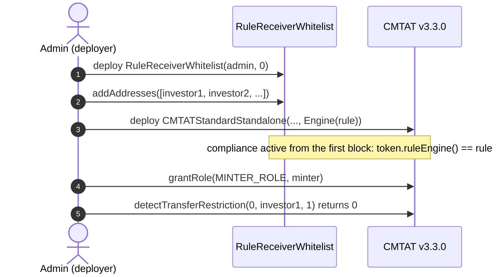

### 4.2 Rule set directly, after deployment

1. **Deploy the token** with `Engine(ruleEngine = address(0))`. Do not mint yet.
2. **Deploy the rule** and fill the whitelist, as in 4.1 steps 1 and 2.
3. **Install it:** `token.setRuleEngine(rule)`, as the token's `DEFAULT_ADMIN_ROLE`. It emits `RuleEngine(rule)` and reverts with `CMTAT_ValidationModule_SameValue` if that rule is already set.
4. **Grant `MINTER_ROLE`**, then check as in 4.1 step 5.

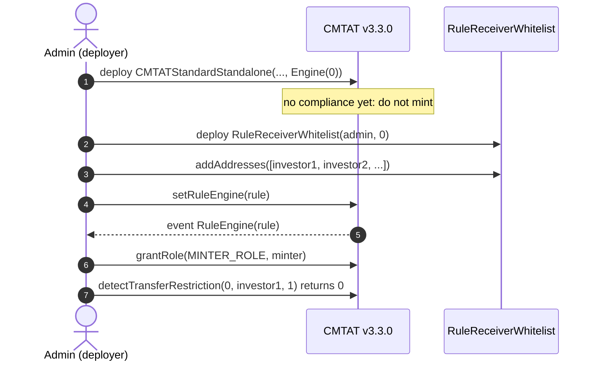

### 4.3 Behind a RuleEngine, at deployment (recommended with other rules)

The token address does not exist yet when the engine is deployed, so the engine is deployed without a token and binds it afterwards. Until that binding, the engine rejects every call from the token (`TokenBinding_UnauthorizedCaller`): no mint, transfer or burn can happen unscreened.

1. **Deploy the RuleEngine:** `RuleEngine(admin, address(0))`.
2. **Deploy the rule**, fill the whitelist, and add it: `engine.addRule(rule)` (`RULES_MANAGEMENT_ROLE`). Add the other rules the same way, for example a `RuleMaxTotalSupply` (which needs the token address, so it is deployed after step 3 and added before step 4).
3. **Deploy the token** with `Engine(ruleEngine = engine)`.
4. **Bind the token:** `engine.bindToken(token)` (`COMPLIANCE_MANAGER_ROLE`). From now on the token works.
5. **Grant `MINTER_ROLE`** and check as in 4.1 step 5.

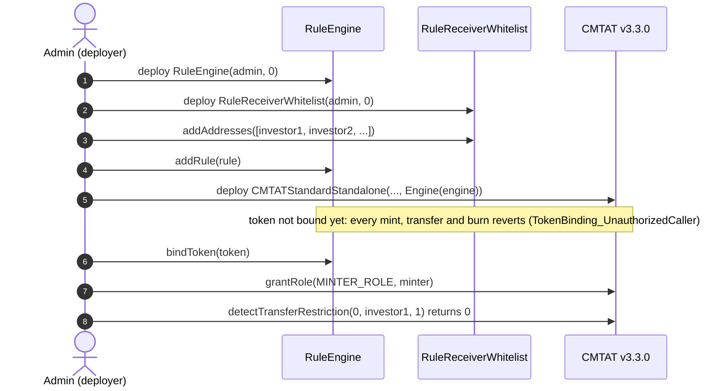

### 4.4 Behind a RuleEngine, after deployment

1. **Deploy the token** with `Engine(ruleEngine = address(0))`. Do not mint yet.
2. **Deploy the RuleEngine** with the token already known: `RuleEngine(admin, token)` binds it in the constructor.
3. **Deploy the rule**, fill the whitelist, `engine.addRule(rule)`.
4. **Install it:** `token.setRuleEngine(engine)`.
5. **Grant `MINTER_ROLE`** and check as in 4.1 step 5.

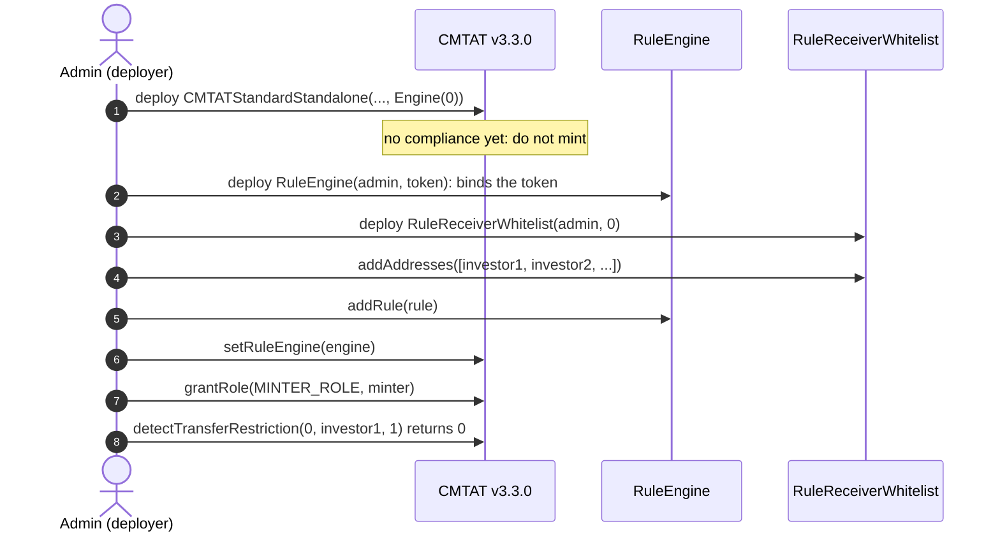

A RuleEngine serving one token is the intended setup. `RuleReceiverWhitelist` itself would work for several tokens (it reads no token state), but every token would then share one list.

The repository script `script/DeployCMTATWithReceiverWhitelist.s.sol` deploys this rule on a v3.3.0 token, set directly on it, in one run. See [`DEPLOYMENT_SCRIPTS.md`](./DEPLOYMENT_SCRIPTS.md).

## 5. Mint workflow

`mint(to, value)` by a `MINTER_ROLE` holder, with the rule active. The token runs its own checks first (contract deactivated, receiver frozen), then notifies the compliance contract **before** creating the tokens, on the 4-argument `transferred(minter, address(0), to, value)`. Pause does not stop a mint. On the Standard variant the call to the compliance contract runs under a transient reentrancy guard.

### 5.1 Rule plugged directly into the token

The token calls `RuleReceiverWhitelist` itself: `token.ruleEngine() == rule`.

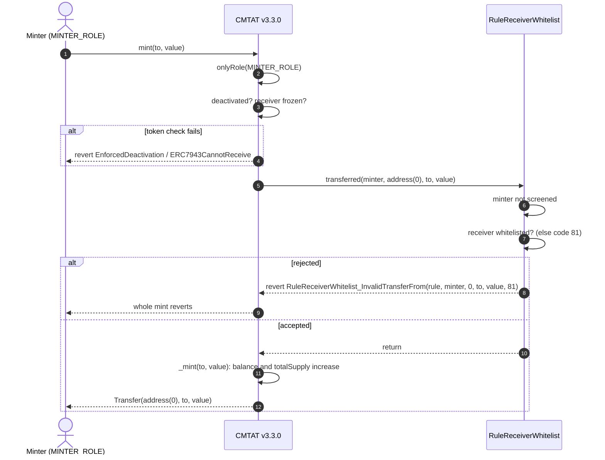

### 5.2 Rule behind a RuleEngine

The token calls the RuleEngine, which accepts only its bound token and then calls each of its rules in order. The first rule that reverts stops the mint, and the engine passes the revert back to the token.

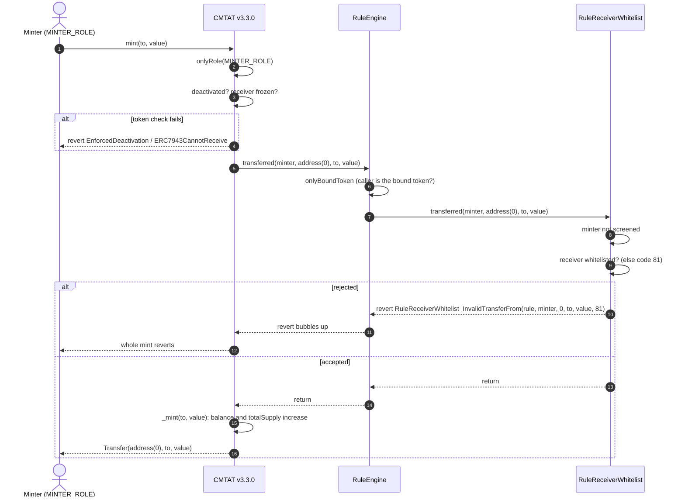

### 5.3 Happy path: a mint to a listed investor

Alice is on the list, the minter is not, and the issuer mints 1,000 to Alice. The rule is plugged directly into the token; behind a RuleEngine the engine sits between the token and the rule, as in §5.2.

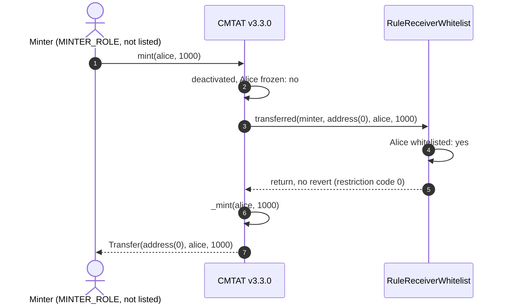

## 6. Transfer and burn workflows

`transfer(to, value)` by a holder. The token first checks that the tokens are not frozen (active balance), then that the token is not paused and nobody involved is frozen, then notifies the compliance contract **before** moving the balance. A `transfer` has no spender and takes the 3-argument path. `transferFrom` takes the 4-argument path with the caller as spender; the token checks that the spender is not frozen, calls the compliance contract, and only then spends the allowance. The rule screens `to` in both cases, so `transferFrom` follows the same diagrams with the spender added to the call.

### 6.1 Rule plugged directly into the token

The token calls `RuleReceiverWhitelist` itself: `token.ruleEngine() == rule`.

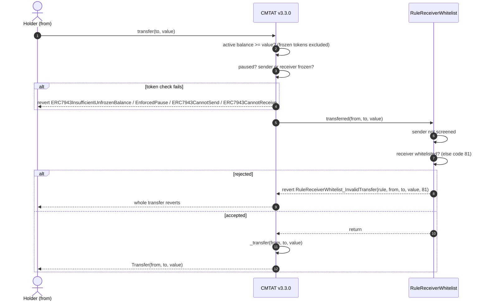

### 6.2 Rule behind a RuleEngine

Same path through the engine as for a mint (§5.2), on the 3-argument `transferred`.

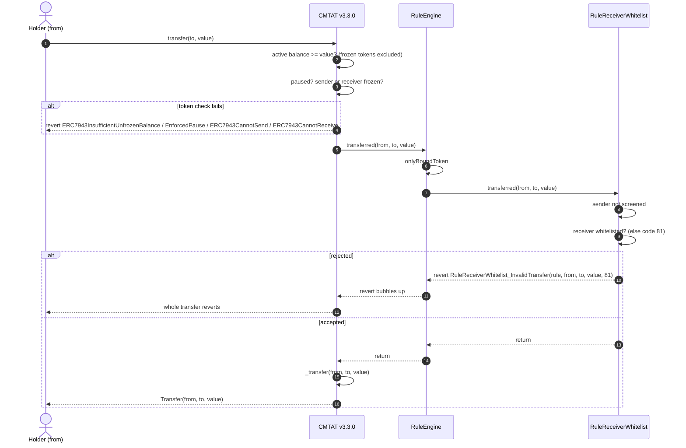

### 6.3 Happy path: a de-listed holder exits

Alice was removed from the list, Bob is on it, Alice holds at least 100 unfrozen tokens, and the token is not paused. Alice can still sell to Bob: this is what the receiver-only check is for. The rule is plugged directly into the token; behind a RuleEngine the engine sits between the token and the rule, as in §6.2.

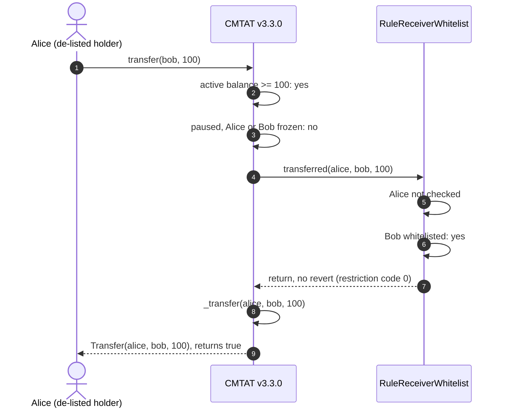

### 6.4 Burn

The rule exempts every burn, whether or not the holder is listed. The token's own checks still apply.

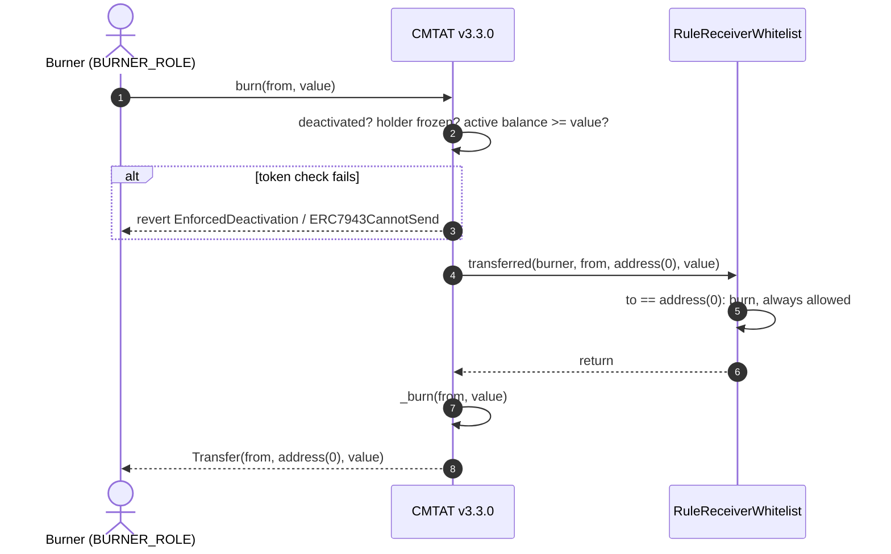

Before sending, a wallet or a front end can ask the same question without a transaction: `token.canTransfer(from, to, value)` on both variants, and `token.detectTransferRestriction(from, to, value)` plus `messageForTransferRestriction(code)` on the Standard variant (the Debt variant has no ERC-1404 layer).

## 7. Operating the token

| Task | Call | Role |
| --- | --- | --- |
| Onboard investors | `rule.addAddresses([...])` (skips duplicates, reverts on `address(0)`) or `addAddress` (reverts on a duplicate) | `ADDRESS_LIST_ADD_ROLE` |
| Offboard | `rule.removeAddresses([...])` / `removeAddress` | `ADDRESS_LIST_REMOVE_ROLE` |
| Stop issuance | revoke `MINTER_ROLE` on the token, or add `RuleMaxTotalSupply` through a RuleEngine: the rule has no `allowMint` flag | token `DEFAULT_ADMIN_ROLE` / engine `RULES_MANAGEMENT_ROLE` |
| Replace the compliance | `token.setRuleEngine(newRuleOrEngine)` | token `DEFAULT_ADMIN_ROLE` |
| Remove the compliance | `token.setRuleEngine(address(0))`: the token becomes unrestricted | token `DEFAULT_ADMIN_ROLE` |

**Removing an investor does not trap their tokens.** A de-listed holder can no longer receive, but can still send to a listed address and can be burned from. This is the difference from `RuleWhitelist`, which screens the sender too. Do not expect the rule to block a holder from selling: to stop an address from sending, freeze it on the token (`ENFORCER_ROLE`) or add `RuleBlacklist`.

**The spender is never screened.** Any address with an allowance can move tokens to a listed receiver. To restrict who may call `transferFrom`, add `RuleSpenderWhitelist` through a RuleEngine.

## 8. Differences from CMTAT v3.0.0

| | v3.0.0 | v3.3.0 |
| --- | --- | --- |
| Constructor `Engine` struct | `{ruleEngine, snapshotEngine, documentEngine}` | `{ruleEngine}` |
| Standard standalone contract | `CMTATStandalone` | `CMTATStandardStandalone` |
| How mint and burn call the rule | 3-argument `transferred`, no minter or burner | 4-argument `transferred`, minter or burner as `spender` (ignored by `RuleReceiverWhitelist`) |
| Mint rejected by the rule | `RuleReceiverWhitelist_InvalidTransfer` | `RuleReceiverWhitelist_InvalidTransferFrom` |
| Token-side check fails (frozen, paused, deactivated) | `CMTAT_InvalidTransfer` | the specific error: `ERC7943CannotSend` / `ERC7943CannotReceive`, `EnforcedPause`, `EnforcedDeactivation` |
| Reentrancy guard around the compliance call | none | transient guard on the Standard variant |

What the rule allows is the same on both versions: it never reads a spender, so the extra minter argument changes only the error name. See [`RULE_SEMANTICS.md`](./RULE_SEMANTICS.md) §7 for the other rules.

See also: [`RuleReceiverWhitelist.md`](../contracts/RuleReceiverWhitelist.md) for the full rule reference, including the ERC-3643 parity tests.
