# Deploy `RuleSanctionsList` with a CMTAT v3.0.0 token

<!-- toc -->

- [1. What the rule enforces](#1-what-the-rule-enforces)
- [2. Choose the setup](#2-choose-the-setup)
- [3. Contracts and roles](#3-contracts-and-roles)
- [4. Deployment steps](#4-deployment-steps)
  - [Rule constructor parameters](#rule-constructor-parameters)
  - [4.1 Rule set directly, at deployment (recommended for sanctions screening alone)](#41-rule-set-directly-at-deployment-recommended-for-sanctions-screening-alone)
  - [4.2 Rule set directly, after deployment](#42-rule-set-directly-after-deployment)
  - [4.3 Behind a RuleEngine, at deployment (recommended with other rules)](#43-behind-a-ruleengine-at-deployment-recommended-with-other-rules)
  - [4.4 Behind a RuleEngine, after deployment](#44-behind-a-ruleengine-after-deployment)
- [5. Mint workflow](#5-mint-workflow)
  - [5.1 Rule plugged directly into the token](#51-rule-plugged-directly-into-the-token)
  - [5.2 Rule behind a RuleEngine](#52-rule-behind-a-ruleengine)
  - [5.3 Happy path: a mint to a clean investor](#53-happy-path-a-mint-to-a-clean-investor)
- [6. Transfer and burn workflows](#6-transfer-and-burn-workflows)
  - [6.1 Transfer, rule plugged directly into the token](#61-transfer-rule-plugged-directly-into-the-token)
  - [6.2 Transfer, rule behind a RuleEngine](#62-transfer-rule-behind-a-ruleengine)
  - [6.3 transferFrom: the spender is screened](#63-transferfrom-the-spender-is-screened)
  - [6.4 Happy path: a transfer between clean holders](#64-happy-path-a-transfer-between-clean-holders)
  - [6.5 Burn, rule plugged directly into the token](#65-burn-rule-plugged-directly-into-the-token)
  - [6.6 Burn, rule behind a RuleEngine](#66-burn-rule-behind-a-ruleengine)
  - [6.7 Happy path: a redemption from a clean holder](#67-happy-path-a-redemption-from-a-clean-holder)
- [7. Operating the token](#7-operating-the-token)

<!-- /toc -->

This guide deploys a CMTAT **v3.0.0** token whose transfers, mints and burns are blocked when they involve an address flagged by a sanctions oracle (Chainalysis-style `isSanctioned(address)`), enforced by `RuleSanctionsList`. It covers:

- where the rule sits: on the token directly, or inside a RuleEngine;
- when it is installed: in the token constructor, or later with `setRuleEngine`;
- how the oracle is configured, and what happens while it is unset;
- what happens on a mint, a transfer and a burn once it is active.

CMTAT v3.0.0 is the last audited CMTAT release. For CMTAT v3.3.0, validated against `v3.3.0-rc4`, see the [v3.3.0 guide](./DEPLOY_RULE_SANCTIONS_LIST_CMTAT_V3.3.0.md), which also lists the differences between the two versions.

> **On v3.0.0 the minter and the burner are not screened.** v3.0.0 calls the rule on mint and burn through the 3-argument `transferred(from, to, value)`, without the address of the caller. A sanctioned `MINTER_ROLE` or `BURNER_ROLE` holder can therefore still mint and burn; only the receiver of a mint and the holder of a burn are sent to the oracle. On CMTAT v3.3.0 the minter and the burner are forwarded and blocked (code 32). On v3.0.0, keep your operator keys under your own control and revoke a role on the token if needed: the rule cannot do it.

> **No oracle, no screening.** While `sanctionsList()` is `address(0)` the rule returns 0 for every operation: it fails **open**. This is the state of a rule deployed with `address(0)` as oracle, and of a rule after `clearSanctionListOracle()`. Pass the oracle in the rule constructor and check `rule.sanctionsList()` before the first mint.

Every step below is tested against a real v3.0.0 token:

- `test/CMTATv3.0.0/RuleSanctionsListV300.t.sol`: rule installed after deployment, on the Standard and Debt variants, directly (§4.2) and behind a RuleEngine bound in its constructor (§4.4); it also pins the unscreened minter;
- `test/CMTATv3.0.0/RuleSanctionsListV300Deployment.t.sol`: rule or RuleEngine passed in the token constructor (§4.1, §4.3), the fail-open state of a rule without oracle, and the unscreened minter.

The tests use a mock oracle (`src/mocks/SanctionListOracle.sol`) in place of the Chainalysis contract.

## 1. What the rule enforces

| Operation | Sent to the oracle | Rejected with |
| --- | --- | --- |
| Transfer `from → to` | `from`, then `to` | 30 (sender), 31 (receiver) |
| `transferFrom` by a spender | the spender, then `from`, then `to` | 32 (spender), 30, 31 |
| Mint to `to` | `to`. **The minter is not sent on v3.0.0** | 31 |
| Burn from `from` | `from`. **The burner is not sent on v3.0.0** | 30 |

The rule calls `oracle.isSanctioned(addr)` once per address, in that order, and stops at the first `true`. The zero address is never sent to the oracle: on a mint `from` is skipped, on a burn `to` is skipped, so an oracle that answered `true` for `address(0)` would not block issuance or redemption.

The rule keeps no list of its own. The oracle's maintainer decides who is sanctioned; the issuer cannot add an address. To also block addresses of your choice, add `RuleBlacklist` next to this rule in a RuleEngine.

**The oracle is called without a fallback.** If it reverts, or if the configured address holds no code, every screened operation reverts, and so do the token's `canTransfer` and `detectTransferRestriction` views. Neither the constructor nor the setter checks that the address is a contract.

Why the minter is missing: CMTAT v3.0.0 mints and burns through `_checkTransferred(address(0), from, to, value)`, so the spender is `address(0)` and the token takes the 3-argument path. `transferFrom` is different: it passes the caller as spender on the 4-argument path, so a sanctioned spender **is** stopped on v3.0.0.

## 2. Choose the setup

**Where the rule sits.**

| Topology | Token calls | Use it when |
| --- | --- | --- |
| **Direct** | the rule itself (`token.ruleEngine() == rule`) | sanctions screening is the only rule. Fewer contracts to deploy, and one external call less per transfer |
| **RuleEngine** | a `RuleEngine`, which calls each of its rules | you need several rules (for example sanctions list + blacklist + max total supply), or want to add rules later without touching the token |

`RuleSanctionsList` keeps no state about transfers, so it behaves identically in both. It needs no token address and no binding to the token.

**When the rule is installed.**

| Moment | How | Effect |
| --- | --- | --- |
| **At deployment** | pass the rule (or the RuleEngine) in the token constructor's `Engine.ruleEngine` field | the token is never unrestricted, the very first mint is screened |
| **After deployment** | deploy the token with `Engine.ruleEngine = address(0)`, then `token.setRuleEngine(...)` | between the two transactions the token has **no compliance**: any mint or transfer goes through. Do not mint or grant `MINTER_ROLE` before `setRuleEngine` |

Installing at deployment, with the oracle passed in the rule constructor, is recommended: directly if sanctions screening is the only rule (§4.1), behind a RuleEngine otherwise (§4.3). Installing afterwards is the right choice for a token already live, or to change or replace the compliance later. In every setup, a rule without an oracle is a second unscreened window, independent of the first.

## 3. Contracts and roles

| Contract | Constructor | Roles that matter here |
| --- | --- | --- |
| `RuleSanctionsList` | `(admin, forwarderIrrevocable, sanctionContractOracle_)` | `DEFAULT_ADMIN_ROLE` (holds every role), `SANCTIONLIST_ROLE` (`setSanctionListOracle`, `clearSanctionListOracle`) |
| `RuleSanctionsListOwnable2Step` | `(owner, forwarderIrrevocable, sanctionContractOracle_)` | the owner sets and clears the oracle; ownership moves in two steps (`transferOwnership`, then `acceptOwnership`) |
| Sanctions oracle | deployed and maintained by its provider, for example Chainalysis | none on the issuer side: it must expose `isSanctioned(address) returns (bool)` |
| `RuleEngine` (RuleEngine `v3.0.0-rc7`, optional) | `(admin, tokenContract)`; `tokenContract` may be `address(0)` | `RULES_MANAGEMENT_ROLE` (`addRule`), `COMPLIANCE_MANAGER_ROLE` (`bindToken`) |
| CMTAT v3.0.0 `CMTATStandalone` (or `CMTATStandaloneDebt`, or a proxy variant) | `(forwarder, admin, ERC20Attributes, ExtraInformationAttributes, Engine{ruleEngine, snapshotEngine, documentEngine})`. `CMTATStandaloneDebt` takes no forwarder | `DEFAULT_ADMIN_ROLE` (`setRuleEngine`, `forcedTransfer`, all roles), `MINTER_ROLE`, `BURNER_ROLE`, `PAUSER_ROLE`, `ENFORCER_ROLE` (freeze an address), `ERC20ENFORCER_ROLE` (freeze part of a balance) |

On both CMTAT and the AccessControl rules, the default admin implicitly holds every role.

The oracle in the rule:

- `sanctionContractOracle_` in the constructor: a non-zero address is stored and emits `SetSanctionListOracle(oracle)`; `address(0)` is accepted and leaves the rule without oracle (fail open).
- `setSanctionListOracle(oracle)` replaces it later and reverts with `RuleSanctionsList_OracleAddressZeroNotAllowed` on `address(0)`.
- `clearSanctionListOracle()` sets it back to `address(0)`, which disables screening at once.
- `forwarderIrrevocable = address(0)` unless you use ERC-2771 meta-transactions for the rule's admin calls.

## 4. Deployment steps

Each setup lists its steps, then draws them as a sequence diagram. The calls are shown from a single admin; in production the rule, oracle and minting roles can be held by different addresses (§3).

### Rule constructor parameters

| Parameter | Type | What it sets | Checks and notes |
| --- | --- | --- | --- |
| `admin` | `address` | Receives `DEFAULT_ADMIN_ROLE`, which implicitly holds every role of the rule. Set it to the account (ideally a multisig) that will operate the rule. | Reverts if `address(0)`. On the `Ownable2Step` variant this parameter is `owner`, who then holds every privileged function |
| `forwarderIrrevocable` | `address` | ERC-2771 trusted forwarder for gasless (meta-transaction) calls to the rule's admin functions. | `address(0)` disables meta-transactions. Cannot be changed after deployment |
| `sanctionContractOracle_` | `ISanctionsList` | The Chainalysis-style oracle the rule asks `isSanctioned(address)` on every operation. | `address(0)` is accepted and leaves the oracle unset: the rule then **lets everything through** until `setSanctionListOracle` is called. The address is not checked for code: an oracle without code, or a reverting one, makes every operation revert |

### 4.1 Rule set directly, at deployment (recommended for sanctions screening alone)

1. **Deploy the rule with its oracle:** `RuleSanctionsList(admin, address(0), oracle)`. It needs no token address.
2. **Deploy the token** with `Engine(ruleEngine = rule, snapshotEngine = 0, documentEngine = 0)`.
3. **Grant `MINTER_ROLE`** to the issuer's minting address, if it is not the admin. A sanctioned minter would not be stopped on v3.0.0.
4. **Check the setup:** `rule.sanctionsList() == oracle` and `token.ruleEngine() == rule`; on the Standard variant, `token.detectTransferRestriction(address(0), investor1, 1) == 0` for a clean investor.

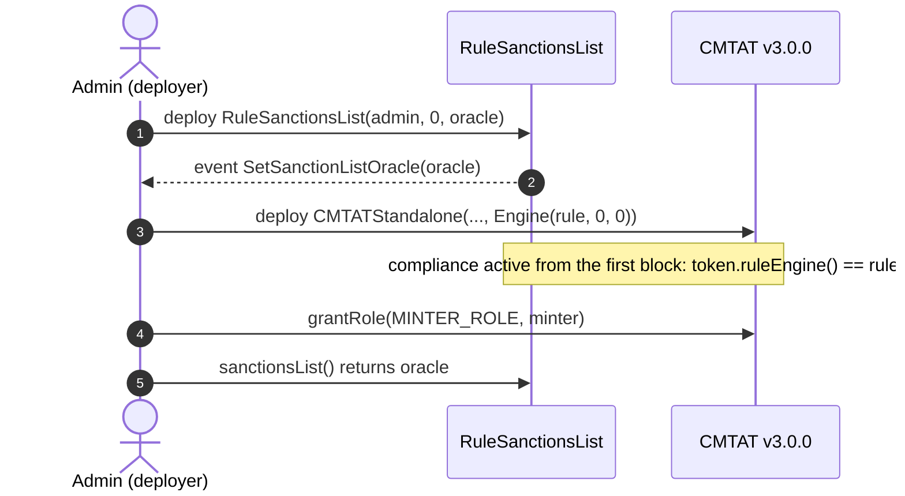

### 4.2 Rule set directly, after deployment

1. **Deploy the token** with `Engine(ruleEngine = address(0), ...)`. Do not mint yet.
2. **Deploy the rule** with its oracle, as in 4.1 step 1.
3. **Install it:** `token.setRuleEngine(rule)`, as the token's `DEFAULT_ADMIN_ROLE`. It emits `RuleEngine(rule)` and reverts with `CMTAT_ValidationModule_SameValue` if that rule is already set.
4. **Grant `MINTER_ROLE`**, then check as in 4.1 step 4.

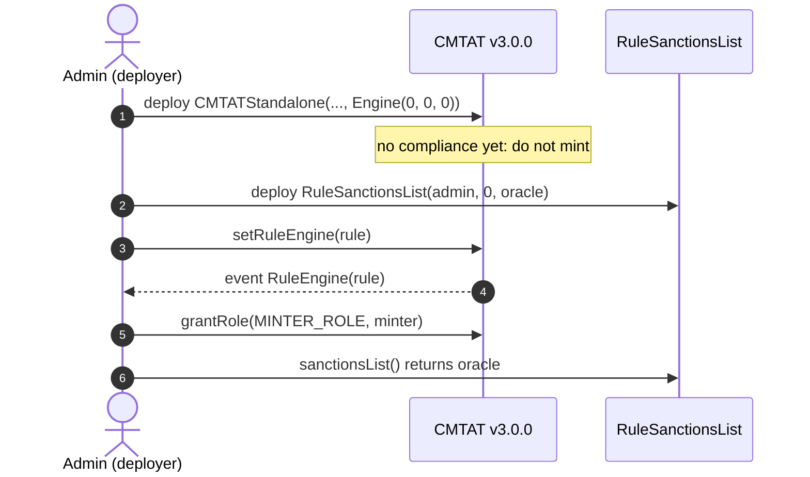

### 4.3 Behind a RuleEngine, at deployment (recommended with other rules)

The token address does not exist yet when the engine is deployed, so the engine is deployed without a token and binds it afterwards. Until that binding, the engine rejects every call from the token (`TokenBinding_UnauthorizedCaller`): no mint or transfer can happen unscreened.

1. **Deploy the RuleEngine:** `RuleEngine(admin, address(0))`.
2. **Deploy the rule** with its oracle and add it: `engine.addRule(rule)` (`RULES_MANAGEMENT_ROLE`). Add the other rules the same way.
3. **Deploy the token** with `Engine(ruleEngine = engine, ...)`.
4. **Bind the token:** `engine.bindToken(token)` (`COMPLIANCE_MANAGER_ROLE`). From now on the token works.
5. **Grant `MINTER_ROLE`** and check as in 4.1 step 4.

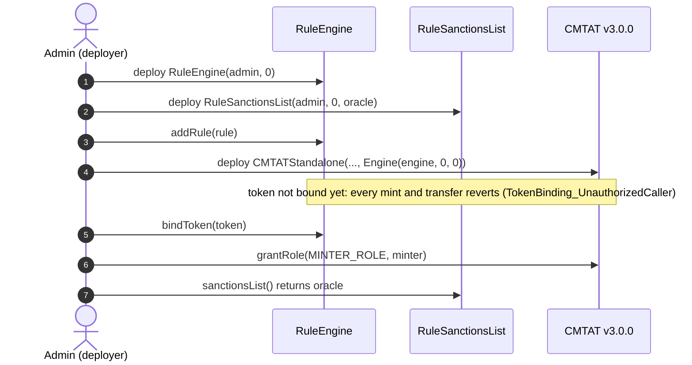

### 4.4 Behind a RuleEngine, after deployment

1. **Deploy the token** with `Engine(ruleEngine = address(0), ...)`. Do not mint yet.
2. **Deploy the RuleEngine** with the token already known: `RuleEngine(admin, token)` binds it in the constructor.
3. **Deploy the rule** with its oracle, `engine.addRule(rule)`.
4. **Install it:** `token.setRuleEngine(engine)`.
5. **Grant `MINTER_ROLE`** and check as in 4.1 step 4.

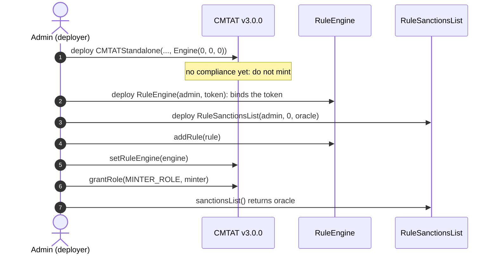

The repository script `script/DeployCMTATWithBlacklistAndSanctionsList.s.sol` follows this order with a blacklist as a second rule, but deploys the current CMTAT (v3.3), not v3.0.0. See [`DEPLOYMENT_SCRIPTS.md`](./DEPLOYMENT_SCRIPTS.md).

A RuleEngine serving one token is the intended setup. `RuleSanctionsList` itself would work for several tokens (it reads no token state), and they would all follow the same oracle.

## 5. Mint workflow

`mint(to, value)` by a `MINTER_ROLE` holder, with the rule active. On v3.0.0 the token checks the active balance of `from` (always passes for `address(0)`), then that the contract is not deactivated and the receiver not frozen, then notifies the compliance contract **before** creating the tokens, on the 3-argument `transferred(address(0), to, value)`: no minter is forwarded, so the rule cannot screen it. Pause does not stop a mint on v3.0.0.

### 5.1 Rule plugged directly into the token

The token calls `RuleSanctionsList` itself: `token.ruleEngine() == rule`.

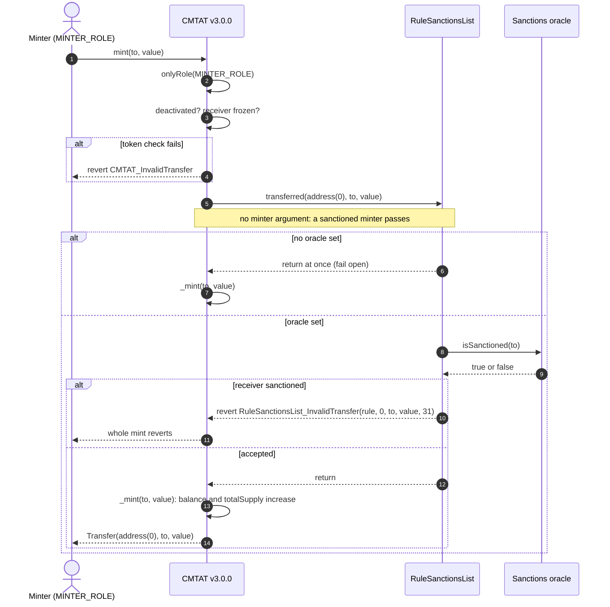

### 5.2 Rule behind a RuleEngine

The token calls the RuleEngine, which accepts only its bound token and then calls each of its rules in order. The first rule that reverts stops the mint, and the engine passes the revert back to the token.

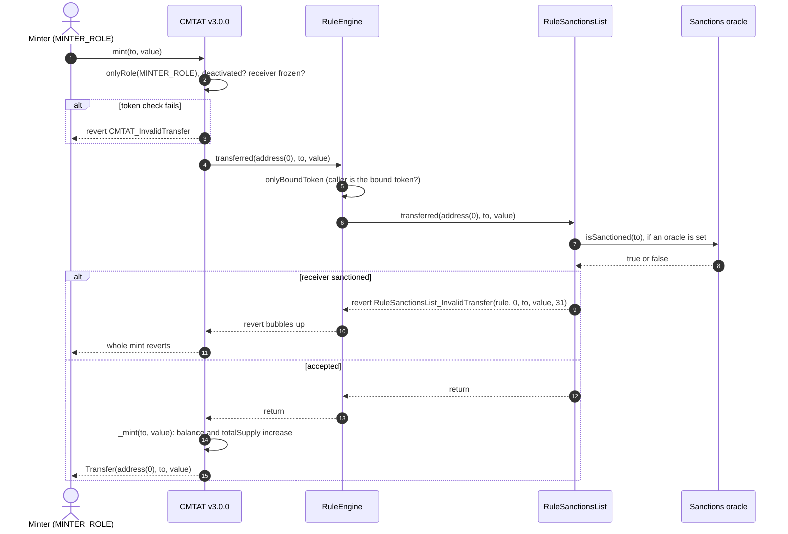

### 5.3 Happy path: a mint to a clean investor

The issuer mints 1,000 tokens to Alice. The oracle is set and does not flag Alice, the contract is active and Alice is not frozen. The rule is plugged directly into the token; behind a RuleEngine the engine sits between the token and the rule, as in §5.2.

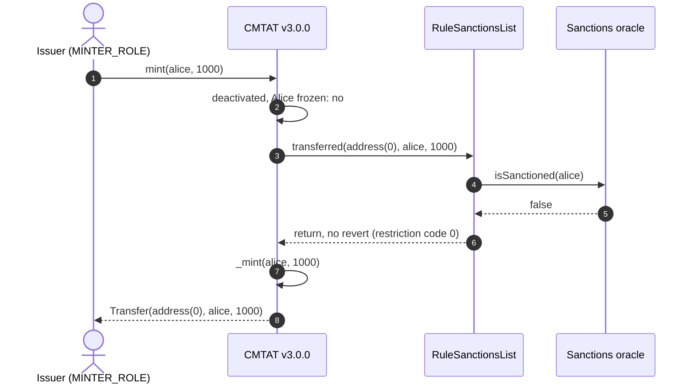

## 6. Transfer and burn workflows

### 6.1 Transfer, rule plugged directly into the token

`transfer(to, value)` by a holder. The token first checks that the tokens are not frozen (active balance), then that the token is not paused and nobody involved is frozen, then notifies the compliance contract **before** moving the balance. A `transfer` has no spender and takes the 3-argument path.

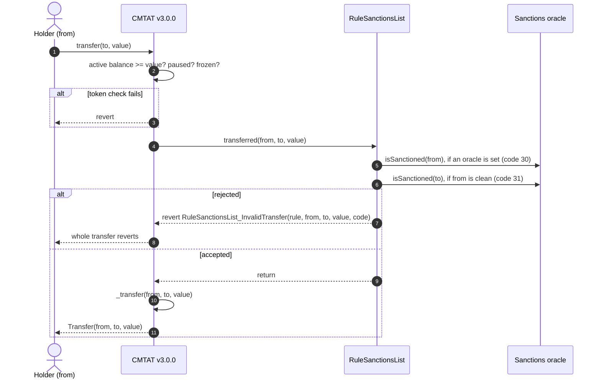

### 6.2 Transfer, rule behind a RuleEngine

Same path through the engine as for a mint (§5.2), on the 3-argument `transferred`.

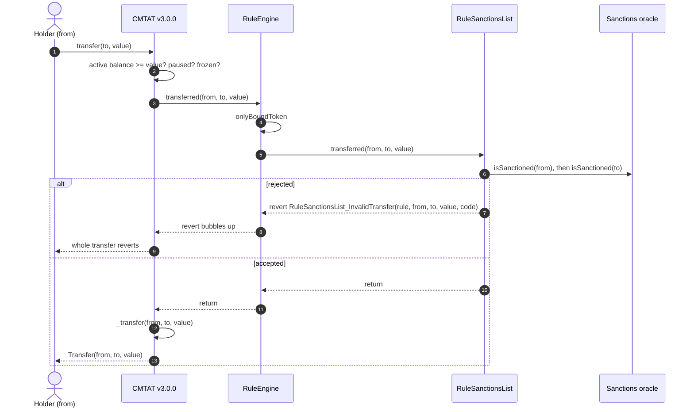

### 6.3 `transferFrom`: the spender is screened

`transferFrom(from, to, value)` by an approved spender takes the 4-argument path, with the caller as spender. The rule sends the spender to the oracle first. Behind a RuleEngine the engine forwards the same 4-argument call.

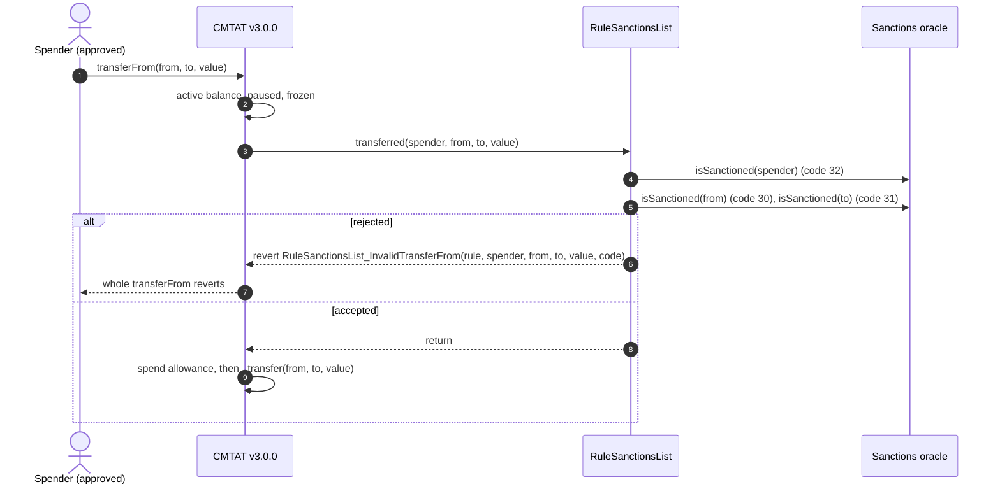

### 6.4 Happy path: a transfer between clean holders

Alice sends 100 tokens to Bob. The oracle flags neither, Alice holds at least 100 unfrozen tokens, and the token is not paused.

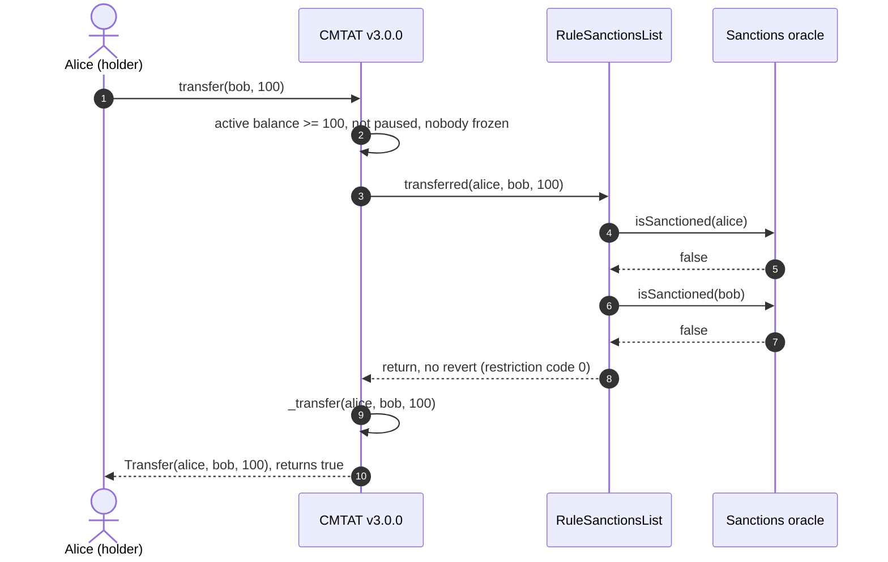

### 6.5 Burn, rule plugged directly into the token

`burn(from, value)` by a `BURNER_ROLE` holder. The token checks the active balance of `from`, that the contract is not deactivated and `from` not frozen, then calls the rule on the 3-argument `transferred(from, address(0), value)`. The burner is not forwarded.

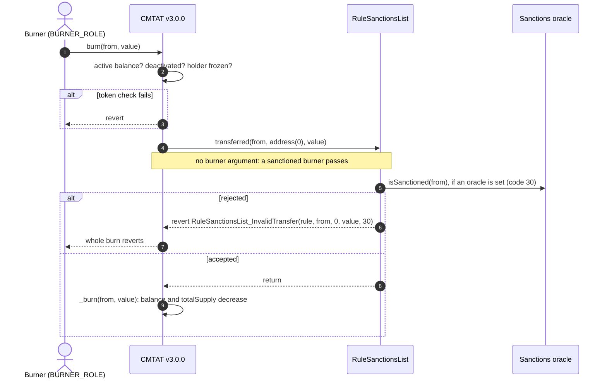

### 6.6 Burn, rule behind a RuleEngine

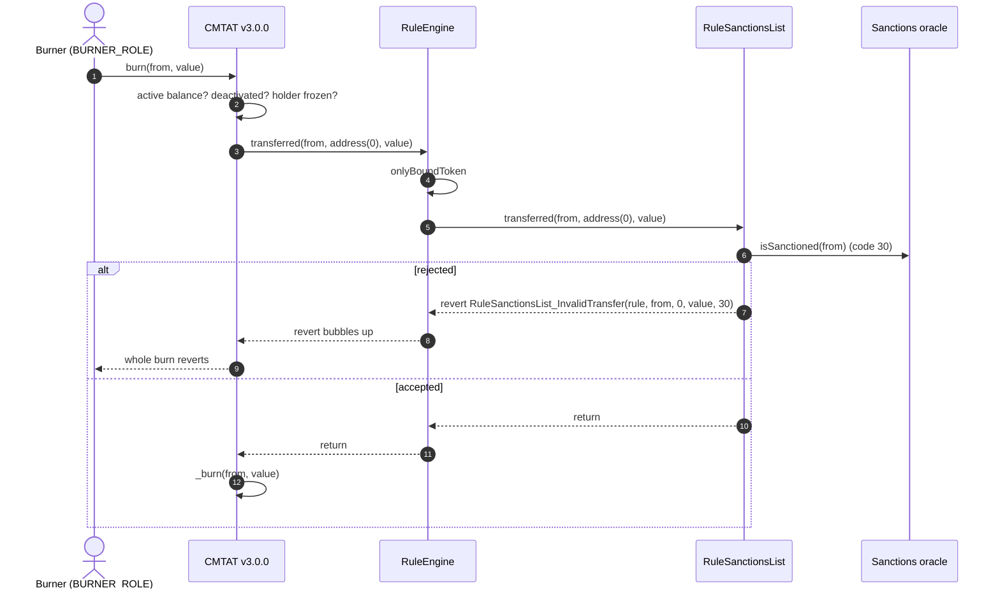

### 6.7 Happy path: a redemption from a clean holder

The issuer burns 50 of Alice's tokens. The oracle does not flag Alice, who is not frozen and holds at least 50 unfrozen tokens.

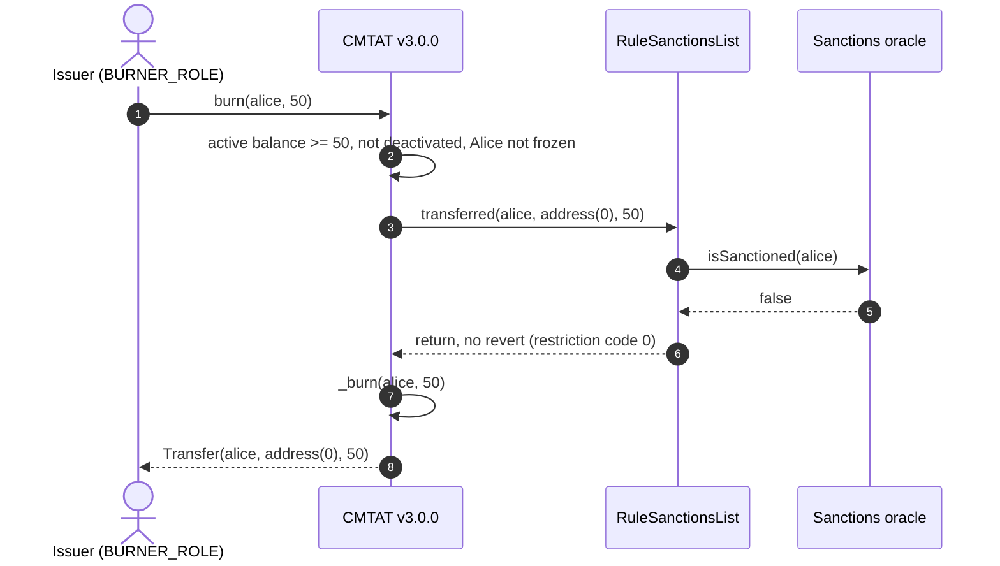

Before sending, a wallet or a front end can ask the same question without a transaction: `token.canTransfer(from, to, value)` and `token.canTransferFrom(spender, from, to, value)` on both variants, and `token.detectTransferRestriction(from, to, value)` plus `messageForTransferRestriction(code)` on the Standard variant (the Debt variant has no ERC-1404 layer). These views call the oracle too.

## 7. Operating the token

| Task | Call | Role |
| --- | --- | --- |
| Point to another oracle (provider migration) | `rule.setSanctionListOracle(newOracle)`; reverts on `address(0)` | `SANCTIONLIST_ROLE` (owner on the Ownable2Step variant) |
| Switch screening off | `rule.clearSanctionListOracle()`: every operation passes this rule | `SANCTIONLIST_ROLE` (owner) |
| Check the configuration | `rule.sanctionsList()`; `address(0)` means no screening | anyone |
| Block an address the oracle does not flag | not possible in this rule: add `RuleBlacklist` in a RuleEngine, or freeze it on the token (`setAddressFrozen`, `ENFORCER_ROLE`) | |
| Stop a compromised minter or burner | revoke its role: `token.revokeRole(MINTER_ROLE, addr)`. The oracle does not stop it on v3.0.0 | token `DEFAULT_ADMIN_ROLE` |
| Replace the compliance | `token.setRuleEngine(newRuleOrEngine)` | token `DEFAULT_ADMIN_ROLE` |
| Remove the compliance | `token.setRuleEngine(address(0))`: the token becomes unrestricted | token `DEFAULT_ADMIN_ROLE` |

**A sanctioned holder's tokens are locked:** the holder can neither send nor be burned from (code 30) while the oracle flags it. The token's `forcedTransfer(from, to, value)` (`DEFAULT_ADMIN_ROLE`; `to = address(0)` burns) does not call the compliance contract, so it moves them regardless of the oracle.

**`clearSanctionListOracle` is a kill switch, not a pause.** It disables screening for every token using the rule, in one call. Guard `SANCTIONLIST_ROLE` (or the owner) as carefully as the token admin.

**A broken oracle stops the token.** If the oracle reverts, or the configured address holds no code, every transfer, mint and burn reverts until `setSanctionListOracle` points to a working contract or `clearSanctionListOracle` is called.

See also: [`RuleSanctionsList.md`](../contracts/RuleSanctionsList.md) for the full rule reference, and [`RULE_SEMANTICS.md`](./RULE_SEMANTICS.md) §7 for the per-rule CMTAT v3.0.0 status.
