# Deploy `RuleSanctionsList` with a CMTAT v3.3.0 token

<!-- toc -->

- [1. What the rule enforces](#1-what-the-rule-enforces)
- [2. Choose the setup](#2-choose-the-setup)
- [3. Contracts and roles](#3-contracts-and-roles)
- [4. Deployment steps](#4-deployment-steps)
  - [Rule constructor parameters](#rule-constructor-parameters)
  - [4.1 Rule set directly, at deployment (recommended for sanctions screening alone)](#41-rule-set-directly-at-deployment-recommended-for-sanctions-screening-alone)
  - [4.2 Rule set directly, after deployment](#42-rule-set-directly-after-deployment)
  - [4.3 Behind a RuleEngine, at deployment (recommended with other rules)](#43-behind-a-ruleengine-at-deployment-recommended-with-other-rules)
  - [4.4 Behind a RuleEngine, after deployment](#44-behind-a-ruleengine-after-deployment)
- [5. Mint workflow](#5-mint-workflow)
  - [5.1 Rule plugged directly into the token](#51-rule-plugged-directly-into-the-token)
  - [5.2 Rule behind a RuleEngine](#52-rule-behind-a-ruleengine)
  - [5.3 Happy path: a mint to a clean investor](#53-happy-path-a-mint-to-a-clean-investor)
- [6. Transfer and burn workflows](#6-transfer-and-burn-workflows)
  - [6.1 Transfer, rule plugged directly into the token](#61-transfer-rule-plugged-directly-into-the-token)
  - [6.2 Transfer, rule behind a RuleEngine](#62-transfer-rule-behind-a-ruleengine)
  - [6.3 transferFrom: the spender is screened](#63-transferfrom-the-spender-is-screened)
  - [6.4 Happy path: a transfer between clean holders](#64-happy-path-a-transfer-between-clean-holders)
  - [6.5 Burn, rule plugged directly into the token](#65-burn-rule-plugged-directly-into-the-token)
  - [6.6 Burn, rule behind a RuleEngine](#66-burn-rule-behind-a-ruleengine)
  - [6.7 Happy path: a redemption from a clean holder](#67-happy-path-a-redemption-from-a-clean-holder)
- [7. Operating the token](#7-operating-the-token)
- [8. Differences from CMTAT v3.0.0](#8-differences-from-cmtat-v300)

<!-- /toc -->

This guide deploys a CMTAT **v3.3.0** token whose transfers, mints and burns are blocked when they involve an address flagged by a sanctions oracle (Chainalysis-style `isSanctioned(address)`), enforced by `RuleSanctionsList`. It covers:

- where the rule sits: on the token directly, or inside a RuleEngine;
- when it is installed: in the token constructor, or later with `setRuleEngine`;
- how the oracle is configured, and what happens while it is unset;
- what happens on a mint, a transfer and a burn once it is active.

v3.3.0 is not final yet: this library is validated against **`v3.3.0-rc4`**, the version pinned in `lib/CMTAT`, and every statement below was checked against that code. For the last audited release, see the [v3.0.0 guide](./DEPLOY_RULE_SANCTIONS_LIST_CMTAT_V3.0.0.md); [§8](#8-differences-from-cmtat-v300) lists what differs.

> **On v3.3.0 the minter and the burner are screened.** v3.3.0 calls the rule on mint and burn through the 4-argument `transferred(spender, from, to, value)`, with the `MINTER_ROLE` or `BURNER_ROLE` holder as `spender`, and the rule sends it to the oracle like an ERC-20 spender: a sanctioned minter cannot mint and a sanctioned burner cannot burn, whoever the receiver or holder is (code 32). This is the intended behaviour of a deny-list, and it differs from v3.0.0, where the operator is never forwarded. If the oracle ever flags one of your operational addresses, every issuance or redemption it sends is rejected until you move the role to another address.

> **No oracle, no screening.** While `sanctionsList()` is `address(0)` the rule returns 0 for every operation: it fails **open**. This is the state of a rule deployed with `address(0)` as oracle, and of a rule after `clearSanctionListOracle()`. Pass the oracle in the rule constructor and check `rule.sanctionsList()` before the first mint.

Every step below is tested against a real v3.3.0-rc4 token:

- `test/RuleSanctionsList/RuleSanctionsListCMTATDeployment.t.sol`: rule or RuleEngine passed in the token constructor (§4.1, §4.3), sanctioned minter and burner rejected with code 32, the fail-open state of a rule without oracle, and an oracle address without code;
- `test/DeploymentScripts/DeployCMTATWithBlacklistAndSanctionsList.t.sol`: rule behind a RuleEngine passed in the token constructor and bound to the token afterwards, next to a blacklist, through the repository script (§4.3).
- `test/DeploymentScripts/DeployCMTATWithSanctionsList.t.sol`: the rule alone passed in the token constructor (§4.1), through the repository script, including an unset oracle that lets every operation through.

No test installs the rule directly on a v3.3.0 token after deployment (§4.2). That setup differs from §4.1 only by the `setRuleEngine` call, which `test/RuleBlacklist/CMTATIntegrationDirect.t.sol` covers for `RuleBlacklist`.

The tests use a mock oracle (`src/mocks/SanctionListOracle.sol`) in place of the Chainalysis contract.

## 1. What the rule enforces

| Operation | Sent to the oracle | Rejected with |
| --- | --- | --- |
| Transfer `from → to` | `from`, then `to` | 30 (sender), 31 (receiver) |
| `transferFrom` by a spender | the spender, then `from`, then `to` | 32 (spender), 30, 31 |
| Mint to `to` | the **minter**, then `to` | 32 (minter), 31 |
| Burn from `from` | the **burner**, then `from` | 32 (burner), 30 |

The rule calls `oracle.isSanctioned(addr)` once per address, in that order, and stops at the first `true`. The zero address is never sent to the oracle: on a mint `from` is skipped, on a burn `to` is skipped, so an oracle that answered `true` for `address(0)` would not block issuance or redemption.

The rule keeps no list of its own. The oracle's maintainer decides who is sanctioned; the issuer cannot add an address. To also block addresses of your choice, add `RuleBlacklist` next to this rule in a RuleEngine.

**The oracle is called without a fallback.** If it reverts, or if the configured address holds no code, every screened operation reverts, and so do the token's `canTransfer` and `detectTransferRestriction` views. Neither the constructor nor the setter checks that the address is a contract.

On v3.3.0 the token mints and burns through `_checkTransferred(_msgSender(), from, to, value)`, so the caller arrives as `spender` and the token takes the 4-argument path. A plain `transfer` passes `spender = address(0)` and takes the 3-argument path. Code 32 is reported as "The spender is sanctioned" for the minter and the burner too: the rule does not distinguish them from an ERC-20 spender.

## 2. Choose the setup

**Where the rule sits.**

| Topology | Token calls | Use it when |
| --- | --- | --- |
| **Direct** | the rule itself (`token.ruleEngine() == rule`) | sanctions screening is the only rule. Fewer contracts to deploy, and one external call less per transfer |
| **RuleEngine** | a `RuleEngine`, which calls each of its rules | you need several rules (for example sanctions list + blacklist + max total supply), or want to add rules later without touching the token |

`RuleSanctionsList` keeps no state about transfers, so it behaves identically in both. It needs no token address and no binding to the token.

**When the rule is installed.**

| Moment | How | Effect |
| --- | --- | --- |
| **At deployment** | pass the rule (or the RuleEngine) in the token constructor's `Engine.ruleEngine` field | the token is never unrestricted, the very first mint is screened |
| **After deployment** | deploy the token with `Engine.ruleEngine = address(0)`, then `token.setRuleEngine(...)` | between the two transactions the token has **no compliance**: any mint or transfer goes through. Do not mint or grant `MINTER_ROLE` before `setRuleEngine` |

Installing at deployment, with the oracle passed in the rule constructor, is recommended: directly if sanctions screening is the only rule (§4.1), behind a RuleEngine otherwise (§4.3). Installing afterwards is the right choice for a token already live, or to change or replace the compliance later. In every setup, a rule without an oracle is a second unscreened window, independent of the first.

## 3. Contracts and roles

| Contract | Constructor | Roles that matter here |
| --- | --- | --- |
| `RuleSanctionsList` | `(admin, forwarderIrrevocable, sanctionContractOracle_)` | `DEFAULT_ADMIN_ROLE` (holds every role), `SANCTIONLIST_ROLE` (`setSanctionListOracle`, `clearSanctionListOracle`) |
| `RuleSanctionsListOwnable2Step` | `(owner, forwarderIrrevocable, sanctionContractOracle_)` | the owner sets and clears the oracle; ownership moves in two steps (`transferOwnership`, then `acceptOwnership`) |
| Sanctions oracle | deployed and maintained by its provider, for example Chainalysis | none on the issuer side: it must expose `isSanctioned(address) returns (bool)` |
| `RuleEngine` (RuleEngine `v3.0.0-rc7`, optional) | `(admin, tokenContract)`; `tokenContract` may be `address(0)` | `RULES_MANAGEMENT_ROLE` (`addRule`), `COMPLIANCE_MANAGER_ROLE` (`bindToken`) |
| CMTAT v3.3.0 `CMTATStandardStandalone` (or `CMTATStandaloneDebt`, or a proxy variant) | `(forwarder, admin, ERC20Attributes, ExtraInformationAttributes, Engine{ruleEngine})`. `CMTATStandaloneDebt` takes no forwarder | `DEFAULT_ADMIN_ROLE` (`setRuleEngine`, `forcedTransfer`, all roles), `MINTER_ROLE`, `BURNER_ROLE`, `PAUSER_ROLE`, `ENFORCER_ROLE` (freeze an address), `ERC20ENFORCER_ROLE` (freeze part of a balance) |

On both CMTAT and the AccessControl rules, the default admin implicitly holds every role. The v3.3.0 `Engine` struct has a single field, `ruleEngine`; the snapshot and document engines of v3.0.0 are no longer constructor arguments.

The oracle in the rule:

- `sanctionContractOracle_` in the constructor: a non-zero address is stored and emits `SetSanctionListOracle(oracle)`; `address(0)` is accepted and leaves the rule without oracle (fail open).
- `setSanctionListOracle(oracle)` replaces it later and reverts with `RuleSanctionsList_OracleAddressZeroNotAllowed` on `address(0)`.
- `clearSanctionListOracle()` sets it back to `address(0)`, which disables screening at once.
- `forwarderIrrevocable = address(0)` unless you use ERC-2771 meta-transactions for the rule's admin calls.

## 4. Deployment steps

Each setup lists its steps, then draws them as a sequence diagram. The calls are shown from a single admin; in production the rule, oracle and minting roles can be held by different addresses (§3).

### Rule constructor parameters

| Parameter | Type | What it sets | Checks and notes |
| --- | --- | --- | --- |
| `admin` | `address` | Receives `DEFAULT_ADMIN_ROLE`, which implicitly holds every role of the rule. Set it to the account (ideally a multisig) that will operate the rule. | Reverts if `address(0)`. On the `Ownable2Step` variant this parameter is `owner`, who then holds every privileged function |
| `forwarderIrrevocable` | `address` | ERC-2771 trusted forwarder for gasless (meta-transaction) calls to the rule's admin functions. | `address(0)` disables meta-transactions. Cannot be changed after deployment |
| `sanctionContractOracle_` | `ISanctionsList` | The Chainalysis-style oracle the rule asks `isSanctioned(address)` on every operation. | `address(0)` is accepted and leaves the oracle unset: the rule then **lets everything through** until `setSanctionListOracle` is called. The address is not checked for code: an oracle without code, or a reverting one, makes every operation revert |

### 4.1 Rule set directly, at deployment (recommended for sanctions screening alone)

1. **Deploy the rule with its oracle:** `RuleSanctionsList(admin, address(0), oracle)`. It needs no token address.
2. **Deploy the token** with `Engine(ruleEngine = rule)`.
3. **Grant `MINTER_ROLE`** (and `BURNER_ROLE`) to the issuer's operational addresses, if they are not the admin. Check that the oracle flags none of them.
4. **Check the setup:** `rule.sanctionsList() == oracle` and `token.ruleEngine() == rule`; on the Standard variant, `token.detectTransferRestrictionFrom(minter, address(0), investor1, 1) == 0` for a clean minter and investor.

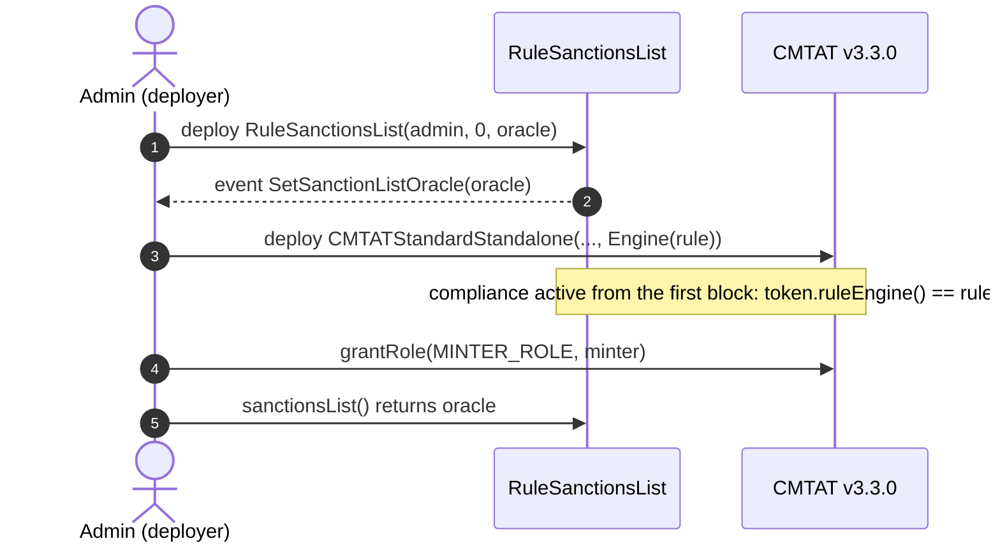

The repository script `script/DeployCMTATWithSanctionsList.s.sol` deploys this rule on a v3.3.0 token, set directly on it, in one run. See [`DEPLOYMENT_SCRIPTS.md`](./DEPLOYMENT_SCRIPTS.md).

### 4.2 Rule set directly, after deployment

1. **Deploy the token** with `Engine(ruleEngine = address(0))`. Do not mint yet.
2. **Deploy the rule** with its oracle, as in 4.1 step 1.
3. **Install it:** `token.setRuleEngine(rule)`, as the token's `DEFAULT_ADMIN_ROLE`. It emits `RuleEngine(rule)` and reverts with `CMTAT_ValidationModule_SameValue` if that rule is already set.
4. **Grant `MINTER_ROLE`**, then check as in 4.1 step 4.

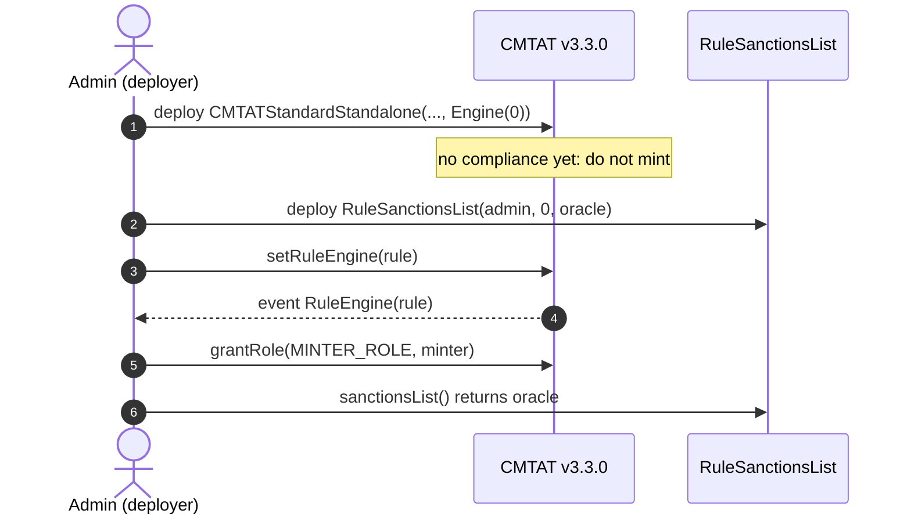

### 4.3 Behind a RuleEngine, at deployment (recommended with other rules)

The token address does not exist yet when the engine is deployed, so the engine is deployed without a token and binds it afterwards. Until that binding, the engine rejects every call from the token (`TokenBinding_UnauthorizedCaller`): no mint or transfer can happen unscreened.

1. **Deploy the RuleEngine:** `RuleEngine(admin, address(0))`.
2. **Deploy the rule** with its oracle and add it: `engine.addRule(rule)` (`RULES_MANAGEMENT_ROLE`). Add the other rules the same way.
3. **Deploy the token** with `Engine(ruleEngine = engine)`.
4. **Bind the token:** `engine.bindToken(token)` (`COMPLIANCE_MANAGER_ROLE`). From now on the token works.
5. **Grant `MINTER_ROLE`** and check as in 4.1 step 4.

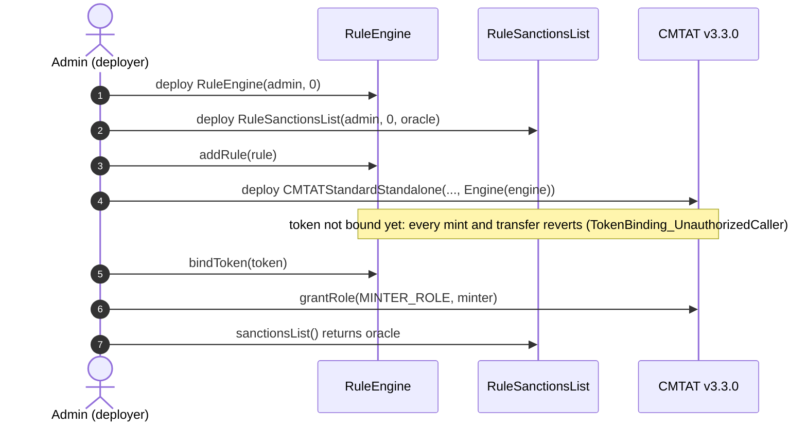

The repository script `script/DeployCMTATWithBlacklistAndSanctionsList.s.sol` deploys this setup on v3.3.0 with a blacklist as a second rule. See [`DEPLOYMENT_SCRIPTS.md`](./DEPLOYMENT_SCRIPTS.md).

### 4.4 Behind a RuleEngine, after deployment

1. **Deploy the token** with `Engine(ruleEngine = address(0))`. Do not mint yet.
2. **Deploy the RuleEngine** with the token already known: `RuleEngine(admin, token)` binds it in the constructor.
3. **Deploy the rule** with its oracle, `engine.addRule(rule)`.
4. **Install it:** `token.setRuleEngine(engine)`.
5. **Grant `MINTER_ROLE`** and check as in 4.1 step 4.

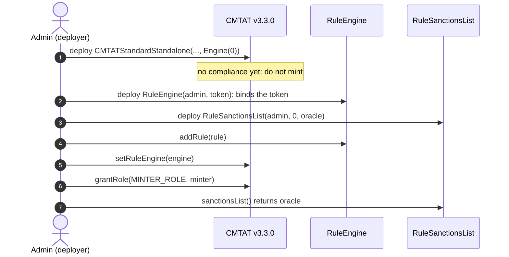

A RuleEngine serving one token is the intended setup. `RuleSanctionsList` itself would work for several tokens (it reads no token state), and they would all follow the same oracle.

## 5. Mint workflow

`mint(to, value)` by a `MINTER_ROLE` holder, with the rule active. The token runs its own checks first (contract deactivated, receiver frozen), then notifies the compliance contract **before** creating the tokens, on the 4-argument `transferred(minter, address(0), to, value)`. Pause does not stop a mint. On the Standard variant the call to the compliance contract runs under a transient reentrancy guard.

### 5.1 Rule plugged directly into the token

The token calls `RuleSanctionsList` itself: `token.ruleEngine() == rule`.

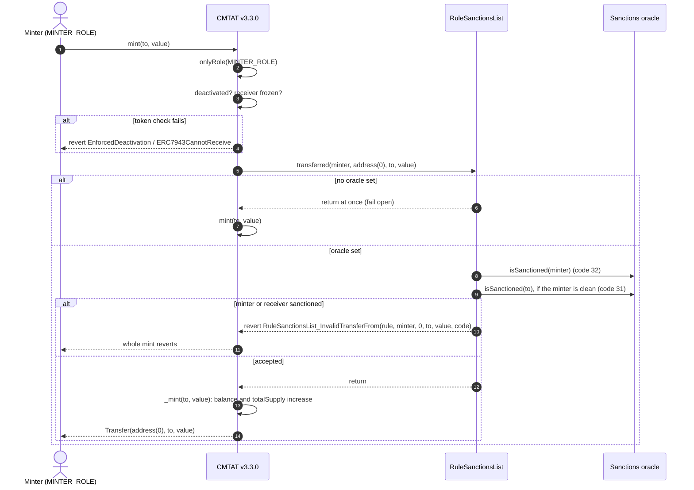

### 5.2 Rule behind a RuleEngine

The token calls the RuleEngine, which accepts only its bound token and then calls each of its rules in order with the same four arguments. The first rule that reverts stops the mint, and the engine passes the revert back to the token.

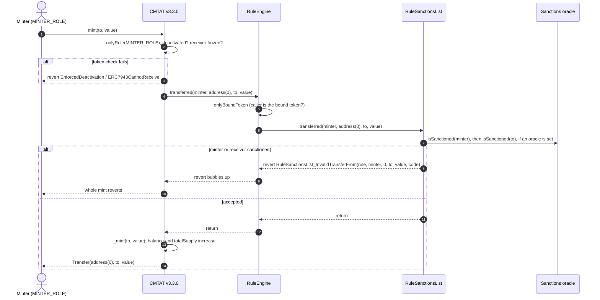

### 5.3 Happy path: a mint to a clean investor

The issuer's minter mints 1,000 tokens to Alice. The oracle is set and flags neither the minter nor Alice, the contract is active and Alice is not frozen. The rule is plugged directly into the token; behind a RuleEngine the engine sits between the token and the rule, as in §5.2.

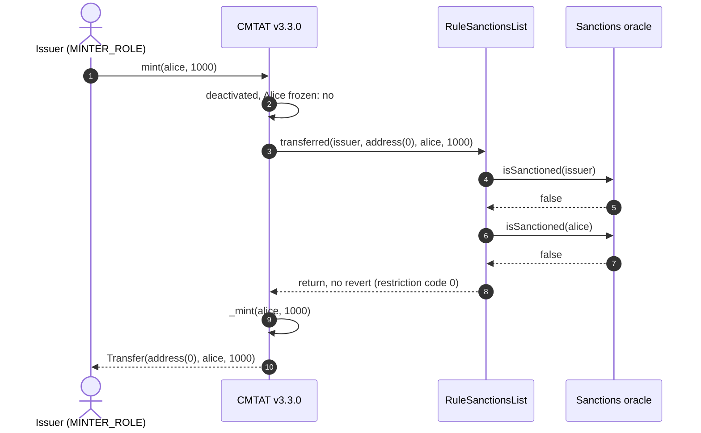

To pre-check a mint without a transaction, ask with the minter: `token.canTransferFrom(minter, address(0), to, value)`, or `detectTransferRestrictionFrom` on the Standard variant. `canTransfer(address(0), to, value)` sends only the receiver to the oracle, so it answers `true` for a sanctioned minter.

## 6. Transfer and burn workflows

### 6.1 Transfer, rule plugged directly into the token

`transfer(to, value)` by a holder. The token first checks that the tokens are not frozen (active balance), then that the token is not paused and nobody involved is frozen, then notifies the compliance contract **before** moving the balance. A `transfer` has no spender and takes the 3-argument path.

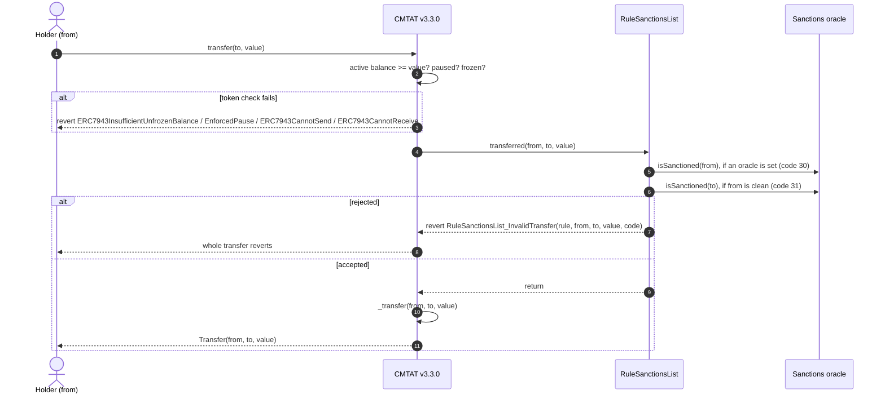

### 6.2 Transfer, rule behind a RuleEngine

Same path through the engine as for a mint (§5.2), on the 3-argument `transferred`.

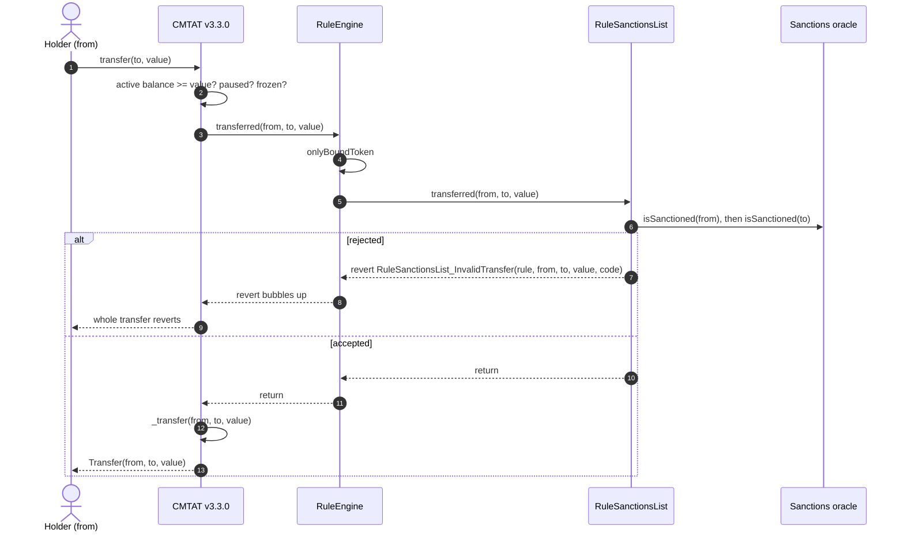

### 6.3 `transferFrom`: the spender is screened

`transferFrom(from, to, value)` by an approved spender takes the 4-argument path, with the caller as spender. The rule sends the spender to the oracle first. Behind a RuleEngine the engine forwards the same 4-argument call.

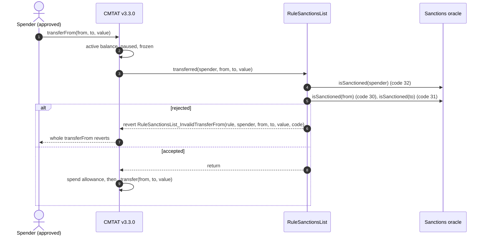

### 6.4 Happy path: a transfer between clean holders

Alice sends 100 tokens to Bob. The oracle flags neither, Alice holds at least 100 unfrozen tokens, and the token is not paused.

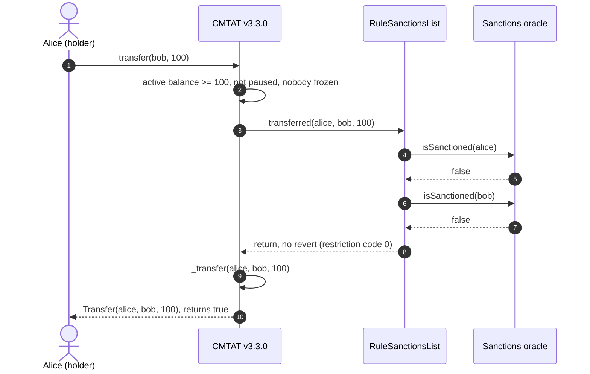

### 6.5 Burn, rule plugged directly into the token

`burn(from, value)` by a `BURNER_ROLE` holder. The token checks the active balance of `from`, that the contract is not deactivated and `from` not frozen, then calls the rule on the 4-argument `transferred(burner, from, address(0), value)`.

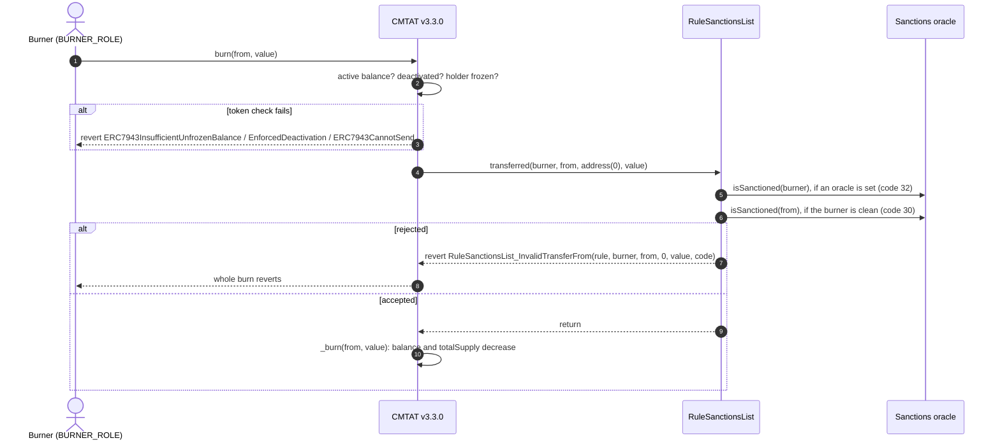

### 6.6 Burn, rule behind a RuleEngine

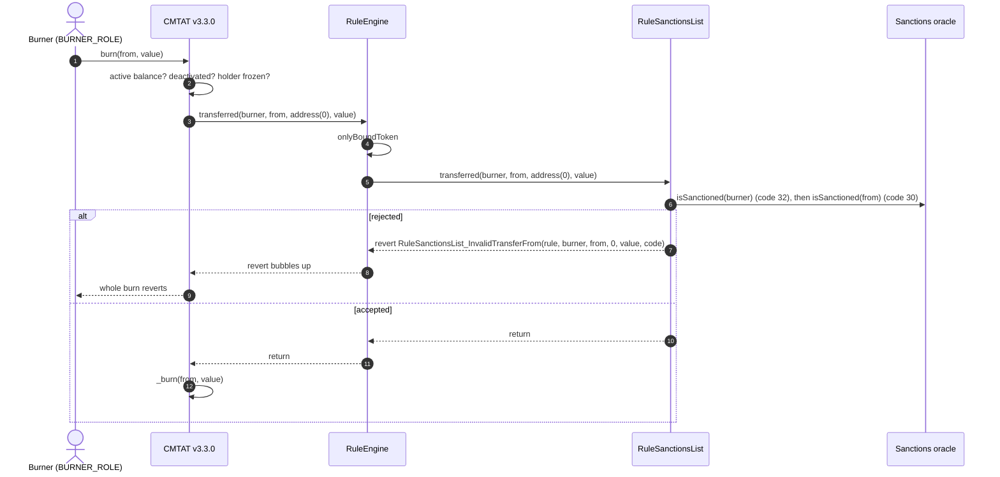

### 6.7 Happy path: a redemption from a clean holder

The issuer burns 50 of Alice's tokens. The oracle flags neither the issuer's burner nor Alice, who is not frozen and holds at least 50 unfrozen tokens.

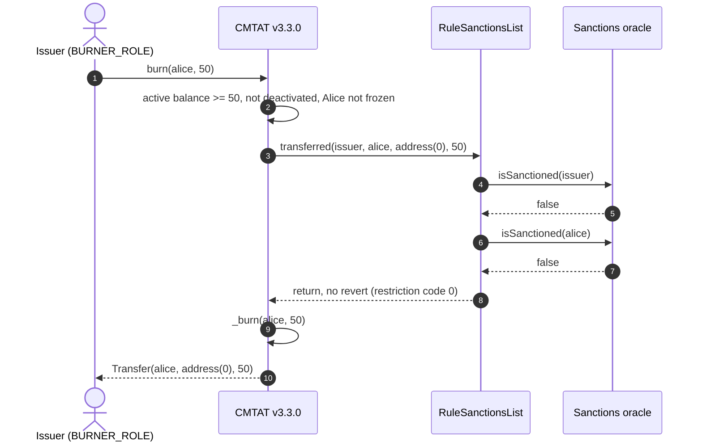

Before sending, a wallet or a front end can ask the same question without a transaction: `token.canTransfer(from, to, value)` and `token.canTransferFrom(spender, from, to, value)` on both variants, and `token.detectTransferRestriction(from, to, value)` / `detectTransferRestrictionFrom(...)` plus `messageForTransferRestriction(code)` on the Standard variant (the Debt variant has no ERC-1404 layer). These views call the oracle too.

## 7. Operating the token

| Task | Call | Role |
| --- | --- | --- |
| Point to another oracle (provider migration) | `rule.setSanctionListOracle(newOracle)`; reverts on `address(0)` | `SANCTIONLIST_ROLE` (owner on the Ownable2Step variant) |
| Switch screening off | `rule.clearSanctionListOracle()`: every operation passes this rule | `SANCTIONLIST_ROLE` (owner) |
| Check the configuration | `rule.sanctionsList()`; `address(0)` means no screening | anyone |
| Block an address the oracle does not flag | not possible in this rule: add `RuleBlacklist` in a RuleEngine, or freeze it on the token (`setAddressFrozen`, `ENFORCER_ROLE`) | |
| Stop a compromised minter or burner | revoke its role: `token.revokeRole(MINTER_ROLE, addr)`. The oracle stops it only if it flags that address | token `DEFAULT_ADMIN_ROLE` |
| Replace the compliance | `token.setRuleEngine(newRuleOrEngine)` | token `DEFAULT_ADMIN_ROLE` |
| Remove the compliance | `token.setRuleEngine(address(0))`: the token becomes unrestricted | token `DEFAULT_ADMIN_ROLE` |

**A sanctioned holder's tokens are locked:** the holder can neither send nor be burned from (code 30) while the oracle flags it. The token's `forcedTransfer(from, to, value)` (`DEFAULT_ADMIN_ROLE`; `to = address(0)` burns) does not call the compliance contract, so it moves them regardless of the oracle.

**`clearSanctionListOracle` is a kill switch, not a pause.** It disables screening for every token using the rule, in one call. Guard `SANCTIONLIST_ROLE` (or the owner) as carefully as the token admin.

**A broken oracle stops the token.** If the oracle reverts, or the configured address holds no code, every transfer, mint and burn reverts until `setSanctionListOracle` points to a working contract or `clearSanctionListOracle` is called.

## 8. Differences from CMTAT v3.0.0

| | v3.0.0 | v3.3.0 |
| --- | --- | --- |
| Constructor `Engine` struct | `{ruleEngine, snapshotEngine, documentEngine}` | `{ruleEngine}` |
| Standard standalone contract | `CMTATStandalone` | `CMTATStandardStandalone` |
| How mint and burn call the rule | 3-argument `transferred`, no minter / burner | 4-argument `transferred`, minter / burner as `spender` |
| Sanctioned minter or burner | **not screened**: mints and burns go through | rejected with code 32 |
| Oracle calls per mint or burn | one (receiver or holder) | two (operator, then receiver or holder) |
| Mint or burn rejected by the rule | `RuleSanctionsList_InvalidTransfer` | `RuleSanctionsList_InvalidTransferFrom` |
| Pre-check of a mint | `canTransfer(address(0), to, value)` is complete | use `canTransferFrom(minter, address(0), to, value)` to include the minter |
| Token-side check fails (frozen, paused, deactivated) | `CMTAT_InvalidTransfer` | the specific error: `ERC7943CannotSend` / `ERC7943CannotReceive`, `EnforcedPause`, `EnforcedDeactivation` |
| Reentrancy guard around the compliance call | none | transient guard on the Standard variant |

Transfers, `transferFrom`, the oracle configuration and the fail-open state behave the same on both versions. See [`RULE_SEMANTICS.md`](./RULE_SEMANTICS.md) §7 for the other rules.

See also: [`RuleSanctionsList.md`](../contracts/RuleSanctionsList.md) for the full rule reference.
