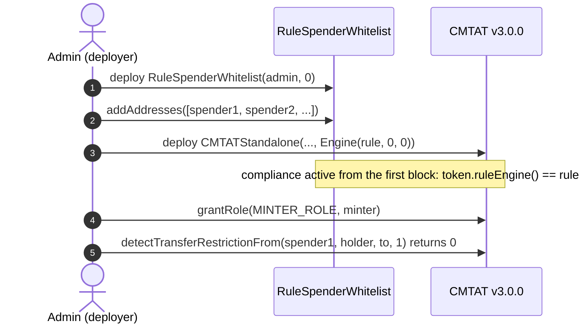
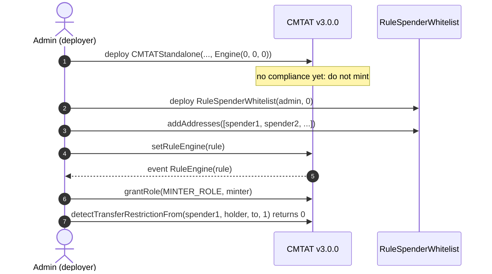
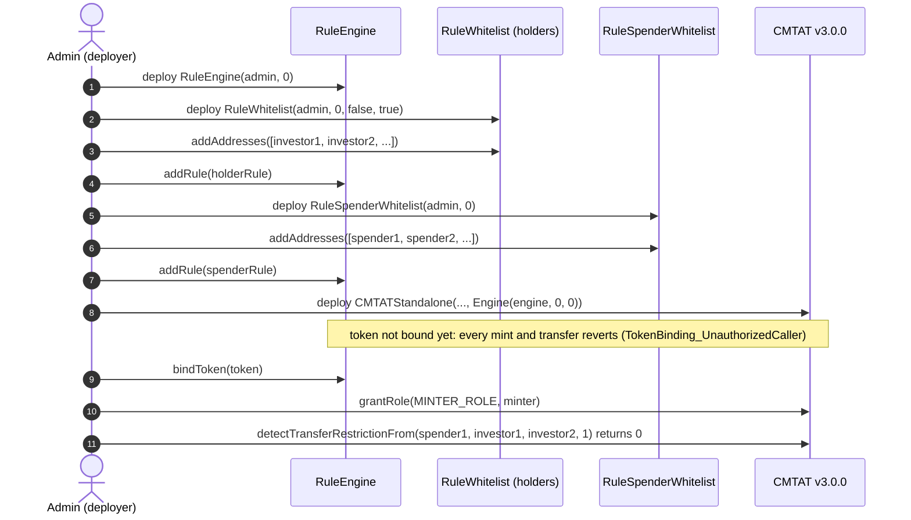
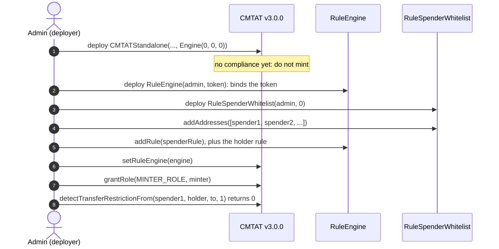
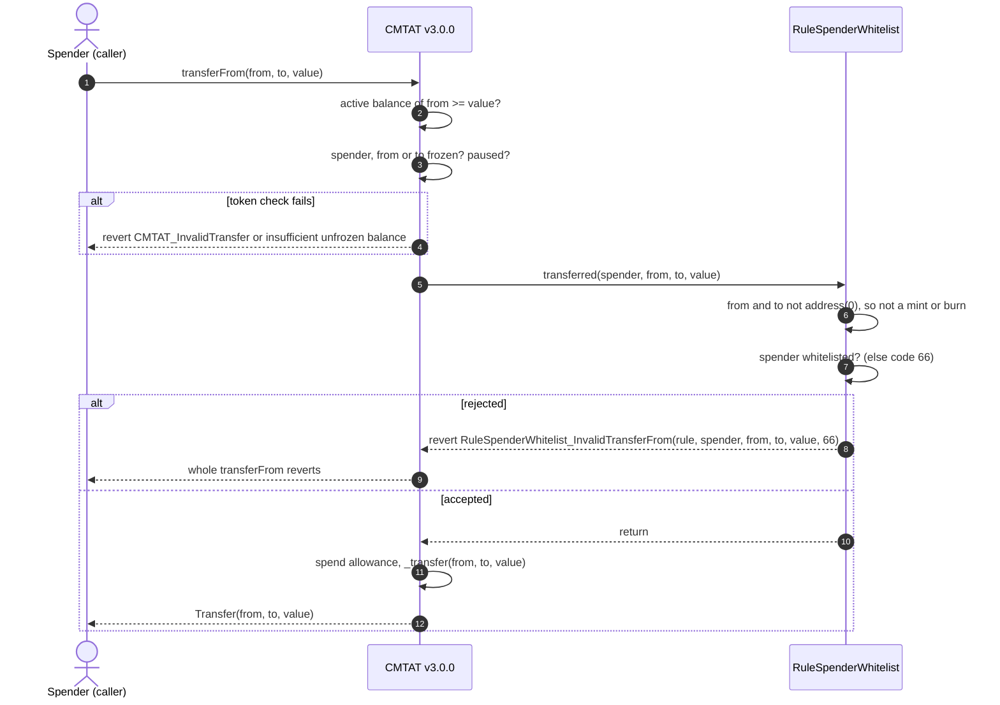
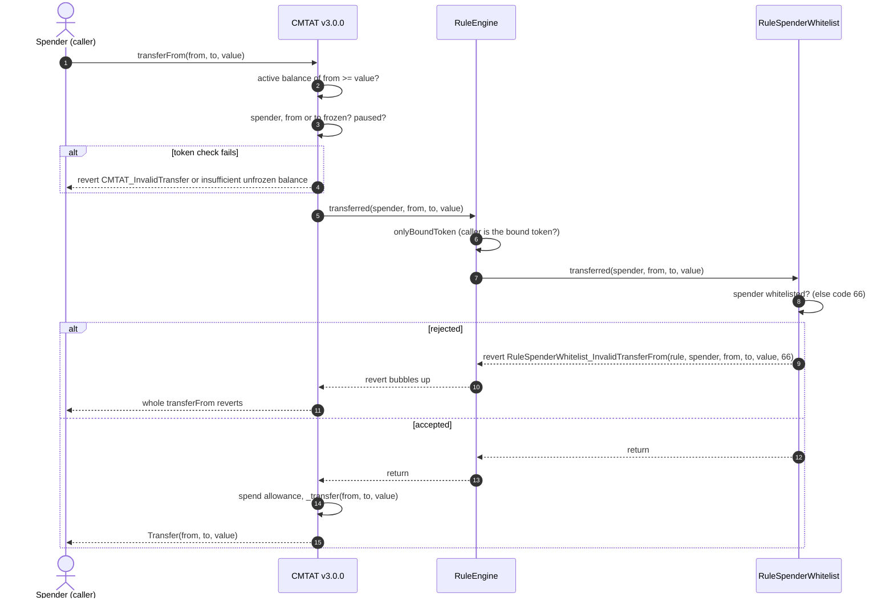
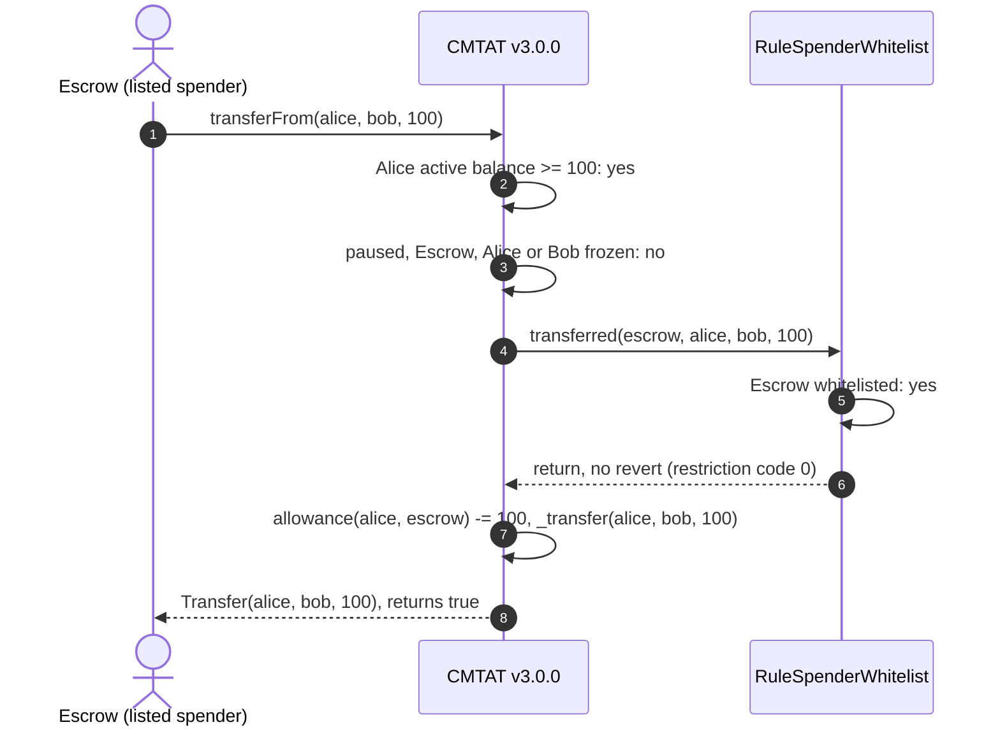
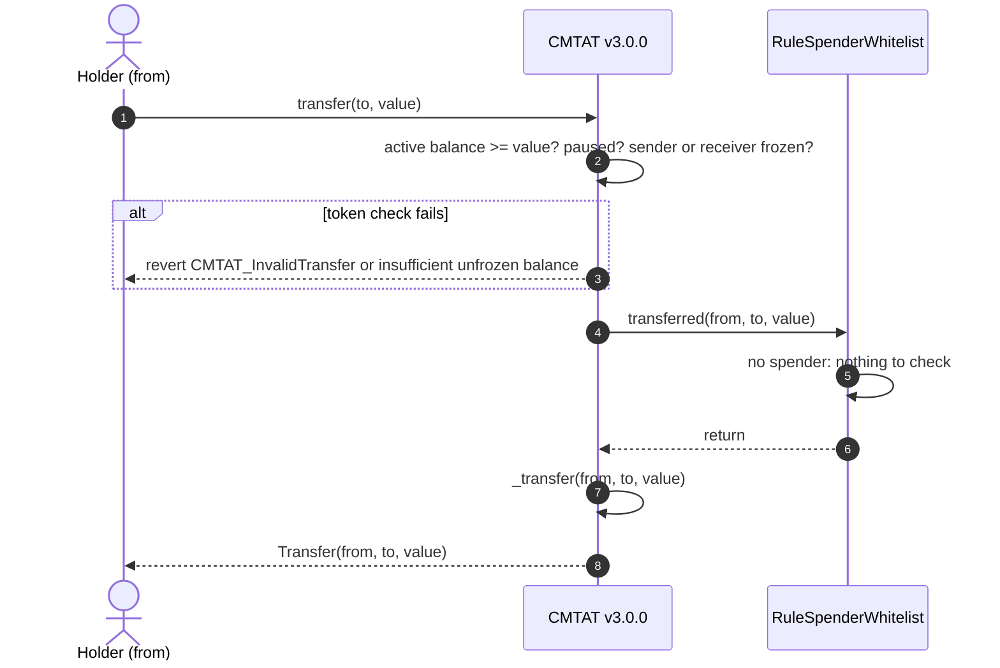
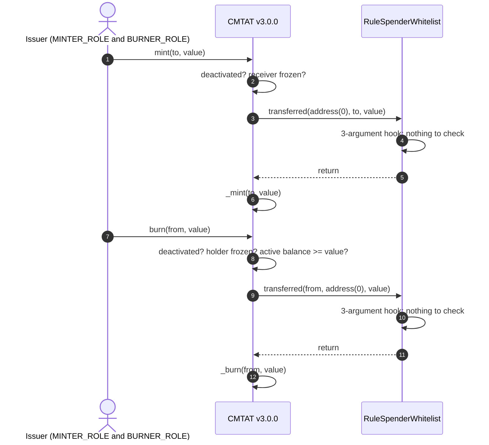

# Deploy `RuleSpenderWhitelist` with a CMTAT v3.0.0 token

[TOC]

This guide deploys a CMTAT **v3.0.0** token where `transferFrom` can only be called by whitelisted spenders, enforced by `RuleSpenderWhitelist`. Direct transfers, mints and burns are not screened by the rule. It covers:

- where the rule sits: on the token directly, or inside a RuleEngine next to a rule that screens holders;
- when it is installed: in the token constructor, or later with `setRuleEngine`;
- what happens on a `transferFrom`, and why a transfer, a mint or a burn passes.

CMTAT v3.0.0 is the last audited CMTAT release. For CMTAT v3.3.0, validated against `v3.3.0-rc4`, see the [v3.3.0 guide](./DEPLOY_RULE_SPENDER_WHITELIST_CMTAT_V3.3.0.md), which also lists the differences between the two versions.

Every setup below is tested against a real v3.0.0 token:

- `test/CMTATv3.0.0/RuleSpenderWhitelistV300.t.sol`: rule installed after deployment, on the Standard and Debt variants, directly and behind a RuleEngine (setups 4.2 and 4.4);
- `test/CMTATv3.0.0/RuleSpenderWhitelistV300Deployment.t.sol`: rule or RuleEngine passed in the token constructor (setups 4.1 and 4.3), with the spender rule alone in the engine.

## 1. What the rule enforces

| Operation | Checked by `RuleSpenderWhitelist` | Rejected with |
| --- | --- | --- |
| Transfer `from → to` | nothing | never |
| `transferFrom` by a spender | the spender (the caller) is whitelisted. `from` and `to` are not checked | 66 (spender) |
| Mint | nothing: the minter is not a delegated spender | never |
| Burn | nothing: the burner is not a delegated spender | never |

On v3.0.0 mint and burn call the rule through the 3-argument `transferred(from, to, value)`, without the minter or burner, and the rule's 3-argument hook does nothing. `transferFrom` is the only call that carries a spender, on the 4-argument `transferred(spender, from, to, value)`. Who may mint or burn is decided by the token's `MINTER_ROLE` and `BURNER_ROLE`.

**The rule restricts nobody's holdings.** Any holder can send to any address with `transfer`, and any address can receive. On its own it only controls who may move tokens on a holder's behalf, for example a settlement or escrow contract. To screen holders, combine it with a rule such as `RuleWhitelist`, `RuleReceiverWhitelist` or `RuleIdentityRegistry` in a RuleEngine.

A holder who calls `transferFrom` on their own tokens arrives as the spender and is screened like any other caller. Use `transfer` for one's own tokens.

## 2. Choose the setup

**Where the rule sits.**

| Topology | Token calls | Use it when |
| --- | --- | --- |
| **Direct** | the rule itself (`token.ruleEngine() == rule`) | delegated transfers are the only thing to control and holders are not screened at all |
| **RuleEngine** | a `RuleEngine`, which calls each of its rules | the usual case: the spender whitelist sits next to a rule that screens holders, or you want to add rules later without touching the token |

`RuleSpenderWhitelist` is stateless, so it behaves identically in both. It needs no binding to the token.

**When the rule is installed.**

| Moment | How | Effect |
| --- | --- | --- |
| **At deployment** | pass the rule (or the RuleEngine) in the token constructor's `Engine.ruleEngine` field | the token is never unrestricted, the first `transferFrom` is screened |
| **After deployment** | deploy the token with `Engine.ruleEngine = address(0)`, then `token.setRuleEngine(...)` | between the two transactions the token has **no compliance**: any mint or transfer goes through. Do not mint or grant `MINTER_ROLE` before `setRuleEngine` |

Recommended: setup 4.3, a RuleEngine at deployment holding this rule and a rule that screens holders. Installing afterwards is the right choice for a token already live, or to change or replace the compliance later.

## 3. Contracts and roles

| Contract | Constructor | Roles that matter here |
| --- | --- | --- |
| `RuleSpenderWhitelist` (or `RuleSpenderWhitelistOwnable2Step`) | `(admin, forwarderIrrevocable)`; the Ownable2Step variant takes `(owner, forwarderIrrevocable)` | `DEFAULT_ADMIN_ROLE` (all roles), `ADDRESS_LIST_ADD_ROLE`, `ADDRESS_LIST_REMOVE_ROLE`. The Ownable2Step variant gives all of it to the owner |
| `RuleEngine` (RuleEngine `v3.0.0-rc7`, optional) | `(admin, tokenContract)`; `tokenContract` may be `address(0)` | `RULES_MANAGEMENT_ROLE` (`addRule`), `COMPLIANCE_MANAGER_ROLE` (`bindToken`) |
| CMTAT v3.0.0 `CMTATStandalone` (or `CMTATStandaloneDebt`, or a proxy variant) | `(forwarder, admin, ERC20Attributes, ExtraInformationAttributes, Engine{ruleEngine, snapshotEngine, documentEngine})`. `CMTATStandaloneDebt` takes no forwarder | `DEFAULT_ADMIN_ROLE` (`setRuleEngine`, `forcedTransfer`, all roles), `MINTER_ROLE`, `BURNER_ROLE`, `PAUSER_ROLE`, `ENFORCER_ROLE` (freeze an address), `ERC20ENFORCER_ROLE` (freeze part of a balance) |

On both CMTAT and the AccessControl rule, the default admin implicitly holds every role.

The rule has no flags. `forwarderIrrevocable = address(0)` unless you use ERC-2771 meta-transactions for the rule's admin calls.

**Not a `RuleWhitelistWrapper` child.** The wrapper refuses this rule (`RuleWhitelistWrapper_ChildDoesNotDeclarePolarity`): its list holds permitted spenders, not permitted holders.

## 4. Deployment steps

Each setup lists its steps, then draws them as a sequence diagram. The calls are shown from a single admin; in production the list, rule and minting roles can be held by different addresses (§3).

### 4.1 Rule set directly, at deployment

1. **Deploy the rule:** `RuleSpenderWhitelist(admin, address(0))`. It needs no token address.
2. **List the spenders:** `addAddresses([spender1, spender2, ...])`, as the admin or an `ADDRESS_LIST_ADD_ROLE` holder. This can also happen after step 3; until then every `transferFrom` is rejected.
3. **Deploy the token** with `Engine(ruleEngine = rule, snapshotEngine = 0, documentEngine = 0)`.
4. **Grant `MINTER_ROLE`** to the issuer's minting address, if it is not the admin. 
5. **Check the setup:** `token.ruleEngine() == rule`; on the Standard variant, `token.detectTransferRestrictionFrom(spender1, holder, to, 1) == 0` and the same call with an unlisted spender returns 66.

### 4.2 Rule set directly, after deployment

1. **Deploy the token** with `Engine(ruleEngine = address(0), ...)`. Do not mint yet.
2. **Deploy the rule** and list the spenders, as in 4.1 steps 1 and 2.
3. **Install it:** `token.setRuleEngine(rule)`, as the token's `DEFAULT_ADMIN_ROLE`. It emits `RuleEngine(rule)` and reverts with `CMTAT_ValidationModule_SameValue` if that rule is already set.
4. **Grant `MINTER_ROLE`**, then check as in 4.1 step 5.

### 4.3 Behind a RuleEngine, at deployment (recommended)

The token address does not exist yet when the engine is deployed, so the engine is deployed without a token and binds it afterwards. Until that binding, the engine rejects every call from the token (`TokenBinding_UnauthorizedCaller`): no mint or transfer can happen unscreened.

1. **Deploy the RuleEngine:** `RuleEngine(admin, address(0))`.
2. **Deploy the holder rule** (here a `RuleWhitelist`), fill it, and add it: `engine.addRule(holderRule)` (`RULES_MANAGEMENT_ROLE`).
3. **Deploy the spender rule**, list the spenders, and add it: `engine.addRule(spenderRule)`.
4. **Deploy the token** with `Engine(ruleEngine = engine, ...)`.
5. **Bind the token:** `engine.bindToken(token)` (`COMPLIANCE_MANAGER_ROLE`). From now on the token works.
6. **Grant `MINTER_ROLE`** and check as in 4.1 step 5.

The test for this setup puts the spender rule alone in the engine; the holder rule is an example of what to add next to it.

### 4.4 Behind a RuleEngine, after deployment

1. **Deploy the token** with `Engine(ruleEngine = address(0), ...)`. Do not mint yet.
2. **Deploy the RuleEngine** with the token already known: `RuleEngine(admin, token)` binds it in the constructor.
3. **Deploy the rules**, fill their lists, and add them with `engine.addRule(...)`.
4. **Install it:** `token.setRuleEngine(engine)`.
5. **Grant `MINTER_ROLE`** and check as in 4.1 step 5.

A RuleEngine serving one token is the intended setup. `RuleSpenderWhitelist` itself would work for several tokens (it reads no token state), but every token would then share one spender list.

## 5. `transferFrom` workflow

`transferFrom(from, to, value)` by a spender holding an allowance. The token first checks that `from` has enough unfrozen tokens, then that the token is not paused and that neither the spender, `from` nor `to` is frozen. It then notifies the compliance contract on the 4-argument `transferred(spender, from, to, value)`, and only after that spends the allowance and moves the balance. An unlisted spender is therefore rejected by the rule even if its allowance is also too low.

### 5.1 Rule plugged directly into the token

The token calls `RuleSpenderWhitelist` itself: `token.ruleEngine() == rule`.

### 5.2 Rule behind a RuleEngine

The token calls the RuleEngine, which accepts only its bound token and then calls each of its rules in order. The first rule that reverts stops the transfer, and the engine passes the revert back to the token.

### 5.3 Happy path: a listed settlement contract moves an investor's tokens

Alice approved 100 tokens to Escrow, a settlement contract on the spender list. Escrow calls `transferFrom(alice, bob, 100)`. Nobody is frozen and the token is not paused. The rule is plugged directly into the token; behind a RuleEngine the engine sits between the token and the rule, as in §5.2.

## 6. Transfer, mint and burn: the rule returns at once

The diagrams show the rule plugged directly into the token; behind a RuleEngine the engine sits between them, as in §5.2, and the other rules of the engine still run.

### 6.1 Transfer

### 6.2 Mint and burn

Before calling `transferFrom`, a spender or a front end can ask the same question without a transaction: `token.canTransferFrom(spender, from, to, value)` on both variants, and `token.detectTransferRestrictionFrom(spender, from, to, value)` plus `messageForTransferRestriction(code)` on the Standard variant (the Debt variant has no ERC-1404 layer). `canTransfer(from, to, value)` always passes this rule, since it has no spender.

## 7. Operating the token

| Task | Call | Role |
| --- | --- | --- |
| Authorise a spender (a settlement, escrow or custody contract) | `rule.addAddresses([...])` (skips duplicates, reverts on `address(0)`) or `addAddress` (reverts on a duplicate) | `ADDRESS_LIST_ADD_ROLE` |
| Withdraw a spender | `rule.removeAddresses([...])` / `removeAddress` | `ADDRESS_LIST_REMOVE_ROLE` |
| Replace the compliance | `token.setRuleEngine(newRuleOrEngine)` | token `DEFAULT_ADMIN_ROLE` |
| Remove the compliance | `token.setRuleEngine(address(0))`: the token becomes unrestricted | token `DEFAULT_ADMIN_ROLE` |

**Removing a spender does not revoke its allowances.** The allowances stay on the token; the next `transferFrom` from that spender is rejected with code 66 until it is listed again. A holder who wants the allowance gone calls `approve(spender, 0)`.

**Listing a spender lets it move any holder's tokens within the allowance that holder gave.** The rule does not check `from` or `to`, so pair it with a holder rule (§2) if the counterparties must be screened.

See also: [`RuleSpenderWhitelist.md`](../contracts/RuleSpenderWhitelist.md) for the full rule reference, and [`RULE_SEMANTICS.md`](./RULE_SEMANTICS.md) §7 for the per-rule CMTAT v3.0.0 status.
