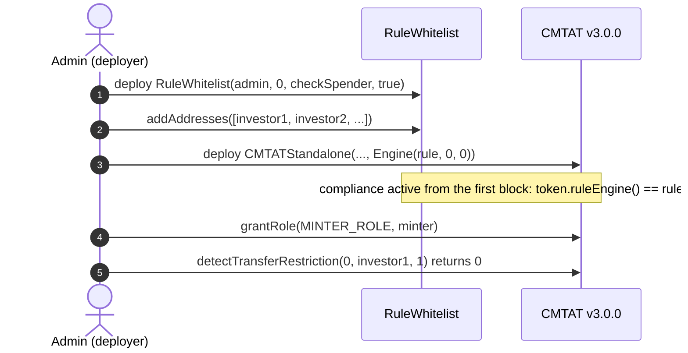
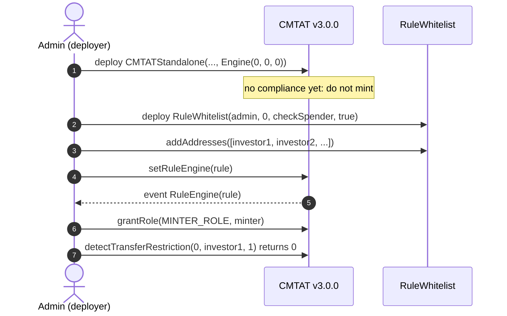
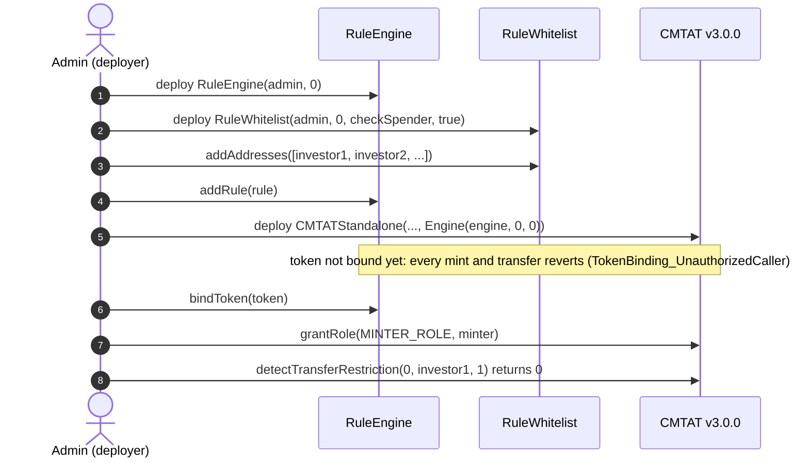
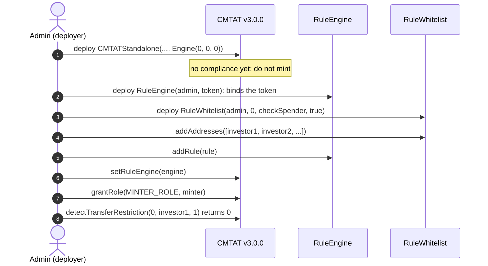
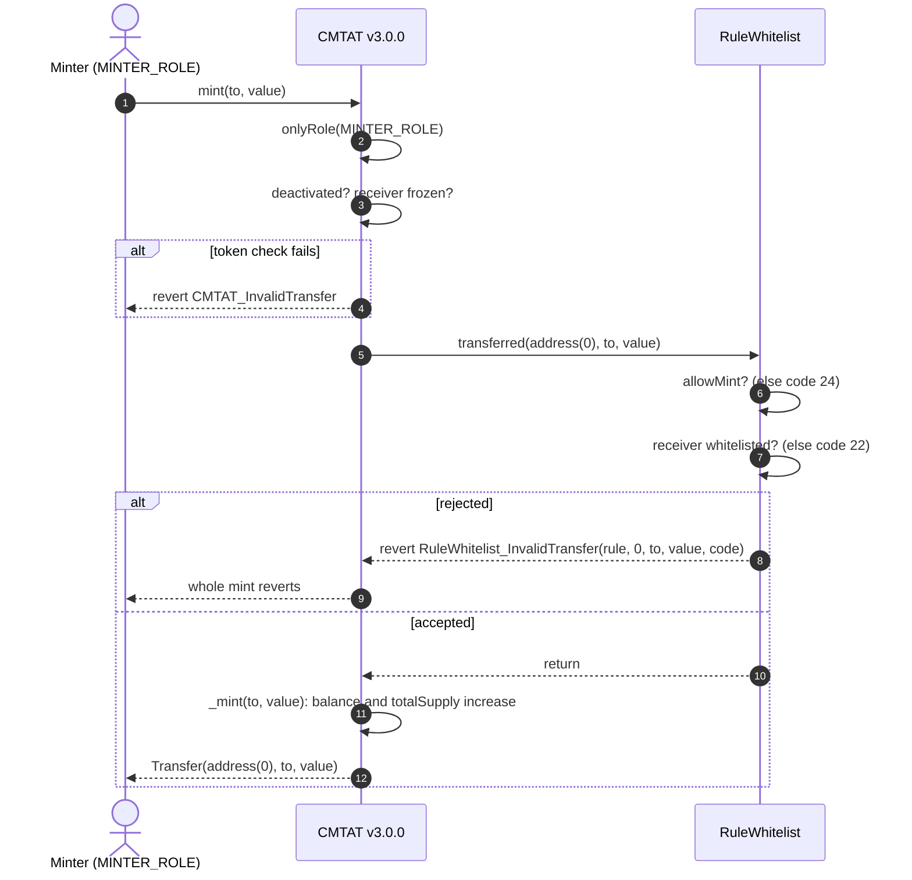
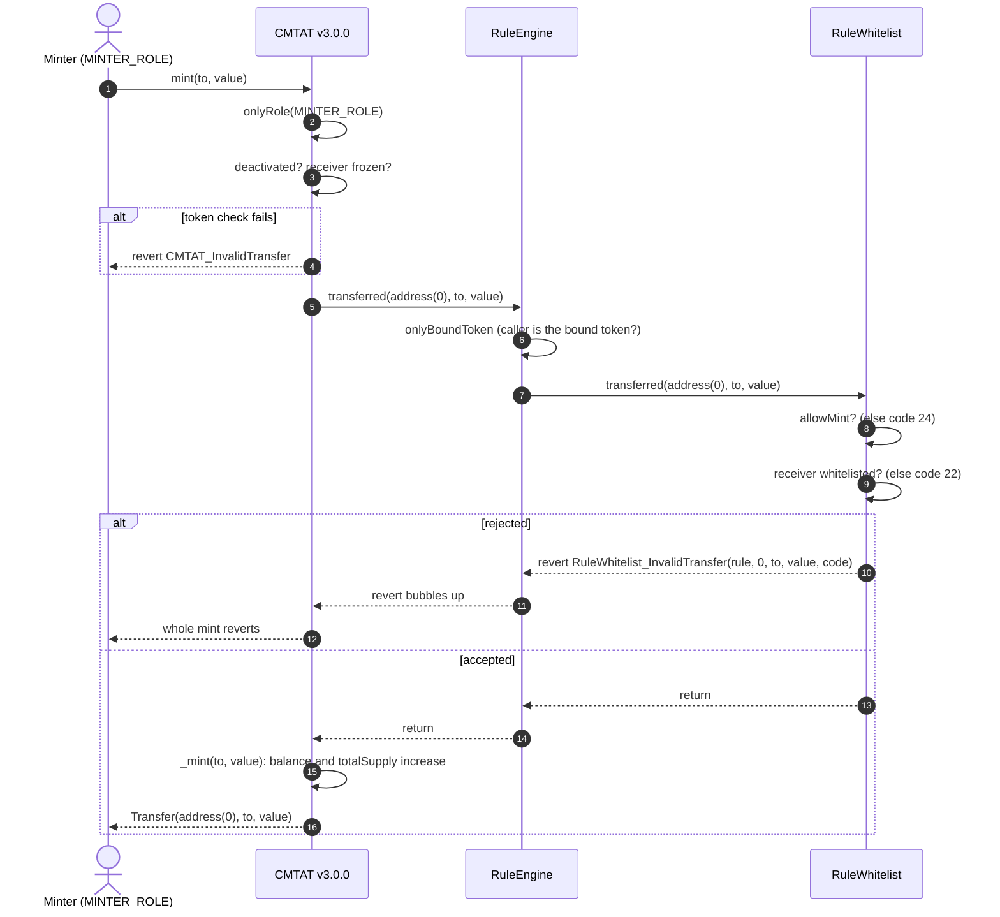
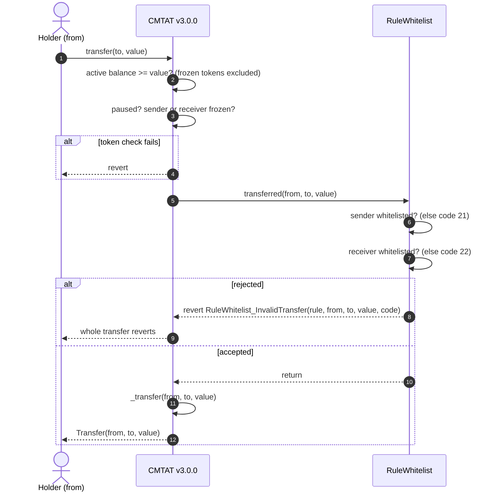
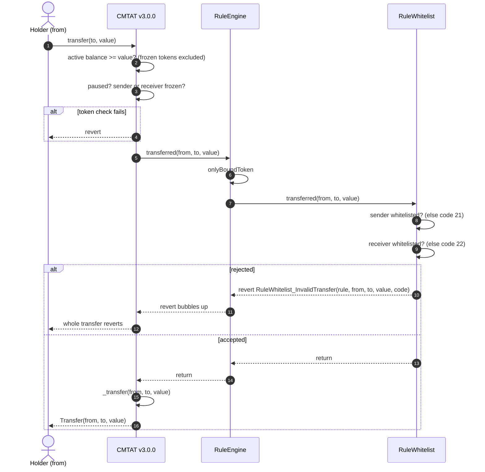
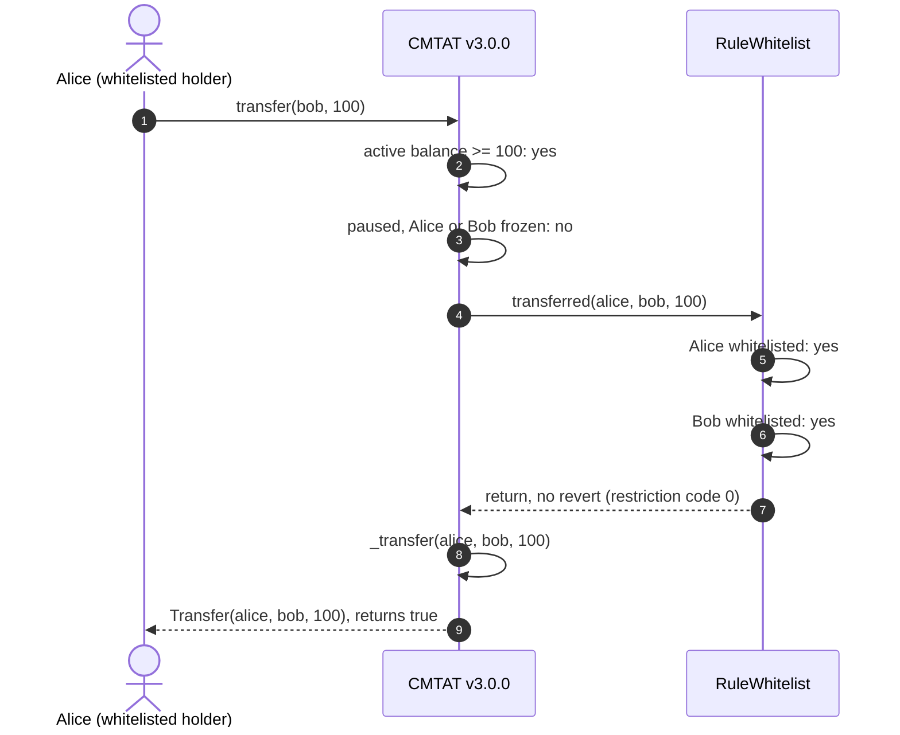

# Deploy `RuleWhitelist` with a CMTAT v3.0.0 token

<!-- toc -->

- [1. What the rule enforces](#1-what-the-rule-enforces)
- [2. Choose the setup](#2-choose-the-setup)
- [3. Contracts and roles](#3-contracts-and-roles)
- [4. Deployment steps](#4-deployment-steps)
  - [Rule constructor parameters](#rule-constructor-parameters)
  - [4.1 Rule set directly, at deployment (recommended for a whitelist alone)](#41-rule-set-directly-at-deployment-recommended-for-a-whitelist-alone)
  - [4.2 Rule set directly, after deployment](#42-rule-set-directly-after-deployment)
  - [4.3 Behind a RuleEngine, at deployment](#43-behind-a-ruleengine-at-deployment)
  - [4.4 Behind a RuleEngine, after deployment](#44-behind-a-ruleengine-after-deployment)
- [5. Mint workflow](#5-mint-workflow)
  - [5.1 Rule plugged directly into the token](#51-rule-plugged-directly-into-the-token)
  - [5.2 Rule behind a RuleEngine](#52-rule-behind-a-ruleengine)
- [6. Transfer workflow](#6-transfer-workflow)
  - [6.1 Rule plugged directly into the token](#61-rule-plugged-directly-into-the-token)
  - [6.2 Rule behind a RuleEngine](#62-rule-behind-a-ruleengine)
  - [6.3 Happy path: both holders whitelisted](#63-happy-path-both-holders-whitelisted)
- [7. Operating the token](#7-operating-the-token)

<!-- /toc -->

This guide deploys a CMTAT **v3.0.0** token whose transfers and mints are restricted to whitelisted addresses by `RuleWhitelist`. It covers:

- where the rule sits: on the token directly, or inside a RuleEngine;
- when it is installed: in the token constructor, or later with `setRuleEngine`;
- what happens on a mint and on a transfer once it is active.

CMTAT v3.0.0 is the last audited CMTAT release. For CMTAT v3.3.0, validated against `v3.3.0-rc4`, see the [v3.3.0 guide](./DEPLOY_RULE_WHITELIST_CMTAT_V3.3.0.md), which also lists the differences between the two versions.

Every step below is tested against a real v3.0.0 token:

- `test/CMTATv3.0.0/RuleWhitelistV300.t.sol`: rule installed after deployment, on the Standard and Debt variants, directly and behind a RuleEngine;
- `test/CMTATv3.0.0/RuleWhitelistV300Deployment.t.sol`: rule or RuleEngine passed in the token constructor.

## 1. What the rule enforces

| Operation | Checked by `RuleWhitelist` | Rejected with |
| --- | --- | --- |
| Transfer `from → to` | `from` and `to` are whitelisted | 21 (sender), 22 (receiver) |
| `transferFrom` by a spender | as above, plus the spender if `checkSpender` is `true` | 23 (spender) |
| Mint to `to` | `allowMint` is `true` and `to` is whitelisted | 24 (mint not allowed), 22 |
| Burn from `from` | `allowBurn` is `true` and `from` is whitelisted | 25 (burn not allowed), 21 |

The zero address is never a whitelist member: mint and burn are permitted by the `allowMint` / `allowBurn` flags, not by listing `address(0)`. The minter's address plays no part, which matters on v3.0.0: that release does not forward the minter to the rule (mint arrives on the 3-argument `transferred(from, to, value)`), so nothing is lost.

## 2. Choose the setup

**Where the rule sits.**

| Topology | Token calls | Use it when |
| --- | --- | --- |
| **Direct** | the rule itself (`token.ruleEngine() == rule`) | the whitelist is the only rule. Fewer contracts to deploy, and one external call less per transfer |
| **RuleEngine** | a `RuleEngine`, which calls each of its rules | you need several rules (for example whitelist + max total supply), or want to add rules later without touching the token |

`RuleWhitelist` is stateless, so it behaves identically in both. It needs no binding to the token.

**When the rule is installed.**

| Moment | How | Effect |
| --- | --- | --- |
| **At deployment** | pass the rule (or the RuleEngine) in the token constructor's `Engine.ruleEngine` field | the token is never unrestricted, the very first mint is screened |
| **After deployment** | deploy the token with `Engine.ruleEngine = address(0)`, then `token.setRuleEngine(...)` | between the two transactions the token has **no compliance**: any mint or transfer goes through. Do not mint or grant `MINTER_ROLE` before `setRuleEngine` |

Installing at deployment is recommended. Installing afterwards is the right choice for a token already live, or to change or replace the compliance later.

## 3. Contracts and roles

| Contract | Constructor | Roles that matter here |
| --- | --- | --- |
| `RuleWhitelist` (or `RuleWhitelistOwnable2Step`) | `(admin, forwarderIrrevocable, checkSpender, allowMintBurn)` | `DEFAULT_ADMIN_ROLE` (all roles, flags), `ADDRESS_LIST_ADD_ROLE`, `ADDRESS_LIST_REMOVE_ROLE` |
| `RuleEngine` (RuleEngine `v3.0.0-rc7`, optional) | `(admin, tokenContract)`; `tokenContract` may be `address(0)` | `RULES_MANAGEMENT_ROLE` (`addRule`), `COMPLIANCE_MANAGER_ROLE` (`bindToken`) |
| CMTAT v3.0.0 `CMTATStandalone` (or `CMTATStandaloneDebt`, or a proxy variant) | `(forwarder, admin, ERC20Attributes, ExtraInformationAttributes, Engine{ruleEngine, snapshotEngine, documentEngine})`. `CMTATStandaloneDebt` takes no forwarder | `DEFAULT_ADMIN_ROLE` (`setRuleEngine`, `forcedTransfer`, all roles), `MINTER_ROLE`, `BURNER_ROLE`, `PAUSER_ROLE`, `ENFORCER_ROLE` (freeze an address), `ERC20ENFORCER_ROLE` (freeze part of a balance) |

On both CMTAT and the AccessControl rules, the default admin implicitly holds every role.

Constructor flags of the rule:

- `allowMintBurn = true` to be able to issue. With `false`, every mint is rejected with code 24, even to a whitelisted investor. Both flags can be changed later with `setAllowMint` / `setAllowBurn` (for example to close issuance for good while keeping redemptions open).
- `checkSpender = true` to also require the spender of a `transferFrom` to be whitelisted. It can be toggled later with `setCheckSpender`.
- `forwarderIrrevocable = address(0)` unless you use ERC-2771 meta-transactions for the rule's admin calls.

## 4. Deployment steps

Each setup lists its steps, then draws them as a sequence diagram. The calls are shown from a single admin; in production the whitelist, rule and minting roles can be held by different addresses (§3).

### Rule constructor parameters

| Parameter | Type | What it sets | Checks and notes |
| --- | --- | --- | --- |
| `admin` | `address` | Receives `DEFAULT_ADMIN_ROLE`, which implicitly holds every role of the rule. Set it to the account (ideally a multisig) that will operate the rule. | Reverts if `address(0)`. On the `Ownable2Step` variant this parameter is `owner`, who then holds every privileged function |
| `forwarderIrrevocable` | `address` | ERC-2771 trusted forwarder for gasless (meta-transaction) calls to the rule's admin functions. | `address(0)` disables meta-transactions. Cannot be changed after deployment |
| `checkSpender_` | `bool` | When `true`, a `transferFrom` also requires the spender to be whitelisted (code 23). Mint and burn are always exempt from the spender check. | Toggle later with `setCheckSpender` |
| `allowMintBurn` | `bool` | Sets both `allowMint` and `allowBurn`. With `false`, every mint (code 24) and burn (code 25) is refused, even for whitelisted holders. | Pass `true` to be able to issue. Adjust each flag later with `setAllowMint` / `setAllowBurn` |

### 4.1 Rule set directly, at deployment (recommended for a whitelist alone)

1. **Deploy the rule:** `RuleWhitelist(admin, address(0), checkSpender, true)`. It needs no token address.
2. **Fill the whitelist:** `addAddresses([investor1, investor2, ...])`, as the admin or an `ADDRESS_LIST_ADD_ROLE` holder. This can also happen after step 3; until then every mint and transfer is rejected.
3. **Deploy the token** with `Engine(ruleEngine = rule, snapshotEngine = 0, documentEngine = 0)`.
4. **Grant `MINTER_ROLE`** to the issuer's minting address, if it is not the admin.
5. **Check the setup:** `token.ruleEngine() == rule`; on the Standard variant, `token.detectTransferRestriction(address(0), investor1, 1) == 0` and the same call to an unlisted address returns
   22. A small test mint confirms it end to end.

### 4.2 Rule set directly, after deployment

1. **Deploy the token** with `Engine(ruleEngine = address(0), ...)`. Do not mint yet.
2. **Deploy the rule** and fill the whitelist, as in 4.1 steps 1 and 2.
3. **Install it:** `token.setRuleEngine(rule)`, as the token's `DEFAULT_ADMIN_ROLE`. It emits `RuleEngine(rule)` and reverts with `CMTAT_ValidationModule_SameValue` if that rule is already set.
4. **Grant `MINTER_ROLE`**, then check as in 4.1 step 5.

The repository script `script/DeployCMTATWithWhitelist.s.sol` follows this order, but deploys the current CMTAT (v3.3), not v3.0.0. See `DEPLOYMENT_SCRIPTS.md`.

### 4.3 Behind a RuleEngine, at deployment

The token address does not exist yet when the engine is deployed, so the engine is deployed without a token and binds it afterwards. Until that binding, the engine rejects every call from the token (`TokenBinding_UnauthorizedCaller`): no mint or transfer can happen unscreened.

1. **Deploy the RuleEngine:** `RuleEngine(admin, address(0))`.
2. **Deploy the rule**, fill the whitelist, and add it: `engine.addRule(rule)` (`RULES_MANAGEMENT_ROLE`).
3. **Deploy the token** with `Engine(ruleEngine = engine, ...)`.
4. **Bind the token:** `engine.bindToken(token)` (`COMPLIANCE_MANAGER_ROLE`). From now on the token works.
5. **Grant `MINTER_ROLE`** and check as in 4.1 step 5.

### 4.4 Behind a RuleEngine, after deployment

1. **Deploy the token** with `Engine(ruleEngine = address(0), ...)`. Do not mint yet.
2. **Deploy the RuleEngine** with the token already known: `RuleEngine(admin, token)` binds it in the constructor.
3. **Deploy the rule**, fill the whitelist, `engine.addRule(rule)`.
4. **Install it:** `token.setRuleEngine(engine)`.
5. **Grant `MINTER_ROLE`** and check as in 4.1 step 5.

A RuleEngine serving one token is the intended setup. `RuleWhitelist` itself would work for several tokens (it reads no token state), but every token would then share one whitelist.

## 5. Mint workflow

`mint(to, value)` by a `MINTER_ROLE` holder, with the rule active. On v3.0.0 the token runs its own checks first (contract deactivated, receiver frozen), then notifies the compliance contract **before** creating the tokens, on the 3-argument `transferred(address(0), to, value)`: no minter is forwarded. Pause does not stop a mint on v3.0.0.

### 5.1 Rule plugged directly into the token

The token calls `RuleWhitelist` itself: `token.ruleEngine() == rule`.

### 5.2 Rule behind a RuleEngine

The token calls the RuleEngine, which accepts only its bound token and then calls each of its rules in order. The first rule that reverts stops the mint, and the engine passes the revert back to the token.

## 6. Transfer workflow

`transfer(to, value)` by a holder. The token first checks that the tokens are not frozen (active balance), then that nobody involved is frozen and that the token is not paused, then notifies the compliance contract **before** moving the balance. A `transfer` has no spender and takes the 3-argument path; `transferFrom` takes the 4-argument path with the caller as spender, where the rule also checks the spender if `checkSpender` is on.

### 6.1 Rule plugged directly into the token

The token calls `RuleWhitelist` itself: `token.ruleEngine() == rule`.

### 6.2 Rule behind a RuleEngine

Same path through the engine as for a mint (§5.2), on the 3-argument `transferred`.

### 6.3 Happy path: both holders whitelisted

The same transfer when everything passes, without the failure branches. Alice and Bob are both on the whitelist, Alice holds at least 100 unfrozen tokens, and the token is not paused. The rule is plugged directly into the token; behind a RuleEngine the engine sits between the token and the rule, as in §6.2.

Before sending, a wallet or a front end can ask the same question without a transaction: `token.canTransfer(from, to, value)` on both variants, and `token.detectTransferRestriction(from, to, value)` plus `messageForTransferRestriction(code)` on the Standard variant (the Debt variant has no ERC-1404 layer).

## 7. Operating the token

| Task | Call | Role |
| --- | --- | --- |
| Onboard investors | `rule.addAddresses([...])` (skips duplicates) or `addAddress` (reverts on a duplicate) | `ADDRESS_LIST_ADD_ROLE` |
| Offboard | `rule.removeAddresses([...])` / `removeAddress` | `ADDRESS_LIST_REMOVE_ROLE` |
| Stop issuance, keep redemptions | `rule.setAllowMint(false)` | rule `DEFAULT_ADMIN_ROLE` |
| Screen delegated spenders | `rule.setCheckSpender(true)` | rule `DEFAULT_ADMIN_ROLE` |
| Replace the compliance | `token.setRuleEngine(newRuleOrEngine)` | token `DEFAULT_ADMIN_ROLE` |
| Remove the compliance | `token.setRuleEngine(address(0))`: the token becomes unrestricted | token `DEFAULT_ADMIN_ROLE` |

**Removing an investor traps their tokens:** a de-listed holder can neither send nor be burned from (codes 21) until re-listed. To move tokens out of a de-listed address use the token's `forcedTransfer(from, to, value)` (`DEFAULT_ADMIN_ROLE` on v3.0.0; `to = address(0)` burns), which does not call the compliance contract. If holders must always be able to exit, use `RuleReceiverWhitelist`, which screens only the receiver.

See also: [`RuleWhitelist.md`](../contracts/RuleWhitelist.md) for the full rule reference, and [`RULE_SEMANTICS.md`](./RULE_SEMANTICS.md) §7 for the per-rule CMTAT v3.0.0 status.
