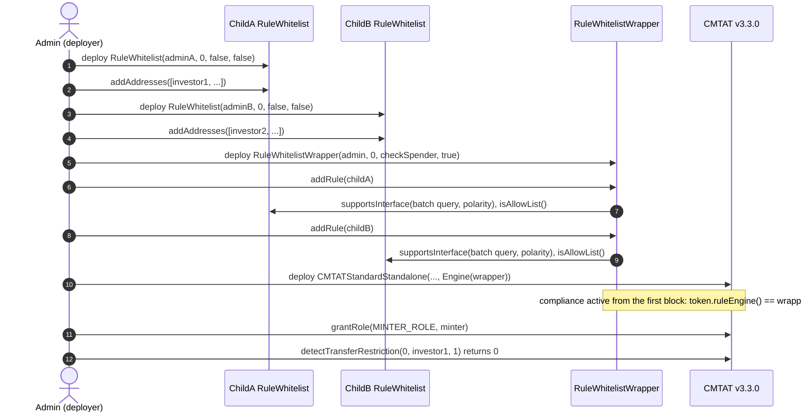
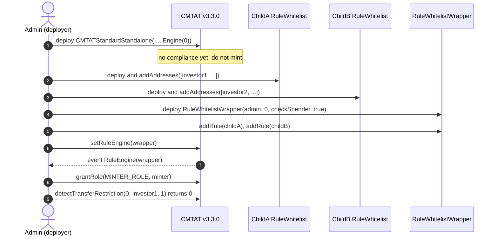
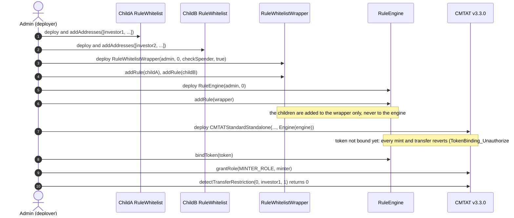
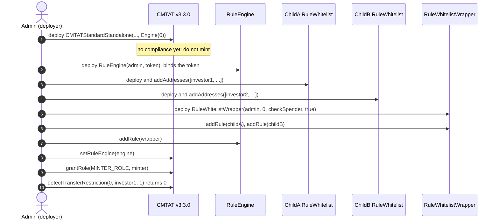
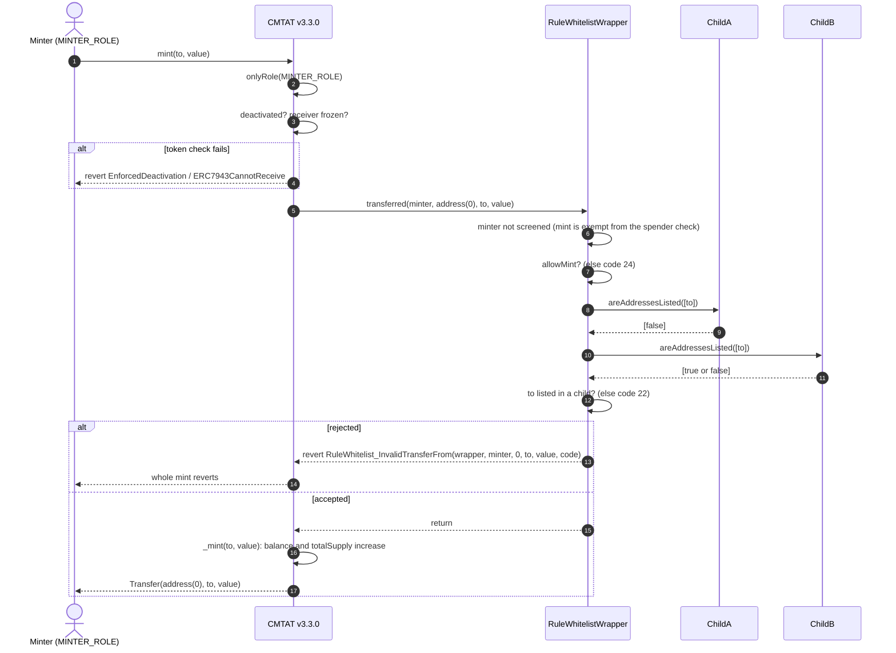
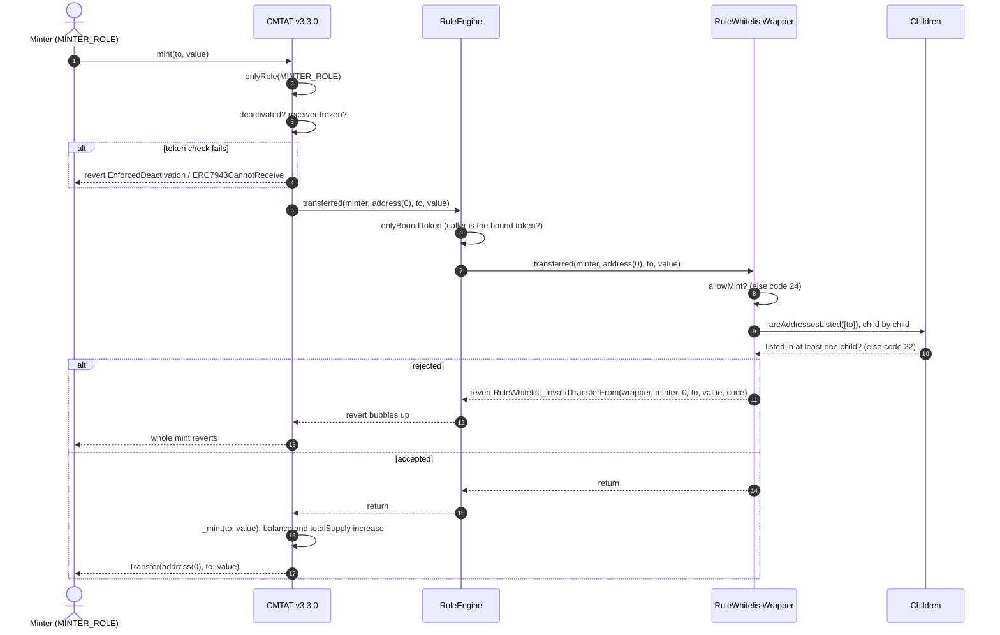
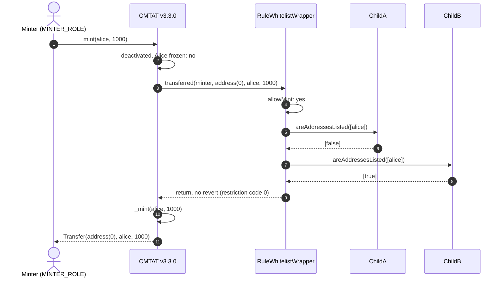
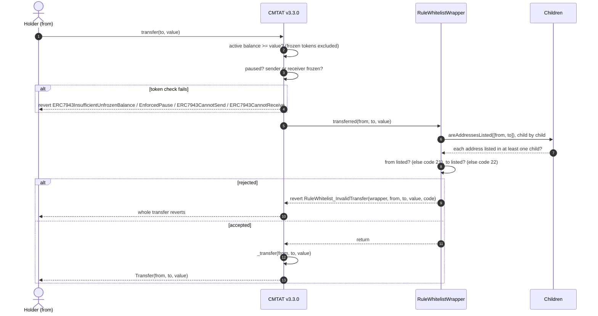
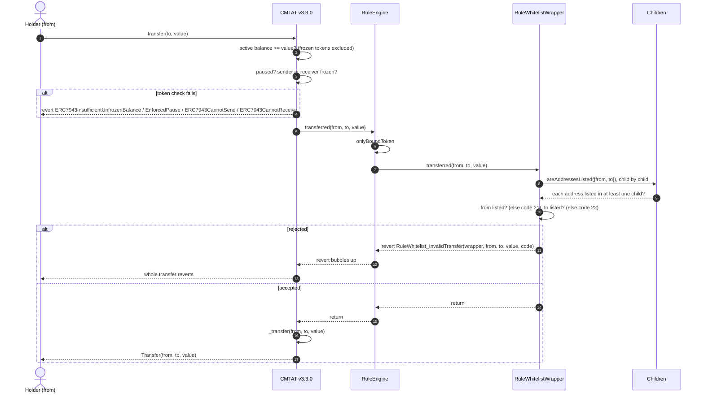
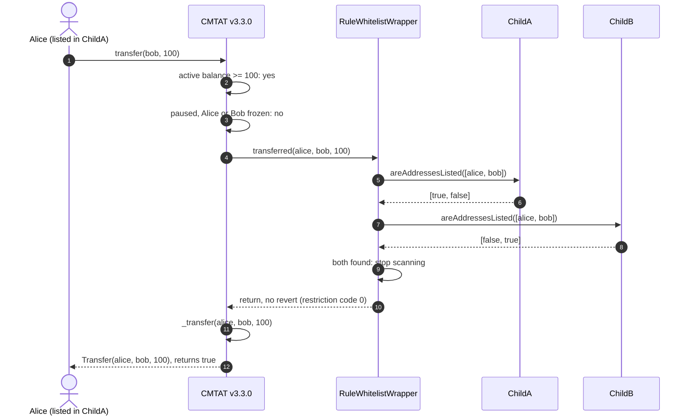

# Deploy `RuleWhitelistWrapper` with a CMTAT v3.3.0 token

<!-- toc -->

- [1. What the rule enforces](#1-what-the-rule-enforces)
  - [Which child rules are accepted](#which-child-rules-are-accepted)
- [2. Choose the setup](#2-choose-the-setup)
- [3. Contracts and roles](#3-contracts-and-roles)
- [4. Deployment steps](#4-deployment-steps)
  - [4.1 Wrapper set directly, at deployment (recommended for the wrapper alone)](#41-wrapper-set-directly-at-deployment-recommended-for-the-wrapper-alone)
  - [4.2 Wrapper set directly, after deployment](#42-wrapper-set-directly-after-deployment)
  - [4.3 Behind a RuleEngine, at deployment (recommended with other rules)](#43-behind-a-ruleengine-at-deployment-recommended-with-other-rules)
  - [4.4 Behind a RuleEngine, after deployment](#44-behind-a-ruleengine-after-deployment)
- [5. Mint workflow](#5-mint-workflow)
  - [5.1 Wrapper plugged directly into the token](#51-wrapper-plugged-directly-into-the-token)
  - [5.2 Wrapper behind a RuleEngine](#52-wrapper-behind-a-ruleengine)
  - [5.3 Happy path: a mint to an investor listed by operator B](#53-happy-path-a-mint-to-an-investor-listed-by-operator-b)
- [6. Transfer workflow](#6-transfer-workflow)
  - [6.1 Wrapper plugged directly into the token](#61-wrapper-plugged-directly-into-the-token)
  - [6.2 Wrapper behind a RuleEngine](#62-wrapper-behind-a-ruleengine)
  - [6.3 Happy path: holders listed by different operators](#63-happy-path-holders-listed-by-different-operators)
- [7. Operating the token](#7-operating-the-token)
- [8. Differences from CMTAT v3.0.0](#8-differences-from-cmtat-v300)

<!-- /toc -->

This guide deploys a CMTAT **v3.3.0** token whose transfers and mints are restricted to addresses listed in **any** of several whitelists, enforced by `RuleWhitelistWrapper`. Each whitelist is a child rule, typically run by a different operator. It covers:

- which child rules the wrapper accepts, and how they are deployed and added;
- where the wrapper sits: on the token directly, or inside a RuleEngine;
- when it is installed: in the token constructor, or later with `setRuleEngine`;
- what happens on a mint and on a transfer once it is active.

v3.3.0 is not final yet: this library is validated against **`v3.3.0-rc4`**, the version pinned in `lib/CMTAT`, and every statement below was checked against that code. For the last audited release, see the [v3.0.0 guide](./DEPLOY_RULE_WHITELIST_WRAPPER_CMTAT_V3.0.0.md); [§8](#8-differences-from-cmtat-v300) lists what differs.

The tests behind this guide, on a real v3.3.0-rc4 token:

- `test/RuleWhitelist/RuleWhitelistWrapperCMTATDeployment.t.sol`: wrapper passed in the token constructor (4.1) and RuleEngine passed in the token constructor (4.3), with a `RuleWhitelist` and a `RuleReceiverWhitelist` as children, `checkSpender` on, an unlisted minter, and the refusal of `RuleBlacklist` and `RuleSpenderWhitelist` as children;
- `test/RuleWhitelist/CMTATIntegrationWhitelistWrapper.t.sol`: wrapper behind a RuleEngine set after deployment (4.4), with three `RuleWhitelist` children;
- setup 4.2 (wrapper set directly after deployment) is not run on a v3.3 token. The wrapper's own logic is covered without a token by `test/RuleWhitelist/WhitelistWrapper.t.sol`.

## 1. What the rule enforces

An address is **listed** when at least one child rule lists it. The wrapper asks each child `areAddressesListed(...)` and stops as soon as every address it needs is found.

| Operation | Checked by `RuleWhitelistWrapper` | Rejected with |
| --- | --- | --- |
| Transfer `from → to` | `from` and `to` are listed | 21 (sender), 22 (receiver) |
| `transferFrom` by a spender | as above, plus the spender if `checkSpender` is `true` | 23 (spender) |
| Mint to `to` | the wrapper's `allowMint` is `true` and `to` is listed | 24 (mint not allowed), 22 |
| Burn from `from` | the wrapper's `allowBurn` is `true` and `from` is listed | 25 (burn not allowed), 21 |

The codes and the errors are those of `RuleWhitelist`: a rejection reverts with `RuleWhitelist_InvalidTransfer` (3-argument path) or `RuleWhitelist_InvalidTransferFrom` (4-argument path).

**Only membership is read from the children.** The wrapper never calls a child's `transferred` or `detectTransferRestriction`. A child's own `allowMint`, `allowBurn` and `checkSpender` flags play no part, and a `RuleReceiverWhitelist` child does not make the wrapper receiver-only: an address it lists counts as listed for the sender, the receiver and the spender alike. Mint and burn are gated by the **wrapper's** flags.

**With no child, every transfer, mint and burn is rejected** (codes 21 or 22): the wrapper fails closed.

On v3.3.0 the token forwards the **minter** (and the burner) as `spender`, on the 4-argument `transferred(spender, from, to, value)`. The wrapper does not screen it, even with `checkSpender = true`: the minter acts on its own authority, not as a delegated ERC-20 spender. Who may mint is decided by the token's `MINTER_ROLE`.

### Which child rules are accepted

`addRule` and `setRules` check each candidate and revert if any check fails:

| Check | Fails for | Error |
| --- | --- | --- |
| non-zero, not already a child | `address(0)`, a duplicate | `RuleEngine_RulesManagementModule_RuleAddressZeroNotAllowed` / `RuleEngine_RulesManagementModule_RuleAlreadyExists` |
| advertises `IAddressListBatchQuery` (`areAddressesListed`) through ERC-165 | a rule that is not an address list (`RuleMaxTotalSupply`, ...), another `RuleWhitelistWrapper` | `RuleWhitelistWrapper_ChildIsNotAnAddressList` |
| advertises `IAddressListPolarity` | `RuleSpenderWhitelist`, which declines on purpose: its list holds spenders, not holders | `RuleWhitelistWrapper_ChildDoesNotDeclarePolarity` |
| `isAllowList()` returns `true` | `RuleBlacklist`, a deny-list | `RuleWhitelistWrapper_ChildIsNotAnAllowList` |
| fewer children than `maxRules()` (default 10) | the eleventh child | `RuleEngine_RulesManagementModule_MaxRulesExceeded` |

Accepted children: `RuleWhitelist`, `RuleReceiverWhitelist` and their Ownable2Step variants. Wrappers do not nest; for an AND of several ORs, put several wrappers in one RuleEngine.

## 2. Choose the setup

**Where the wrapper sits.**

| Topology | Token calls | Use it when |
| --- | --- | --- |
| **Direct** | the wrapper itself (`token.ruleEngine() == wrapper`) | the combined whitelist is the only rule |
| **RuleEngine** | a `RuleEngine`, which calls each of its rules, the wrapper being one of them | you need other rules too (for example a supply cap), or want to add rules later without touching the token |

In both cases the children are **not** given to the token or to the RuleEngine: they are added to the wrapper only. A child also added to the RuleEngine would screen on its own, and an address listed by another child only would then be rejected.

The wrapper is stateless towards the token, so it behaves identically in both topologies. It needs no binding to the token.

**When the wrapper is installed.**

| Moment | How | Effect |
| --- | --- | --- |
| **At deployment** | pass the wrapper (or the RuleEngine) in the token constructor's `Engine.ruleEngine` field | the token is never unrestricted, the very first mint is screened |
| **After deployment** | deploy the token with `Engine.ruleEngine = address(0)`, then `token.setRuleEngine(...)` | between the two transactions the token has **no compliance**: any mint or transfer goes through. Do not mint or grant `MINTER_ROLE` before `setRuleEngine` |

Installing at deployment is recommended: setup 4.1 when the wrapper is the only rule, 4.3 with other rules. In every setup, deploy the children and add them to the wrapper first, so the token is never live with an empty wrapper (which rejects everything) or a partial child list.

## 3. Contracts and roles

| Contract | Constructor | Roles that matter here |
| --- | --- | --- |
| `RuleWhitelistWrapper` (or `RuleWhitelistWrapperOwnable2Step`) | `(admin, forwarderIrrevocable, checkSpender, allowMintBurn)`; the Ownable2Step variant takes `owner` first | `DEFAULT_ADMIN_ROLE` (all roles, `setCheckSpender`, `setAllowMint`, `setAllowBurn`), `RULES_MANAGEMENT_ROLE` (`addRule`, `removeRule`, `setRules`, `clearRules`, `setMaxRules`). The Ownable2Step variant gives all of it to the owner |
| Each child: `RuleWhitelist` or `RuleReceiverWhitelist` (or an Ownable2Step variant) | `RuleWhitelist(admin, forwarderIrrevocable, checkSpender, allowMintBurn)`, `RuleReceiverWhitelist(admin, forwarderIrrevocable)`. The flags of a `RuleWhitelist` child are not used by the wrapper | per child: `DEFAULT_ADMIN_ROLE`, `ADDRESS_LIST_ADD_ROLE`, `ADDRESS_LIST_REMOVE_ROLE`. Each operator can hold the roles of its own child only |
| `RuleEngine` (RuleEngine `v3.0.0-rc7`, optional) | `(admin, tokenContract)`; `tokenContract` may be `address(0)` | `RULES_MANAGEMENT_ROLE` (`addRule`), `COMPLIANCE_MANAGER_ROLE` (`bindToken`) |
| CMTAT v3.3.0 `CMTATStandardStandalone` (or `CMTATStandaloneDebt`, or a proxy variant) | `(forwarder, admin, ERC20Attributes, ExtraInformationAttributes, Engine{ruleEngine})`. `CMTATStandaloneDebt` takes no forwarder | `DEFAULT_ADMIN_ROLE` (`setRuleEngine`, `forcedTransfer`, all roles), `MINTER_ROLE`, `BURNER_ROLE`, `PAUSER_ROLE`, `ENFORCER_ROLE` (freeze an address), `ERC20ENFORCER_ROLE` (freeze part of a balance) |

On CMTAT, the wrapper and the AccessControl rules, the default admin implicitly holds every role. The v3.3.0 `Engine` struct has a single field, `ruleEngine`; the snapshot and document engines of v3.0.0 are no longer constructor arguments.

Constructor flags of the wrapper:

- `allowMintBurn = true` to be able to issue. With `false`, every mint is rejected with code 24, even to a listed investor. Both flags can be changed later with `setAllowMint` / `setAllowBurn`.
- `checkSpender = true` to also require the spender of a `transferFrom` to be listed in a child. It never applies to the minter or burner. It can be toggled later with `setCheckSpender`.
- `forwarderIrrevocable = address(0)` unless you use ERC-2771 meta-transactions for the wrapper's admin calls.

## 4. Deployment steps

Each setup lists its steps, then draws them as a sequence diagram. The diagrams show two children, `ChildA` (a `RuleWhitelist` run by operator A) and `ChildB` (run by operator B), and calls from a single admin; in production each child, the wrapper and the token can have different admins (§3).

### 4.1 Wrapper set directly, at deployment (recommended for the wrapper alone)

1. **Deploy the children:** one `RuleWhitelist(adminA, address(0), false, false)` per operator. Their flags are not used by the wrapper.
2. **Fill each child:** `childA.addAddresses([...])`, `childB.addAddresses([...])`, by each operator's `ADDRESS_LIST_ADD_ROLE`. This can also happen later; until then every mint and transfer to an unlisted address is rejected.
3. **Deploy the wrapper:** `RuleWhitelistWrapper(admin, address(0), checkSpender, true)`. It needs no token address.
4. **Add the children:** `wrapper.addRule(childA)`, `wrapper.addRule(childB)` (`RULES_MANAGEMENT_ROLE`). Each call runs the checks of §1.
5. **Deploy the token** with `Engine(ruleEngine = wrapper)`.
6. **Grant `MINTER_ROLE`** to the issuer's minting address, if it is not the admin. It does not need to be listed.
7. **Check the setup:** `token.ruleEngine() == wrapper`, `wrapper.rulesCount()` is the number of children; on the Standard variant, `token.detectTransferRestriction(address(0), investor, 1) == 0` for an investor listed in any child, and 22 for an unlisted one. `wrapper.isVerified(investor)` gives the same answer.

### 4.2 Wrapper set directly, after deployment

1. **Deploy the token** with `Engine(ruleEngine = address(0))`. Do not mint yet.
2. **Deploy and fill the children, deploy the wrapper and add the children**, as in 4.1 steps 1 to 4.
3. **Install it:** `token.setRuleEngine(wrapper)`, as the token's `DEFAULT_ADMIN_ROLE`. It emits `RuleEngine(wrapper)` and reverts with `CMTAT_ValidationModule_SameValue` if that wrapper is already set.
4. **Grant `MINTER_ROLE`**, then check as in 4.1 step 7.

### 4.3 Behind a RuleEngine, at deployment (recommended with other rules)

The token address does not exist yet when the engine is deployed, so the engine is deployed without a token and binds it afterwards. Until that binding, the engine rejects every call from the token (`TokenBinding_UnauthorizedCaller`): no mint or transfer can happen unscreened.

1. **Deploy and fill the children, deploy the wrapper and add the children**, as in 4.1 steps 1 to 4.
2. **Deploy the RuleEngine:** `RuleEngine(admin, address(0))`.
3. **Add the wrapper** (not the children): `engine.addRule(wrapper)` (`RULES_MANAGEMENT_ROLE`). Add the other rules the same way.
4. **Deploy the token** with `Engine(ruleEngine = engine)`.
5. **Bind the token:** `engine.bindToken(token)` (`COMPLIANCE_MANAGER_ROLE`). From now on the token works.
6. **Grant `MINTER_ROLE`** and check as in 4.1 step 7.

### 4.4 Behind a RuleEngine, after deployment

1. **Deploy the token** with `Engine(ruleEngine = address(0))`. Do not mint yet.
2. **Deploy the RuleEngine** with the token already known: `RuleEngine(admin, token)` binds it in the constructor.
3. **Deploy and fill the children, deploy the wrapper and add the children**, as in 4.1 steps 1 to 4, then `engine.addRule(wrapper)`.
4. **Install it:** `token.setRuleEngine(engine)`.
5. **Grant `MINTER_ROLE`** and check as in 4.1 step 7.

A RuleEngine serving one token is the intended setup. The wrapper itself would work for several tokens (it reads no token state), but every token would then share the same children.

## 5. Mint workflow

`mint(to, value)` by a `MINTER_ROLE` holder, with the wrapper active. The token runs its own checks first (contract deactivated, receiver frozen), then notifies the compliance contract **before** creating the tokens, on the 4-argument `transferred(minter, address(0), to, value)`. Pause does not stop a mint. On the Standard variant the call to the compliance contract runs under a transient reentrancy guard.

### 5.1 Wrapper plugged directly into the token

The token calls `RuleWhitelistWrapper` itself: `token.ruleEngine() == wrapper`. The wrapper asks its children in order until `to` is found.

### 5.2 Wrapper behind a RuleEngine

The token calls the RuleEngine, which accepts only its bound token and then calls each of its rules in order, the wrapper being one of them. The first rule that reverts stops the mint, and the engine passes the revert back to the token.

### 5.3 Happy path: a mint to an investor listed by operator B

Alice is listed in ChildB only, `allowMint` is `true`, and the issuer mints 1,000 to her. The wrapper is plugged directly into the token; behind a RuleEngine the engine sits between the token and the wrapper, as in §5.2.

## 6. Transfer workflow

`transfer(to, value)` by a holder. The token first checks that the tokens are not frozen (active balance), then that the token is not paused and nobody involved is frozen, then notifies the compliance contract **before** moving the balance. A `transfer` has no spender and takes the 3-argument path. `transferFrom` takes the 4-argument path with the caller as spender; with `checkSpender` on, the wrapper looks up the spender together with `from` and `to` and rejects with code 23 if no child lists it.

### 6.1 Wrapper plugged directly into the token

The wrapper asks each child about `from` and `to` in a single call, and stops once both have been found.

### 6.2 Wrapper behind a RuleEngine

Same path through the engine as for a mint (§5.2), on the 3-argument `transferred`.

### 6.3 Happy path: holders listed by different operators

Alice is listed by operator A (ChildA), Bob by operator B (ChildB). Alice holds at least 100 unfrozen tokens and the token is not paused. The wrapper is plugged directly into the token; behind a RuleEngine the engine sits between the token and the wrapper, as in §6.2.

A burn follows the mint path with the roles swapped: the wrapper checks `allowBurn` (else code 25), then that `from` is listed in a child (else code 21). Before sending, a wallet or a front end can ask the same question without a transaction: `token.canTransfer(from, to, value)` on both variants, and `token.detectTransferRestriction(from, to, value)` plus `messageForTransferRestriction(code)` on the Standard variant (the Debt variant has no ERC-1404 layer).

## 7. Operating the token

| Task | Call | Role |
| --- | --- | --- |
| Onboard an investor | `childX.addAddresses([...])` or `addAddress` on the operator's own child | that child's `ADDRESS_LIST_ADD_ROLE` |
| Offboard | `childX.removeAddresses([...])` / `removeAddress` | that child's `ADDRESS_LIST_REMOVE_ROLE` |
| Add an operator | deploy a new child, then `wrapper.addRule(child)` | wrapper `RULES_MANAGEMENT_ROLE` |
| Remove an operator | `wrapper.removeRule(child)`: its investors are no longer listed unless another child lists them | wrapper `RULES_MANAGEMENT_ROLE` |
| Stop issuance, keep redemptions | `wrapper.setAllowMint(false)` | wrapper `DEFAULT_ADMIN_ROLE` |
| Screen delegated spenders | `wrapper.setCheckSpender(true)` | wrapper `DEFAULT_ADMIN_ROLE` |
| Replace the compliance | `token.setRuleEngine(newRuleOrEngine)` | token `DEFAULT_ADMIN_ROLE` |

**An investor is de-listed only when no child lists them.** Removing an address from one child has no effect if another child still lists it.

**Removing an investor traps their tokens,** as with `RuleWhitelist`: a holder listed in no child can neither send nor be burned from (code 21). Use the token's `forcedTransfer(from, to, value)` (`DEFAULT_ADMIN_ROLE`; `to = address(0)` burns), which does not call the compliance contract.

**Each child costs gas on every transfer.** The wrapper makes one external call per child it scans, about 8.8k gas each, and a transfer that is going to be rejected scans every child. Keep the list at or below the default cap of 10 and put the child that lists the most holders first. `clearRules()` or removing the last child makes every transfer fail.

## 8. Differences from CMTAT v3.0.0

| | v3.0.0 | v3.3.0 |
| --- | --- | --- |
| Constructor `Engine` struct | `{ruleEngine, snapshotEngine, documentEngine}` | `{ruleEngine}` |
| Standard standalone contract | `CMTATStandalone` | `CMTATStandardStandalone` |
| How mint and burn call the wrapper | 3-argument `transferred`, no minter | 4-argument `transferred`, minter / burner as `spender` (not screened by the wrapper) |
| Mint rejected by the wrapper | `RuleWhitelist_InvalidTransfer` | `RuleWhitelist_InvalidTransferFrom` |
| Token-side check fails (frozen, paused, deactivated) | `CMTAT_InvalidTransfer` | the specific error: `ERC7943CannotSend` / `ERC7943CannotReceive`, `EnforcedPause`, `EnforcedDeactivation` |
| Reentrancy guard around the compliance call | none | transient guard on the Standard variant |

What the wrapper allows is the same on both versions: the minter never mattered to it. See [`RULE_SEMANTICS.md`](./RULE_SEMANTICS.md) §7 for the other rules.

See also: [`RuleWhitelistWrapper.md`](../contracts/RuleWhitelistWrapper.md) for the full rule reference, including the gas measurements of the child scan.
